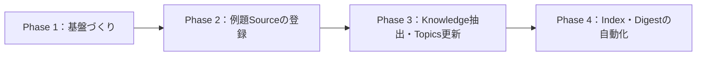

# 2026年11月のまとめ

## 1. 概要

2026年11月は、knowledge-vault が立ち上がった月である。リポジトリの活動は11月9日に始まったため、この月次まとめは、月の初めからではなく、11月9日からの動きを整理したものになる。また、このまとめの作成日は11月10日であり、月末までの追加があれば、このファイルは更新する。つまり、11月の途中経過としてのまとめである。

それでも、この短い期間で Phase 1 から Phase 3 までが進み、「情報源の登録 → 知識の抽出 → 横断的なまとめ」という一連の流れが一通り動いたことが、今月の最大の変化である。登録された情報源は3件で、中心となるテーマは、AIエージェントに仕事を任せるときに、自分の思考をどう守るか、という問いと、東京リージョンで動かしていてもバージニア北部（us-east-1）への依存が残る場合に、障害のときに何が起きるか、という問いに加えて、生成AIにドット絵を作らせる方法と、指示（プロンプト）の設計という実践である。

## 2. 期間中に登録された情報

11月に登録された Source は3件、Knowledge は6件である。

### Source

| タイトル | 登録日 | 情報源の種類 | カテゴリ | タグ |
| --- | --- | --- | --- | --- |
| [ChatGPT×ドット絵ピクセルアートの作成手順やプロンプト完全ガイド](../../sources/articles/2025-08-05-chatgpt-pixel-art-guide.md) | 2026-11-11 | articles | AI | pixel-art, chatgpt, prompt-design, generative-ai, image-generation, design, business |
| [東京リージョンで使っていてもバージニア北部に依存しているもの](../../sources/articles/2026-11-06-aws-us-east-1-dependency-from-tokyo-region.md) | 2026-11-10 | articles | Infrastructure | aws, us-east-1, control-plane, data-plane, route-53, cloudfront, iam, cloudtrail, fault-isolation, static-stability |
| [Critical thinking when agents do the work](../../sources/social/x/2026-11-03-critical-thinking-when-agents-do-the-work.md) | 2026-11-09 | social | AI | agentic-workflows, critical-thinking, cognitive-surrender, cognitive-debt, verification, code-review |

### Knowledge

| タイトル | 登録日 | カテゴリ | タグ |
| --- | --- | --- | --- |
| [エージェント作業における検証の習慣](../../knowledge/ai/verification-for-agent-work.md) | 2026-11-10 | AI | verification, agentic-workflows, code-review, critical-thinking |
| [コントロールプレーンとデータプレーンの分離](../../knowledge/infrastructure/control-plane-and-data-plane-separation.md) | 2026-11-10 | Infrastructure | aws, us-east-1, control-plane, data-plane, route-53, cloudfront, iam, fault-isolation |
| [認知的降伏と認知的負債](../../knowledge/ai/cognitive-surrender-and-cognitive-debt.md) | 2026-11-10 | AI | cognitive-surrender, cognitive-debt, agentic-workflows, critical-thinking |
| [静的安定性と障害時の備え](../../knowledge/infrastructure/static-stability-and-outage-preparedness.md) | 2026-11-10 | Infrastructure | aws, us-east-1, static-stability, fault-isolation, control-plane, data-plane, cloudtrail |
| [AIでドット絵を作る3つの方法](../../knowledge/ai/ai-pixel-art-generation-methods.md) | 2026-11-11 | AI | pixel-art, chatgpt, generative-ai, text-art, ascii-art |
| [ドット絵生成のプロンプト設計](../../knowledge/ai/pixel-art-prompt-design.md) | 2026-11-11 | AI | pixel-art, prompt-design, chatgpt, troubleshooting |

今月の蓄積は、件数よりも「流れができたこと」に意味がある。11月9日に基盤（Phase 1）ができ、同日に最初の例題 Source が登録され（Phase 2）、翌10日にそこから Knowledge が2件抽出され、Topics が2件更新された（Phase 3）。さらに Phase 4 では、インデックスの自動生成と Digest 生成の仕組みが整い、週次・月次・年次のまとめを継続的に作れるようになった。つまり、11月は「知識をためる仕組みを作る月」だったと言える。

Qiita の記事からは、クラウドインフラに関する Knowledge が2件抽出され、新しい Topics「クラウドインフラ」が作られた。AIエージェントに関する蓄積とは別の軸で、インフラの障害への備えというテーマが加わった。

キレカクの記事からは、ドット絵生成に関する Knowledge が2件抽出され、Topics「人工知能」が更新された。これで「人工知能」は、初めて2件の情報源を持つ Topics になった。AIエージェントとの協働というテーマに、生成AIの実践という角度が加わった。

## 3. 重要な記事

今月の重要な記事は、Addy Osmani による X の長文記事「Critical thinking when agents do the work」（2026-11-03）である。理由は次のとおりである。

第一に、AIエージェントがコードを書く量が増えるなかで、「人は理解や判断をどこまで手放してよいのか」という問いを、段階と実践の両面から具体的に論じているからである。抽象的な注意喚起にとどまらず、検証の習慣や依頼の仕方など、すぐ試せる実践が示されている。

第二に、この1件の記事から Knowledge が2件抽出でき、Topics が2件更新できたからである。1件の情報源が、複数の再利用可能な知識と、複数のテーマへの広がりを生んだことは、Source と Knowledge を分離するこのリポジトリの狙いが、実際に働いた例になった。

第三に、関心の高さもうかがえることである。ページ表示では約550万回表示され、読了時間は14分とされていた。長い記事であるにもかかわらず多くの人に読まれていることは、このテーマへの関心の大きさを示す一例である。

今月のもう1件の重要な記事は、yama3133 による Qiita の記事「東京リージョンで使っていてもバージニア北部に依存しているもの」（2026-11-06）である。理由は次のとおりである。

第一に、コントロールプレーンとデータプレーンの分担を、IAM、Route 53、CloudFront などの具体的なサービスに即して整理しているからである。グローバルサービスのコントロールプレーンは us-east-1 にあり、データプレーンは各リージョンに分散している、という分担が、東京の利用者にとって何を意味するかを、設定の変更とふだんの利用に分けて示している。

第二に、2025年10月20日の us-east-1 の大規模障害を、発端と東京の利用者への影響に分けて記録しているからである。発端は、DynamoDB の DNS を管理する仕組みの競合状態で、`dynamodb.us-east-1.amazonaws.com` の DNS レコードが空になったことである。東京では、稼働中の EC2 / Lambda / RDS、Route 53 の名前解決、CloudFront の配信などは基本的に動き続けた一方で、IAM の作成・変更や Route 53 レコードの変更などができなくなる可能性があった、と整理されている。

第三に、この1件の記事から Knowledge が2件抽出でき、新しい Topics「クラウドインフラ」の初版が作られたからである。1件の情報源が、複数の再利用可能な知識と、新しいテーマの両方を生んだ点は、例題記事と同じである。

さらに、キレカクの記事「ChatGPT×ドット絵ピクセルアートの作成手順やプロンプト完全ガイド」（2025-08-05）も、今月の重要な記事である。理由は次のとおりである。

第一に、ChatGPT でドット絵を作る方法を、テキストアート生成、ASCII + 色指定、プログラムコード生成の3つに整理し、それぞれの向き不向きと実践手順まで具体的に示しているからである。

第二に、プロンプトの設計原則（5W1H と技術仕様の明確化、段階的詳細化、制約条件の優先順位付け）と、ぼやけ・色数の超過・比率の崩れといった頻出の問題への対処が、指示する側で打てる手として整理されているからである。

第三に、この1件の記事から Knowledge が2件抽出され、Topics「人工知能」が2件目の情報源で更新されたからである。「人工知能」は、これで初めて複数の情報源を持つ Topics になった。なお、記事中のビジネス効果の数字は、根拠の内訳が示されていない著者の主張として、Source の中で区別して記録されている。

## 4. 注目すべき技術・知識

今月、注目すべき知識は次のとおりである。

- **認知的降伏（cognitive surrender）**：AIの出力がすっかり自分のものになり、確認の必要すら感じなくなる状態。委譲の度合いが深まるにつれて、人は少しずつこの段階へ進む。Wharton の Steven Shaw と Gideon Nave による用語である。
- **認知的負債（cognitive debt）と理解の負債（comprehension debt）**：AIに頼ることで失われた理解が、借金のように積み重なるという考え方。コードはきれいに見え、テストも通るのに、誰も仕組みを理解していない状態が例として挙げられている。
- **検証の習慣**：エージェントの作業に対する検証を、習慣として組み込む考え方。「検証済み」の定義を事前に決めること、緑のチェックは一つの性質しか示さないと知ること、完了の条件を具体的な形にしておくことが中心である。
- **ゴム印化（rubber stamping）**：レビューが内容の確認ではなく形式的な承認になってしまう状態。600行のプルリクエストの例が示すように、量が多すぎると人は細部を読まずに承認してしまう。
- **オーケストレーションの負担（orchestration tax）と意図の負債（intent debt）**：エージェントが生成した量と、自分が責任を持てる量の差が負担になることや、意図を伝えきれないまま作業が進むことで生じる負債である。
- **依頼の仕方の実践**：仮説を立ててから依頼する、盲点を探す一手間を入れる、反対意見を求める、といった実践も注目に値する。依頼する前に自分で考えることが、思考を守る具体的な方法として示されている。
- **コントロールプレーンとデータプレーンの分離**：管理機能と実際に処理を行う機能を分けて考える考え方。グローバルサービスではコントロールプレーンが us-east-1 に集まり、データプレーンが各リージョンに分散しているため、東京で動かしていても設定の変更は us-east-1 を通る。
- **静的安定性（static stability）**：依存先の管理機能が止まっても、何も変更せずに動き続けられる性質。復旧手順にコントロールプレーンを組み込まず、フェイルオーバーは Route 53 のヘルスチェックや ARC のルーティングコントロールなど、データプレーンの機能で行う、という備えの中心になる考え方である。
- **us-east-1 への依存と障害分離境界**：東京リージョンで使っていても us-east-1 に置かれるものがある。us-east-1 にしかないサービス（請求・コスト管理など）や、東京で使っていても us-east-1 に置かれるログ（Route 53 クエリログ、CloudTrail のグローバルサービスイベントなど）が、その例である。
- **ドット絵を作る3つの方法**：テキストアート生成、ASCII + 色指定、プログラムコード生成の3方式。手軽さではテキストアート、ピクセル単位の制御と再現性ではコード生成が優れるとされる。
- **プロンプトの黄金法則**：5W1H と技術仕様を明確に書くこと、コンセプト→詳細→調整と段階的に詳しくすること、制約条件に優先順位を付けること。
- **色の列挙と禁止**：色数が指定より増える問題への対処。使用できる色を HEX コードで列挙し、それ以外の色と、濃淡の調整や透明度の変更を禁止する。ぼやけへの対処は、アンチエイリアスの禁止と各ピクセル単色の明示である。
- **領域配分**：キャラクターの比率が崩れる問題への対処。頭部・胴体・脚部などがキャンバスの何行目にあたるかを、数値で指定する。

## 5. 新しく発見された関連性

今月、新しく見えてきた関連性は次の4点である。

第一に、「検証の習慣」と「認知的降伏」の関係である。検証の習慣は、単なる品質管理の手法ではなく、認知的降伏への対抗策として位置づけられる。検証の仕組みを作り、その証拠を確認することで、理解を手放しすぎない状態を保てる。2件の Knowledge が互いに参照し合う関係になったことも、このつながりの表れである。

第二に、同じ1件の Source から、人工知能と開発者生産性という2つの Topics が更新されたことである。批判的思考というテーマと、コードレビューという実務のテーマが、同じ情報源からつながった。今後、情報源が増えれば、テーマ同士のつながりはさらに見えやすくなるはずである。

第三に、Qiita の記事から抽出した2件の Knowledge が、互いに参照し合う関係になったことである。「コントロールプレーンとデータプレーンの分離」を前提にして、「静的安定性と障害時の備え」では復旧手順やフェイルオーバーの設計を考える。分離の理解が、備えの設計につながる関係である。

第四に、Topics「人工知能」に2件目の情報源が加わったことである。Addy Osmani の記事は「AIに任せるとき、思考をどう守るか」を論じ、キレカクの記事は「AIに作らせるとき、指示をどう設計するか」を扱う。委譲への姿勢と指示の技術という、表裏の関係にある2つの角度が、同じ Topics の中に集まった。

なお、今月の3つのテーマ（AIエージェントと批判的思考、クラウドインフラの障害への備え、生成AIによるドット絵生成）は、それぞれ別の情報源から生まれたもので、共通の情報源による直接のつながりはまだない。「人工知能」の Topics には2件の情報源が集まったが、扱う問いが異なるため、同じ問いへの比較はまだできない。

## 6. 重要なKnowledge

今月の重要な Knowledge は、例題 Source から抽出した次の2件である。

- [認知的降伏と認知的負債](../../knowledge/ai/cognitive-surrender-and-cognitive-debt.md)：委譲の段階と、失われた理解が負債として積み重なる仕組みを整理したもの。エージェントを使うあらゆる場面で、自分の思考をどこまで手放しているかを見直す枠組みになる。
- [エージェント作業における検証の習慣](../../knowledge/ai/verification-for-agent-work.md)：検証を習慣として組み込むための知識。「検証済み」の定義、緑のチェックの意味、完了条件の具体化など、実践の枠組みを整理したもの。

あわせて、Qiita の記事から抽出した次の2件である。

- [コントロールプレーンとデータプレーンの分離](../../knowledge/infrastructure/control-plane-and-data-plane-separation.md)：管理機能と処理を行う機能の分離を整理したもの。グローバルサービスではコントロールプレーンが us-east-1 に集まっているため、東京で動かしていても設定の変更は us-east-1 を通る、という障害時の分かれ方を見分ける枠組みになる。
- [静的安定性と障害時の備え](../../knowledge/infrastructure/static-stability-and-outage-preparedness.md)：依存先の管理機能が止まっても動き続けられる性質と、復旧手順やフェイルオーバーの設計についての知識。復旧の操作そのものが止まっている管理機能に依存していないかを確認する、という備えの考え方を整理したもの。

あわせて、キレカクの記事から抽出した次の2件である。

- [AIでドット絵を作る3つの方法](../../knowledge/ai/ai-pixel-art-generation-methods.md)：生成AIでドット絵を作る3方式（テキストアート、ASCII + 色指定、プログラムコード生成）と、パレット統一・バリエーション派生・検証という共通の進め方を整理したもの。
- [ドット絵生成のプロンプト設計](../../knowledge/ai/pixel-art-prompt-design.md)：5W1H と技術仕様、段階的詳細化、制約の優先順位という指示の原則と、ぼやけ・色数・比率の3つの問題への対処を対応付けたもの。曖昧な指示が AI の既定の振る舞いに負ける、という構造への対策である。

## 7. Topicsへの反映状況

今月は、次の3件の Topics が更新された。

| Topics | 更新日 |
| --- | --- |
| [人工知能](../../topics/artificial-intelligence.md) | 2026-11-11 |
| [開発者生産性](../../topics/developer-productivity.md) | 2026-11-10 |
| [クラウドインフラ](../../topics/cloud-infrastructure.md) | 2026-11-10 |

「人工知能」は、AIエージェントと批判的思考の関係を中心に、例題 Source と Knowledge 2件をもとに初版が作られた。「開発者生産性」は、コードレビューと検証という角度から、同じ例題 Source と検証の習慣の Knowledge をもとに更新された。

「クラウドインフラ」は、Qiita の記事と Knowledge 2件をもとに初版が作られた。コントロールプレーンとデータプレーンの分離、静的安定性、ログの置き場所の確認という三つの層で、クラウドインフラの障害への備えを整理したものである。

「人工知能」はその後、2026-11-11 にキレカクの記事と Knowledge 2件をもとに追加で更新された。AIエージェントと批判的思考という当初の中心に、生成AIへの指示の設計という実践の角度が加わった。

ただし、「開発者生産性」と「クラウドインフラ」は、現時点では情報源は1件のみである。「人工知能」は2件になったが、2件の問いは異なるため、同じ問いへの比較はまだできない。「ソフトウェアアーキテクチャ」は、関連する情報源がまだないため、今月は更新されていない。情報源が増えたら、Topics の比較や更新も進めていくことが、今後の課題である。
