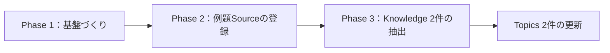

# 2026年 第46週のまとめ

## 1. 概要

今週は、knowledge-vault が動き始めた最初の週である。11月9日に Phase 1 でディレクトリ構成やテンプレートなどの基盤ができ、同じ日に Phase 2 で最初の例題となる情報源が登録され、11月10日に Phase 3 でそこから Knowledge が抽出され、Topics が更新された。つまり、この1週間で「情報源の登録 → 知識の抽出 → 横断的なまとめ」という一連の流れが、初めて一通り動いた。

情報源は6件である。1件は Addy Osmani による X の長文記事、もう1件は yama3133 による Qiita の技術記事「東京リージョンで使っていてもバージニア北部に依存しているもの」（2026-11-06）で、さらにもう1件は、キレカクの記事「ChatGPT×ドット絵ピクセルアートの作成手順やプロンプト完全ガイド」（2025-08-05、登録は2026-11-11）である。加えてもう1件は、おもしろフラッシュトレード倉庫による X の記事「LLM エージェントを活用した高頻度売買システムの自己改善ワークフロー構築」（2026-11-11）である。Qiita の記事は、外部の技術記事としては、今週初めての登録である。したがって、今週のまとめは「蓄積の量」ではなく「仕組みが動き始めたこと」と「最初の実例から何が見えたか」を整理するものである。中心となるテーマは、AIエージェントに仕事を任せるときに、自分の思考をどう守るか、という問いと、東京リージョンで動かしていてもバージニア北部（us-east-1）への依存が残る場合に、障害のときに何が起きるか、という問いに加えて、生成AIにドット絵を作らせる方法と、指示（プロンプト）の設計という実践に加えて、エージェントに自己改善ループを回させる実践に加えて、E2Eテストの制約と役割分担、ローカルLLMの実行基盤という実践である。

## 2. 期間中に登録された情報

期間中に登録された Source は6件、Knowledge は15件である。

### Source

| タイトル | 登録日 | 情報源の種類 | カテゴリ | タグ |
| --- | --- | --- | --- | --- |
| [GGUFってなんだ？〜ローカルLLMの「共通言語」を完全理解する〜](../../sources/technical/2026-02-22-gguf-llm-qiita.md) | 2026-11-15 | technical | AI | gguf, llm, quantization, llama-cpp, local-llm, ollama |
| [E2Eテスト大全（あなたの知らない、E2Eテスト周辺の理論）](../../sources/technical/2026-11-04-e2e-testing-taizen.md) | 2026-11-13 | technical | Programming | e2e-testing, software-testing, test-strategy, formal-methods, test-automation, ai-development |
| [LLM エージェントを活用した高頻度売買システムの自己改善ワークフロー構築](../../sources/social/x/2026-11-11-llm-agent-hft-self-improvement.md) | 2026-11-11 | social | AI | agentic-workflows, claude-code, self-improvement, high-frequency-trading, backtesting, knowledge-management, agent-skills |
| [ChatGPT×ドット絵ピクセルアートの作成手順やプロンプト完全ガイド](../../sources/articles/2025-08-05-chatgpt-pixel-art-guide.md) | 2026-11-11 | articles | AI | pixel-art, chatgpt, prompt-design, generative-ai, image-generation, design, business |
| [東京リージョンで使っていてもバージニア北部に依存しているもの](../../sources/articles/2026-11-06-aws-us-east-1-dependency-from-tokyo-region.md) | 2026-11-10 | articles | Infrastructure | aws, us-east-1, control-plane, data-plane, route-53, cloudfront, iam, cloudtrail, fault-isolation, static-stability |
| [Critical thinking when agents do the work](../../sources/social/x/2026-11-03-critical-thinking-when-agents-do-the-work.md) | 2026-11-09 | social | AI | agentic-workflows, critical-thinking, cognitive-surrender, cognitive-debt, verification, code-review |

### Knowledge

| タイトル | 登録日 | カテゴリ | タグ |
| --- | --- | --- | --- |
| [エージェント作業における検証の習慣](../../knowledge/ai/verification-for-agent-work.md) | 2026-11-10 | AI | verification, agentic-workflows, code-review, critical-thinking |
| [コントロールプレーンとデータプレーンの分離](../../knowledge/infrastructure/control-plane-and-data-plane-separation.md) | 2026-11-10 | Infrastructure | aws, us-east-1, control-plane, data-plane, route-53, cloudfront, iam, fault-isolation |
| [認知的降伏と認知的負債](../../knowledge/ai/cognitive-surrender-and-cognitive-debt.md) | 2026-11-10 | AI | cognitive-surrender, cognitive-debt, agentic-workflows, critical-thinking |
| [静的安定性と障害時の備え](../../knowledge/infrastructure/static-stability-and-outage-preparedness.md) | 2026-11-10 | Infrastructure | aws, us-east-1, static-stability, fault-isolation, control-plane, data-plane, cloudtrail |
| [AIでドット絵を作る3つの方法](../../knowledge/ai/ai-pixel-art-generation-methods.md) | 2026-11-11 | AI | pixel-art, chatgpt, generative-ai, text-art, ascii-art |
| [ドット絵生成のプロンプト設計](../../knowledge/ai/pixel-art-prompt-design.md) | 2026-11-11 | AI | pixel-art, prompt-design, chatgpt, troubleshooting |
| [エージェント自己改善ループの設計](../../knowledge/ai/agent-self-improvement-loop-design.md) | 2026-11-11 | AI | agentic-workflows, self-improvement, claude-code, knowledge-management, agent-skills, automation |
| [バックテストにおけるレイテンシ補正](../../knowledge/ai/backtest-latency-correction.md) | 2026-11-11 | AI | backtesting, latency, high-frequency-trading, verification |
| [E2Eテストで検知できる欠陥の分類](../../knowledge/programming/e2e-test-detectable-defects.md) | 2026-11-13 | Programming | e2e-testing, software-testing, defect-classification, verification-and-validation, test-strategy |
| [E2Eテストの数理的制約](../../knowledge/programming/e2e-test-mathematical-constraints.md) | 2026-11-13 | Programming | e2e-testing, software-testing, test-automation, flaky-tests, test-strategy, ai-development |
| [E2Eテストの分類体系と手法の選択](../../knowledge/programming/e2e-test-taxonomy-and-method-selection.md) | 2026-11-13 | Programming | e2e-testing, software-testing, test-strategy, test-pyramid, formal-methods, ai-development |
| [自動E2Eテストの実装パターンと実行タイミング](../../knowledge/programming/e2e-test-implementation-patterns-and-timing.md) | 2026-11-13 | Programming | e2e-testing, test-automation, software-testing, design-patterns, page-object-pattern, test-strategy |
| [GGUFフォーマットの構造と設計](../../knowledge/ai/gguf-format-structure.md) | 2026-11-15 | AI | gguf, llm, local-llm, llama-cpp |
| [LLMの量子化タイプの読み解きと選択](../../knowledge/ai/llm-quantization-types-and-selection.md) | 2026-11-15 | AI | quantization, llm, gguf, local-llm |
| [GGUFの実践ワークフロー（変換・量子化・実行）](../../knowledge/ai/gguf-practical-workflow.md) | 2026-11-15 | AI | gguf, llama-cpp, ollama, local-llm, llm |

今週の変化は、登録件数そのものよりも、登録された情報の「つながり方」にある。例題 Source からは、AIエージェントとの協働に関する Knowledge が2件抽出された。Source から Knowledge への流れが確認できた。

Qiita の記事からは、クラウドインフラに関する Knowledge が2件抽出され、新しい Topics「クラウドインフラ」が作られた。AIエージェントに関する蓄積とは別の軸で、インフラの障害への備えというテーマが加わった。

キレカクの記事からは、ドット絵生成に関する Knowledge が2件抽出され、Topics「人工知能」が更新された。これで「人工知能」は、初めて2件の情報源を持つ Topics になった。AIエージェントとの協働というテーマに、生成AIの実践という角度が加わった。

supermomonga の記事からは、エージェントの自己改善ループとバックテストのレイテンシ補正に関する Knowledge が2件抽出され、Topics「人工知能」が更新された。これで「人工知能」は、3件の情報源を持つ Topics になった。AIエージェントとの協働というテーマに、ほぼ人間の介入なしに改善を回す実践という角度が加わった。
Kuniwak の記事からは、E2Eテストに関する Knowledge が4件抽出され、新しい Topics「ソフトウェアテスト」が作られた。AIエージェントに関する蓄積とは別の軸で、テストの理論と実践というテーマが加わった。

GeneLab_999 の記事からは、GGUFと量子化に関する Knowledge が3件抽出され、Topics「人工知能」が更新された。これで「人工知能」は、4件の情報源を持つ Topics になった。エージェントへの委譲や生成AIの使い方とは別の側面で、LLM をローカルで動かす実行基盤という角度が加わった。

流れを図にすると、次のとおりである。

## 3. 重要な記事

今週の重要な記事は、Addy Osmani による X の長文記事「Critical thinking when agents do the work」（2026-11-03）である。理由は次のとおりである。

第一に、AIエージェントがコードを書く量が増えるなかで、「人は理解や判断をどこまで手放してよいのか」という問いを、段階と実践の両面から具体的に論じているからである。抽象的な注意喚起にとどまらず、検証の習慣や依頼の仕方など、すぐ試せる実践が示されている。

第二に、この1件の記事から Knowledge が2件抽出でき、Topics が2件更新できたからである。1件の情報源が、複数の再利用可能な知識と、複数のテーマへの広がりを生んだことは、Source と Knowledge を分離するこのリポジトリの狙いが、実際に働いた例になった。

第三に、関心の高さもうかがえることである。ページ表示では約550万回表示され、読了時間は14分とされていた。長い記事であるにもかかわらず多くの人に読まれていることは、このテーマへの関心の大きさを示す一例である。

今週のもう1件の重要な記事は、yama3133 による Qiita の記事「東京リージョンで使っていてもバージニア北部に依存しているもの」（2026-11-06）である。理由は次のとおりである。

第一に、コントロールプレーンとデータプレーンの分担を、IAM、Route 53、CloudFront などの具体的なサービスに即して整理しているからである。グローバルサービスのコントロールプレーンは us-east-1 にあり、データプレーンは各リージョンに分散している、という分担が、東京の利用者にとって何を意味するかを、設定の変更とふだんの利用に分けて示している。

第二に、2025年10月20日の us-east-1 の大規模障害を、発端と東京の利用者への影響に分けて記録しているからである。発端は、DynamoDB の DNS を管理する仕組みの競合状態で、`dynamodb.us-east-1.amazonaws.com` の DNS レコードが空になったことである。東京では、稼働中の EC2 / Lambda / RDS、Route 53 の名前解決、CloudFront の配信などは基本的に動き続けた一方で、IAM の作成・変更や Route 53 レコードの変更などができなくなる可能性があった、と整理されている。

第三に、この1件の記事から Knowledge が2件抽出でき、新しい Topics「クラウドインフラ」の初版が作られたからである。1件の情報源が、複数の再利用可能な知識と、新しいテーマの両方を生んだ点は、例題記事と同じである。

さらに、キレカクの記事「ChatGPT×ドット絵ピクセルアートの作成手順やプロンプト完全ガイド」（2025-08-05）も、今週の重要な記事である。理由は次のとおりである。

第一に、ChatGPT でドット絵を作る方法を、テキストアート生成、ASCII + 色指定、プログラムコード生成の3つに整理し、それぞれの向き不向きと実践手順まで具体的に示しているからである。

第二に、プロンプトの設計原則（5W1H と技術仕様の明確化、段階的詳細化、制約条件の優先順位付け）と、ぼやけ・色数の超過・比率の崩れといった頻出の問題への対処が、指示する側で打てる手として整理されているからである。

第三に、この1件の記事から Knowledge が2件抽出され、Topics「人工知能」が2件目の情報源で更新されたからである。「人工知能」は、これで初めて複数の情報源を持つ Topics になった。なお、記事中のビジネス効果の数字は、根拠の内訳が示されていない著者の主張として、Source の中で区別して記録されている。

さらに、supermomonga の記事「LLM エージェントを活用した高頻度売買システムの自己改善ワークフロー構築」（2026-11-11）も、今週の重要な記事である。理由は次のとおりである。

第一に、エージェントの自己改善ループを、定期実行の仕組み（Paseo の Heartbeat と Schedule の使い分け）・データの蓄積（データレイク QuantLake）・知見の集約（Obsidian の vault）の3要素に分けて整理し、bot ごとに改善を回しながら知見だけを共有する設計を示しているからである。

第二に、バックテストの精度を上げるためのレイテンシ補正を付録で詳しく扱っているからである。ヒストリカルデータには実稼働のレイテンシが含まれていないため、実測した受信・発注・イベント受信の遅延（さらに jitter）をパラメータ化して補正してから検証する、という手順が示されている。

第三に、この1件の記事から Knowledge が2件抽出され、Topics「人工知能」が3件目の情報源で更新されたからである。「人工知能」は、これで3件の情報源を持つ Topics になった。なお、記事冒頭の成果を示す埋め込みポストの本文は取得できなかったため、具体的な数値や成果の内容は Source には記録されていない。取得時点の表示は約21.9万回だった。
さらに、Kuniwak の記事「E2Eテスト大全（あなたの知らない、E2Eテスト周辺の理論）」（2026-11-04）も、今週の重要な記事である。理由は次のとおりである。

第一に、E2Eテストの定義と境界を定めたうえで、検知できる欠陥を正当性違反と妥当性違反（Boehm の Verification と Validation）に分類し、手法の選択を「どの欠陥を検知したいか」から決める土台を示しているからである。

第二に、実行コスト・保守コスト・原因調査範囲・結果の不確実性・カバレッジの組み合わせ爆発という5つの数理的制約を整理し、E2E は銀の弾丸ではなく、単体テスト・形式手法による設計検証・E2Eテストの役割分担が重要になる、と論じているからである。この制約はテストを書くのが人間でも AI でも変わらない、という点も、AI 時代の開発への含意として示されている。

第三に、この1件の記事から Knowledge が4件抽出でき、新しい Topics「ソフトウェアテスト」の初版が作られたからである。1件の情報源が、複数の再利用可能な知識と、新しいテーマの両方を生んだ点は、例題記事と同じである。なお、グラフベース、モンキーベース、ペルソナベース、ReusableOperator、ContextStream、テストケース連鎖は、記事の筆者独自の用語であることに Source の中で注意が記されている。

さらに、GeneLab_999 の記事「GGUFってなんだ？〜ローカルLLMの「共通言語」を完全理解する〜」（2026-02-22）も、今週の重要な記事である。理由は次のとおりである。

第一に、GGUF を単なる「軽いモデルファイル」ではなく、アーキテクチャ情報・トークナイザー・量子化済みの重みを実行に必要な情報ごと1ファイルにパッケージした、自己完結性の高いフォーマットとして整理し、キーバリュー形式のメタデータによる拡張性と、テンソルごとの量子化の柔軟性を示しているからである。

第二に、`Q4_K_M` のような量子化タイプの記号をビット数・量子化方式・サイズと品質のバランスに分解して読む方法と、VRAM 容量から逆算する選択指針を示しているからである。ローカルLLMを使ううえで、人気のファイルを選ぶのではなく制約から選ぶ、という実践の枠組みになる。

第三に、この1件の記事から Knowledge が3件抽出され、Topics「人工知能」が4件目の情報源で更新されたからである。エージェントへの委譲や生成AIの使い方とは別の側面で、LLM をローカルで動かす実行基盤という角度が加わった。なお、記事は llama.cpp の内部実装の詳細や量子化手法の数学的な厳密な導出は扱わないと明示している。

## 4. 注目すべき技術・知識

今週、注目すべき知識は次のとおりである。

- **認知的降伏（cognitive surrender）**：AIの出力がすっかり自分のものになり、確認の必要すら感じなくなる状態。委譲の度合いが深まるにつれて、人は少しずつこの段階へ進む。Wharton の Steven Shaw と Gideon Nave による用語である。
- **認知的負債（cognitive debt）と理解の負債（comprehension debt）**：AIに頼ることで失われた理解が、借金のように積み重なるという考え方。コードはきれいに見え、テストも通るのに、誰も仕組みを理解していない状態が例として挙げられている。
- **検証の習慣**：エージェントの作業に対する検証を、習慣として組み込む考え方。「検証済み」の定義を事前に決めること、緑のチェックは一つの性質しか示さないと知ること、完了の条件を具体的な形にしておくことが中心である。
- **ゴム印化（rubber stamping）**：レビューが内容の確認ではなく形式的な承認になってしまう状態。600行のプルリクエストの例が示すように、量が多すぎると人は細部を読まずに承認してしまう。
- **オーケストレーションの負担（orchestration tax）と意図の負債（intent debt）**：エージェントが生成した量と、自分が責任を持てる量の差が負担になることや、意図を伝えきれないまま作業が進むことで生じる負債である。
- **依頼の仕方の実践**：仮説を立ててから依頼する、盲点を探す一手間を入れる、反対意見を求める、といった実践も注目に値する。依頼する前に自分で考えることが、思考を守る具体的な方法として示されている。
- **コントロールプレーンとデータプレーンの分離**：管理機能と実際に処理を行う機能を分けて考える考え方。グローバルサービスではコントロールプレーンが us-east-1 に集まり、データプレーンが各リージョンに分散しているため、東京で動かしていても設定の変更は us-east-1 を通る。
- **静的安定性（static stability）**：依存先の管理機能が止まっても、何も変更せずに動き続けられる性質。復旧手順にコントロールプレーンを組み込まず、フェイルオーバーは Route 53 のヘルスチェックや ARC のルーティングコントロールなど、データプレーンの機能で行う、という備えの中心になる考え方である。
- **us-east-1 への依存と障害分離境界**：東京リージョンで使っていても us-east-1 に置かれるものがある。us-east-1 にしかないサービス（請求・コスト管理など）や、東京で使っていても us-east-1 に置かれるログ（Route 53 クエリログ、CloudTrail のグローバルサービスイベントなど）が、その例である。
- **ドット絵を作る3つの方法**：テキストアート生成、ASCII + 色指定、プログラムコード生成の3方式。手軽さではテキストアート、ピクセル単位の制御と再現性ではコード生成が優れるとされる。
- **プロンプトの黄金法則**：5W1H と技術仕様を明確に書くこと、コンセプト→詳細→調整と段階的に詳しくすること、制約条件に優先順位を付けること。
- **色の列挙と禁止**：色数が指定より増える問題への対処。使用できる色を HEX コードで列挙し、それ以外の色と、濃淡の調整や透明度の変更を禁止する。ぼやけへの対処は、アンチエイリアスの禁止と各ピクセル単色の明示である。
- **領域配分**：キャラクターの比率が崩れる問題への対処。頭部・胴体・脚部などがキャンバスの何行目にあたるかを、数値で指定する。
- **エージェント自己改善ループ**：定期実行・データ蓄積・知見集約の3要素で、エージェントが改善を回し続ける仕組み。改善は Heartbeat で30分ごとに、知見の整理は Schedule で6時間ごとに回し、試行錯誤の記録（experiments）と確定した知見（findings）を分けて保存する。
- **バックテストにおけるレイテンシ補正**：ヒストリカルデータに実稼働の遅延を反映させて、バックテストの検証精度を上げる方法。マーケットデータの受信遅延、発注遅延、イベント受信までの遅延の3つをパラメータ化し、さらに遅延のばらつき（jitter）も反映させる。
- **Agent Skills**：エージェントにリポジトリ外のリソースを使わせるための接続点。Claude Code は既定ではリポジトリ外のデータレイクやナレッジベースを使わないため、使い方を記した Skills を読み込ませる必要がある。
- **E2Eテストで検知できる欠陥の分類**：正当性違反（仕様への不適合、Verification）と妥当性違反（要求への不適合、Validation）に分け、正当性違反をさらに活性違反（起きるべきことが起きない）と安全性違反（起きてはならないことが起きる）に分ける考え方。E2E の定義と境界が定まって初めて意味を持つ分類である。
- **E2Eテストの数理的制約**：実行コスト、保守コスト、原因調査範囲、結果の不確実性、カバレッジの組み合わせ爆発の5つ。E2E は1件あたり数十秒かかることもあり、単体テストと同じ感覚でケースを増やすことは原理的にできない。制約はテストの作成者が人間でも AI でも変わらない。
- **E2Eテストの分類体系と手法の選択**：例ベース、グラフベース、モンキーベース、ペルソナベース、エラー推測ベースの5手法。軸は「何を入力とし、何をテストオラクルとするか」で、単独で万能な手法はなく、高価値シナリオの例ベースを土台に併用する。単体テスト・形式手法による設計検証・E2E の役割分担と一体である。
- **自動E2Eテストの実装パターンと実行タイミング**：ReusableOperator、ContextStream、Record & Playback、テストケース連鎖の4パターンで保守コストに対処し、実装前に書く先行実行と結合後に書く追認実行の使い分けを整理したもの。追認実行には実装の挙動を無批判に正解化するリスクがある。
- **GGUFフォーマットの構造と設計**：重み・メタデータ・トークナイザーを1ファイルに自己完結させた llama.cpp のネイティブ形式。キーバリュー形式のメタデータで新しいアーキテクチャに対応し、テンソルごとに異なる量子化を適用できる。safetensors とは学習・配布と推論実行の住み分けである。
- **LLMの量子化タイプの読み解きと選択**：`Q4_K_M` をビット数・K-Quant 方式・サイズと品質のバランス（S/M/L）に分解して読む方法。Q4_K_M がバランス最良で最も人気、という選び方を、VRAM 容量から逆算する指針にしている。
- **GGUFの実践ワークフロー**：変換（HuggingFace モデルを FP16 の GGUF にする）→量子化→推論（llama-cli）→API 化（llama-server、OpenAI 互換）の4ステップ。手軽さを求める場合は Ollama がこの流れを内部で肩代わりする。

## 5. 新しく発見された関連性

今週、新しく見えてきた関連性は次の7点である。

第一に、「検証の習慣」と「認知的降伏」の関係である。検証の習慣は、単なる品質管理の手法ではなく、認知的降伏への対抗策として位置づけられる。検証の仕組みを作り、その証拠を確認することで、理解を手放しすぎない状態を保てる。2件の Knowledge が互いに参照し合う関係になったことも、このつながりの表れである。

第二に、同じ1件の Source から、人工知能と開発者生産性という2つの Topics が更新されたことである。批判的思考というテーマと、コードレビューという実務のテーマが、同じ情報源からつながった。今後、情報源が増えれば、テーマ同士のつながりはさらに見えやすくなるはずである。

第三に、Qiita の記事から抽出した2件の Knowledge が、互いに参照し合う関係になったことである。「コントロールプレーンとデータプレーンの分離」を前提にして、「静的安定性と障害時の備え」では復旧手順やフェイルオーバーの設計を考える。分離の理解が、備えの設計につながる関係である。

第四に、Topics「人工知能」に2件目の情報源が加わったことである。Addy Osmani の記事は「AIに任せるとき、思考をどう守るか」を論じ、キレカクの記事は「AIに作らせるとき、指示をどう設計するか」を扱う。委譲への姿勢と指示の技術という、表裏の関係にある2つの角度が、同じ Topics の中に集まった。

第五に、supermomonga の記事が「検証」のテーマに新しいつながりをもたらしたことである。自己改善ループの信頼性は、各サイクルの検証（バックテスト）の質で決まる。バックテストの精度を上げるレイテンシ補正の Knowledge は、例題 Source から抽出した「エージェント作業における検証の習慣」と、検証を仕組みとして各サイクルに埋め込む関係にある。自律化が進むほど検証の質が全体を左右する、という点で、認知的降伏への注意ともつながる。
第六に、Kuniwak の記事が「検証」のテーマに新しいつながりをもたらしたことである。E2Eテストで検知できる欠陥の分類は、Boehm の Verification と Validation という、例題 Source から抽出した「エージェント作業における検証の習慣」と同じ言葉で組み立てられている。E2E は仕様間の整合と忠実度を厳選した範囲で担い、単体テストが論理と分岐網羅を、形式手法による設計検証が仕様間の不整合の事前排除を担う、という役割分担は、「検証」を1つの習慣ではなく層として考える見方につながる。

第七に、GeneLab_999 の記事が、エージェントの仕事を「動かす基盤」の側からつないだことである。GGUF と量子化は、ローカルで LLM を動かすときの実行基盤であり、エージェントを動かすモデルの品質・サイズ・VRAM 容量の制約を決める。エージェントに何を任せるかという委譲の話と、任せたものを何の上で動かすかという基盤の話が、同じ「人工知能」の Topics の中でつながった。

なお、今週の6つのテーマ（AIエージェントと批判的思考、クラウドインフラの障害への備え、生成AIによるドット絵生成、エージェントの自己改善ループ、E2Eテストの理論、ローカルLLMの実行基盤）は、それぞれ別の情報源から生まれたもので、共通の情報源による直接のつながりはまだない。「人工知能」の Topics には4件の情報源が集まったが、扱う問いが異なるため、同じ問いへの比較はまだできない。

## 6. 重要なKnowledge

今週の重要な Knowledge は、例題 Source から抽出した次の2件である。

- [認知的降伏と認知的負債](../../knowledge/ai/cognitive-surrender-and-cognitive-debt.md)：委譲の段階と、失われた理解が負債として積み重なる仕組みを整理したもの。エージェントを使うあらゆる場面で、自分の思考をどこまで手放しているかを見直す枠組みになる。
- [エージェント作業における検証の習慣](../../knowledge/ai/verification-for-agent-work.md)：検証を習慣として組み込むための知識。「検証済み」の定義、緑のチェックの意味、完了条件の具体化など、実践の枠組みを整理したもの。

あわせて、Qiita の記事から抽出した次の2件である。

- [コントロールプレーンとデータプレーンの分離](../../knowledge/infrastructure/control-plane-and-data-plane-separation.md)：管理機能と処理を行う機能の分離を整理したもの。グローバルサービスではコントロールプレーンが us-east-1 に集まっているため、東京で動かしていても設定の変更は us-east-1 を通る、という障害時の分かれ方を見分ける枠組みになる。
- [静的安定性と障害時の備え](../../knowledge/infrastructure/static-stability-and-outage-preparedness.md)：依存先の管理機能が止まっても動き続けられる性質と、復旧手順やフェイルオーバーの設計についての知識。復旧の操作そのものが止まっている管理機能に依存していないかを確認する、という備えの考え方を整理したもの。

あわせて、キレカクの記事から抽出した次の2件である。

- [AIでドット絵を作る3つの方法](../../knowledge/ai/ai-pixel-art-generation-methods.md)：生成AIでドット絵を作る3方式（テキストアート、ASCII + 色指定、プログラムコード生成）と、パレット統一・バリエーション派生・検証という共通の進め方を整理したもの。
- [ドット絵生成のプロンプト設計](../../knowledge/ai/pixel-art-prompt-design.md)：5W1H と技術仕様、段階的詳細化、制約の優先順位という指示の原則と、ぼやけ・色数・比率の3つの問題への対処を対応付けたもの。曖昧な指示が AI の既定の振る舞いに負ける、という構造への対策である。

あわせて、supermomonga の記事から抽出した次の2件である。

- [エージェント自己改善ループの設計](../../knowledge/ai/agent-self-improvement-loop-design.md)：定期実行・データ蓄積・知見集約の3要素と、experiments と findings の二層構造で、エージェントが改善を回し続ける仕組みを整理したもの。セッションの性質による定期処理の使い分けと、外部リソースを Agent Skills で接続する点が中心である。
- [バックテストにおけるレイテンシ補正](../../knowledge/ai/backtest-latency-correction.md)：ヒストリカルデータに実稼働の遅延を反映させ、バックテストの検証精度を上げる方法を整理したもの。受信・発注・イベント受信の3つの遅延と jitter をパラメータ化する手順が中心である。

あわせて、Kuniwak の記事から抽出した次の4件である。

- [E2Eテストで検知できる欠陥の分類](../../knowledge/programming/e2e-test-detectable-defects.md)：E2Eテストの定義と境界を定めたうえで、検知できる欠陥を正当性違反と妥当性違反に分類し、手法の選択の土台にしたもの。活性違反と安全性違反の区別が中心である。
- [E2Eテストの数理的制約](../../knowledge/programming/e2e-test-mathematical-constraints.md)：実行コスト・保守コスト・原因調査範囲・結果の不確実性・カバレッジの組み合わせ爆発という5つの制約を、M 層モデルなどから導いたもの。E2E の適用範囲は「書けるかどうか」ではなく制約から決まる上限で絞るべきだ、という帰結が中心である。
- [E2Eテストの分類体系と手法の選択](../../knowledge/programming/e2e-test-taxonomy-and-method-selection.md)：5手法を入力とテストオラクルで分類し、例ベースを土台に併用する組み合わせと、テストピラミッドの役割分担を整理したもの。グラフベース、モンキーベース、ペルソナベースは筆者独自の用語である。
- [自動E2Eテストの実装パターンと実行タイミング](../../knowledge/programming/e2e-test-implementation-patterns-and-timing.md)：ReusableOperator、ContextStream、Record & Playback、テストケース連鎖の4パターンと、先行実行・追認実行の使い分けを整理したもの。保守コストへの対処と、オラクルの設計判断が中心である。

あわせて、GeneLab_999 の記事から抽出した次の3件である。

- [GGUFフォーマットの構造と設計](../../knowledge/ai/gguf-format-structure.md)：重み・メタデータ・トークナイザーを1ファイルに自己完結させた GGUF の設計を整理したもの。キーバリュー形式のメタデータによる拡張性と、テンソルごとの量子化の柔軟性が中心である。
- [LLMの量子化タイプの読み解きと選択](../../knowledge/ai/llm-quantization-types-and-selection.md)：`Q4_K_M` のような記号を分解して読む方法と、VRAM 容量から逆算する選択指針を整理したもの。人気のファイルを選ぶのではなく制約から選ぶ、という枠組みが中心である。
- [GGUFの実践ワークフロー（変換・量子化・実行）](../../knowledge/ai/gguf-practical-workflow.md)：変換→量子化→推論→API 化の4ステップと、環境別の設定の考え方を整理したもの。Ollama がこの流れを内部で肩代わりする位置づけも示されている。

## 7. Topicsへの反映状況

今週は、次の4件の Topics が更新された。

| Topics | 更新日 |
| --- | --- |
| [人工知能](../../topics/artificial-intelligence.md) | 2026-11-15 |
| [ソフトウェアテスト](../../topics/software-testing.md) | 2026-11-13 |
| [開発者生産性](../../topics/developer-productivity.md) | 2026-11-10 |
| [クラウドインフラ](../../topics/cloud-infrastructure.md) | 2026-11-10 |

「人工知能」は、AIエージェントと批判的思考の関係を中心に、例題 Source と Knowledge 2件をもとに初版が作られた。「開発者生産性」は、コードレビューと検証という角度から、同じ例題 Source と検証の習慣の Knowledge をもとに更新された。

「クラウドインフラ」は、Qiita の記事と Knowledge 2件をもとに初版が作られた。コントロールプレーンとデータプレーンの分離、静的安定性、ログの置き場所の確認という三つの層で、クラウドインフラの障害への備えを整理したものである。

「人工知能」はその後、2026-11-11 にキレカクの記事と Knowledge 2件をもとに追加で更新された。AIエージェントと批判的思考という当初の中心に、生成AIへの指示の設計という実践の角度が加わった。

「人工知能」は同日さらに、supermomonga の記事と Knowledge 2件をもとに追加で更新された。自己改善ループの設計と、検証としてのバックテストのレイテンシ補正という角度が加わった。

「ソフトウェアテスト」は、2026-11-13 に Kuniwak の記事と Knowledge 4件をもとに初版が作られた。E2Eテストの定義と境界、検知できる欠陥の分類、数理的制約、手法の選択、実装パターンという五つの層で、E2Eテストの理論と実践を整理したものである。

「人工知能」はその後、2026-11-15 に GeneLab_999 の記事と Knowledge 3件をもとに追加で更新された。LLM をローカルで動かす実行基盤（GGUF と量子化）という角度が加わった。

ただし、「開発者生産性」と「クラウドインフラ」と「ソフトウェアテスト」は、現時点では情報源は1件のみである。「人工知能」は4件になったが、4件の問いは異なるため、同じ問いへの比較はまだできない。「ソフトウェアアーキテクチャ」は、関連する情報源がまだないため、今週は更新されていない。
