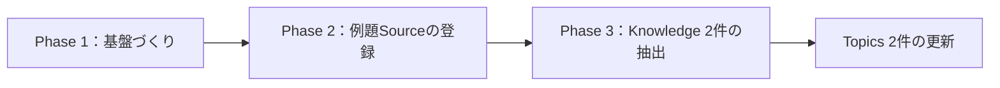

# 2026年 第46週のまとめ

## 1. 概要

今週は、knowledge-vault が動き始めた最初の週である。11月9日に Phase 1 でディレクトリ構成やテンプレートなどの基盤ができ、同じ日に Phase 2 で最初の例題となる情報源が登録され、11月10日に Phase 3 でそこから Knowledge が抽出され、Topics が更新された。つまり、この1週間で「情報源の登録 → 知識の抽出 → 横断的なまとめ」という一連の流れが、初めて一通り動いた。

情報源はまだ1件のみである。Addy Osmani による X の長文記事である。したがって、今週のまとめは「蓄積の量」ではなく「仕組みが動き始めたこと」と「最初の実例から何が見えたか」を整理するものである。中心となるテーマは、AIエージェントに仕事を任せるときに、自分の思考をどう守るか、という問いである。

## 2. 期間中に登録された情報

期間中に登録された Source は1件、Knowledge は2件である。

### Source

| タイトル | 登録日 | 情報源の種類 | カテゴリ | タグ |
| --- | --- | --- | --- | --- |
| [Critical thinking when agents do the work](../../sources/social/x/2026-11-03-critical-thinking-when-agents-do-the-work.md) | 2026-11-09 | social | AI | agentic-workflows, critical-thinking, cognitive-surrender, cognitive-debt, verification, code-review |

### Knowledge

| タイトル | 登録日 | カテゴリ | タグ |
| --- | --- | --- | --- |
| [エージェント作業における検証の習慣](../../knowledge/ai/verification-for-agent-work.md) | 2026-11-10 | AI | verification, agentic-workflows, code-review, critical-thinking |
| [認知的降伏と認知的負債](../../knowledge/ai/cognitive-surrender-and-cognitive-debt.md) | 2026-11-10 | AI | cognitive-surrender, cognitive-debt, agentic-workflows, critical-thinking |

今週の変化は、登録件数そのものよりも、登録された情報の「つながり方」にある。例題 Source からは、AIエージェントとの協働に関する Knowledge が2件抽出された。Source から Knowledge への流れが確認できた。

流れを図にすると、次のとおりである。

## 3. 重要な記事

今週の重要な記事は、Addy Osmani による X の長文記事「Critical thinking when agents do the work」（2026-11-03）である。理由は次のとおりである。

第一に、AIエージェントがコードを書く量が増えるなかで、「人は理解や判断をどこまで手放してよいのか」という問いを、段階と実践の両面から具体的に論じているからである。抽象的な注意喚起にとどまらず、検証の習慣や依頼の仕方など、すぐ試せる実践が示されている。

第二に、この1件の記事から Knowledge が2件抽出でき、Topics が2件更新できたからである。1件の情報源が、複数の再利用可能な知識と、複数のテーマへの広がりを生んだことは、Source と Knowledge を分離するこのリポジトリの狙いが、実際に働いた例になった。

第三に、関心の高さもうかがえることである。ページ表示では約550万回表示され、読了時間は14分とされていた。長い記事であるにもかかわらず多くの人に読まれていることは、このテーマへの関心の大きさを示す一例である。

## 4. 注目すべき技術・知識

今週、注目すべき知識は次のとおりである。

- **認知的降伏（cognitive surrender）**：AIの出力がすっかり自分のものになり、確認の必要すら感じなくなる状態。委譲の度合いが深まるにつれて、人は少しずつこの段階へ進む。Wharton の Steven Shaw と Gideon Nave による用語である。
- **認知的負債（cognitive debt）と理解の負債（comprehension debt）**：AIに頼ることで失われた理解が、借金のように積み重なるという考え方。コードはきれいに見え、テストも通るのに、誰も仕組みを理解していない状態が例として挙げられている。
- **検証の習慣**：エージェントの作業に対する検証を、習慣として組み込む考え方。「検証済み」の定義を事前に決めること、緑のチェックは一つの性質しか示さないと知ること、完了の条件を具体的な形にしておくことが中心である。
- **ゴム印化（rubber stamping）**：レビューが内容の確認ではなく形式的な承認になってしまう状態。600行のプルリクエストの例が示すように、量が多すぎると人は細部を読まずに承認してしまう。
- **オーケストレーションの負担（orchestration tax）と意図の負債（intent debt）**：エージェントが生成した量と、自分が責任を持てる量の差が負担になることや、意図を伝えきれないまま作業が進むことで生じる負債である。
- **依頼の仕方の実践**：仮説を立ててから依頼する、盲点を探す一手間を入れる、反対意見を求める、といった実践も注目に値する。依頼する前に自分で考えることが、思考を守る具体的な方法として示されている。

## 5. 新しく発見された関連性

今週、新しく見えてきた関連性は次の2点である。

第一に、「検証の習慣」と「認知的降伏」の関係である。検証の習慣は、単なる品質管理の手法ではなく、認知的降伏への対抗策として位置づけられる。検証の仕組みを作り、その証拠を確認することで、理解を手放しすぎない状態を保てる。2件の Knowledge が互いに参照し合う関係になったことも、このつながりの表れである。

第二に、同じ1件の Source から、人工知能と開発者生産性という2つの Topics が更新されたことである。批判的思考というテーマと、コードレビューという実務のテーマが、同じ情報源からつながった。今後、情報源が増えれば、テーマ同士のつながりはさらに見えやすくなるはずである。

## 6. 重要なKnowledge

今週の重要な Knowledge は、例題 Source から抽出した次の2件である。

- [認知的降伏と認知的負債](../../knowledge/ai/cognitive-surrender-and-cognitive-debt.md)：委譲の段階と、失われた理解が負債として積み重なる仕組みを整理したもの。エージェントを使うあらゆる場面で、自分の思考をどこまで手放しているかを見直す枠組みになる。
- [エージェント作業における検証の習慣](../../knowledge/ai/verification-for-agent-work.md)：検証を習慣として組み込むための知識。「検証済み」の定義、緑のチェックの意味、完了条件の具体化など、実践の枠組みを整理したもの。

## 7. Topicsへの反映状況

今週は、次の2件の Topics が 2026-11-10 に更新された。

| Topics | 更新日 |
| --- | --- |
| [人工知能](../../topics/artificial-intelligence.md) | 2026-11-10 |
| [開発者生産性](../../topics/developer-productivity.md) | 2026-11-10 |

「人工知能」は、AIエージェントと批判的思考の関係を中心に、例題 Source と Knowledge 2件をもとに初版が作られた。「開発者生産性」は、コードレビューと検証という角度から、同じ例題 Source と検証の習慣の Knowledge をもとに更新された。

ただし、両 Topics とも、現時点では情報源は1件のみである。複数の情報源の比較はまだできないことは、各 Topics にも正直に書かれている。「ソフトウェアアーキテクチャ」は、関連する情報源がまだないため、今週は更新されていない。
