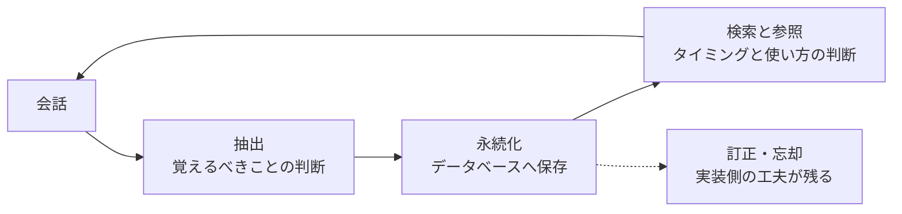

# エージェントのメモリー設計の難所

## 1. 概要

AI エージェントに、セッションをまたいでユーザーの関心事ややりとりの注意点を記憶させる仕組み（メモリー）は、自作する場合の難所である。

難しさは三層ある。第一に、仕組み自体は単純に見えても、「覚えておくべきことの抽出」「しかるべきタイミングでの検索」「適切な参照」の一つひとつが奥深い。第二に、サードパーティ製 API を使っても、過去のメモリーの訂正や忘却は実装側の工夫として残る。第三に、自作エージェントのメモリーは、ユーザーが普段使っている AI エージェントと共有されないため、どれだけ良いエージェントを作っても、メモリーが引き継がれないことが乗り換えの障壁になりうる。

この知識は、自作の分析エージェントの開発をやめて分析 MCP に作り直した著者の振り返りをもとに整理したものである。

## 2. 基本概念

- **メモリー**：セッションをまたいで、ユーザーの関心事ややりとりの注意点を記憶しておく仕組み。
- **抽出**：ユーザーとの会話から、覚えておくべきことを取り出す工程。何を覚えるべきかの判断そのものが難しい。
- **永続化**：抽出した情報を、何らかのデータベースに保存する工程。
- **検索と参照**：しかるべきタイミングでデータベースを検索し、会話の中で適切に参照させる工程。タイミングと使い方の判断が難しい。
- **訂正と忘却**：過去に覚えたメモリーが誤っていたり古くなったりした場合に直すこと、および、覚えたことを消すこと。仕組みとして用意しないと、誤った記憶が残り続ける。
- **メモリーの非共有**：あるエージェントに蓄積されたメモリーが、別のエージェントからは使えない状態。利用者にとっては、乗り換えると記憶が引き継がれないことを意味する。

## 3. 詳細解説

### 仕組みは単純でも、一つひとつが奥深い

元記事では、メモリーの仕組みは次の三つに分解されている。

1. ユーザーとの会話から、覚えておくべきことを抽出する。
2. 何らかのデータベースに情報を永続化する。
3. しかるべきタイミングでデータベースを検索し、適切に参照させる。

これだけ、と著者は書く。しかし、「覚えておくべきことを抽出する」「しかるべきタイミングで検索する」「適切に参照させる」は、それぞれが奥深すぎる、というのが著者の実感である。つまり、部品を並べること自体は難しくなくても、その判断の質を上げることが難しい、という構造になっている。

### サードパーティ製 API を使っても残るもの

mem0 などのサードパーティ製 API を使えば、メモリー機能の一部は楽に実装できる。ただし、開発者側でやるべきことは残る。元記事では、次の二つが挙げられている。

- 過去のメモリーを訂正する
- 過去のメモリーを忘却させる

これらは実装側で工夫する必要がある。覚える仕組みを買っても、記憶の手入れの運用までは買えない、という点が要点である。

### 最大の欠点は、共有されないこと

著者が最大の欠点として挙げているのは、技術的な難しさではなく、ユーザーが普段使っている AI エージェントとの間でメモリーが共有されないことである。

どれだけ良い AI エージェントを自作しても、普段使いのエージェントに蓄積されたメモリーは引き継がれない。利用者にとっては、新しいエージェントに移ると、これまでの関心事や注意点をまた一から伝えることになる。これは、エージェントの出来の良し悪しとは別の、乗り換えの障壁になる。

この観点は、メモリーを「自作エージェントの内部機能」としてだけでなく、「利用者が普段の場所に留まる理由」として見る見方につながる。汎用エージェントに機能を接続する構成では、メモリーは普段使いの側に蓄積され続けるため、この障壁が生まれない。

## 4. 仕組み・構造

難所を工程ごとに整理すると、次のようになる。

| 工程 | 難しい点 |
| --- | --- |
| 抽出 | 会話のどこが「覚えておくべきこと」かの判断 |
| 永続化 | 保存自体は比較的単純 |
| 検索と参照 | しかるべきタイミングで取り出し、適切に参照させる判断 |
| 訂正・忘却 | サードパーティ製 API を使っても実装側の工夫が残る |
| 共有 | 普段使いのエージェントと共有されず、乗り換えの障壁になる |

## 5. メリット・デメリット

この知識は、メモリーを自作する場合の論点の整理であり、手法そのもののメリット・デメリットではない。自作と外部利用の対比として整理する。

自作する場合：

- メリット：メモリーの仕様（何を覚え、どう参照するか）を用途に合わせて細かく決められる可能性がある。
- デメリット：抽出・検索・参照の質を上げる工夫が終わらず、訂正・忘却の運用も自分たちで抱える。さらに、利用者の普段使いのエージェントとは共有されない。

汎用エージェント側のメモリーを使う場合：

- メリット：利用者が普段から蓄積しているメモリーを、そのまま用途の業務にも活用できる。乗り換えの障壁が生まれない。
- デメリット：メモリーの仕様は汎用エージェント側に委ねられ、用途固有の細かな制御はできない可能性がある。

## 6. 活用例

- **専用エージェントの企画時の確認項目**：メモリーが必要な企画では、「抽出の判断をどう作るか」「訂正と忘却をどう用意するか」「利用者の既存のメモリーが引き継がれないことをどう考えるか」の三点を、作り始める前に確認する材料になる。
- **MCP 構成を選ぶ根拠の一つ**：用途固有の機能を汎用エージェントに接続する構成では、メモリーは汎用エージェント側に残る。メモリーの難所と非共有の問題を同時に避けられることが、[専用エージェントを自作せず、汎用エージェントと MCP で構成する判断](custom-agent-vs-general-agent-with-mcp.md) の根拠の一つになっている。

## 7. 関連する知識

- [専用エージェントを自作せず、汎用エージェントと MCP で構成する判断](custom-agent-vs-general-agent-with-mcp.md) — メモリーを含む基盤部分を汎用エージェントに任せる構成の判断を整理した知識。

## 8. 参照した情報源

- [自作AIエージェントの開発をやめた](../../sources/articles/2026-11-05-stopped-building-custom-ai-agent.md) — ブログ「無駄と文化」の記事（2026-11-05）。メモリーの難しさについて「メモリーという難所」の節で述べられている。
