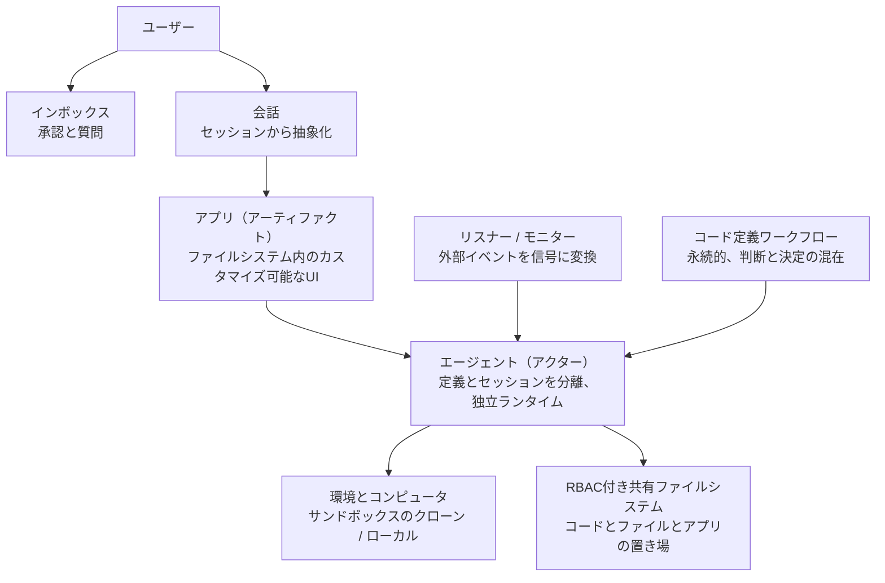

# エージェントプラットフォームの設計図：8つの構成要素

## 1. 概要

多数のエージェントを載せるプラットフォーム（エージェント基盤）を設計するとき、論点は8つの構成要素に分解できる、という設計図である。John Suh の「Agent platform of 2027」が提示したもので、アプリケーション層が単一のエージェント基盤（エージェントOS）に収束し、他のソフトウェアはその下のデータベースになる、というビジョンを前提に、各要素について「現在の標準」と「移行先」を対置している。

8要素は、実行モデル（アクター）、環境とコンピュータ、RBAC付きファイルシステム、セッションと会話の分離、インボックス、リスナーとモニター、コード定義ワークフロー、アプリ（アーティファクト）である。個別の要素は独立した設計判断として切り出して使える。

## 2. 基本概念

- **庭の土台という比喩**：基盤は完成品のアプリを配る場所ではなく、顧客が自社の「種」（業務やエージェント定義）を植え、エージェント・人間・事業のセンサー信号で育てる土台である。「工場の工場」という自動化の比喩より、育成と進化の比喩が実態に近いとする。
- **分離の原則の反復**：この設計図では「定義と実体を分ける」判断が繰り返し現れる。エージェントの定義とインスタンス／セッション、権限とコンピュータ、セッションと会話、ワークフローの定義と実行、である。分離することで、片方を差し替え・拡張しても、もう片方が壊れない。
- **revealed preference（実際に示された選好）**：ベンダーや企業の主張ではなく、実際の運用で選ばれた形から設計の方向を読む方法。単一の mega-agent の主張に対し、実際の事例では小さな道具だけを持つエージェント群が使われていた、という観察に使われている。

## 3. 詳細解説

### 実行モデル：アクター

現在の標準は Temporal 型のワークフロー基盤にエージェントをデプロイする形だが、移行先はアクターモデルである。各エージェントハーネスが独立したランタイムを持ち、異なる実装のエージェントループが同一テナント内でも安全に共存する。分離が必須になる理由は自己改善である。エージェントが自分の拡張やフックをその場で書き換えることを許すなら、書き換えの影響範囲を実行単位の中に閉じ込めなければならない。

### 環境とコンピュータ

コンピュータは、チェックポイント付きサンドボックスのクローンと、利用者のローカルコンピュータの2種。エージェントとコンピュータは N 対 M の関係で、1エージェントが複数サンドボックスを実験に使うことも、多数のエージェントが少数の VM を共有することもできる。環境の構成自体をエージェントが変更できることが要件になる。

### ファイルシステムと権限

エージェントの群れはクラウド上の共有 POSIX ファイルシステムで働き、アクセス制御はコンピュータではなくファイルシステム側に付ける。置かれるのは、コード・拡張・定義（GitHub 的な部分）と、ファイルやアプリ（Google Drive 的な部分）である。成果物とデータが集まる場所が、そのまま権限管理の中心になる。

### UI、イベント、ワークフロー、アプリ

残りの4要素は別ページに切り出してある。UI はセッションと会話の分離＋承認インボックス（[セッションと会話の分離と承認インボックス](session-conversation-separation.md)）、アプリはフォーク可能なアーティファクトとしての定義（[アプリ＝フォークできるアーティファクトという考え方](apps-as-forkable-artifacts.md)）を参照。

イベント処理は、cron や webhook プラグインの上位集合として、テナントがその場で定義できるリスナー／モニターに一般化される。外部のイベントストリーム（WebSocket、Kafka、CDC など）を購読し、決定的な処理またはエージェントの判断で「行動可能な信号」に変換する。要件が会話の中で変わる前提なので、基盤側の事前実装ではなく、その場での組み立てが本質になる。

ワークフローは、ドラッグ＆ドロップ型の自動化ではなくコードで定義する。業務ワークフローは長い時間軸で動き、エージェントの判断と決定的なステップが混在する。データの流れが API と MCP で基盤に集まるなら、定義の置き場も基盤に寄せるのが一貫する。

## 4. 仕組み・構造

## 5. メリット・デメリット

メリット：

- 設計の論点が要素ごとに独立しているため、基盤の一部だけを採用・評価できる。
- 分離の原則により、自己改善のような強い拡張性を、安全性（影響範囲の限定）と両立させやすい。
- UI とイベントの一般化により、利用者ごとの要件の違いを、基盤の改修ではなく利用者側の定義で吸収できる。

デメリット・注意点：

- 全体はビジョン（予測）の提示であり、「単一基盤への収束」などの中核主張に実証はない。設計の部品表としては有用でも、市場予測としては割り引いて読む必要がある。
- 要素ごとの成熟度は揃っていない。アクター実行や RBAC 付き共有ファイルシステムは既存技術の組み合わせで描ける一方、リスナーの「その場で組み立てる」要件などは実装難度が高い。
- 分離を徹底すると、部品間の契約（インターフェース）の設計と運用の負担が増える。小規模な基盤では過剰設計になりうる。

## 6. 活用例

- 自前のエージェント基盤やハーネスを設計するときの、論点のチェックリストとして使う。特に「権限はどこに付けるか」「ユーザーに見せるのはセッションか会話か」は、早い段階で決めないと後から変えにくい。
- 既存のエージェント製品を評価するときの物差しにする。各要素について「現在の標準」側にいるか「移行先」側にいるかで、その製品の設計判断と将来の移行コストが見える。
- 個人向けのエージェント運用にも縮小して適用できる。承認インボックスは承認カードの設計に、リスナーの一般化は cron とフックの使い分けの整理に、それぞれ対応する。

## 7. 関連する知識

- [セッションと会話の分離と承認インボックス](session-conversation-separation.md) — 本設計図の UI 要素を切り出したもの
- [アプリ＝フォークできるアーティファクトという考え方](apps-as-forkable-artifacts.md) — 本設計図のアプリ要素を切り出したもの
- [エージェント自己改善ループの設計](agent-self-improvement-loop-design.md) — 自己改善を回す側の設計。本設計図では、自己改善を許すための実行分離が前提として現れる
- [自作エージェントと汎用エージェント＋MCPの比較](custom-agent-vs-general-agent-with-mcp.md) — 基盤を自作するか汎用基盤に乗るかの判断軸
- [ハーネスの定義と流派](harness-definitions-and-schools.md) — ハーネスという単位の捉え方。本設計図のアクターは、その実行単位の置き方の1案になる

## 8. 参照した情報源

- [Agent platform of 2027（John Suh の X ポスト）](../../sources/social/x/2026-11-22-agent-platform-of-2027.md)
