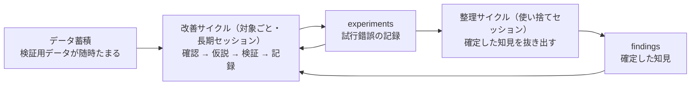

# エージェント自己改善ループの設計

## 1. 概要

LLM エージェントが、ほぼ人間の介入なしに、自分の担当対象を改善し続ける仕組み（自己改善ループ）の設計知識である。出典の事例は、複数の HFT（高頻度取引）bot を対象に、監視・仮説づくり・バックテスト・記録を30分ごとに回し、知見の整理を6時間ごとに別処理で行うワークフローである。

設計の要点は、ループを「定期実行の仕組み」「データの蓄積」「知見の集約」の3要素に分けること、試行錯誤の記録（experiments）と確定した知見（findings）を分けて保存すること、セッションの性質（長期間の文脈を持つか、使い捨てか）で定期処理を使い分けること、そして、エージェントが既定では使わない外部リソースを Agent Skills で接続することである。

この型は取引に限らず、継続的な改善対象（コードベース、運用システム、データ分析など）を持つエージェント運用一般に応用できる。

## 2. 基本概念

- **自己改善ループ**：エージェントが「データを見る → 仮説を立てる → 検証する → 結果を記録する」を定期的に繰り返し、対象を改善し続ける仕組み。
- **永続的な定期実行（Heartbeat 型）**：既存のセッションに定期処理をアタッチする方式。再起動しても処理が残り、セッションの文脈が蓄積される。対象ごとの長期セッションに向く。
- **使い捨ての定期実行（Schedule 型）**：毎回新しいセッションを作る方式。終わったらアーカイブできるため、整理・集計のような、その場限りの処理に向く。
- **experiments（試行錯誤の記録）**：各サイクルの試行と結果をそのまま残した記録。生の履歴であり、整理されていない。
- **findings（確定した知見）**：experiments の中から、検証を経て確定した知見だけを抜き出して整理したもの。他のエージェントが次の仮説づくりに使う。
- **ナレッジベース**：全エージェントの experiments と findings を1か所に集約する場所。リポジトリの外に置くことで、リポジトリを分けたエージェント同士でも知見を共有できる。
- **Agent Skills**：エージェントに追加で読み込ませる指示・手順のまとまり。リポジトリ外のリソース（データ蓄積先、ナレッジベースなど）をエージェントに使わせるための接続点になる。
- **prompt cache**：LLM への入力の再利用の仕組み。定期実行の間隔をキャッシュの有効期間内に収めると、文脈を引き継いだ処理が効率よく回る。

## 3. 詳細解説

### 3要素への分解

ループは次の3要素に分けると設計しやすい。

1. **定期実行の仕組み**：改善サイクルと整理サイクルを、それぞれの間隔で回す。出典の実装では AI ハーネス（Paseo）の Heartbeat と Schedule がこれを担い、その中で Claude Code が動く。
2. **データの蓄積**：検証に使うデータを継続的にためる場所。出典では、ヒストリカルデータと実稼働データを蓄積するデータレイク（QuantLake）が担う。
3. **知見の集約**：experiments と findings を集めるナレッジベース。出典では Obsidian の vault に検索補助（qmd）を組み合わせている。

### セッションの使い分け

定期処理は、セッションの性質で使い分ける。

- **改善サイクル**は対象ごとに長期セッションを1つ持ち、永続的な定期実行で回す。監視、仮説づくり、検証、記録を担当し、自分と他のエージェントの experiments と findings を参照する。
- **整理サイクル**は使い捨てセッションで回す。全エージェントの experiments を走査し、確定した知見を findings に移す。文脈を持ち越さないため、毎回まっさらな判断で整理できる。

揮発性の定期実行（再起動で消える loop 機構）は、長期運用の基盤にはならない点にも注意する。

### 間隔の設計

改善サイクルの間隔は、データの更新頻度と、LLM の prompt cache の有効期間の両方から決める。出典では、著者の認識としてキャッシュの有効期間を60分とし、それを切らさない30分間隔を採用している。整理サイクルは6時間ごとである。

### 外部リソースの接続

エージェントは既定では、自分のリポジトリの外にあるリソースを使わない。データ蓄積先とナレッジベースのそれぞれについて、使い方を記した Agent Skills を用意して読み込ませることで、初めてループの部品として機能する。

### 改善と運用保守を同じ定期処理に載せる

定期実行のプロンプトには、改善だけでなく運用保守の指示も加えられる。出典では、取引所のメンテナンス確認と期間中の停止、データフィードの遅延が閾値を超えたときの停止、異常時にエージェント自身の判断で対象を一時停止・完全停止する許可まで含めている。権限を広げる場合は、停止の条件、復旧の手順、人間への通知といった境界を先に決めておくことが前提になる。

## 4. 仕組み・構造

ループの構造を図にすると、次のとおりである。

## 5. メリット・デメリット

### メリット

- 人間が介在しなくても改善が継続し、24時間体制の運用ができる。
- experiments と findings の二層構造により、試行錯誤が知見として複利でたまる。他のエージェントの知見も次の仮説に使える。
- 改善と整理を分けることで、記録する側が整理に追われず、整理する側も新鮮な目で判断できる。
- 複数の対象を並行して改善・保守できるため、1人でも扱える対象の数が増える。

### デメリット

- ループ全体の信頼性は、各サイクルの検証の質で決まる。検証が甘いと、誤った改善が自動で積み重なる。
- 異常時の停止権限など、エージェントに与える権限の設計を誤ると、影響が大きい。
- 整理サイクルが止まると experiments がたまる一方になり、知見の共有が機能しなくなる。
- 定期実行そのもののコスト（LLM の利用量）が継続的にかかる。

## 6. 活用例

- **HFT bot の自己改善（出典の事例）**：bot ごとにリポジトリと改善セッションを分け、30分ごとにデータ確認・仮説・バックテスト・experiments 保存を行い、6時間ごとの整理で findings 化する。知見は Obsidian vault に集約し、全 bot で共有する。運用保守（メンテナンス対応、異常時の停止）も同じ Heartbeat に載せる。
- 同じ型は、検証手段（テスト、計測、シミュレーション）を持つ対象一般に応用できる。たとえば、コードベースの継続的な改善や、データパイプラインの異常検知と調整などである。いずれも「検証を各サイクルに組み込むこと」が前提になる。

## 7. 関連する知識

- [バックテストにおけるレイテンシ補正](backtest-latency-correction.md)：自己改善ループの検証（バックテスト）の精度を支える知識。検証が現実を再現していなければ、ループの改善は空転する。
- [エージェント作業における検証の習慣](verification-for-agent-work.md)：エージェントの作業に対する検証を習慣化する知識。自己改善ループでは、この検証を仕組みとして各サイクルに埋め込む関係にある。
- [認知的降伏と認知的負債](cognitive-surrender-and-cognitive-debt.md)：自律化が進むほど、人は理解を手放しやすい。自己改善ループを導入する際の、人の側の注意点として対応する。

## 8. 参照した情報源

- [LLM エージェントを活用した高頻度売買システムの自己改善ワークフロー構築](../../sources/social/x/2026-11-11-llm-agent-hft-self-improvement.md)（元URL：https://x.com/supermomonga/status/2120375864408129846）
