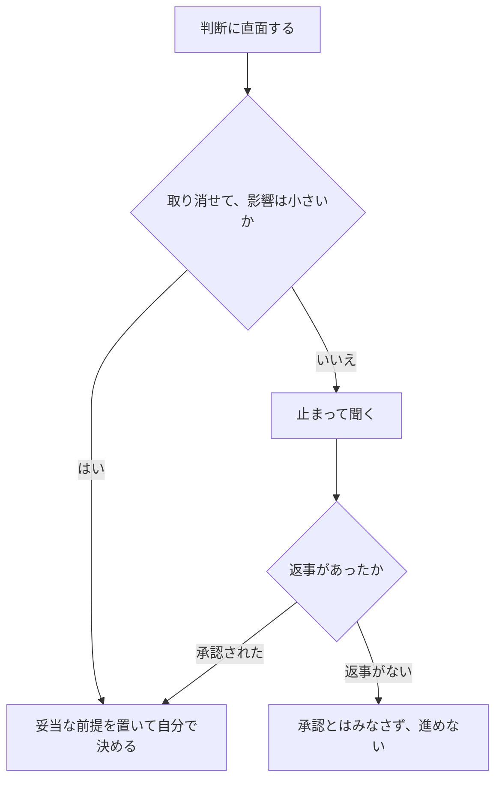

# エージェントを自走させる取り決め：任せる判断と聞く判断の線引き

## 1. 概要

AI エージェントを広く自走させる場合に、判断の仕方そのものを文章で取り決めておく方法である。OpenClaw（チャットから話しかけられるオープンソースの AI アシスタント）の AGENTS.md の実践をもとに整理した。

中心は、自分で決めてよい判断と、止まって聞く判断の線引きである。取り消しのきく日常的な判断はエージェントが自分で決め、重大な判断（新しい設定項目、公開している契約を壊す変更、有料サービスの利用、破壊的な操作）は改めて聞く。あわせて、返事がないことを承認とみなさないこと、失敗が続いたときの止まる条件も取り決めに含まれる。

OpenClaw は複数のエージェントを並行して自走させ、行動の判断まで任せている。その代わりに判断の仕方を細かく取り決めている、というのがこの方法の構造である。ただし、取り決めを守るかどうかはまだ AI に委ねられている、という限界も元記事は明記している。

## 2. 基本概念

- **自走**：エージェントが、人の逐次の指示を待たずに、任された作業を自分で進めること。
- **取り決め**：エージェントとの間で定めた、判断の仕方の約束。規約集というより、仕事を任せる相手との取り決めのように書かれる。
- **任せる判断**：取り消しのきく日常的な判断。妥当な前提を置いて、エージェントが自分で決めてよい範囲である。
- **聞く判断**：止まって人に聞くべき重大な判断。新しい設定項目、公開している契約を壊す変更、有料サービスの利用、破壊的な操作が該当する。
- **沈黙は承認ではない**：返事がないことを、承認されたこととみなさない、という原則。
- **止まる条件**：自走を切り替える・終える条件。同じ失敗が続く場合の手段の切り替えや、必須のチェックが通った後の終了の仕方を含む。

## 3. 詳細解説

### 線引き：取り消せるかどうか

OpenClaw の AGENTS.md の中心にあるのは、自分で決めてよい判断と、止まって聞く判断の線引きである。

自分で決めてよいのは、取り消しのきく日常的な判断である。妥当な前提を置いて自分で決め、聞くのは、文脈では解決できない重大な判断だけにする。並行して進められる独立した作業は、確認を待つ間も続ける、という進め方も含まれる。

止まって聞くのは、次のような判断である。

- 新しい設定項目を加えること
- 公開している契約（インターフェースなど）を壊す変更
- 有料サービスの利用
- 破壊的な操作

線引きの物差しは「取り消せるかどうか」と「影響の大きさ」である。取り消せて影響が小さいものは任せ、取り消せないもの・影響が大きいものは聞く。

### 返事がないことは承認ではない

取り決めには、返事がないことを承認とみなさない、という原則が含まれている。自走するエージェントにとって、確認を求めたまま返事がない状態は起こりうる。そのときに「返事がないから進めてよい」と解釈すると、聞くべき判断の線引きが崩れる。この原則は、線引きを守るための土台である。

なお、進捗の報告は完了ではなく、あくまで途中経過の地点である、という位置づけも取り決めに含まれている。報告したことをもって終わったことにしない、という意味である。

### 止まる条件：失敗の切り替えと、終わり方

自走には、止まる条件も取り決められている。

- 新しい証拠のないまま同じ失敗が2回続くか、10分進展がなければ、別の手段に切り替える。同じやり方を繰り返さない。
- 振る舞いが証明されて必須のチェックが通ったら、頼まれていない磨き込みはせずに終える。頼まれた範囲を超えて広げない。

前者は、失敗への固執を防ぐ条件である。後者は、やり過ぎを防ぐ条件で、自走の範囲を「頼まれたこと」に保つ役割を持つ。

### この方法の限界

元記事は、この取り決めについて、守るかどうかはまだ AI に委ねられている、と評価している。文章の取り決めは、読まれて、守られて初めて効く。機械的に強制する仕組み（フックやリンター）と比べると、確実さでは劣る。

そのため、この方法は単独ではなく、破壊的な操作のような「起きてからでは遅いもの」については、機械的に止める仕組みと組み合わせることが考えられる。元記事で紹介されているサンプルのハーネスでも、OpenClaw からは3行の取り決めを取り入れつつ、取り返しのつかない操作は Bun 型のフックで実行前に止める形が組み合わされている。

## 4. 仕組み・構造

判断の流れとして整理すると、次のようになる。

| 場面 | 取り決め |
| --- | --- |
| 取り消しのきく日常的な判断 | 自分で決める。聞くのは重大な判断だけ |
| 新しい設定項目、契約を壊す変更、有料サービス、破壊的な操作 | 止まって聞く |
| 聞いたが返事がない | 承認とみなさない |
| 同じ失敗が2回続く、または10分進展がない | 別の手段に切り替える |
| 振る舞いが証明され、必須のチェックが通った | 磨き込みをせずに終える |

## 5. メリット・デメリット

メリット：

- 任せる範囲が言葉で決まるため、エージェントが逐一止まらずに進められ、自走の速度が上がる。
- 聞くべき判断が先に列挙されているため、重大な判断が独断で進むことを抑えられる。
- 止まる条件があるため、失敗への固執や、頼まれていない作業への拡大を抑えられる。

デメリット・注意点：

- 文章の取り決めは、守るかどうかが AI に委ねられる。機械的な強制と比べると確実さで劣る。
- 線引きの列挙（聞くべき判断の一覧）は、プロジェクトごとに作る必要がある。一般化した一覧をそのまま持ち込んでも、自プロジェクトの重大な判断を漏らす可能性がある。
- 「10分」「2回」のような数値は OpenClaw の実践であり、作業の種類によって適切な値は変わる。

## 6. 活用例

- **自分のエージェント運用への取り入れ**：元記事のサンプルハーネスでも、OpenClaw からは「頼まれていない範囲に広げない、重大な判断だけを聞く、返事がないことを承認とみなさない」という3行の取り決めが取り入れられている。まずこの3行から始める形が、移しやすい単位である。
- **破壊的な操作との組み合わせ**：取り決めで「破壊的な操作は聞く」と定めるだけでなく、本番データベースへの書き込みのような取り返しのつかない操作は、フックで実行前に止める仕組みと組み合わせる。文章の約束と機械の強制を、影響の大きさで使い分ける。

## 7. 関連する知識

- [AIへの信頼度で変わるハーネスの形（5つのOSSの比較）](harness-shapes-by-trust-in-ai.md) — OpenClaw を「中間」に位置づける、比較の枠組みを整理した知識。
- [境界とセキュリティ](boundaries-and-security-for-agents.md) — エージェントが到達できないようにする「境界」の層を整理した既存の知識。取り決めが「判断の約束」だとすれば、境界は「そもそも届かないようにする」仕組みであり、両者は補い合う。

## 8. 参照した情報源

- [ハーネスエンジニアリングを有名OSSはどう組んでいるのか？AIへの信頼で比べる5事例](../../sources/technical/2026-10-16-oss-ai-agent-harness-philosophy.md) — 松本 淳太郎（Gibberish Lab）の記事（2026-10-16）。OpenClaw の AGENTS.md の節が、この知識の元になっている。
