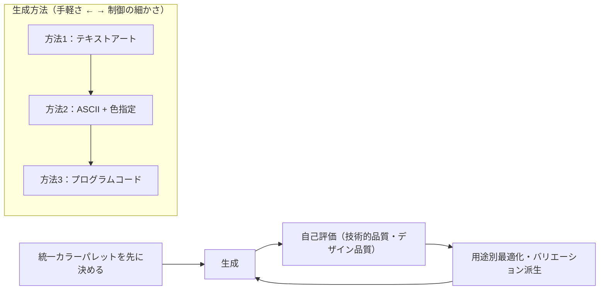

# AIでドット絵を作る3つの方法

## 1. 概要

生成AI（記事では ChatGPT）でドット絵（ピクセルアート）を作る方法は、表現の形式によって3つに整理できる。(1) 記号の並びで絵を表すテキストアート生成、(2) 記号の配置図と色指定表を組み合わせる ASCII + 色指定、(3) HTML や Python などのプログラムコードを生成させる方法、である。

3つの方法は、難易度と品質・再現性のトレードオフで並んでいる。手軽さでは (1)、キャラクターの定義のしやすさでは (2)、ピクセル単位の制御と再現性では (3) が優れる。用途に合わせて選ぶことが要点である。

また、どの方法でも、統一カラーパレットを先に決めること、ベースからバリエーションを派生させること、生成後に評価と修正を回すことが、実用レベルの品質に近づけるための共通の進め方になる。

## 2. 基本概念

- **ドット絵（ピクセルアート）**：小さな正方形（ピクセル）を組み合わせて描くデジタルアート。限られた色数と解像度の中で表現する。
- **テキストアート**：■や□などの記号の並びで絵を表現する手法。記号ごとに色を割り当てると、ドット絵の配置図になる。
- **ASCII + 色指定**：記号の配置図と、各記号に対応する色の表（HEX コードなど）を組み合わせてキャラクターを定義する手法。
- **プログラムコード生成**：HTML テーブルや Python + PIL などのコードで、各ピクセルの色を直接指定して描画する手法。
- **カラーパレット**：作品に使う色の集合。先に決めて統一すると、複数の作品やバリエーションに一貫性が出る。
- **スプライトシート**：アニメーションの各フレームを1枚の画像に横並びに配置したもの。
- **アンチエイリアス**：境界を滑らかに見せる中間色の処理。ドット絵では境界がぼやける原因になるため、無効化が前提になる。

## 3. 詳細解説

### 方法1：テキストアート生成

■□●○などの記号で絵を表す方法である。プロンプトでは、作成対象、サイズ（例：16×16）、色数、スタイル（レトロゲーム風など）、用途、出力形式（どの記号が何色か）を指定する。記号のグリッド自体が配置図になるため、そのまま読み取れる。シンプルなアイコンやロゴに向く。

改良のコツは3つある。色は「赤」ではなく「レンガ色」「朱色」のように具体的に指定すること。既存作品を参考イメージとして例示すること。まず 8×8 のような小さいサイズで試し、16×16、32×32 へ段階的に拡大することである。

### 方法2：ASCII + 色指定

記号の配置図と色指定表を組み合わせる方法である。キャラクター設定（名前、性格、服装）と技術仕様（サイズ、カラーパレットを HEX コードで、アニメーションの有無）を分けて書き、出力には配置図、色指定表、制作意図の説明を含めさせる。中程度の複雑さのキャラクターに向く。色を記号から分離して管理できるため、色替えのバリエーションが作りやすい。

### 方法3：プログラムコード生成

HTML テーブルや Python + PIL のコードを生成させ、各ピクセルの色をコードで直接指定する方法である。要件として、各セル（ピクセル）に背景色を設定すること、アンチエイリアスなしで拡大表示すること、色パレットの上限（例：最大16色）を守ること、PNG で保存できること、などをコードに含める。ピクセル単位で制御できるため再現性が高く、大きなサイズや、組み合わせ生成のような機械処理にも向く。

### 制作の進め方（3方法共通）

- **パレット統一**：複数のドット絵を作るときは、最初に統一カラーパレットを決める。パレット作成自体もAIに行わせ、色名と HEX コード、使用用途、組み合わせ例を出させることができる。
- **バリエーション派生**：表情（基本、喜び、怒り、悲しみ、驚き）や服装のバリエーションは、ゼロから作り直すのではなく、ベースキャラクターから派生させ、変更点を明確にして統一感を保つ。
- **アニメーション**：歩行などは、フレーム（例：4フレーム）を横並びにしたスプライトシートとして生成させる。各フレームの個別表示、フレーム間の差分説明、推奨フレームレートも合わせて出させる。逆向きは反転処理で作る。
- **検証と修正**：生成後に、技術的品質（ピクセルの整列性、色使いの統一性、サイズ感）とデザイン品質（視認性、魅力度、用途への適合性）を5段階で自己評価させ、低い項目の改善案を出させる。次に用途別（SNS アイコン、印刷物、ファビコン）に最適化し、必要なら A/B テスト用のバリエーションを作る。

## 4. 仕組み・構造

3つの方法の位置づけと、共通の制作フローを図にすると、次のとおりである。

どの方法でも、「パレットを決める→生成する→評価する→直す」の循環が品質を支える。方法の違いは、生成の表現形式（記号、配置図＋色表、コード）の違いであり、循環そのものは共通である。

## 5. メリット・デメリット

### メリット

- **方法1（テキストアート）**：プログラミング不要で最も手軽である。配置図がそのまま読めるため、結果の確認と手直しがしやすい。
- **方法2（ASCII + 色指定）**：形と色を分離して管理できるため、色替えや差分のバリエーション展開がしやすい。
- **方法3（プログラムコード）**：ピクセル単位で制御でき、再現性が高い。大きいサイズ、組み合わせ生成、アニメーションのフレーム生成など、機械処理と組み合わせやすい。
- **共通**：統一パレットと派生の進め方により、複数作品の一貫性を保ちやすい。

### デメリット・注意点

- **方法1**：記号の種類とグリッドの大きさに表現が制限され、複雑なキャラクターや大きいサイズには向かない。
- **方法2**：配置図と色表の両方を管理する必要があり、サイズが大きくなると手間が増える。
- **方法3**：コードの実行環境と、生成されたコードの確認が必要になる。AI が出すコードはそのままでは意図どおりに動かない場合があり、検証の手間がかかる。
- **共通**：AI の出力は、色数の超過、アンチエイリアスによるぼやけ、比率の崩れといった問題を起こしやすい。制約を明示し、評価と修正を回すことが前提になる（具体策は「ドット絵生成のプロンプト設計」を参照）。

## 6. 活用例

- **SNS アイコン・ファビコン**：方法1で 16×16 のシンプルなアイコンを作り、用途別最適化で小サイズでの視認性を確認する。
- **キャラクターの色替え展開**：方法2で配置図を固定し、色指定表だけを差し替えて、色違いのバリエーションを作る。
- **ゲーム素材の量産**：方法3でコードとして生成し、パレット統一と派生生成で、キャラクターやアイテムのセットを一貫したスタイルで揃える。
- **歩行アニメーション**：方法2または方法3で、4フレームのスプライトシートを生成し、ゲームエンジンや CSS アニメーションで再生する。
- **プログラマブルな生成**：方法3の考え方は、文字マップで形を定義し、コードで色を割り当てて描画する自作ジェネレーターにもそのまま応用できる。形（マップ）と色（パレット）を分離する設計が、組み合わせ生成を可能にする。

## 7. 関連する知識

- [ドット絵生成のプロンプト設計](pixel-art-prompt-design.md)：3つの方法に共通する、指示の出し方（5W1H + 技術仕様、段階的詳細化、制約の優先順位）と、ぼやけ・色数・比率の問題への対処を整理した知識。

## 8. 参照した情報源

- [sources/articles/2025-08-05-chatgpt-pixel-art-guide.md](../../sources/articles/2025-08-05-chatgpt-pixel-art-guide.md)
