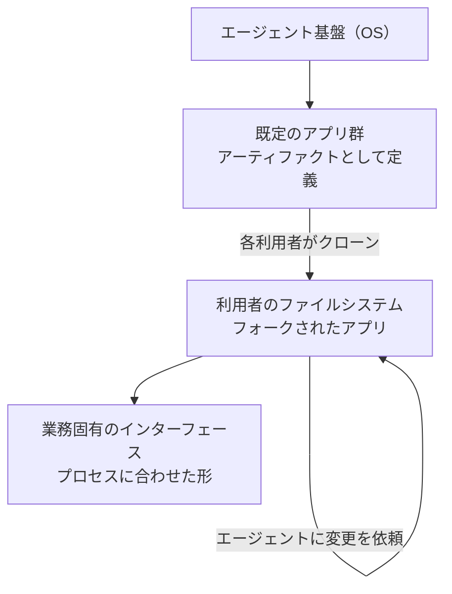

# アプリ＝フォークできるアーティファクトという考え方

## 1. 概要

エージェント基盤における「アプリ」の定義である。Replit のような開発環境、Claude Artifacts のような生成物、ChatGPT Apps や埋め込みウィジェットは別カテゴリではなく、1つの「アプリ」という概念に収束する、とする。そのアプリとは、利用者のファイルシステムの中にあり、利用者がフォークして自分の業務に合わせて変えられるものを指す。John Suh の「Agent platform of 2027」が提示した考え方で、垂直 SaaS の前提への批判と対になっている。

## 2. 基本概念

- **アプリ＝アーティファクト**：インターフェースはすべて、基盤の中のファイルとして存在するアプリである。会話一覧のような基盤自身の画面でさえ、1つのアーティファクトとして定義される。各利用者はコードベースの「クローン」を自分のファイルシステムに持ち、拡張・変更できる。OS が既定のアプリを同梱する姿に似る。
- **表現形式は二次的**：生成 UI（部品を JSON で表す）、HTML 混じりの専用 DSL、専用ランタイム形式など、表現の方式は複数ありうるが、基盤が「アプリ」という概念の下で全部を支えるなら、どの表現かは本質ではなくなる。
- **カスタマイズ性の所在**：汎用 OS の上にエージェントOSを重ねる理由は、その上のアプリケーション層のカスタマイズ性と拡張性にある。基盤の価値は、共通機能の提供ではなく、利用者ごとの違いを吸収できることから生まれる。

## 3. 詳細解説

この考え方の核心は、垂直 SaaS の前提への疑いである。垂直 SaaS は「同じ業界の会社は業務が十分に似ているから、共通の画面や表現方法が正当化できる」という前提で成り立つ。しかし実際には、たとえば税務書類のレビューひとつを取っても、「レビューする対象」という名詞は共通でも、情報を評価し理解するプロセスは各社固有である。

優れた垂直 SaaS が、結局は設定可能なプラットフォームへ進化し、社内外のセールスエンジニアやコンサルタントが各社向けの設定を担ってきた事実は、この前提の綻びを示す。合わせ作業がどうしても要るなら、その作業を担うのは人間の導入チームではなく、指示を受けたエージェントであるべきだ、というのが帰結である。利用者は、自分のエージェントにアプリの変更を直接頼めるようになる。

アプリの入れ物（コンテナ）の形は1つに定まらない。tmux 的な画面、メッセージに埋め込まれたアプリ、チャットを脇に置くアプリ中心の画面、無限キャンバス、層状ウィンドウの固定キャンバス、固定寸法のパネルなどが併存し、アプリ自体が別のアプリの入れ物にもなる。

## 4. 仕組み・構造

## 5. メリット・デメリット

メリット：

- 業務プロセスの違いを、ベンダーの開発待ちではなく、利用者側の変更で吸収できる。
- アプリがファイルとして存在するため、バージョン管理や差分の確認が、通常のコードと同じ作法でできる。
- 基盤側は「アプリの概念と入れ物」を支えることに集中でき、個別業務の実装を持たずに済む。

デメリット・注意点：

- 利用者ごとにフォークが分かれると、基盤側の更新を各フォークへどう届けるか（アップグレードパス）が問題になる。
- 変更をエージェントに任せる前提では、変更の検証と巻き戻しの仕組みが要る。壊れたフォークを利用者が自力で直せるとは限らない。
- 「業務は各社固有」という前提が強い領域（会計事務所の例）と、実際に共通化が効く領域の見極めは残る。前提を一般化しすぎると、共通化の利益を捨てることになる。

## 6. 活用例

- 個人の道具作りに縮小して適用できる。自分用の小さなアプリやページを、使いながらエージェントに直させていく運用は、「フォークできるアプリ＋エージェントによる変更」の最小形である。
- 製品評価の観点になる。その製品の画面や機能が、利用者の側でどこまで変えられるか（設定項目の多さではなく、定義そのものを触れるか）を見る。
- 垂直 SaaS の導入判断で、「共通の業務フローに自社を合わせる」コストと、「自社のプロセスに合わせて変える」選択肢の有無を比べる材料になる。

## 7. 関連する知識

- [エージェントプラットフォームの設計図：8つの構成要素](agent-platform-blueprint.md) — 本考え方を含む全体の設計図。アプリはファイルシステム要素と結びついている
- [セッションと会話の分離と承認インボックス](session-conversation-separation.md) — 会話の画面自体もアプリとして定義される、という点で関連する

## 8. 参照した情報源

- [Agent platform of 2027（John Suh の X ポスト）](../../sources/social/x/2026-11-22-agent-platform-of-2027.md)
