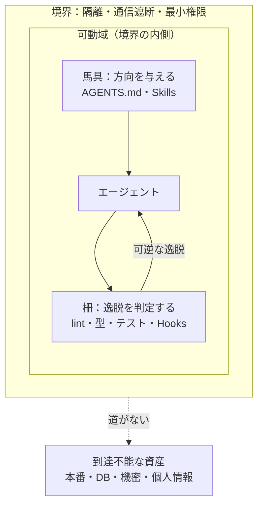

# 境界とセキュリティ

## 1. 概要

AIエージェントの環境設計には、馬具（方向を与える）と柵（逸脱を判定する）の外側に、境界という第3の層がある。境界は、エージェントが触れる範囲（可動域）を決める層であり、隔離、通信遮断、最小権限によって、危険な対象への到達自体を無くす。判定するのではなく、道を作らないことが原理である。

境界が必要なのは、柵は漏れることがあり、漏れた先に取り返しのつかない事故があるためである。可逆な逸脱は柵で拾ってフィードバック・ループに戻し、不可逆な逸脱は境界で試行そのものを無くす、という使い分けが要点になる。

セキュリティの観点では、自律性を上げるほどエージェント自体が攻撃の入口になる。危険が最大化する条件は、機密データへのアクセス、不審コンテンツの読み取り、外部への送信の3つがそろうこと（lethal trifecta）であり、この3つを同時に許さないことが設計の要点である。

この知識は、木下雄一朗のスライド「ハーネス設計入門」の第2部のうち、3層の役割とセキュリティの節をもとに整理したものである。

## 2. 基本概念

- **境界（Boundaries）**：エージェントの可動域を決める層である。壁の内側だけに道を作り、外の資産へは道を作らない。
- **可動域**：エージェントが到達できる範囲である。境界の内側が可動域になる。
- **隔離**：コンテナやサンドボックスなどで、作業環境を本番や機密から切り離すことである。
- **通信遮断**：外部への経路を断ち、情報の持ち出しや外部からの到達を防ぐことである。
- **最小権限**：作業に必要な範囲だけの権限を与え、それ以外は与えない原則である。
- **不可逆な逸脱**：起きてしまったら取り返しがつかない逸脱である。本番データの破壊、機密の外部送信などが該当する。
- **間接プロンプトインジェクション**：外部コンテンツに紛れた指示に、エージェントが従ってしまう攻撃である。
- **lethal trifecta（致命的な三要素）**：Simon Willison が提示した、AIエージェントの危険が最大化する3条件の組み合わせである。機密データへのアクセス、不審コンテンツの読み取り、外部への送信を指す。

## 3. 詳細解説

### 3層の役割分担

ハーネス設計の3層は、問いと性質が異なる。

| 層 | 役割 | 問い | 性質 |
| --- | --- | --- | --- |
| 馬具（ハーネス） | 方向を与える | どう走るか | 指示する。効き目は確率的 |
| 柵（ガードレール） | 判定する | 道から外れていないか | 機械的に Yes / No を判定する |
| 境界 | 可動域を決める | 触れられるか | 構造的・事前。到達自体を無くす |

馬具と柵は境界の内側で働く。境界の外には、本番、データベース、機密、個人情報といった資産を置き、そこへ通じる道を作らない。

柵と境界の違いは決定的である。柵は道の端で逸脱を検知する仕組みであり、検知には漏れがありうる。境界は、戻れない場所への道を最初から作らない仕組みであり、そもそも試行が起きない。したがって、逸脱の性質で使い分ける。可逆な逸脱（テストが落ちる、規約に反するなど）は柵で拾い、フィードバック・ループに戻して直させる。不可逆な逸脱（本番の破壊、機密の送信など）は境界で不可能にする。

### セキュリティ：任せるほど、守りが要る

自律性を上げるほど、エージェント自体が攻撃の入口になる。資料では、次の4つの危険が挙げられる。

1. **間接プロンプトインジェクション**：外部コンテンツに紛れた指示に従ってしまう。
2. **機密・個人情報の漏洩**：認証情報や顧客データを読ませないことが対策になる。
3. **破壊的操作**：rm や force push を、実行できなくする。
4. **サプライチェーン**：提案された依存パッケージは、人が確認する。

危険が最大化するのは、機密データへのアクセス × 不審コンテンツの読み取り × 外部への送信、の3つが同時に許されたときである。これは Simon Willison の lethal trifecta（2025-06-16）として出典が示されている。たとえば、機密を読めるエージェントが、攻撃者の指示を含む外部コンテンツを読み、その内容を外部へ送信できる状態がそろうと、攻撃が成立する。どれか1つでも欠ければ、攻撃の連鎖は断ち切れる。

守りも仕組みで作るものとされ、組み合わせは、行動への柵（危険な実行を事前に止める）× 隔離（サンドボックス）× 信頼境界（審査済み Skill・Plugin のみを使う）である。人の注意力に依存せず、構造で守るという点で、境界の考え方と一貫している。

## 4. 仕組み・構造

3層の配置を示す。

- 境界の内側では、馬具が方向を与え、柵が逸脱を判定し、可逆な逸脱はループに戻る。
- 境界の外の資産には道がないため、エージェントの判断ミスや外部からの指示注入があっても、到達そのものが起きない。

## 5. メリット・デメリット

メリット：

- 不可逆な事故を、検知の精度に依存せず構造的に防げる。
- 可逆／不可逆で対策を分けるため、守りのコストを危険の大きさに比例させられる。
- lethal trifecta のように、危険の条件を組み合わせで捉えることで、抜け道の設計漏れに気づきやすい。

デメリット：

- 隔離や権限分離の整備には手間がかかり、利便性（すぐ本番を確認できる等）とのトレードオフがある。
- 境界を強くしすぎると、正当な作業まで届かなくなり、迂回（権限の安易な追加）を招くことがある。
- 境界は事前の構造設計であるため、後から用途が広がったときに、可動域の見直しを怠ると穴になる。

## 6. 活用例

- エージェントの作業をサンドボックスやクラウド環境で行い、本番の認証情報を渡さない。
- 機密データに触れるタスクと、外部コンテンツを読むタスクと、外部送信を行うタスクを分離し、1つのエージェントに3要素を同時に持たせない。
- 危険なコマンド（rm、force push など）を Hooks や許可リストで実行前に止める。
- 導入する Skill や Plugin は審査済みのものに限り、信頼境界を明示する。
- 提案された依存パッケージの追加は、人が確認してから取り込む。

## 7. 関連する知識

- [ハーネスとガードレールの設計](harness-and-guardrail-design.md) — 境界の内側で働く馬具と柵の設計を整理した知識。行動への柵は本知識の境界と接続する。
- [ハーネスの定義と流派](harness-definitions-and-schools.md) — ハーネスの定義の範囲を整理した知識。
- [ハーネスの運用と寿命](harness-operations-and-lifespan.md) — 作業の順序で境界を最初に引く理由を含め、運用面を整理した知識。

## 8. 参照した情報源

- [ハーネス設計入門 〜 基礎知識の整理から実務へのステップアップ 〜](../../sources/technical/2026-09-24-harness-design-introduction.md) — 木下雄一朗（kinopee）によるスライド資料（2026-09-24、Findy 主催 Web セミナー）。3層の役割、境界の考え方、セキュリティと lethal trifecta の出典である。lethal trifecta は同資料が Simon Willison の記事（2025-06-16）を出典として示したものである。
