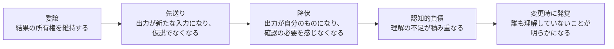

# 認知的降伏と認知的負債

## 1. 概要

AIエージェントに作業を任せると、人は便利さと引き換えに、自分の理解や判断を少しずつ手放していく。このファイルでは、その手放しを段階で捉える考え方と、手放した理解が借金のように積み重なる仕組みを、再利用可能な知識として整理する。

中心となる考え方は二つある。一つは、委譲の度合いを示すスペクトルである。作業を委ねながら結果の所有権を自分に残す段階、出力がそのまま次の入力になる段階、そして出力が自分のものになり確認の必要すら感じなくなる段階である。最後の段階が「認知的降伏」と呼ばれる状態である。

もう一つは、失われた理解が「認知的負債」や「理解の負債」として積み重なるという考え方である。借金という言葉が示すとおり、失われた理解はあとで返済が必要になる。変更や不具合が起きたときに、理解の不足がまとめて姿を現す。

この知識は、特定の記事の要約ではない。エージェントを使うあらゆる場面で、自分の思考をどこまで手放しているかを見直すための、概念と実践の枠組みである。

## 2. 基本概念

- **委譲**：作業を他者（ここではAIエージェント）に任せること。任せた側は、結果の責任や判断をどこまで残すかを決める必要がある。
- **認知的降伏（cognitive surrender）**：AIの出力がすっかり自分のものになり、確認の必要すら感じなくなる状態。Wharton の Steven Shaw と Gideon Nave による用語である。信頼や慣れが高まるにつれて、人は少しずつこの段階へ進む。
- **認知的負債（cognitive debt）**：AIに頼ることで自分の理解や思考力が少しずつ失われ、積み重なった状態を指す。Margaret-Anne Storey の共有システム理論の考え方では、チームで共有しているシステムについての理解が少しずつ浸食されていく。
- **理解の負債（comprehension debt）**：コードにおける認知的負債と同じ考え方で、Jeremy Twei による用語である。コードはきれいに見え、テストも通るが、誰もその仕組みを理解していない状態を指す。
- **所有権**：結果について、説明でき、判断でき、責任を持てる状態であること。委譲しても所有権が残っているかどうかが、段階を見分ける目安になる。

## 3. 詳細解説

委譲は「するか・しないか」の二択ではない。委譲の度合いは連続したスペクトルであり、人はその上を少しずつ移動する。移動が少しずつ進むため、どの段階にいるのかに気づきにくい。ここでは、スペクトルを三つの段階に分けて説明する。

最初の段階は、作業を委ねながらも結果の所有権を自分が持つ状態である。エージェントにコードを書かせても、人は何を作ったのか、なぜその作り方なのかを把握している。出力は自分の判断で受け入れたものであり、間違いがあれば自分で気づける。この段階では、委譲は効率を上げるための手段であり、思考は手放されていない。

次の段階は、エージェントの出力がそのまま次の作業の入力になる状態である。出力は検証される前に前提として使われ、仮説ではなくなる。人は出力の細部を追わなくなり、流れだけをなぞるようになる。前の段階では「出力は正しいかもしれない」という仮説だったものが、「出力は正しい」という前提に変わっている。ここが分かれ目である。

最後の段階は、出力がすっかり自分のものになる状態である。確認の必要すら感じなくなる。人は出力を疑わず、自分の判断として扱う。ここで起きているのが認知的降伏である。思考を委ねた結果、考えること自体を手放してしまう状態である。

この移動は、一段一段はどれも合理的に見える。前の回答はよく読んだから、次の回答はざっと見るだけにする。その次は骨格だけを確認する。そうしているうちに、ある行について聞かれて説明できなくなる。それが、降伏に気づく瞬間である。

認知的負債は、この移動の結果として積み重なる。理解の不足は、すぐには目に見えない。コードはきれいに見え、テストも通る。戦略文書の目次を読んで承認しただけでも、承認したこと自体は記録に残る。不足が明らかになるのは、システムに変更を加えようとしたとき、あるいは自分の頭の中にあるはずの心のモデルを当てはめようとしたときである。そのときに初めて、理解が存在しないことに気づく。

## 4. 仕組み・構造

委譲のスペクトルと、負債の蓄積の仕組みを図で示す。

この構造で重要なのは、段階の移動と負債の蓄積が、どちらも「気づきにくい」ことである。移動は少しずつ進み、負債は見えないまま積み重なる。だからこそ、段階を確認する仕組みを、作業の流れの中に組み込む必要がある。

一方で、すべてを自分で理解し直す必要はない。大規模なコードベースの全体像を常に頭の中に保つことはできない。目指すのは、全体像の常時保持ではなく、必要になったときに理解をオンデマンドで再構築できることである。どこに何があるか、どういう流れで動くか、どこを確認すればよいかが分かれば、理解は取り戻せる。ただし、そのためには「自分が何を持っていないか」を知っている必要がある。

委譲の判断は、リスクで分ける。低リスクの作業なら、全面的に委譲してよい。失敗しても影響が小さく、やり直しがきくからである。一方で、他者に影響する判断では、推論を手元に残す必要がある。結論だけを受け取るのではなく、なぜその結論になったのかを自分でたどれる状態を保つ。

## 5. メリット・デメリット

### メリット

- 委譲の度合いを段階で捉えることで、自分の思考をどこまで手放しているかを点検できる。
- 段階に名前があることで、チームで「今はどの段階か」を共有して話し合える。
- 全体像の常時保持を目指さず、オンデマンドでの再構築を目標にすることで、無理のない運用ができる。
- 低リスクの作業は全面的に委譲できるため、時間と注意力を重要な判断に集中できる。

### デメリット

- 段階の移動は少しずつ進むため、仕組みがないと気づくのが遅れる。
- 理解の不足は、変更や不具合が起きるまで目に見えない。
- 理解を再構築するには、どこを確認すればよいかを知っている必要があり、その手がかり自体を失うと再構築が難しくなる。
- 委譲の判断を毎回意識するには手間がかかり、忙しいときほど確認を省きやすい。

## 6. 活用例

- エージェントにコードを書かせたあと、変更箇所について「何を作ったのか、なぜその作り方なのか」を自分の言葉で説明してみる。説明できなければ、所有権が残っていない段階にいる。
- 依頼する前に、自分の仮説を立てておく。何が起きるはずか、どういう結果を期待するかを先に言葉にしておく。出力が仮説と違うときに気づける。
- 見落としがないか、意図的に死角を探す一手間を入れる。考えるのを助けてもらうのか、考えること自体を委譲するのか、その区別を意識する。
- 反対意見を聞く。自分の考えに沿う出力だけを受け取っていると、見落としに気づけない。反対の立場からの指摘で、判断の偏りを正す。
- 判断の基準として、保守する人の前で賭けられるかどうかを問う。その変更を実際に保守する人の前で、自分の判断として賭けることができるか。できないなら、理解が足りていないか、判断を委ねすぎている。
- 週に一度、エージェントなしでコードを書くなど、日常の実践で思考の筋力を保つ。月に一度、自分がやらなくなったことを書き出し、そのうちどれを手放してよいか、どれを取り戻すべきかを決める。
- 自分の頭の中にあるはずの心のモデルを、変更前に当てはめてみる。当てはまらなければ、理解の不足がある。不足がある場所を記録し、オンデマンドで再構築する手がかりにする。

## 7. 関連する知識

- [エージェント作業における検証の習慣](verification-for-agent-work.md) — 検証を習慣にすることで、委譲の段階が進みすぎないようにする知識。認知的降伏を防ぐための実践とつながる。

## 8. 参照した情報源

- [Critical thinking when agents do the work](../../sources/social/x/2026-11-03-critical-thinking-when-agents-do-the-work.md)
