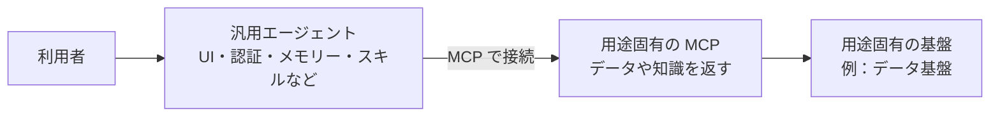

# 専用エージェントを自作せず、汎用エージェントと MCP で構成する判断

## 1. 概要

特定用途の AI エージェントを作るとき、エージェント全体を自作するのではなく、用途に固有な部分だけを MCP として切り出し、残りを汎用エージェント（Claude.ai など）に任せる、という構成の判断である。

根拠は、自作の守備範囲の広さにある。チャット UI で動くエージェントを自作すると、用途固有の処理のほかに、UI、認証基盤、セッション管理、メモリー、オーケストレーション、アセット管理、スキルシステムといった基盤部分まで賄う必要がある。これらは無くてもエージェントとしては成り立つが、普段使いの汎用エージェントと比べると物足りなくなり、一つひとつに注力すると用途固有の部分の品質に回す時間が減る。

この知識は、データ分析用途のエージェントをスクラッチで開発していた著者が、開発をやめて分析 MCP として作り直した経験をもとに整理したものである。著者の用途では、汎用エージェントに MCP を接続するだけで、基礎的なデータ分析を担うエージェントとして使える感触が得られている。

## 2. 基本概念

- **専用エージェント**：特定の用途（データ分析など）に絞って作られた AI エージェント。用途固有の処理だけでなく、動くための基盤も含めて一式を指す。
- **汎用エージェント**：Claude.ai、ChatGPT、Gemini のように、用途を限定せず広く使われる AI エージェント。UI、認証、メモリーなどの基盤が備え付けられている。
- **MCP（Model Context Protocol）**：AI アプリケーションが外部のデータやツールと接続するための仕組み。用途固有の部分だけを切り出して、汎用エージェントから使える形にするための接続点になる。
- **守備範囲**：自作する場合に、自分たちで賄わなければならない構成要素の広さ。フレームワークを使っても、基盤部分の多くは残る。
- **引き算**：エージェント全体を作るのではなく、本質的でない部分を汎用エージェントに任せ、自分たちが作る範囲を減らす考え方。元記事で、MCP への移行を表す言い方として使われている。

## 3. 詳細解説

### 自作すると何を賄うことになるか

元記事で挙げられている、自作エージェントで賄わなければならない領域は次のとおりである。

- UI
- 認証基盤
- セッション管理
- メモリー
- サブエージェントのオーケストレーションルール
- アセットのアップロード
- アップロードされたアセットの管理
- スキルシステム

著者は Google ADK（マルチエージェントシステムを構築・デプロイするためのフレームワーク）を使っていたが、それでもこれらの領域は自作する必要があった。フレームワークが肩代わりするのは一部であり、基盤全体が消えるわけではない。

問題は、これらが用途の本質ではないにもかかわらず、時間を使う点にある。すべてに注力するには時間がかかり、限られた時間で多くのものを作ろうとすると、一つひとつの品質は下がってしまう。

### MCP に切り出すと何が起きるか

著者は、事前集計されたデータを返したり、各データについての知識を的確に返したりする MCP として作り直した。汎用エージェントにこの MCP を接続すると、汎用エージェントが「分析エージェント化」した感覚が得られたという。

任せた側では、次のようなことが起きる。

- データ表示の UI は手放しでも改善されていく。たとえば Claude.ai は Artifacts でインタラクティブな可視化もしてくれる。
- 認証基盤、メモリー、アセット管理、スキルシステムは、普段使い慣れた仕組みをそのまま業務にも活用できる。
- 利用者は、普段使っている場所のまま、接続するだけで用途固有の機能を使えるようになる。

つまり、自作では自分たちが追いつく必要があった改善を、汎用エージェント側の進歩として受け取れるようになる。

### 移行のコストについて

元記事では、移行自体は難しくなかったとされている。コードの多くは自作エージェント時代のものを流用でき、リライトで整理整頓もできた。MCP のベースの FastMCP も、自作時に使っていた Google ADK も、ベースに FastAPI があるためコードが似通っており、ドメインモデルの面でも実装の面でも移行は難しくなかったという。

ただし、これは著者の技術選択がたまたま近かった面もある。移行コストは、元の実装と MCP 側の実装の近さによって変わる点には注意が必要である。

## 4. 仕組み・構造

判断の手順として整理すると、次のようになる。

1. 作ろうとしているエージェントの構成要素を洗い出し、用途固有の部分と、汎用エージェントがすでに備えている基盤部分に分ける。
2. 基盤部分を自作・維持するコストと、汎用エージェントに任せた場合に失うもの（細かな制御など）を比べる。
3. 用途固有の部分だけを MCP として切り出せるかを確かめる。
4. 切り出せるなら、汎用エージェントに接続する形で届ける。利用者が普段使っている場所に届くことも、採用の決め手になる。

## 5. メリット・デメリット

メリット：

- 作る範囲が用途固有の部分に絞られ、限られた時間を本質的な部分に使える。
- UI やメモリーなどの改善を、汎用エージェント側の進歩として手放しで受け取れる。
- 利用者は普段使い慣れた仕組み（認証、メモリー、アセット管理など）をそのまま使えるため、乗り換えの障壁が小さい。
- 普段使っている場所に届けられるため、使ってもらえる機会が生まれやすい。

デメリット・注意点：

- UI や基盤の細かな制御は、汎用エージェント側の仕様に委ねることになる。用途固有の体験を細部まで作り込みたい場合は、自作でなければ届かない部分が残る可能性がある。
- 汎用エージェント側の変更（機能や接続仕様の変化）の影響を受ける。
- 元記事は著者のデータ分析用途での経験であり、すべての用途で MCP 化だけで十分とは限らない。切り分けの判断は用途ごとに必要である。

## 6. 活用例

- **データ分析**：元記事の事例。事前集計されたデータを返し、データについての知識を返す分析 MCP を作り、Claude.ai のコネクタとしてチームに共有したところ、活用例がシェアされるなど、実際に使ってもらえた。
- **判断の物差しとしての活用**：新しい専用エージェントの企画時に、構成要素の一覧（UI、認証、セッション管理、メモリー、オーケストレーション、アセット管理、スキルシステム）を作り、「これは汎用エージェントがすでに持っていないか」と一つずつ問うことで、自作範囲を決める材料になる。

## 7. 関連する知識

- [エージェントのメモリー設計の難所](agent-memory-design-challenges.md) — 自作の守備範囲の中でも特に難しいメモリーについて、その難しさと、共有されないことの障壁を整理した知識。
- [分析エージェントの価値はデータ基盤で決まる](data-foundation-for-analysis-agents.md) — MCP に切り出した先で、本当に注力すべきだったデータ基盤について整理した知識。

## 8. 参照した情報源

- [自作AIエージェントの開発をやめた](../../sources/articles/2026-11-05-stopped-building-custom-ai-agent.md) — ブログ「無駄と文化」の記事（2026-11-05）。データ分析エージェントの自作をやめ、分析 MCP に作り直した経験の振り返り。
