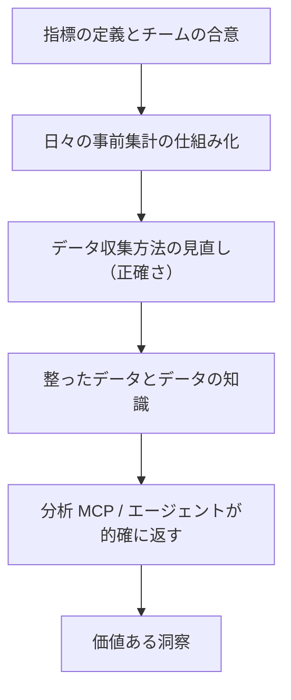

# 分析エージェントの価値はデータ基盤で決まる

## 1. 概要

データ分析を行う AI エージェントの出力の質は、エージェントそのものの作りよりも、その手前にあるデータ基盤で決まる、という知識である。

元記事の著者は当初、BigQuery の execute_sql ツールを AI に繋げば良い洞察が得られると考えていたが、実際には、工夫のないデータを渡すだけでは分かりきったことしか返ってこなかった。前進の感覚が得られたのは、注目すべき指標を定義してチームで合意したとき、その指標が日々事前集計されるよう仕組み化したとき、その指標が正確になるようデータの収集方法を見直したときであり、どれも AI 以前の工程だった。

つまり、有用な分析エージェントを作るためには、有用なデータ基盤が先に必要である。エージェント側の開発に注力する前に、指標とデータの整備に注力すべきだ、という順序の話である。

## 2. 基本概念

- **データ基盤**：分析に使うデータの収集、蓄積、集計の仕組み全体。元記事では、指標の定義、事前集計、収集方法の見直しがその中身として挙げられている。
- **指標の定義と合意**：注目すべき指標をしっかり定義し、チームで合意すること。何を見るべきかが定まっていないと、エージェントに渡すデータも定まらない。
- **事前集計**：注目すべき指標が日々集計されるよう、あらかじめ仕組み化しておくこと。エージェントがその都度生データを処理するのではなく、整った集計結果を受け取れる形にする。
- **データ収集の正確さ**：指標が正確になるよう、データの収集方法そのものを見直すこと。集計の土台となるデータが不正確なら、集計結果も洞察も不正確になる。
- **当たり前の洞察**：工夫のないデータを渡したときに AI が返す、分かりきった内容。元記事では「朝晩は電車が混むようです」「冬はおでんが売れるようです」が例として挙げられている。

## 3. 詳細解説

### ツールを繋ぐだけでは洞察は生まれない

著者の当初の見立ては、BigQuery の execute_sql ツールを AI に繋げば、良い感じの洞察を語ってくれるのではないか、というものだった。しかし、これは全然違った。

当たり前のデータを渡すだけでは、当たり前のことしか言わないのが AI である。何の工夫もしなければ、「朝晩は電車が混むようです」「冬はおでんが売れるようです」などの分かりきったことしか言わない、と著者は書いている。

ここで分かるのは、エージェントに道具（SQL を実行する手段）を与えることと、エージェントが価値ある洞察を返すことは、別の問題だということである。洞察の材料が整っていなければ、道具があっても材料不足のままである。

### 前進の感覚が得られた三つの工程

分析エージェントとして前進している感覚が得られたのは、次の三つのときだったとされている。

1. 注目するべき指標をしっかり定義し、チームで合意したとき
2. 注目するべき指標が日々事前集計されるよう仕組み化したとき
3. 注目するべき指標が正確になるようにデータの収集方法を見直したとき

一つ目は、人間側の合意形成である。何が重要な指標かは、データだけからは決まらず、チームで定義して合意する必要がある。二つ目は、集計の仕組み化である。指標が定まっても、その都度集計する形では安定して使えず、日々事前集計される形にして初めて、エージェントが安定して参照できる材料になる。三つ目は、土台の正確さである。集計の仕組みがあっても、集めるデータ自体が不正確なら、結果は正確にならない。

著者は、これらどれも AI 以前の工程であり、データ基盤として当たり前のことを地道にやる類の作業だったと振り返っている。そして、有用な分析エージェントを作るためには有用なデータ基盤が必要で、エージェントを作っている場合ではなかった、と結論づけている。

### エージェント開発との関係

この知識は、エージェント開発を否定するものではない。元記事の著者は最終的に、分析 MCP として作り直し、事前集計されたデータを返したり、各データについての知識を的確に返したりする形にしている。つまり、エージェント側（この場合は MCP 側）が担うのは、整ったデータ基盤の上に立ち、その材料を的確に返す部分であり、材料を整える部分はデータ基盤が担う、という分担である。

順序として重要なのは、データ基盤の整備が先、エージェントの作り込みが後だという点である。この順序を逆にすると、道具だけが揃って洞察が生まれない状態になりやすい。

## 4. 仕組み・構造

工程と、その工程が担うものを整理すると次のようになる。

| 工程 | 担うもの |
| --- | --- |
| 指標の定義と合意 | 何を見るべきかを決める（人間側の合意形成） |
| 事前集計の仕組み化 | 指標を日々、安定して参照できる材料にする |
| 収集方法の見直し | 材料そのものの正確さを保つ |
| エージェント / MCP | 整った材料を受け取り、的確に返し、考察する |

## 5. メリット・デメリット

この知識を実践に移す場合の整理である。

メリット：

- エージェントの出力の質のボトルネックが、エージェント側ではなくデータ側にあると早めに気づける。
- 指標の定義と合意は、エージェントのためだけでなく、チームの分析活動そのものの土台にもなる。
- 事前集計の仕組み化により、エージェントが参照する材料が安定し、回答の再現性も保ちやすくなる。

デメリット・注意点：

- データ基盤の整備は地道な作業であり、効果が見えるまでに時間がかかる場合がある。
- 元記事は著者の分析用途での経験にもとづく。分析以外の用途のエージェントに、同じ順序がそのまま当てはまるとは限らない。
- 指標の定義は一度で終わるものではなく、事業や関心の変化に応じて見直しが要る可能性がある。元記事では見直しの周期までは述べられていない。

## 6. 活用例

- **分析エージェント企画時の順序の確認**：分析エージェントや分析 MCP を作り始める前に、「注目すべき指標は定義され、チームで合意されているか」「その指標は日々事前集計されているか」「収集方法は正確か」を確認し、欠けているものがあれば、そちらを先に整える材料になる。
- **出力が浅い場合の切り分け**：エージェントの洞察が分かりきった内容にとどまる場合、エージェントのプロンプトやモデルを疑う前に、渡しているデータが「当たり前のデータ」のままになっていないかを確かめる観点になる。

## 7. 関連する知識

- [専用エージェントを自作せず、汎用エージェントと MCP で構成する判断](custom-agent-vs-general-agent-with-mcp.md) — データ基盤の上に立つ分析 MCP を、汎用エージェントに接続する構成の判断を整理した知識。

## 8. 参照した情報源

- [自作AIエージェントの開発をやめた](../../sources/articles/2026-11-05-stopped-building-custom-ai-agent.md) — ブログ「無駄と文化」の記事（2026-11-05）。「分析の手応えとデータ基盤」の節が、この知識の元になっている。
