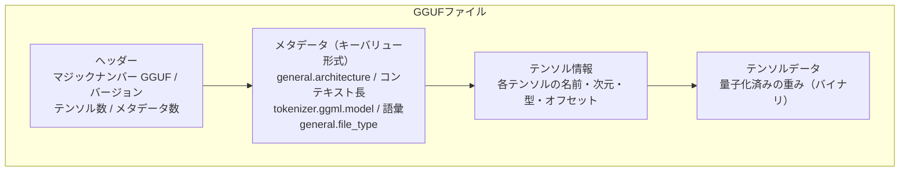

# GGUFフォーマットの構造と設計

## 1. 概要

GGUF（GGML Universal File Format）は、LLM 推論エンジン llama.cpp のネイティブなモデルファイル形式であり、量子化済みの重み・メタデータ・トークナイザーを1ファイルに自己完結させた設計が中核にある。ファイル1つで、追加の設定ファイルなしに推論を始められることが、他のモデル形式との最大の違いである。

GGUF は、前身の GGML 形式が抱えた「モデルのメタデータを柔軟に格納できず、新しいアーキテクチャに対応しにくい」という限界を解消するため、2023年8月に llama.cpp の作者 Georgi Gerganov 氏自身が設計した。設計目標は、自己完結性、キーバリュー形式のメタデータによる拡張性、アーキテクチャをメタデータに記録することによるポータビリティ、テンソルごとに異なる量子化を適用できる柔軟性の4つである。

## 2. 基本概念

- **GGUF**：llama.cpp のネイティブフォーマット。重み・メタデータ・トークナイザーを1ファイルに格納する。
- **GGML**：GGUF の前身の形式。メタデータ格納の拡張性に限界があり、GGUF に置き換えられた。
- **自己完結性**：モデルの実行に必要な情報（アーキテクチャ、コンテキスト長、トークナイザー語彙、量子化済みの重み）がすべて1ファイルに含まれる性質。
- **メタデータ（キーバリュー形式）**：`general.architecture` のようなキーで任意の情報を格納できる仕組み。新しいアーキテクチャや設定項目の追加に、形式自体を変えずに対応できる。
- **テンソル**：モデルの重みを格納する多次元配列。GGUF ではテンソルごとに名前・次元・型・オフセットが記録される。
- **トークナイザー**：テキストを数値列（トークン）に変換する仕組み。GGUF にはその語彙データも同梱される。
- **safetensors**：テンソルの保存に特化した形式。学習・ファインチューニング・配布が主用途で、GGUF とは補完関係にある。

## 3. 詳細解説

### なぜ「全部入り」なのか

モデルを実行するには、重みだけでは足りない。アーキテクチャの種類、コンテキスト長、トークナイザーの語彙といった情報がそろって初めて推論できる。safetensors のような保存特化の形式では、これらの情報は別ファイル（設定ファイルやトークナイザーファイル）に分かれている。GGUF はそれらをすべて1ファイルに束ねることで、「ファイルを受け取ればそのまま動く」状態を作る。これが、ローカルLLMの配布と実行の摩擦を大きく下げた。

### メタデータをキーバリュー形式にした意味

GGML の限界は、格納できるメタデータの形が固定されていたことにある。GGUF はキーバリュー形式を採用し、任意のキーで情報を追加できるようにした。これにより、新しいモデルアーキテクチャが登場しても、形式の根幹を変えることなく、必要なメタデータを追加して対応できる。拡張性を形式の中心に置いたことが、GGUF が多様なモデルの受け皿になれた理由である。

### safetensors との住み分け

両者は競合ではなく、工程ごとの役割分担である。safetensors は学習・ファインチューニング・HuggingFace Hub での配布を担い、量子化自体は別ツールが行う。GGUF はローカル推論・エッジデプロイを担い、量子化の仕組みを内蔵し、実行に必要なメタデータ全部を持つ。セキュリティ面では、どちらも実行コードを含まないため安全である。したがって、学習済みモデルは safetensors で配布し、ローカル推論には GGUF に変換して使う、という流れが主流のワークフローになっている。

## 4. 仕組み・構造

GGUF ファイルは、次の4セクションで構成される。

- **ヘッダー**：マジックナンバー「GGUF」、バージョン番号、テンソル数とメタデータ数を記録する。
- **メタデータ**：アーキテクチャ名、コンテキスト長、トークナイザーの種類と語彙、ファイルタイプなどをキーバリュー形式で格納する。ツール側はこれを読んで、アーキテクチャを自動判定し、実行に必要な設定を組み立てる。
- **テンソル情報**：各テンソルの名前、次元、型、データ領域へのオフセットを記録する。テンソルごとに型（量子化タイプ）を変えられることが、テンソル単位の量子化の基盤になっている。
- **テンソルデータ**：量子化済みの重みのバイナリ本体である。

## 5. メリット・デメリット

メリット：

- ファイル1つで推論を開始でき、配布と受け取りが単純になる。
- キーバリュー形式のメタデータにより、新しいアーキテクチャや設定への拡張が容易である。
- テンソルごとに量子化タイプを変えられ、品質とサイズの細かい調整ができる。
- 実行コードを含まないため、読み込み時の安全性が高い。
- Ollama、LM Studio、GPT4All など主要なローカルLLMツールが採用し、エコシステムが広い。

デメリット：

- 学習・ファインチューニングの用途には向かず、その工程では safetensors など別形式が必要になる。
- 実行環境は事実上 llama.cpp 系に寄っており、形式の普及は llama.cpp エコシステムと一体である。
- メタデータの自由度が高い反面、中身を理解せずに使うと、量子化タイプなどの選択根拠がブラックボックスになりやすい。

## 6. 活用例

- HuggingFace Hub で配布されたモデルを GGUF に変換し、個人の PC でローカル推論する。
- Ollama や LM Studio などのツールに GGUF ファイルを読み込ませ、追加設定なしでモデルを実行する。
- Python の `gguf` パッケージ（`GGUFReader`）でメタデータを読み取り、モデルのアーキテクチャやテンソル構成を確認する。
- 量子化タイプの異なる複数の GGUF を用意し、ハードウェアごとに使い分ける（量子化の選択自体は [LLMの量子化タイプの読み解きと選択](llm-quantization-types-and-selection.md) を参照）。

## 7. 関連する知識

- [LLMの量子化タイプの読み解きと選択](llm-quantization-types-and-selection.md) — GGUF に格納される重みの量子化タイプの命名規則と選択指針を整理した知識。
- [GGUFの実践ワークフロー（変換・量子化・実行）](gguf-practical-workflow.md) — モデルの変換から推論、API サーバー化までの手順を整理した知識。

## 8. 参照した情報源

- [GGUFってなんだ？〜ローカルLLMの「共通言語」を完全理解する〜](../../sources/technical/2026-02-22-gguf-llm-qiita.md) — GeneLab_999 による Qiita 記事（2026-02-22）。GGUF の背景、ファイル構造、設計目標、safetensors との比較の出典である。
