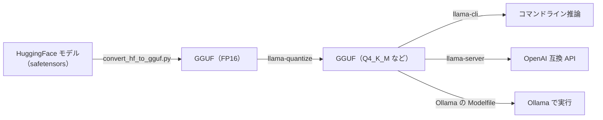

# GGUFの実践ワークフロー（変換・量子化・実行）

## 1. 概要

GGUF を実践で使う流れは、「変換（HuggingFace モデルを FP16 の GGUF にする）→ 量子化（目的のタイプに変換する）→ 推論（コマンドラインで実行する）→ API 化（OpenAI 互換サーバーとして公開する）」の4ステップで構成される。配布形式である safetensors から、推論形式である GGUF へ移す変換が起点になる（形式の役割分担は [GGUFフォーマットの構造と設計](gguf-format-structure.md) を参照）。

手軽さを求める場合は Ollama がこの流れを内部で肩代わりする。自分で変換パイプラインを持つと、量子化タイプや実行パラメータを細かく制御できる。本知識は、その手順と、環境別の設定の考え方、よくあるエラーへの対処を整理する。

## 2. 基本概念

- **llama.cpp**：GGUF の実行基盤となる C/C++ 実装の推論エンジン。ビルドには CMake を使う。Mac では brew でのインストールが簡単で、GPU 対応したい場合はソースからビルドする。
- **convert_hf_to_gguf.py**：llama.cpp に付属する変換スクリプト。HuggingFace のモデルを GGUF（まず FP16）に変換する。
- **llama-quantize**：FP16 の GGUF を、指定した量子化タイプ（Q4_K_M など）に変換するツール。
- **llama-cli**：GGUF モデルをコマンドラインで推論実行するツール。
- **llama-server**：GGUF モデルを OpenAI 互換 API サーバーとして起動するツール。既存の OpenAI SDK のコードの向き先を変えるだけでローカルLLMを使える。
- **GPU オフロード（-ngl）**：モデルの層のうち何層を GPU で処理するかの指定。多すぎると VRAM 不足になり、エラー時は値を減らして CPU と分担させる。
- **Ollama**：内部的に llama.cpp と GGUF を使う実行ツール。Modelfile でカスタム GGUF を取り込める。
- **環境別設定**：開発・本番・テストで、量子化タイプやコンテキスト長などの設定を分ける運用。開発は高品質（Q8_0）、本番はバランス（Q4_K_M）、テストは最軽量（Q4_0）という使い分けが典型である。

## 3. 詳細解説

### 4ステップの流れ

第1ステップは変換である。HuggingFace で配布されているモデル（safetensors 形式）を、`convert_hf_to_gguf.py` で FP16 の GGUF に変換する。いきなり量子化せず FP16 を中間形式にするのは、FP16 が量子化の起点として使い回せるためである。第2ステップで、`llama-quantize` に FP16 のファイルと量子化タイプを指定し、目的の GGUF を作る。量子化タイプの選び方は [LLMの量子化タイプの読み解きと選択](llm-quantization-types-and-selection.md) を参照する。第3ステップで、`llama-cli` にモデルとプロンプトを与えて推論を確認する。第4ステップで、`llama-server` を起動すると、そのモデルが OpenAI 互換 API として振る舞い、アプリケーションから透過的に利用できる。

### 環境構築と設定の考え方

llama.cpp の導入は、Mac では brew が最も簡単である。NVIDIA GPU を使う場合は、CUDA を有効にしてソースからビルドする。Windows では Visual Studio 2022 の C++ ビルドツールが必要になる。

実行設定は環境ごとに分けるのが実践的である。開発環境では CPU 実行・小さめのコンテキスト・高品質な量子化（Q8_0）で正確さを見て、本番環境では全層 GPU オフロード・長いコンテキスト・バランス型の量子化（Q4_K_M）で運用し、テスト環境では最小限のコンテキストと最軽量の量子化（Q4_0）で CI を回す、という分離である。設定を分けることで、品質の問題が量子化由来か設定由来かを切り分けやすくなる。

### Ollama という近道

コマンド一発で試したい場合は Ollama が向く。公開モデルはそのまま実行でき、自前の GGUF ファイルも、Modelfile に `FROM` でパスを指定して取り込める。変換や量子化の制御はできない代わりに、4ステップを意識せずに済む。自作パイプラインと Ollama は排他ではなく、「試すのは Ollama、細かく制御するなら自作」という使い分けが現実的である。

### メタデータの確認

GGUF の中身は、Python の `gguf` パッケージの `GGUFReader` で確認できる。メタデータの項目名と、テンソルの名前・形状・型を読み出せるため、変換結果の検証に使える。ただしトークナイザー語彙のような巨大なデータは表示から除かないと、出力が膨大になる。

## 4. 仕組み・構造

ワークフロー全体の流れは次のとおりである。

よくあるエラーと対処法は次のとおりである。

| エラー | 原因 | 対処法 |
| --- | --- | --- |
| `error: unknown model architecture` | llama.cpp が対応していないアーキテクチャ | llama.cpp を最新版に更新する。対応アーキテクチャは頻繁に追加される |
| `CUDA error: out of memory` | GPU オフロード層が多すぎる | `-ngl` の値を減らして CPU との分担を調整する |
| `failed to load model` | GGUF バージョンの不一致 | llama.cpp と GGUF ファイルのバージョンを合わせる。古い GGML ファイルは再変換が必要 |
| `token not found` | トークナイザーの不整合 | 変換元モデルの tokenizer_config.json を確認する |
| `cmake: command not found` | ビルドツール未インストール | apt や brew で cmake を入れる |
| Windows で `'cl' is not recognized` | MSVC が未設定 | Visual Studio Installer で「C++ によるデスクトップ開発」を追加する |

## 5. メリット・デメリット

自作パイプラインのメリット：

- 量子化タイプや推論パラメータを細かく制御できる。
- FP16 の中間形式を持てば、複数の量子化タイプを何度でも作り直せる。
- llama-server により、既存の OpenAI API 向けコードをほぼそのままローカルLLMに向けられる。

デメリット：

- ビルドや変換の手間がかかり、環境差異（OS、GPU、ドライバ）でつまずく箇所が多い。
- アーキテクチャ対応は llama.cpp の更新に依存し、新しいモデルではバージョン不一致のエラーが起きやすい。

Ollama のメリットは手軽さ、デメリットは変換・量子化の制御ができないことである。

## 6. 活用例

- 自分の GPU の VRAM に合わせて量子化タイプを選び、7B〜70B 級のモデルをローカルで動かす。
- llama-server を立て、OpenAI SDK を使う既存アプリケーションの向き先をローカルに切り替えて、API コストなしで開発・検証する。
- 開発・本番・テストで設定ファイルを分け、量子化タイプとコンテキスト長を使い分ける。
- 環境診断として、cmake、llama.cpp の各コマンド、Python の `gguf` パッケージ、GPU の有無を一括でチェックするスクリプトを用意し、構築時のつまずきを早期に見つける。

## 7. 関連する知識

- [GGUFフォーマットの構造と設計](gguf-format-structure.md) — 変換先である GGUF 形式の構造と、safetensors との役割分担を整理した知識。
- [LLMの量子化タイプの読み解きと選択](llm-quantization-types-and-selection.md) — 第2ステップで指定する量子化タイプの読み解きと、VRAM 別の選択指針を整理した知識。

## 8. 参照した情報源

- [GGUFってなんだ？〜ローカルLLMの「共通言語」を完全理解する〜](../../sources/technical/2026-02-22-gguf-llm-qiita.md) — GeneLab_999 による Qiita 記事（2026-02-22）。環境構築、変換・量子化・実行の手順、環境別設定、エラー対処、Ollama と llama-server のユースケースの出典である。
