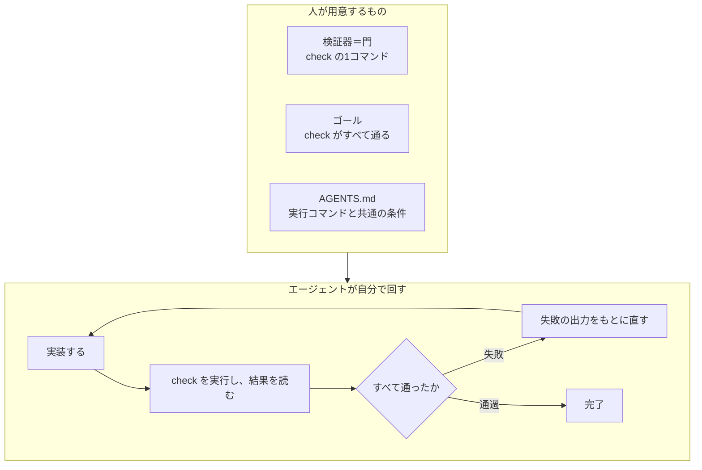

# ハーネスとガードレールの設計

## 1. 概要

AIエージェントの環境設計は、役割の違う2つの仕組みに分けられる。ハーネス（馬具）は、走り出す前に「どう走ってほしいか」を自然言語で伝える事前設計の層であり、内容は人間の判断で決まる「主観」の層である。ガードレール（柵）は、走った後に「道から外れていないか」を機械的に Yes / No で判定する「客観」の層である。

この区別の前提は、生成AIが確率で動くことである。同じ指示でも出力は毎回同じとは限らないため、指示だけに頼らず、環境と検証で受け止める。ハーネスで進路を示し、ガードレールで逸脱を検知し、検証器とゴール（check がすべて通ること）を渡してエージェント自身にフィードバック・ループを閉じさせる、というのが設計の骨格である。

この知識は、木下雄一朗のスライド「ハーネス設計入門」の第2部をもとに整理したものである。第3の層である境界については [境界とセキュリティ](boundaries-and-security-for-agents.md) を参照すること。

## 2. 基本概念

- **ハーネス（馬具）**：走り出す前に意図を伝える層である。プロジェクトの前提・規約・手順・禁止事項を、エージェントが参照できる形で明文化する。効き目は確率的であり、絶対ではない。
- **ガードレール（柵）**：走った後に逸脱を機械的に検証する層である。lint、型チェック、ビルド、テストなどで Yes / No を判定する。誰が実行しても結果は同じである。
- **AGENTS.md**：ハーネスの中心的な道具である。常時コンテキストに読み込まれるルールファイルで、1行ごとに「家賃」（コンテキストの占有コスト）がかかる。
- **Skills**：定型作業の手順書を切り出し、必要な場面でだけ読ませる仕組みである。常駐するルールと、オンデマンドの手順書を使い分ける。
- **サブエージェント**：役割を分けて委任する子エージェントである。文脈の分離が要点で、呼び出し方にはその場で作る方法と、定義して呼ぶ方法がある。
- **check コマンド**：フォーマッタ、リンター、型チェック、ビルド、テストを1つに束ねた検証コマンドである。人も AI も同じ門をくぐる形にする。
- **レール**：柵を自動で走らせる仕組みである。クライアント Hooks、Git hooks、CI の3本があり、外側ほど強制力が強い。
- **フィードバック・ループ**：エージェントが実装し、check を実行し、結果を読んで自分で直す循環である。人が用意するのは検証器（門）とゴールである。

## 3. 詳細解説

### 前提：生成AIは確率で動く

生成AIは1トークンごとに確率で次の語を選ぶため、小さな揺らぎが数千トークン分積み重なる。従来のプログラムが決定的（同じ入力 → 同じ出力）なのに対し、生成AIは確率的（同じ入力 → 分布からのサンプル）である。低確率の悪い選択もゼロではない以上、指示の質だけでは品質は担保できない。だから、事前の伝達（ハーネス）と事後の検証（ガードレール）の両方で受け止める設計になる。

### ハーネスの道具と書き方

事前に伝える道具は、適用範囲と深さで使い分ける。常時読み込まれるルール（AGENTS.md）、必要なときだけ読む手順書（Skills）、役割を分けて委任する仕組み（サブエージェント）という並びで、適用範囲は狭く・深くなる。

AGENTS.md の書き方の要点は、「何を書くかを選ぶのが設計」という点にある。ルールは毎回コンテキストに読み込まれるため、1行ごとに家賃がかかる。

書くこと：

- プロジェクト概要（1段落で。目的が分かると判断が揃う）
- コマンド（ビルド、テスト、lint。エージェントが自分で検証できるようになる）
- プロジェクト固有の規約・構成（命名、ディレクトリ、エラー処理の流儀）
- してはいけないこと（触ってはいけないファイル、変更禁止の API）

書かないこと：

- 一般常識や言語の一般的な作法（モデルはすでに知っている）
- コードを読めば分かること（実装と二重管理になり、すぐ食い違う）
- 長大な設計書の貼り付け（常時読むには重い。Skills や参照リンクへ逃がす）
- 守れているか検証できない精神論（「きれいに書く」は、機械的に判定できる形に直す）

運用の目安は、最初は最小限にし、全行が実際の失敗や規約に対応していることを基準にすることである。足りない分は、逸脱が出たら1行足して育てる。

Skills は、ルールに全部書くとコンテキストが溢れる問題への対処である。定型作業を手順書として切り出し、必要な場面でだけ読ませることで、常駐コンテキストを軽く保つ。

サブエージェントの呼び出し方は2系統ある。その場で作るオンデマンド生成は使い捨ての委任で、大量の調査・比較の並列化や、結果の要約だけ持ち帰りたい場面に向く。事前に定義して呼ぶ形は、役割・観点・出力形式をファイルに定義しておく育てて共有する委任で、レビューやセキュリティ監査のように毎回同じ観点で行う作業に向く。並列化は待ち時間を減らすが、同時に走る数だけ時間当たりのトークン消費は増える。定義ファイルは、サブエージェント用の AGENTS.md にあたる。

### ガードレールの階層

ガードレールはいずれも機械的に Yes / No を判定する仕組みで、検証する対象の深さが異なる。

| 段 | 検証する対象 | 役割 |
| --- | --- | --- |
| フォーマッタ | 表記 | 表記の統一。議論の余地なく自動修正できる |
| リンター | 表記〜作法 | バグの芽と規約違反を静的に検出する |
| 型チェック | 整合性 | データの流れの矛盾を実行前に検出する |
| ビルド | 成立 | 成果物として成り立つかの最低ラインを確認する |
| テスト | 振る舞い | 仕様どおり動くかを確認する |

対象は表記 → 整合性 → 振る舞いへと深くなり、右へ行くほど判定が強い。この5つを check の1コマンドに束ね、人も AI も同じ門をくぐる形にする。共通の完了条件は「check がすべて通ること」である。原則として、ガードレールが強いほど、エージェントは自分の失敗に気づけるため、任せられる範囲が広がる。

### 柵を走らせるレール

柵（判定の道具）とレール（柵を自動で走らせる仕組み）は別である。レールは3本あり、外側ほど強制力が強い。

| レール | 走る時点 | 強制力 | 特徴 |
| --- | --- | --- | --- |
| クライアント Hooks | 編集・実行の瞬間 | 弱い（設定で無効にできる） | 最速で柵を走らせる。行動への柵も兼ねる |
| Git hooks | コミット・push 時 | 中（`--no-verify` で抜けられる） | 人も AI も、コミットや push の前に同じ門をくぐる |
| CI | PR の作成・更新時 | 最大（抜けられない） | 手元ですり抜けてもここで捕まえる。ブランチ保護で失敗時はマージ不可にできる |

設計の構図は「内側で速く気づき、外側で確実に止める」であり、レールもハーネスの一部とされる。

### 柵は2種類ある

成果物への柵は、書いたものを事後に検証する。対象はコードで、問うことは「正しく作れたか」であり、失敗はフィードバック・ループの入力になる。作り込みの中心はこちらである。

行動への柵は、これからやることを事前にブロックする。対象は行為で、問うことは「実行してよいか」であり、Hooks や許可リストで、危険なコマンドの実行や外部送信を止める。起きる前に止めるしかない事故に使う。

どちらも、人の注意力に頼らず機械的に止める点では共通している。

### フィードバック・ループを閉じる

検証器とゴールを渡すと、エージェントは自分でループを閉じる。流れは、実装する → check を自分で実行して結果を読む → 失敗の出力をもとに自分で直す → 再実行する、という循環である。人が用意するものは、検証器としての門（check）と、ゴール（check がすべて通ること）である。実行コマンドと共通の条件は AGENTS.md に書き、タスク固有の条件はプロンプトで渡す。タスク固有の条件もテストにして check に入れれば、完了の判定を「check がすべて通る」に一本化できる。

## 4. 仕組み・構造

フィードバック・ループの構造を示す。

ハーネス（事前の伝達）が進路を与え、ガードレール（事後の判定）が逸脱を検知し、その判定結果がループの入力になって自己修正が回る。3つの要素は分離されているが、ループとしてつながることで初めて自走が成立する。

## 5. メリット・デメリット

メリット：

- 役割（伝える／判定する）を分けることで、問題が起きたときにどちらの層を直すべきか判断しやすい。
- 判定が機械的であるため、エージェントが人の介在なしに失敗へ気づいて直せる範囲が広がる。
- check への一本化により、人と AI の完了条件が一致し、確認の齟齬が減る。
- レールの多重化により、速さ（内側）と確実さ（外側）を両立できる。

デメリット：

- ハーネスの効き目は確率的であり、書いたからといって必ず守られるわけではない。柵との併用が前提になる。
- ルールを書きすぎるとコンテキストを圧迫し、かえって判断の質を落とす。選別と棚卸しが欠かせない。
- 柵の整備（テストや型の充実）には初期コストがかかり、弱い柵のままではループを閉じても品質は上がらない。
- 行動への柵や Hooks はクライアント依存の部分が大きく、環境が変わると効き方が変わる。

## 6. 活用例

- プロジェクトの AGENTS.md を最小限から始め、逸脱が起きるたびに、対応するルールを1行足して育てる。
- フォーマッタ、リンター、型チェック、ビルド、テストを `check` の1コマンドに束ね、完了条件を「check がすべて通る」に統一する。
- 定型的な作業手順（リリース手順、調査手順など）を Skills に切り出し、常駐ルールから外してコンテキストを軽くする。
- レビュー観点を定義ファイルに書き、サブエージェントに同じ観点で繰り返しレビューさせる。
- 危険なコマンドの実行をクライアント Hooks で止め、CI とブランチ保護で最終的に捕まえる多重化を行う。

## 7. 関連する知識

- [ハーネスの定義と流派](harness-definitions-and-schools.md) — ハーネスの定義の範囲と流派、語彙の収束を整理した知識。
- [境界とセキュリティ](boundaries-and-security-for-agents.md) — 馬具と柵の外側にある第3の層（境界）と、セキュリティの要点を整理した知識。
- [ハーネスの運用と寿命](harness-operations-and-lifespan.md) — 作業の順序、コスト、技術的負債としてのハーネスを整理した知識。
- [エージェント作業における検証の習慣](verification-for-agent-work.md) — 人の側の実践として、検証の定義を事前に決め、証拠を確認する習慣を整理した知識。環境側の設計であるハーネスとは補完関係にある。

## 8. 参照した情報源

- [ハーネス設計入門 〜 基礎知識の整理から実務へのステップアップ 〜](../../sources/technical/2026-09-24-harness-design-introduction.md) — 木下雄一朗（kinopee）によるスライド資料（2026-09-24、Findy 主催 Web セミナー）。第2部の前提、ハーネスとガードレールの区別、AGENTS.md の書き方、柵の階層とレール、フィードバック・ループの出典である。
