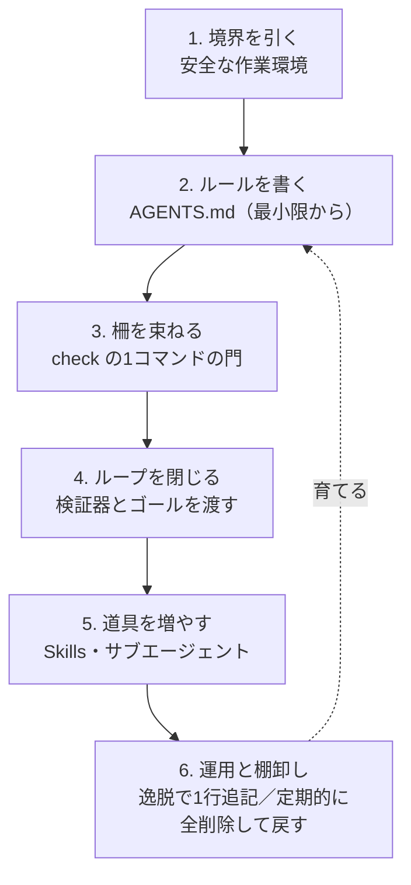

# ハーネスの運用と寿命

## 1. 概要

ハーネスは、作って終わりではなく、順序を守って導入し、運用で育て、寿命を見て棚卸しするものである。この知識では、木下雄一朗のスライド「ハーネス設計入門」の第2部の後半をもとに、作業の順序、コストとの関係、技術的負債としての寿命、まとめの4原則を整理する。

要点は3つある。第1に、導入の順序は「境界 → ルール → 柵 → ループ → 道具 → 運用と棚卸し」であり、逆順にやると効かないルールと使われない道具が積み上がる。第2に、自走時間の長さは成果ではなく、ハーネスの仕事はターン、リクエスト、トークンを減らして短く・少なく・安く終えることにある。第3に、モデルの弱点を補う作り込みは次世代モデルで溶けて消えるため、ハーネスは薄く軽く保ち、定期的に棚卸しする必要がある。

なお、コストに関する数値は、同資料が Uber の公開情報を引いて示したものであり、ここでは資料の記述として扱う。

## 2. 基本概念

- **作業の順序**：ハーネス導入の手順である。境界を引く、ルールを書く、柵を束ねる、ループを閉じる、道具を増やす、運用と棚卸し、の6段階である。
- **棚卸し**：蓄積したルールや作り込みを定期的に見直し、不要になったものを捨てる作業である。全削除して要るものだけ戻す方法が資料では示される。
- **コスト方程式**：総コストを、ユーザー数 × セッション/ユーザー × ターン/セッション × リクエスト/ターン × トークン/リクエスト × 単価/トークン の6項の掛け算で捉える考え方である。資料が Uber の事例として紹介したものである。
- **オーバーヘッド**：エージェントの動作にかかる余分なターン、リクエスト、トークンである。方程式の中央の3項が該当し、ハーネスで減らせる部分とされる。
- **隠れた技術的負債**：現行モデルの弱点を補うために作り込んだハーネスが、モデルの進化で不要になる性質を指す資料の表現である。
- **溶ける**：モデルの弱点を補う回避策や作り込みが、次世代モデルに吸収されて不要になることである。

## 3. 詳細解説

### 作業の順序

ハーネスエンジニアリングの手順は次の6段階である。

1. **境界を引く**：安全な作業環境を用意する。サンドボックスかクラウドエージェントで作業し、本番の認証情報は渡さない。
2. **ルールを書く（AGENTS.md）**：最小限から始める。全行が実際の失敗や規約に対応していることが基準である。AI に草案を書かせ、人間が削る進め方が示される。
3. **柵を立て、「1コマンドの門」に束ねる**：lint、型、テストを check に束ね、人も AI も同じ門をくぐる。
4. **ループを閉じる**：検証器とゴール（check がすべて通る）を渡し、エージェント自身に回させる。
5. **繰り返しが見えたら、道具を増やす**：繰り返す手順は Skills へ、観点はサブエージェントへ移す。
6. **運用で育て、定期的に棚卸しする**：逸脱が出たら1行追記する。数か月に一度は全削除し、要るものだけ戻す棚卸しを行う（Git 管理で安全に試せる）。

要点は「境界を先に引く。ルールより先に道具を増やさない」である。道具から先に増やすと、使われない道具と効かないルールが積み上がる。

### コスト：自走時間は目的ではない

自走は手段であり、目標は短く・少なく・安く終えることである。資料では Uber のコスト方程式が紹介される。6つの項のうち、ユーザー数やセッション数のような利用の広がりは「増えてよい項」であり、中央の3項（ターン、リクエスト、トークン）はエージェントのオーバーヘッドとして、ハーネスで減らす対象になる。

- **ターン**：計画を速くし、不要なターンやエラーを減らす。
- **リクエスト**：根拠づけ（社内情報のグラフなど）で、無駄な探索を減らす。
- **トークン**：常駐コンテキストを削る（MCP の CLI 化、キャッシュなど）。

資料が示す Uber の結果（2026年2月から8月）では、利用者が7倍、リクエストが9.4倍に増えた一方で総コストは横ばいであり、中央の3項が下がったことで、1,000リクエストあたりのコストは34%減、1セッションあたりは52%減（ピーク比、モデル固定）になったとされる。いちばん効いた手は、サブエージェントを安いモデルにすること、つまり方程式の右端の「単価」への手当てだったという。これらの数値は資料が Uber の公開情報を引いたものであり、ここでは資料の記述として記録する。「長く走ったことは、成果ではない」という一文がこの考え方を象徴している。

### ハーネスの寿命：隠れた技術的負債

作り込んだハーネスにも寿命がある。資料では「良いチームほど多くのハーネスを作る。その多くは次世代モデルで不要になる」という Han Lee の言葉（2026年）が引かれる。

溶けて消えるのは、現行モデルの弱点を補う部分である。「省略せずに全部出力して」「全部読んでから直して」のような注意書き、細かく刻んだ手順、独自のリトライ処理といった回避策や作り込みは、モデルが賢く・大きくなることでモデル側に吸収される。

一方で残るのは、テスト（check）、権限と境界、プロジェクト固有の規約である。これらはモデルの能力とは無関係に、そのプロジェクトにとって必要な決まりである。

したがって、ある時点の形に固執せず、薄く軽く保ち、定期的に棚卸しすることが結論になる。棚卸しでは、思い切って全削除し、要るものだけを戻すことで、本当に効いているルールだけが残る。

### まとめ：4原則

資料の結論は、ハーネスエンジニアリングの4原則である。

1. **戻れない場所に道を作らない**：本番・機密・個人情報・不可逆な操作は、到達できないようにする。隔離環境、通信遮断、最小権限で、境界を先に引く。
2. **進路はハーネスで示す**：規約、コマンド、禁止事項を明文化し、逸脱が出るたびに1行足す。書いたあとの運用が大事である。
3. **逸脱はガードレールで検知**：lint、型、テスト、Hooks を「1コマンドの門」に束ね、人も AI も同じ門をくぐる。判定は機械的に行う。
4. **ループを閉じて自走させる**：検証器とゴールを渡せば、エージェントが自分で直して完走する。その分、任せられる範囲が広がる。

## 4. 仕組み・構造

導入の順序と、各段階の依存関係を示す。

前の段階が土台になって次の段階が効く。境界がないまま自走させると事故の範囲が広がり、柵がないままループを閉じても自己修正の拠り所がない。順序そのものが設計である。

## 5. メリット・デメリット

メリット：

- 順序を守ることで、投資が無駄になりにくい（道具の先行投資や、効かないルールの蓄積を避けられる）。
- コストを方程式で捉えることで、削減の対象（ターン、リクエスト、トークン、単価）を具体的に議論できる。
- 棚卸しを前提にすることで、ハーネスを薄く保ち、モデル進化の恩恵を受け続けられる。

デメリット：

- 棚卸し（特に全削除して戻す方法）は心理的、運用的に負荷があり、Git 管理などの安全網が前提になる。
- 「溶ける」見極めを誤ると、まだ必要なルールまで捨ててしまい、同じ失敗を繰り返す。
- コストの最適化だけを追うと、検証の厚みなど品質側の投資が痩せるおそれがある。

## 6. 活用例

- 新しいプロジェクトでエージェントを導入するときに、まず作業環境の境界（サンドボックス、認証情報の分離）から用意する。
- AGENTS.md を最小限で始め、逸脱のたびに1行足す運用を、数か月ごとの棚卸しとセットで回す。
- 繰り返し発生する手順を Skills 化し、定型レビューを定義済みサブエージェントに寄せて、常駐コンテキストとターンを減らす。
- コストの議論を「自走時間の長さ」ではなく、ターン数、リクエスト数、トークン数の削減として行う。
- モデルを更新したタイミングで、弱点補完のための注意書きがまだ要るかを見直す。

## 7. 関連する知識

- [ハーネスとガードレールの設計](harness-and-guardrail-design.md) — 順序の各段階で作る対象（馬具、柵、ループ）の設計を整理した知識。
- [境界とセキュリティ](boundaries-and-security-for-agents.md) — 順序の最初に引く境界と、セキュリティの要点を整理した知識。
- [ハーネスの定義と流派](harness-definitions-and-schools.md) — ハーネスの定義の範囲と収束を整理した知識。

## 8. 参照した情報源

- [ハーネス設計入門 〜 基礎知識の整理から実務へのステップアップ 〜](../../sources/technical/2026-09-24-harness-design-introduction.md) — 木下雄一朗（kinopee）によるスライド資料（2026-09-24、Findy 主催 Web セミナー）。作業の順序、コスト方程式と Uber の事例（同資料が Uber の公開情報を引いたもの）、隠れた技術的負債、4原則の出典である。
