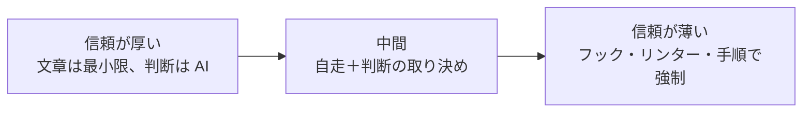

# AIへの信頼度で変わるハーネスの形（5つのOSSの比較）

## 1. 概要

AI コーディングエージェント向けのハーネス（指示ファイル、ルール、フック、スキル、権限設定などの一式）の形は、プロジェクトが AI の判断をどこまで信頼しているかで大きく変わる、という比較の枠組みである。

信頼するほど、ハーネスに書く量は減り、残りは AI の判断に任される。信頼しないほど、文章の指示に頼らず、フックやリンターといった機械的な仕組みで結果をそろえるようになる。

この知識は、松本 淳太郎が Zed・Sentry・OpenClaw・Bun・PostHog の5つの OSS の実ファイル（2026-10-16 時点）を読み比べた記事をもとに整理したものである。信頼の厚さの順序は、ハーネスの設計から読み取った著者の解釈であり、プロジェクトの規模や開発文化の影響もありうる点は、著者自身が断っている。

## 2. 基本概念

- **AI への信頼**：AI の判断にどこまで任せているか。この記事の比較軸である。
- **ハーネス**：コーディングエージェントがリポジトリで作業するときに従う仕組み一式。指示ファイル、ルール、スキル、フック、権限設定、AI による貢献のポリシーを含む。
- **書く量と縛り方**：信頼が厚い設計では、常時読み込まれる文章は少なく、判断は AI に残る。信頼が薄い設計では、文章の量というより、機械的な強制（フック、リンター、検証）の比重が増える。

## 3. 詳細解説

### 5つの OSS を信頼が厚い順に並べる

| 信頼 | OSS | 特徴 |
| --- | --- | --- |
| 最も厚い | Zed | AI がよく踏む罠だけを書き、細かい動き方は AI を信頼して任せている |
| 厚い | Sentry | ルートの AGENTS.md は短い索引にとどめ、何を読みに行くかは AI に任せている |
| 中間 | OpenClaw | AI を自走させる代わりに、破壊的な操作は必ず聞く、同じ失敗が2回続いたら手段を変える、といった約束を細かく決めている |
| やや薄い | Bun | 作業の大半は任せつつ、繰り返す間違いは文章で頼まず、フックで実行前に止めて正しいコマンドを返している |
| 最も薄い | PostHog | リンター、コミット時の検証、100本を超えるスキル、文章の4段で縛り、変更の中身ごとに使うスキルまで指定している |

### 信頼が厚い側：書く量を減らし、判断を残す

Zed は、AI はコードを読めば構造をつかめるとみなし、構造の説明（地図）は書かず、慣れていても踏む罠だけを書く。人間が握るのは、何を罠とするかの判断だけである。詳しくは [ルールは地図ではなく罠：新規ルールの3条件と索引型の構成](rules-as-traps-not-maps.md) を参照すること。

Sentry は、ルートの AGENTS.md を60行未満の索引に絞り、詳細は領域ごとの AGENTS.md と29本のスキルに分け、どれを読むかは AI が決める。任せているのは「読みに行く判断」である。

### 中間：自走させる代わりに、判断の仕方を取り決める

OpenClaw は、複数のエージェントを並行して自走させ、行動の判断まで任せる。その代わり、任せる判断と聞く判断の線引きや、失敗時の止まる条件を文章で細かく取り決めている。取り決めを守るかどうかは、まだ AI に委ねられている。詳しくは [エージェントを自走させる取り決め：任せる判断と聞く判断の線引き](agreements-for-autonomous-agents.md) を参照すること。

### 信頼が薄い側：機械で止め、手順でそろえる

Bun は、作業の大半は任せつつ、繰り返し起きる間違いだけは文章で頼むのをやめ、実行前に走るフックで止めて、正しいコマンドと理由を返す。フックは2つだけに絞られている。

PostHog は、文章で頼んだことは守られるとは限らないという前提で、規約を載せる順番を、リンター（CI とセット）、コミット時の検証、スキル、文章の指示の順に定めている。スキルは100本を超え、変更の中身ごとに使うスキルまで指定する。

### 設計への使い方

この枠組みの使い方は、自分のチームのハーネスを設計するときに、まず「AI の何を信頼し、何を信頼していないか」を言葉にすることである。その線引きが見えれば、どの OSS のやり方を借りるべきかが見えてくる。ハーネスエンジニアリングは、その線引きを仕組みに落とす作業だ、というのが元記事の結論である。

## 4. 仕組み・構造

信頼の置き方と、主に使う仕組みの対応は次のとおりである。

| 信頼の置き方 | 主な仕組み | 代表例 |
| --- | --- | --- |
| AI の読む力・判断を信頼する | 罠だけのルール、索引だけの指示ファイル | Zed、Sentry |
| 行動の判断まで任せるが、判断の仕方は決める | 文章による取り決め（線引きと止まる条件） | OpenClaw |
| 繰り返す間違いは信頼しない | 実行前に止めて正解を返すフック | Bun |
| 文章が守られることを信頼しない | リンター、コミット時の検証、大量のスキル | PostHog |

## 5. メリット・デメリット

この枠組みを使うメリット：

- ハーネスの設計の議論を、「何を書くか」の前に「何を信頼するか」の言葉にできる。具体的な仕組みの選択（ルール、スキル、フック、リンター）に出発点ができる。
- 他プロジェクトの事例を、規模や文化の違いを割り引いたうえで、自分たちの線引きに引き寄せて借りられる。

注意点：

- 信頼の厚さの順序は、元記事の著者がハーネスの設計から読み取った解釈である。プロジェクトの規模や開発文化の違いも影響しているはずだと、著者自身が断っている。
- 5事例は大規模な OSS のものである。小規模なプロジェクトにそのままの形で移せるとは限らず、とくに PostHog 型の大量のスキルは維持コストがかかる。
- 信頼は一枚岩ではない。対象（読む判断、行動の判断、コマンドの正確さなど）ごとに置き方が違う、というのが事例の示すところでもある。

## 6. 活用例

- **自分のリポジトリの棚卸し**：今あるルール、スキル、フックを並べ、「これは AI の何を信頼していないから置いているのか」を一つずつ言葉にしてみる。理由が言えないものは、Zed 型の基準（罠かどうか）で見直す材料になる。
- **新しい制約を足すときの置き場所の判断**：繰り返す間違いなら Bun 型のフック、領域の作法なら Sentry 型の領域ファイルとスキル、判断の線引きなら OpenClaw 型の取り決め、というように、間違いの種類から置き場所を選ぶ。

## 7. 関連する知識

- [ルールは地図ではなく罠：新規ルールの3条件と索引型の構成](rules-as-traps-not-maps.md) — 信頼が厚い側の代表である Zed と Sentry の、書く量を減らす具体策を整理した知識。
- [エージェントを自走させる取り決め：任せる判断と聞く判断の線引き](agreements-for-autonomous-agents.md) — 中間の OpenClaw の、判断の仕方を取り決める方法を整理した知識。
- [ハーネスとガードレールの設計](harness-and-guardrail-design.md) — ハーネス（事前の伝達）とガードレール（機械的な判定）の区別を整理した既存の知識。信頼が厚い設計は伝達に寄せ、薄い設計は判定に寄せる、という対応で読める。

## 8. 参照した情報源

- [ハーネスエンジニアリングを有名OSSはどう組んでいるのか？AIへの信頼で比べる5事例](../../sources/technical/2026-10-16-oss-ai-agent-harness-philosophy.md) — 松本 淳太郎（Gibberish Lab）の記事（2026-10-16）。5つの OSS の実ファイルを、AI への信頼の軸で読み比べたもの。
