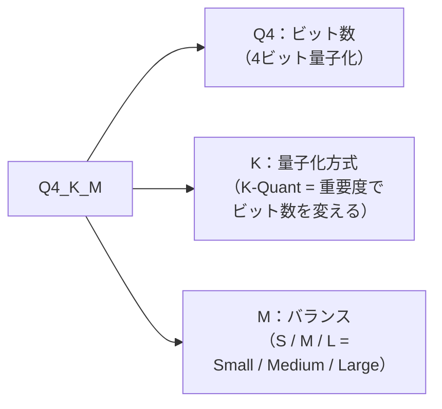

# LLMの量子化タイプの読み解きと選択

## 1. 概要

量子化（Quantization）は、LLM の重み（パラメータ）の精度を下げて、ファイルサイズとメモリ使用量を削減する技術である。ローカルLLMでは、モデルの品質と、自分のハードウェア（VRAM 容量）の兼ね合いを決める中心的な選択が、この量子化である。

GGUF の量子化タイプは `Q4_K_M` のような記号で表され、「ビット数・量子化方式・サイズと品質のバランス」の3要素に分解して読める。記号を読めるようになると、「人気のファイルを選ぶ」のではなく、「制約から逆算して選ぶ」ことができる。本知識は、その読み解きと選択指針を整理する。

## 2. 基本概念

- **量子化**：重みの精度を下げることでサイズとメモリ使用量を削減する技術。高解像度の写真を圧縮するようなもので、品質は多少落ちるがサイズは劇的に小さくなる。
- **ビット数とサイズ**：1パラメータあたりの容量は、float32 で4バイト、float16 で2バイト、int8 で1バイト、int4 で0.5バイトが目安である。7B モデルでは、float32 で約28GB、float16 で約14GB、int8 で約7GB、int4 で約3.5GB になる。
- **量子化タイプの記号**：先頭の `Q` と数字がビット数（Q4 なら4ビット）、`K` が K-Quant 方式、末尾の `S` / `M` / `L` がサイズと品質のバランス（Small / Medium / Large）を表す。
- **K-Quant**：テンソルの重要度に応じてビット数を変える量子化方式。重要なテンソルを高精度に保ち、そうでないものを低精度にする。
- **旧方式（一律量子化）**：Q4_0 のように、全テンソルを一律に同じビット数で量子化する方式。K-Quant より品質で劣るため、レガシーと位置づけられる。
- **F16**：量子化なしの16ビット浮動小数点。変換の中間形式や、品質の参照用に使われる。

## 3. 詳細解説

### 記号の読み解き

`Q4_K_M` を分解すると、4ビット量子化、K-Quant 方式、Medium（品質とサイズのバランス型）となる。代表的なタイプと7B モデルでのサイズ目安は次のとおりである。

| 量子化タイプ | ビット数 | 品質 | 7Bモデルサイズ | 用途 |
| --- | --- | --- | --- | --- |
| Q2_K | 2bit | 低 | 約2.7GB | 極限の省メモリ |
| Q3_K_S | 3bit | やや低 | 約3.2GB | メモリが厳しい環境 |
| Q4_0 | 4bit | 中 | 約3.8GB | レガシー。Q4_K_M を推奨 |
| Q4_K_M | 4bit | 中〜高 | 約4.1GB | 最も人気。バランス最良 |
| Q5_K_M | 5bit | 高 | 約5.0GB | 品質重視かつ省メモリ |
| Q6_K | 6bit | かなり高 | 約5.9GB | 品質重視 |
| Q8_0 | 8bit | 非常に高 | 約7.2GB | ほぼ無劣化。変換の中間形式にも |
| F16 | 16bit | 最高 | 約14GB | 量子化なし（参照用） |

迷った場合の標準的な選択は Q4_K_M である。品質とサイズのバランスが最も良く、コミュニティでも最も使われている。

### K-Quant が一律量子化より優れる理由

モデルのすべてのテンソルが同じだけ重要なわけではない。K-Quant は、テンソルの重要度に応じてビット数を変える。たとえば注意機構の重みは6ビットの高精度で保持し、FFN 層の重みは4ビットに落とす、といった配分を自動で行う。一律4ビットの旧方式（Q4_0）と同じ平均ビット数でも、重要な部分を守る分だけ品質が高い。これが、GGUF が「テンソルごとに異なる量子化を適用できる」設計（[GGUFフォーマットの構造と設計](gguf-format-structure.md) を参照）と組み合わさって効いてくる。

### 選択の考え方

選択は、品質の好みではなく、ハードウェア制約から逆算するのが基本である。モデルのファイルサイズが VRAM に収まることが実行の前提になるため、まず VRAM 容量で候補を絞り、その範囲で最も品質の高いタイプを選ぶ。CPU 推論の場合は、RAM 容量が同じ役割を果たす。

## 4. 仕組み・構造

量子化タイプの記号の構造は次のとおりである。

VRAM 容量別の選択指針（7B モデルを想定した目安）は次のとおりである。

| 環境 | 推奨タイプ | 理由 |
| --- | --- | --- |
| VRAM 4GB | Q3_K_S | 4GB では3ビット量子化がほぼ唯一の選択肢 |
| VRAM 8GB | Q4_K_M | 最も人気のバランス型。7B モデルが快適に動く |
| VRAM 16GB | Q6_K | 余裕があるなら品質重視。Q8_0 も選択可能 |
| VRAM 24GB以上 | Q8_0 | ほぼ無劣化。品質最優先なら F16 も |
| CPU のみ | Q4_K_M | CPU 推論でもバランスが良い。RAM 容量に注意 |

## 5. メリット・デメリット

量子化全般のメリット：

- 大きなモデルを個人のハードウェアで動かせるようになる（70B モデルが float16 の約140GB から、4ビット級では約35GB まで縮む）。
- ファイルサイズが小さくなり、配布と保存の負担が減る。
- メモリ使用量が減る分、コンテキスト長や同時実行に回せる余地が生まれる。

デメリット：

- ビット数を下げるほど品質は劣化する。特に2〜3ビット級では劣化が目立つ。
- タイプの種類が多く、記号の意味を知らないと選択の根拠を持てない。
- 同じモデルでも量子化タイプごとに別ファイルになるため、複数を使い分けると保存容量を消費する。

K-Quant のトレードオフとして、変換の仕組みは旧方式より複雑だが、得られる品質の利得が大きく、現在の標準になっている。

## 6. 活用例

- VRAM 8GB の GPU で 7B モデルを動かすために Q4_K_M を選ぶ。
- 品質評価の基準として Q8_0 や F16 を用意し、量子化による劣化の度合いを比較する。
- 開発環境では Q8_0 の高品質、本番環境では Q4_K_M のバランス、CI では最軽量の Q4_0、というように環境ごとに量子化タイプを使い分ける。
- モデルを選ぶ際、ダウンロードページの記号を見て、サイズと品質の位置づけを即座に判断する。

## 7. 関連する知識

- [GGUFフォーマットの構造と設計](gguf-format-structure.md) — 量子化済みの重みを格納する GGUF 形式そのものの構造と設計を整理した知識。
- [GGUFの実践ワークフロー（変換・量子化・実行）](gguf-practical-workflow.md) — `llama-quantize` による量子化を含む、変換から実行までの手順を整理した知識。

## 8. 参照した情報源

- [GGUFってなんだ？〜ローカルLLMの「共通言語」を完全理解する〜](../../sources/technical/2026-02-22-gguf-llm-qiita.md) — GeneLab_999 による Qiita 記事（2026-02-22）。量子化の基本、量子化タイプの解読表、K-Quant と旧方式の違い、VRAM 別の選択ガイドの出典である。
