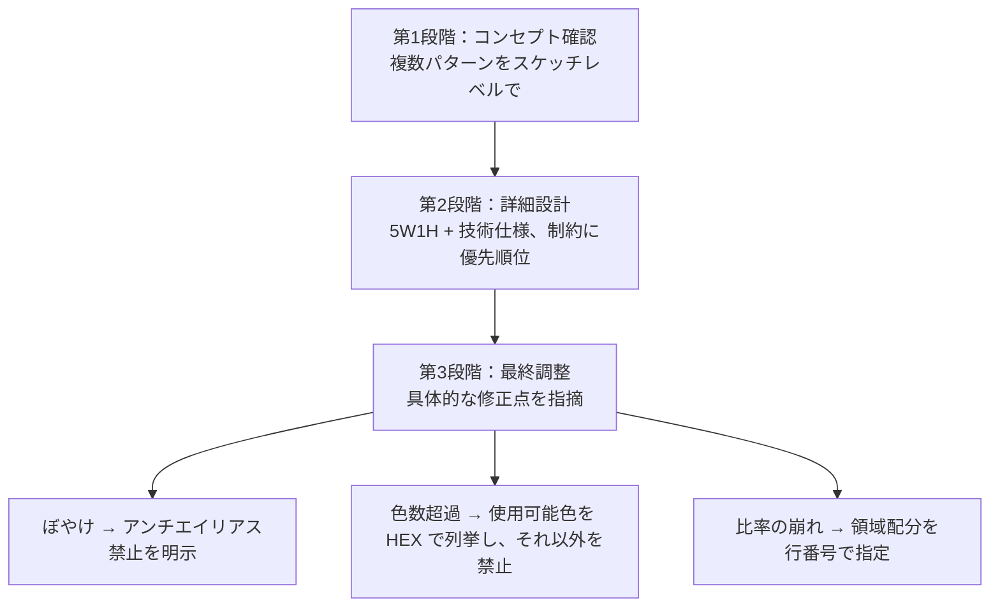

# ドット絵生成のプロンプト設計

## 1. 概要

生成AIにドット絵を作らせる際の、指示（プロンプト）の設計原則を整理した知識である。中心は3つの原則、すなわち、5W1H と技術仕様を明確に書くこと、コンセプト→詳細→調整と段階的に詳しくすること、制約条件に優先順位を付けること、である。

あわせて、生成で頻出する3つの問題（ぼやけ、色数の超過、比率の崩れ）について、原因と、指示側で打てる対処を対応付ける。いずれも「曖昧な指示が、AI の既定の振る舞いに負ける」という構造であり、対処は「禁止と数値で縛る」ことに集約される。

これらの原則はドット絵に限らず、生成AIへの指示一般に応用できる部分が大きい。特に、制約を列挙するだけでなく優先順位まで付ける点と、領域配分を行数で数値指定する点は、画像生成以外でも使える考え方である。

## 2. 基本概念

- **5W1H + 技術仕様**：What（何を）、Who（誰が使う）、When（いつ使う）、Where（どこで使う）、Why（なぜ作る）、How（どのように実現するか＝サイズ、色数などの技術仕様）をそろえて書く指示の枠組み。
- **段階的詳細化**：一度に完璧な指示を書くのではなく、コンセプト確認→詳細設計→最終調整の3段階で、生成と選択を繰り返しながら詰める進め方。
- **制約条件の優先順位**：ファイルサイズ、色数、視認性、デザイン性などの制約に「最優先」「優先」「重要」「希望」と順位を付け、制約が競合した場合の判断基準を先に渡すこと。
- **領域配分**：キャンバス内の要素配置を、行番号などの数値範囲で指定すること。例：32×32 で頭部は1〜12行目、胴体は13〜24行目、脚部は25〜32行目。
- **アンチエイリアス**：境界を滑らかに見せる中間色の処理。ドット絵ではぼやけの原因になる。

## 3. 詳細解説

### 原則1：5W1H + 技術仕様の明確化

指示には、作成対象の詳細（What）、使用者・対象者（Who）、使用場面（When）、使用媒体（Where）、作成目的（Why）に加えて、技術仕様（How：ピクセル数、色パレット、ファイル形式など）を書く。ドット絵では特に、サイズと色数が結果を大きく左右するため、技術仕様の欠落が失敗の主因になる。

### 原則2：段階的詳細化

進め方は3段階である。第1段階では、コンセプトデザインを複数パターン（例：異なる個性で3パターン）出させ、スケッチレベルで選ぶ。第2段階では、採用したパターンについて具体的な技術仕様を与えて詳細設計させる。第3段階では、完成品に対して具体的な修正点を指摘して最終調整する。一度で完璧を求めず、3〜4回の修正で品質を上げる前提で回す。

### 原則3：制約条件の優先順位明示

制約は列挙するだけでは不十分で、優先順位を付ける。記事の例では、ファイルサイズ10KB以下を最優先、色数最大8色を優先、16×16 でも判別可能な視認性を重要、可愛らしい印象を希望、と順位を付け、制約が競合する場合は優先順位に従って調整するよう指示している。順位があることで、AI が勝手に何を犠牲にするかを、指示側が制御できる。

### 問題1：生成されたドット絵がぼやけている

原因は、AI が自動的にアンチエイリアスを適用することだとされる。対処は、必須条件として次を明示することである。アンチエイリアス完全無効、シャープなピクセル境界、色混合一切なし、各ピクセルは単色で塗りつぶし。そして「ぼかし」「グラデーション」「滑らか」な処理を使わないことを重ねて指示し、レトロゲーム機（ファミコン、ゲームボーイ）と同じ表現方法だと例示する。

### 問題2：色数が指定より多くなってしまう

原因は、色指定が曖昧なことだとされる。対処は、使用可能色を HEX コードで列挙し（例：#000000、#FFFFFF、#FF0000、#00FF00、#0000FF）、それ以外の色の使用、色の濃淡調整、透明度の変更をすべて禁止することである。さらに、各ピクセルがどの色番号を使用しているかを、配置図とともに明記させることで、検証可能にする。

### 問題3：キャラクターの比率がおかしい

原因は、サイズ制約内での描画の優先順位が不明確なことだとされる。対処は、領域配分を数値で指定することである。記事の例では、32×32 ピクセル内で、頭部を上から1〜12行目（12ピクセル）、胴体を13〜24行目（12ピクセル）、脚部を25〜32行目（8ピクセル）とし、横幅はキャラクター本体を中央の24ピクセル幅、左右余白を各4ピクセルと指定している。

## 4. 仕組み・構造

段階的詳細化と、問題への対処の対応を図にすると、次のとおりである。

3つの問題はいずれも第3段階で発見されがちだが、対処の指定自体は第2段階の技術仕様にあらかじめ埋め込んでおくこともできる。問題が起きてから直すのではなく、既知の問題は仕様の段階で先回りして縛るのが、段階的詳細化の使い方である。

## 5. メリット・デメリット

### メリット

- **再現性が上がる**：技術仕様と制約を数値で縛ることで、生成ごとのばらつきが減り、同じ品質を繰り返し得やすくなる。
- **修正の焦点が定まる**：段階を分けることで、「コンセプトの問題か、仕様の問題か、調整の問題か」を切り分けて直せる。
- **競合時の判断を制御できる**：制約に優先順位を付けると、何を守り何を捨てるかをAI 任せにせずに済む。
- **問題への対処が定型化できる**：ぼやけ・色数・比率の3問題は、原因と対処の対応がはっきりしており、チェックリストとして使い回せる。

### デメリット・注意点

- **指示を書く手間が増える**：5W1H と技術仕様を毎回そろえるのは負担であり、小さな作品では割に合わない場合がある。
- **縛りすぎると表現が硬くなる**：色や配分を厳密に縛るほど、AI の側の工夫の余地は減る。視認性のような「守るべき制約」と、デザイン性のような「委ねたい制約」を分ける必要がある。
- **数値指定が正しいとは限らない**：領域配分の数値自体が不適切だと、そのまま比率の悪い結果が再現されてしまう。配分の妥当性は、生成物の評価で確かめるしかない。

## 6. 活用例

- **猫のキャラクター制作**：方法1のプロンプト例では、作成対象（可愛い猫の顔）、サイズ（16×16）、色数と色（4色：黒、白、オレンジ、ピンク）、スタイル（レトロゲーム風）、用途（SNS アイコン）、出力形式（記号と色の対応）をそろえて指定している。5W1H + 技術仕様の実例である。
- **ブランドロゴ**：業界、ターゲット層、ブランドカラー、キーワードに加え、32×32 ピクセル、背景透明、PNG 形式といった技術仕様を指定し、小さいサイズでも認識できることを要件にする。
- **ゲーム用スプライト**：役割（主人公／敵／NPC）、基本アクション、フレーム数（4フレーム）、各フレームのサイズ、統一パレットの使用を、キャラクター仕様と技術要件に分けて指定する。
- **プログラムで直接描く場合への応用**：プロンプトを介さず文字マップで直接描く場合でも、領域配分の考え方は使える。たとえば横向きの歩く猫では、頭・体・脚の行配分を先に決めてから描くことで、全体のバランスを崩さずに描き直せる。

## 7. 関連する知識

- [AIでドット絵を作る3つの方法](ai-pixel-art-generation-methods.md)：テキストアート、ASCII + 色指定、プログラムコード生成という、指示を受ける側の生成方法を整理した知識。本知識のプロンプト設計は、そのいずれの方法でも土台になる。

## 8. 参照した情報源

- [sources/articles/2025-08-05-chatgpt-pixel-art-guide.md](../../sources/articles/2025-08-05-chatgpt-pixel-art-guide.md)
