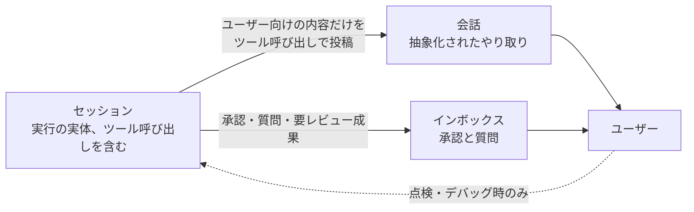

# セッションと会話の分離と承認インボックス

## 1. 概要

エージェント製品のユーザーインターフェースに関する設計原則である。エージェントの実行そのもの（セッション、中間のツール呼び出しを含む）をユーザーにそのまま見せる設計を誤りとし、ユーザーが触れる面は、セッションから抽象化された「会話」と、承認と質問に絞った「インボックス」であるべきだ、とする。John Suh の「Agent platform of 2027」が、エージェントプラットフォームの設計図の1要素として提示した。

## 2. 基本概念

- **セッション**：エージェントの実行の実体。ツール呼び出しや中間の試行錯誤を含む。コードベースに相当するもので、点検とデバッグのために開くことはあっても、主要な UI ではない。
- **会話**：ユーザー向けに抽象化されたやり取り。抽象度は Slack のチャンネルやメールスレッドと同水準が目安になる。ユーザー向けの内容は、セッションの発言をそのまま流すのではなく、ツール呼び出しを通じて「投稿」される形にする。
- **インボックス**：会話を読み通す代わりに、承認と質問だけが集まる受け箱。人間の対応が要る中間成果のレビューには、テナント（利用者）固有の小さいアプリを載せられる。

## 3. 詳細解説

セッション露出型の UI は、作り手にとっては実装が素直である。エージェントの発言とツール呼び出しをそのまま画面に出せばよいからである。しかし利用者にとっては、読むべきものと読まなくてよいものの区別がつかず、エージェントの作業量が増えるほど、利用者の確認の負担が比例して増える。エージェントの価値が「任せられること」にあるなら、UI は任せる範囲を広げる方向、つまり露出を減らす方向に進むはずだ、というのがこの原則の背景にある。

分離すると、セッション側は自由に試行錯誤でき、会話側は「利用者に届けるべき内容だけ」を編集して投稿できる。セッションへの直接アクセスは残すが、それは不具合の調査や監査のための「コードを読む」行為として位置づける。

インボックスは、この分離の帰結である。利用者の仕事は、会話の通読ではなく、承認するか、質問に答えるか、の判断に寄っていく。承認の単位で中間成果をレビューできるため、人間が関与する地点（human-in-the-loop）を、作業の流れの中に意図的に設計できる。

セッションを包むだけの製品（ADE）は、この移行に弱い。既存の成功した形（セッションの可視化そのものが価値だった段階）に適応しているため、抽象化への移行がイノベーターのジレンマになる、という予測もあわせて提示されている。

## 4. 仕組み・構造

## 5. メリット・デメリット

メリット：

- 利用者の確認負担が、エージェントの作業量に比例しなくなる。並行して多くのエージェントを動かす運用と相性がよい。
- 承認の地点が明示されるため、任せる範囲と人間が見る範囲の線引きを、UI の形で固定できる。
- セッション側の実装（ツールや中間表現）を、利用者向けの見た目に縛られずに変えられる。

デメリット・注意点：

- 抽象化の設計を誤ると、利用者が「何が起きているか分からない」状態になる。会話側に何を投稿するかの基準設計が要る。
- 承認が集中すると、インボックス自体がボトルネックになる。承認の粒度と、自動で進めてよい範囲の取り決めが前提になる。
- デバッグ時にはセッションを直接見る必要があり、二重の面を持つ分、実装と運用の部品は増える。

## 6. 活用例

- 個人向けエージェントでも同じ原則が使える。たとえば、長い作業の経過をすべてチャットに流すのではなく、結果と判断が要る点だけをカードや短い報告で届け、詳細は求められたときに開く形は、この分離の縮小版である。
- 承認カードの設計指針になる。承認は「会話の一部」ではなくインボックスの項目として扱い、何を・どこへ・どのデータで実行するのかを判断材料として揃える。
- 定期実行やイベント駆動のエージェントでは、報告先を会話ではなくインボックスに寄せることで、静かな実行と要対応の通知を分けられる。

## 7. 関連する知識

- [エージェントプラットフォームの設計図：8つの構成要素](agent-platform-blueprint.md) — 本原則を含む全体の設計図
- [エージェントを自走させる取り決め：任せる判断と聞く判断の線引き](agreements-for-autonomous-agents.md) — インボックスに何を上げるかは、この線引きと表裏一体である
- [エージェント作業の検証](verification-for-agent-work.md) — 中間成果のレビューをどう行うかという観点で関連する

## 8. 参照した情報源

- [Agent platform of 2027（John Suh の X ポスト）](../../sources/social/x/2026-11-22-agent-platform-of-2027.md)
