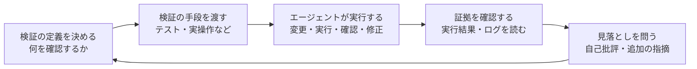

# エージェント作業における検証の習慣

## 1. 概要

エージェントに作業を任せると、作業のボトルネックは「書くこと」から「正しいことを確かめること」へ移る。エージェントはコードを書き、テストを作り、実行し、結果を読んで、人が見る前に何度もやり直すことができる。だからこそ、人が行うべき検証は、出力のすべてを一行ずつ読むことではなく、検証の仕組みを作り、その証拠を確認することになる。

このファイルでは、エージェントの作業に対する検証を、習慣として組み込むための知識を整理する。中心となる考え方は三つある。第一に、「検証済み」の定義を事前に決めること。第二に、緑のチェックは一つの性質しか示さないと知ること。第三に、完了の条件を、テストの通過やスクリーンショット、ログなどの具体的な形にしておくことである。

この知識は、特定の記事の要約ではない。エージェントと協働するあらゆる場面で、検証の質を保つための、仕組みと実践の枠組みである。

## 2. 基本概念

- **検証**：出力が正しいか、意図に沿っているか、副作用がないかを確かめる行為。テストの通過、目視の確認、ログや実行結果の確認などが含まれる。
- **検証の手段**：エージェントに渡す、確認のための仕組み。エンドツーエンドのテスト、プロパティテスト、実際のアプリ操作などが含まれる。エージェントはこれらの手段を使って、変更・実行・確認・修正の循環を回すことができる。
- **「検証済み」の定義**：何をもって確認できたとするのかを、事前に決めた基準。事後に決めると、どのような結果でも「確認できた」と解釈してしまう。
- **ゴム印化（rubber stamping）**：レビューが、内容の確認ではなく、形式的な承認になってしまう状態。量が多すぎると、人は細部を読まずに承認してしまう。
- **自己批評**：エージェントが、自分の作業を別の文脈から見直すこと。新しい文脈で見直すことで、元の作業では気づけなかった抜け漏れを見つけやすくなる。

## 3. 詳細解説

エージェントの作業では、検証の質が成果の質を決める。エージェントは、検証の手段さえ与えれば、変更を加え、検証を実行し、結果を読んで、修正を試みる、という循環を、人が見る前に回すことができる。人の役割は、その循環を回す仕組みを作り、循環の結果として出てきた証拠を確認することである。

ただし、検証そのものも委譲してしまうことがある。「結論を裏付ける証拠はあるか」という問いは、「チェックが緑になったか」という問いにすり替わりやすい。エージェントはテストを作るのも安くできるため、緑のチェックがたくさん並ぶ。しかし、緑のチェックは一つの性質しか示さない。壊れた機能を見逃すテストも、緑になる。テストが、機能と同じ間違いを含んで作られていれば、間違ったまま通ってしまう。緑のチェックが何を証明したのか、そして何を証明していないのかを、毎回問う必要がある。

そのため、「検証済み」の定義は、事前に決めておく。事後に決めると、どのような結果でも「確認できた」と解釈してしまう。定義を先に決めておくことで、確認の抜け漏れに気づける。定義には、確認する範囲と、確認しない範囲の両方を含める。確認しない範囲が分かれば、次に確認すべきことが見える。

完了の条件も、具体的な形にしておく。テストの通過、スクリーンショット、ログやトレースなど、事実として残るものが完了の条件である。「できているように見える」という印象ではなく、事実で完了を判断する。エージェントから完了の通知を受け取ったら、要約を読む前に、実行したコマンドとその出力を先に確認する。要約は、実行結果の解釈にすぎないからである。

自己批評も、検証の仕組みに組み込む。エージェントに、別の文脈から自分の作業を見直させることで、元の作業では気づけなかった抜け漏れを見つけやすくなる。最後に「見落としはないか」と問うだけでも、追加の指摘が出てくることがある。毎回行う仕組みにしておくことが大切で、思い出したときだけ行うのでは不十分である。

検証の深さは、場面によって変える。すべてを深く検証する必要はない。いつ深く掘るべきかを見極めることが、技術である。目安として、「チェックが見逃すものを言えないなら、簡単な承認ではなく、きちんとしたレビューを頼む」という基準がある。コード以外の場面でも同じで、たとえばエージェントがまとめた顧客の声や競合分析では、元の文書をいくつか確認し、結論を支える数字が正しく計算されているかを確かめる。

## 4. 仕組み・構造

検証を習慣にするための循環を図で示す。

この循環の要点は、人の作業が循環の「入口」と「出口」に集まることである。入口では、検証の定義と手段を決める。出口では、実行結果という証拠を確認し、見落としを問う。循環の中身はエージェントに任せられるが、入口と出口の判断は人に残る。

確認する証拠は、要約ではなく、実行そのものである。実行したコマンドとその出力、テストの結果、スクリーンショット、ログやトレースなど、事実として残るものを確認する。要約を読むのは、そのあとである。

## 5. メリット・デメリット

### メリット

- 検証の仕組みを作ることで、エージェントが人の確認を待たずに修正の循環を回せる。
- 「検証済み」の定義を事前に決めることで、確認の抜け漏れに気づける。
- 完了の条件を具体的な形にすることで、「できているように見える」という印象による判断を防げる。
- 自己批評を仕組みに組み込むことで、思い出したときだけ行う場合に比べて、抜け漏れを見つけやすくなる。
- 証拠を確認する習慣がつくことで、要約だけを読んで承認してしまうことを防げる。

### デメリット

- 検証の手段を作ること自体に手間がかかる。テストや確認の仕組みがない場合は、まずそこから作る必要がある。
- 緑のチェックが増えると、確認したつもりになりやすい。チェックの意味を毎回問う意識が必要である。
- 検証を深く行うと時間がかかるため、場面ごとに深さを変える判断が求められる。
- 自己批評も万能ではなく、見落としをすべて拾えるわけではない。最後の判断は人に残る。

## 6. 活用例

- エージェントに作業を頼む前に、「検証済み」の定義を書き出しておく。何を確認するのか、確認しない範囲はどこかを決める。
- エージェントに、検証の手段を渡す。エンドツーエンドのテスト、プロパティテスト、実際のアプリ操作など、確認の方法を作業の流れに組み込む。
- チェックが緑になったら、「何を証明したのか」「何を証明していないのか」を問う。緑のチェックは一つの性質しか示さないことを前提にする。
- 完了の条件を、テストの通過、スクリーンショット、ログやトレースなど、事実として残る形で決める。完了の通知を受け取ったら、要約を読む前に、実行したコマンドとその出力を先に確認する。
- 作業の最後に、エージェントに自己批評をさせる。別の文脈から見直させ、「見落としはないか」と問う。毎回行う仕組みにしておく。
- 600行のプルリクエストのような大きな変更では、エージェントに下した決定や前提を列挙させる。何を決めたのか、何を前提にしたのかが一覧になれば、レビューする人は要点を確認できる。
- 自分をクイズで試す。出力の内容について、自分に問いを立てて答えてみる。答えられなければ、理解が足りていない。長いセッションでは、変更についての報告書を書かせ、その最後にクイズを付け、完全に解けるまでマージしない、という運用もできる。
- 「チェックが見逃すものを言えないなら、簡単な承認ではなく、きちんとしたレビューを頼む」という基準を使う。コード以外のまとめでも、元の文書をいくつか確認し、結論を支える数字が正しく計算されているかを確かめる。
- 依頼する前に、自分の仮説を立てておく。何が起きるはずかを先に言葉にしておくことで、出力が仮説と違うときに気づける。仮説がないまま出力を受け取ると、出力がそのまま正解に見えてしまう。
- 反対意見を聞く。自分の考えに沿う出力だけを受け取っていると、見落としに気づけない。複数のモデルに反対の立場で議論させ、自分の意見を作る。
- 判断の基準として、保守する人の前で賭けられるかどうかを問う。その変更を実際に保守する人の前で、自分の判断として賭けることができるか。

## 7. 関連する知識

- [認知的降伏と認知的負債](cognitive-surrender-and-cognitive-debt.md) — 検証を習慣にすることで、委譲の段階が進みすぎないようにする知識。検証の仕組みは、認知的降伏を防ぐための実践とつながる。

## 8. 参照した情報源

- [Critical thinking when agents do the work](../../sources/social/x/2026-11-03-critical-thinking-when-agents-do-the-work.md)
