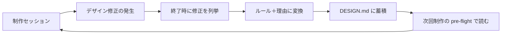

# デザイン修正をルールとして蓄積する

## 1. 概要

エージェントとの制作で受けたデザイン修正を、その場限りで終わらせず、理由つきのルールとして文書（DESIGN.md 等）に蓄積し、次の制作の前提にする方法である。Emil Kowalski の learn-taste スキルと、Hallmark の「ロックされた design.md を事前調査で読む」運用から抽出した。

## 2. 基本概念

- **learn-taste**：セッションの終わりに走らせるスキル。そのセッションで行われたデザイン修正（利用者自身の手直しを含む）をすべて集め、それぞれを「理由つきのルール」に変換して DESIGN.md に書き残す。
- **ロックされた design.md**：プロジェクトのデザイン判断の正本。Hallmark の pre-flight はこれを読み、勝手に変えない前提でビルドを始める。
- **ルール化の単位**：修正そのものではなく、「何を、なぜ変えたか」を1件のルールとして残す。理由がないルールは、次の場面で適用可否を判断できない。

## 3. 詳細解説

エージェントはセッションを跨ぐと、過去の修正を忘れる。同じ誤りを繰り返すたびに利用者が同じ修正を指示するのは、負担であり、品質のばらつきの元でもある。learn-taste の発想は、この繰り返しを断つために、修正の履歴を「次のエージェントが読む前提資料」に変換することである。

蓄積の流れは単純である。(1) セッション中にデザイン修正が起きる。(2) 終了時に修正を列挙する（エージェントへの指示だけでなく、利用者が自分で直した箇所も含む。自分で直した箇所は、言語化されていない好みの現れである）。(3) 各修正を「ルール＋理由」に書き換える。(4) DESIGN.md に追記し、次回の制作では pre-flight（着手前の読み込み）で参照する。

Hallmark の運用は、この蓄積を受け取る側の形を示している。ビルドの pre-flight でフォント、パレット、フレームワークとともにロックされた design.md を読み、既存の判断を前提として新しいページを作る。Impeccable（Hallmark の影響元の一つ）も、視覚システムを DESIGN.md に記録して次の機能や次のエージェントに渡す、という同じ方向の仕組みを持つとされる。

## 4. 仕組み・構造

## 5. メリット・デメリット

メリットは、修正のたびにエージェントの出力が利用者の好みに寄っていくこと、判断の理由が残るため新しい場面への転用が利くこと、プロジェクトを跨いでも（文書を持ち運べば）蓄積が効くことである。

デメリットは、ルールが増えすぎると文脈を圧迫し、古いルールが新しい意図と衝突することである。定期的な棚卸しと、覆されたルールの更新・削除が要る。また、理由の記録を省くとルールが形骸化する。

## 6. 活用例

- アプリのデザイン決定（ステージ寸法の式、スコアの軸など）を rationale 文書に残し、仕様変更のたびに更新する運用は、この方法の実例である。
- レビューで繰り返し同じ指摘（例：配色のくすみ、リンクの見せ方）をした場合、それをルール化してから次の制作に臨む。

## 7. 関連する知識

- [アニメーションと質感の判断基準](./animation-and-feel-decisions.md) — 蓄積されるルールの具体例（動きと質感の既定値）。
- [AI 生成 UI の slop サインと品質ゲート](./ai-slop-tells-and-quality-gates.md) — ゲートの Reflex 層（理由を記録すれば覆せる既定）は、ルール蓄積と相性のよい運用である。

## 8. 参照した情報源

- [Skills For Designers and Engineers（emilkowalski/skills）](../../sources/technical/2026-03-16-emil-kowalski-skills.md)
- [Hallmark ― AI 生成らしく見せないデザインスキル](../../sources/technical/2026-04-27-hallmark.md)
