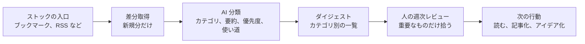

# ブックマークの自動キュレーション：分類と優先度付けをAIに任せる仕組み

## 1. 概要

ブックマークやリンクのストックが溜まる問題への対処として、ストックを「全部読む」対象ではなく「分類して優先度をつける」対象として扱い、その分類を AI に自動で任せる仕組みである。

問題の構造はこうである。保存は1クリックで安いため、ストックは週100件のペースでも増える。一方、それを1件ずつ開いて読む手動レビューは重く、習慣として続かない。結果として「後で読む」は「永遠に読まない」になる。

この仕組みの転換は、人が見る対象を、ストックそのものから、AI が分類・要約・優先度付けをしたダイジェストに変えることである。人はダイジェストをざっと見て、重要なものだけを拾う。分類の出力には、カテゴリと1行要約だけでなく、優先度と「そのストックが何の種になるか（使い道）」まで含めるのが要点で、ダイジェストがそのまま次の行動の候補リストになる。

実現の形は2つある。1つは自作のパイプライン型で、API で新規分を取得し、定期実行で AI に分類させ、Markdown ダイジェストとしてリポジトリに蓄積する（Zenn の記事の事例）。もう1つは製品型で、保存した瞬間に AI がタグ付けと要約を行い、検索で再発見できるようにする（Karakeep）。どちらも「分類を人の手から外す」という核は共通している。

## 2. 基本概念

- **キュレーション**：集まった情報に分類と優先度を付けて、後から見返して使える形に整えること。ここでは AI が担う処理を指す。
- **分類の出力形式**：AI 分類の結果の構造。カテゴリ、1行要約、優先度に加え、なぜ保存したかの推測と、コンテンツ化の可能性（使い道）を含める形が、事例では採られている。
- **ダイジェスト**：分類結果をカテゴリ別にまとめた Markdown などの文書。人が実際に目を通す対象は、ストックそのものではなくこちらである。
- **差分取得**：前回処理した最後の項目を状態として記録し、次回は新規分だけを取得・処理する方式。毎日回す仕組みでは、処理量とコストを新規分だけに抑えられる。
- **保存時の自動分類**：製品型の形。保存した瞬間に AI がタグ付けと要約を行い、整理という後工程そのものをなくす。
- **分類の調整（チューニング）**：分類の粒度や精度は、分類の指示（プロンプトや SKILL）を数回調整して安定させるもの、という運用の前提。

## 3. 詳細解説

### なぜ「読む」では破綻するのか

保存のコストと読むコストの非対称が、根本の原因である。保存は一瞬で済むため、ストックの増加ペースは人の処理ペースを簡単に超える。週100件のブックマークを1つずつ開いて読む週次レビューは、事例では3週間で挫折している。退屈で重い作業は、習慣にならない。

ここでの捉え直しは、ストックへの接し方を変えることである。全部を読むのではなく、分類して優先度をつける。優先度が付けば、人は上から少し見るだけで足りる。分類と優先度付けは、読解そのものより機械に任せやすい種類の作業である。

### 分類の出力に「使い道」を含める

事例の分類出力は、次の構造をしている。

- **category**：AI-Tools、Dev、Productivity、Business、News、Other のような固定のカテゴリ。
- **summary**：1行要約。
- **key_insight**：なぜブックマークしたかの推測。
- **content_potential**：blog、x-post、note、dev-idea、none のような、そのストックが何の種になるか。
- **priority**：high、medium、low。

要点は content_potential のような「使い道」の推定である。単なる分類だけでは、ダイジェストは整理された一覧で終わる。使い道まで付くと、ダイジェストは「次にやることの候補リスト」になる。事例では、このフラグが付いたブックマークから実際に2本の記事が生まれている。

### パイプライン型の構成

自作パイプライン型（Zenn の記事の事例）の構成は、次のとおりである。

1. **取得**：X API v2 の Bookmarks エンドポイントから、前回以降の新規分だけを取得する。差分の判定は、状態ファイルに記録した最新のブックマーク ID で行う（API が追加日時の降順で返すことを利用する）。
2. **分類**：Claude Code の SKILL が、各ブックマークを上記の出力形式で分類する。分類ロジックを SKILL として定義しておくことで、運用中の調整が容易になる。
3. **出力**：Markdown ダイジェストを生成し、Git リポジトリにコミットして蓄積する。実行は GitHub Actions の cron で毎日定時に行う。

ダイジェストの形式は、カテゴリ別に件数つきで並べ、各項目にタイトル、メトリクス（いいね数やブックマーク数）、使い道の注記を付け、末尾に注目のピックアップと統計を置く形である。

### 製品型：保存時の自動分類

製品型（Karakeep）の違いは、分類のタイミングである。パイプライン型が「貯まったものを定期的に捌く」のに対し、製品型は保存した瞬間に AI がタグ付け、分類、要約を行い、整理の後工程そのものをなくす。

製品型では、再発見の仕組みも一体になっている。保存したものすべてへの全文検索、意味で探すセマンティック検索、画像内の文字への OCR 検索が用意され、「分類が完璧でなくても、検索で拾える」ことが前提になっている。さらに、URL パターンなどの条件で自動的にタグ付けや振り分けを行う自動化ルールや、RSS フィードの自動取り込みのような、入口側の自動化も備える。

### 運用で安定させる

分類は、最初から安定するものではない。事例では、初回はカテゴリの粒度が荒く、分類の指示を4回調整して精度が安定した。分類ロジックを SKILL のような差し替え可能な定義として持つことが、この調整の前提になる。

効果として記録されているのは、「後で読む」が「週次レビューの素材」に変わったことである。人は週末にダイジェストをざっと見るだけで、重要なブックマークを見逃さなくなった。コストは、事例では分類1回あたり約0.02〜0.05ドル、月1〜2ドル程度とされている。

## 4. 仕組み・構造

パイプライン型と製品型の対比は次のとおりである。

| 観点 | パイプライン型（自作） | 製品型（Karakeep） |
| --- | --- | --- |
| 分類のタイミング | 定期実行（毎日など）でまとめて | 保存した瞬間 |
| 分類の置き場所 | SKILL など自分の定義 | 製品の AI タグ付け |
| 人が見るもの | Markdown ダイジェスト | タグと検索で引くストック |
| 再発見の手段 | ダイジェストと蓄積先の検索 | 全文検索、セマンティック検索、OCR |
| 調整の自由度 | 分類の指示を自分で直せる | 製品の範囲内（自動化ルールなど） |

## 5. メリット・デメリット

メリット：

- 人の作業が「全部を読む」から「ダイジェストをざっと見る」に変わり、ストックの量が増えても破綻しにくい。
- 優先度と使い道が付くため、ストックが次の行動（読む、書く、作る）の候補リストになる。
- 差分取得により、定期実行のコストは新規分だけに抑えられる。

デメリット・注意点：

- 入口の API に制約がある場合がある。事例では、Bookmarks API は有料プラン必須で、取得は最大800件までという上限があった。入口ごとに制約の確認が要る。
- 分類の品質は、指示の調整を前提とする。初回の分類をそのまま信用せず、数回の調整と見直しを見込む必要がある。
- AI の分類は、自分の分類体系とずれることがある。固定のカテゴリやタグの表記ルールを自分で持っている場合、その体系に寄せられるかどうかが設計の要点になる。

## 6. 活用例

- **X のブックマークの週次レビュー化**：事例そのものの形である。毎日自動で分類とダイジェスト生成を行い、週末にダイジェストだけを見て、重要なものと記事化の種を拾う。
- **他のストックへの転用**：入口を RSS や後で読むサービスに替えても、「新規分を取得し、AI が分類と優先度付けをし、ダイジェストで見返す」という形はそのまま使える。製品型を選ぶ場合は、保存時の自動タグ付けとセマンティック検索を持つ Karakeep のような製品が候補になる。

## 7. 関連する知識

- [読み物ストックの処理ワークフロー：トリアージ型・ショートリスト型・クラシック型](read-it-later-library-workflows.md) — 自動分類が「入口と仕分け」を担うのに対し、こちらは人がストックを捌く側の処理の型を整理した知識。自動キュレーションで優先度が付いたあとの読み方として、ショートリスト型の考え方がつながる。

## 8. 参照した情報源

- [X.comブックマークをGitHub Actions × Claude Codeで自動キュレーションする](../../sources/technical/2026-03-30-x-bookmark-curation-gha-claude-code.md) — amu_lab の Zenn 記事（2026-03-30）。パイプライン型の構成、分類の出力形式、運用結果の情報源。
- [Karakeep - The Bookmark Everything App](../../sources/other/2026-11-21-karakeep-bookmark-manager.md) — Karakeep 公式サイト。製品型の保存時の自動分類、検索、自動化ルールの情報源。
