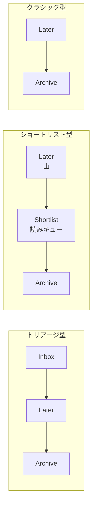

# 読み物ストックの処理ワークフロー：トリアージ型・ショートリスト型・クラシック型

## 1. 概要

後で読むために保存した文書やリンクのストックを、どの流れで捌くかという処理の型を、Readwise Reader の3つのライブラリ構成をもとに整理した知識である。

型は3つある。トリアージ型は、新しいものすべてを受信箱（Inbox）で受け、1件ずつ判断して、削除・アーカイブ・後で読む（Later）へ振り分ける型である。ショートリスト型は、新しいものをまず大きな山（Later）に受け入れ、山は山として認めたうえで、優先度の高いものだけを小さな読みキュー（Shortlist）に引き上げる型である。クラシック型は、後で読む（Later）とアーカイブ（Archive）の2か所だけで回す、最も単純な型である。

3つの型の違いは、「保存したものすべてに判断を通すかどうか」と「読む前の選別をどこでやるか」に集約される。保存量が判断量を超える読み手にはトリアージ型は破綻しやすく、ショートリスト型が受け皿になる。逆に保存量が少ない読み手には、ショートリスト型の2段構えは過剰で、クラシック型で足りる。

また、この知識にはもう一つの論点がある。処理の型は、固定するものではなく、切り替えられるものとして設計できる、という点である。Reader では構成をいつでも変更でき、文書は新しい型の適切な置き場所へ自動で移される。選択のコストが低いことが、自分の読み方に合う型を試して見つけることを可能にしている。

## 2. 基本概念

- **置き場所（ロケーション）**：ストックの中での文書の状態を表す場所。受信箱、後で読む、ショートリスト、アーカイブが基本の部品である。
- **トリアージ型**：受信箱 → 後で読む → アーカイブの流れ。全件に一度は判断を通すことを前提とする型。
- **ショートリスト型**：後で読む → ショートリスト → アーカイブの流れ。山から優先度の高いものだけを読みキューに引き上げる型。
- **クラシック型**：後で読む → アーカイブの流れ。仕分けの手順を最小化した型。
- **アンチライブラリ**：ショートリスト型における「後で読む」の位置づけ。「いつか読むかもしれないもの全部」を抱える、未読の山そのものを指す Readwise のガイドの言葉。
- **読みキュー（ショートリスト）**：実際に読む対象として選び抜かれた、小さな一覧。山とは別に保たれることが要点である。
- **目印（タグ）による横断**：置き場所を分けずに、タグで優先の目印を付ける方法。Reader では、トリアージ型でも shortlist タグによる既定ビューが用意され、置き場所を問わず優先分を横断して拾える。

## 3. 詳細解説

### トリアージ型：入口で全件に判断を通す

流れは Inbox → Later → Archive である。新しい文書はすべて Inbox に入り、1件ずつ処理される。処理とは、削除する、アーカイブする、後で読むために Later へ移す、のいずれかである。

この型の前提は、入ってくる量が、判断できる量の範囲内にあることである。「受信箱を空にする（inbox zero）」運用と相性がよく、生産性重視の読み手に向くとされる。裏を返せば、保存量が判断量を超えたとき、Inbox 自体が新しい未処理の山になり、型が破綻する。

### ショートリスト型：山を認め、選別だけを小さく保つ

流れは Later → Shortlist → Archive である。新しい文書は Later に入り、Later は「いつか読むかもしれないもの全部」を抱えるアンチライブラリとして働く。そこから優先度の高いものを Shortlist に昇格させ、Shortlist が実際の読みキューになる。

この型の発想は、山そのものを無くそうとしないことである。全件の判断は諦め、代わりに「読む直前の選別」だけを小さく確実に保つ。たくさん保存するが、一度に集中して読みたいのは少しだけ、という読み手に向く。分けるのは「必ず読む」ものと「読むかもしれない」ものである。

### クラシック型：仕分けを最小化する

流れは Later → Archive である。新しい文書は Later に入り、読み終えたら Archive に移して恒久保存と将来の参照に回す。置き場所は2つだけで、Instapaper や Pocket のような従来の後で読むアプリに似た、最も単純な型である。

この型は、仕分けの手順そのものを嫌う読み手に向く。処理の判断は「読んだかどうか」だけであり、優先度の管理はしない。その分、山の中からの再発見は、検索などの別の仕組みに委ねることになる。

### 型は切り替えられるものとして設計する

Readwise の設計で注目すべきは、3つの型が排他的な初期設定ではなく、いつでも切り替え可能な選択肢として用意されている点である。切り替えると、文書は新しい型の適切な置き場所へ自動で移される。移動が発生する変更では、事前に確認が出る。

整理の型の選択は、間違えると移行が面倒で固定化しがちである。自動移行があることで、「試して、合わなければ戻す」が現実的になる。長く使うストックでは、型そのものの良し悪しと同じくらい、型を変えられることが効く。

### 構造で分けるか、目印で分けるか

もう一つの論点は、優先の区別を「置き場所（構造）」でやるか、「タグ（目印）」でやるかである。Reader では、ショートリスト型の Shortlist は置き場所だが、トリアージ型にも「⭐ Shortlist」という既定ビューがあり、shortlist タグを付けた文書を、どの置き場所にあっても横断して拾える。

つまり「優先度の高いものを選び出す」という部品は、構造としても目印としても実装できる。構造で分けるほうが状態は明確になるが移動の手間があり、目印で分けるほうが柔軟だが一覧性はビューに依存する。型を選ぶ際の、もう一段細かい設計判断である。

### 入口側の自動化との関係

処理の型は、人が捌く側の設計である。これとは別に、入口側では、保存時の自動タグ付け（Karakeep）や RSS の自動取り込みのような自動化がありうる。入口で自動分類が済んでいれば、トリアージ型の1件ずつの判断は軽くなる。逆に自動化がない場合は、ショートリスト型のように「全件判断を前提にしない」型のほうが破綻しにくい。処理の型は、入口の自動化の有無とあわせて選ぶものである。

## 4. 仕組み・構造

| 型 | 流れ | 全件に判断を通すか | 向く読み手 |
| --- | --- | --- | --- |
| トリアージ型 | Inbox → Later → Archive | 通す（入口で全件） | 保存量が判断量の範囲内で、受信箱を空にしたい |
| ショートリスト型 | Later → Shortlist → Archive | 通さない（読む直前だけ選別） | たくさん保存し、読むのは選んだ少しだけ |
| クラシック型 | Later → Archive | 通さない（読んだかどうかだけ） | 仕分けの手順を最小にしたい |

## 5. メリット・デメリット

各型の向き不向きは次のとおりである。

- **トリアージ型**：ストックの状態が常に明確で、未処理が溜まらない。ただし保存量が判断量を超えると破綻し、受信箱自体が山になる。
- **ショートリスト型**：保存量が多くても破綻せず、読む対象はいつも小さく保てる。ただし山（Later）は放置される前提であり、山からの再発見は選別の機会に依存する。
- **クラシック型**：手順が最小で迷いがない。ただし優先度の管理がなく、山が増えると「どこから読むか」が毎回問題になる。

共通の注意点として、どの型も「読む時間そのもの」を生むわけではない。型が解くのは、読む対象の選び方と、ストックの状態の見通しである。

## 6. 活用例

- **自分のストックの型の点検**：今の後で読むストックが、事実上どの型で回っているかを言語化する。受信箱が山になっているなら、それはトリアージ型の破綻であり、ショートリスト型への移行が候補になる。
- **ストックの置き場所の設計**：新しいストックの置き場（リンク集、ブックマーク集など）を設計するとき、置き場所を何段にするか、優先の区別を構造でやるか目印でやるかを、この3型を物差しに決める。

## 7. 関連する知識

- [ブックマークの自動キュレーション：分類と優先度付けをAIに任せる仕組み](bookmark-curation-with-ai-classification.md) — 入口と仕分けを AI の自動分類で担う仕組みを整理した知識。この知識の処理の型は、自動分類の結果を人がどう読み進めるかという、続きの設計にあたる。

## 8. 参照した情報源

- [How to choose a Library configuration](../../sources/other/2026-11-21-readwise-reader-library-configuration.md) — Readwise の公式ドキュメント。3つのライブラリ構成の定義と使い分けの情報源。
- [Karakeep - The Bookmark Everything App](../../sources/other/2026-11-21-karakeep-bookmark-manager.md) — Karakeep 公式サイト。入口側の自動化（保存時の自動タグ付け、RSS の自動取り込み）の情報源として参照した。
