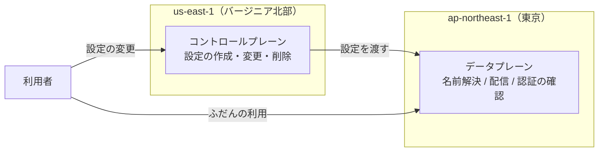

# コントロールプレーンとデータプレーンの分離

## 1. 概要

コントロールプレーンとデータプレーンの分離は、クラウドサービスの管理機能と、実際に処理を行う機能を分けて考える設計の考え方である。管理機能が止まっても、処理を行う側が動き続けていれば、既存のサービスは動き続ける。逆に、管理機能に依存する操作は、管理機能が止まると行えなくなる。

この分離を理解していると、障害のときに何が起きるかを、事前に整理できる。「動いているものが止まるのか」「設定の変更ができなくなるのか」という違いを見分けることが、障害への備えの出発点になる。

AWS では、グローバルサービスでこの分離がリージョンをまたぐ形になっている。管理機能（コントロールプレーン）は us-east-1（バージニア北部）に集まっているものが多く、処理を行う側（データプレーン）は各リージョンに分散している。

## 2. 基本概念

- **コントロールプレーン**：サービスの管理機能。設定の作成・変更・削除などを行う側である。IAM ユーザーを作る、Route 53 のレコードを変更する、CloudFront の設定を変える、といった操作がこれにあたる。
- **データプレーン**：実際に処理を行う側。名前解決、コンテンツの配信、認証の確認など、ふだんの利用の処理を行う。既存の設定をもとに動き続ける。
- **グローバルサービス**：リージョンをまたいで共通に使われるサービス。IAM、Route 53、CloudFront などがこれにあたる。管理機能は us-east-1 に集まっているものが多い。
- **リージョン**：AWS のサービスを提供する地理的な単位。東京リージョンは `ap-northeast-1`、バージニア北部リージョンは `us-east-1` である。
- **障害分離境界（fault isolation boundary）**：障害の影響が広がらないように分ける境界。AWS公式ホワイトペーパー「AWS Fault Isolation Boundaries」で説明されている考え方である。

## 3. 詳細解説

コントロールプレーンとデータプレーンは、役割が違う。コントロールプレーンは「どういう設定にするか」を決める側であり、データプレーンは「決まった設定のとおりに処理する」側である。設定が決まってしまえば、データプレーンはコントロールプレーンに問い合わせることなく、処理を続けることができる場合が多い。

AWS のグローバルサービスでは、この分離がリージョンをまたぐ。IAM、AWS Organizations、Route 53、CloudFront、CloudFront 用の WAF・ACM、Shield Advanced などのコントロールプレーンは us-east-1 にある。一方で、データプレーンは各リージョンに分散している。Route 53 の名前解決や CloudFront の配信は、利用者に近い場所で処理される。

そのため、東京リージョンでシステムを動かしていても、ふだんの利用は東京で完結するように見える。しかし、設定を変更する操作は us-east-1 を通る。us-east-1 が使えなくなると、新しい設定を作ったり、既存の設定を変えたりすることができなくなる。

呼び出し先のリージョンと、実際に処理が行われる場所は、必ずしも同じではない。東京リージョンを指定して呼び出しても、裏側で us-east-1 に依存する操作がある。S3 バケットの作成・削除や設定変更、API Gateway のエッジ最適化エンドポイントの作成、ELB / RDS などの DNS 登録などが、その例である。

us-east-1 にしかないサービスもある。請求・コスト管理、Billing Conductor、Marketplace の一部の API などは、東京リージョンにはなく、利用するには us-east-1 を通る必要がある。

## 4. 仕組み・構造

分離の仕組みを図にすると、次のとおりである。

利用者がふだん使う処理は、データプレーンを通る。設定の変更だけが、コントロールプレーンを通る。このため、コントロールプレーンが止まっても、データプレーンが動いていれば、既存の処理は動き続ける。ただし、新しい設定は作れなくなる。

障害が起きたときの影響を、この図で整理できる。コントロールプレーンが止まると、「設定の変更」の矢印が止まる。データプレーンの矢印は動き続ける。つまり、障害の影響は「動き続けるもの」と「できなくなるもの」に分かれる。

2025年10月の us-east-1 の障害では、この分かれ方が実際に起きた。稼働中の EC2 / Lambda / RDS、Route 53 の名前解決、CloudFront の配信、発行済み認証情報による認証は基本的に動き続けた。一方で、IAM の作成・変更、Route 53 レコードの変更、CloudFront の設定変更、Organizations の操作はできなくなる可能性があった。

## 5. メリット・デメリット

### メリット

- **障害の影響を予測できる**：コントロールプレーンとデータプレーンを分けて考えることで、障害のときに何が起きるかを、事前に整理できる。
- **既存のサービスが動き続ける**：管理機能が止まっても、データプレーンが動いていれば、稼働中のサービスは基本的に動き続ける。
- **設計の判断材料になる**：新しい仕組みを作るときに、その操作がコントロールプレーンに依存するかどうかを確認することで、障害時の振る舞いを設計に織り込める。

### デメリット・注意点

- **設定の変更が止まる**：コントロールプレーンが使えない間は、新しい設定を作ったり、既存の設定を変えたりできない。障害の最中に設定を変えて復旧しようとしても、その操作自体ができない場合がある。
- **依存が見えにくい**：呼び出し先のリージョンと、実際に処理が行われる場所は、必ずしも同じではない。東京を指定して呼び出しても、裏側で us-east-1 に依存する操作があるため、依存関係を把握するには、サービスごとの仕組みを確認する必要がある。
- **ログの置き場所も別になる場合がある**：利用しているリージョンとは別に、ログが置かれる場合がある。Route 53 クエリログや CloudFront 用 WAF のログ、CloudTrail のグローバルサービスイベントなどは、東京で使っていても us-east-1 に置かれる。

## 6. 活用例

- **障害時の影響を整理する**：新しいシステムを設計するときに、使うサービスの操作を「コントロールプレーンの操作」と「データプレーンの処理」に分けて書き出す。障害のときに「動き続けるもの」と「できなくなるもの」を、事前に一覧にする。
- **変更操作の依存先を確認する**：S3 バケットの作成・削除や設定変更、API Gateway のエッジ最適化エンドポイントの作成、ELB / RDS などの DNS 登録など、東京で呼び出しても us-east-1 に依存する操作があることを踏まえ、障害の最中に必要になる操作を洗い出す。
- **ログの置き場所を確認する**：障害の最中に確認したいログが、障害の影響を受ける場所に置かれていないかを確認する。Route 53 クエリログ、CloudFront 用 WAF のログ、CloudFront 標準ログ（v2）、CloudTrail のグローバルサービスイベント、請求額メトリクス EstimatedCharges などは、東京で使っていても us-east-1 に置かれる。
- **グローバルサービスの管理機能の置き場所を確認する**：IAM、AWS Organizations、Route 53、CloudFront、CloudFront 用の WAF・ACM、Shield Advanced などのコントロールプレーンは us-east-1 にあることを踏まえ、設定変更の可否を障害時の想定に入れる。

## 7. 関連する知識

- [静的安定性と障害時の備え](static-stability-and-outage-preparedness.md)：コントロールプレーンが止まった状態でも動き続けられる性質（静的安定性）と、障害への備えについての知識。コントロールプレーンとデータプレーンの分離を前提に、復旧手順やフェイルオーバーの設計を考える。

## 8. 参照した情報源

- [sources/articles/2026-11-06-aws-us-east-1-dependency-from-tokyo-region.md](../../sources/articles/2026-11-06-aws-us-east-1-dependency-from-tokyo-region.md)
