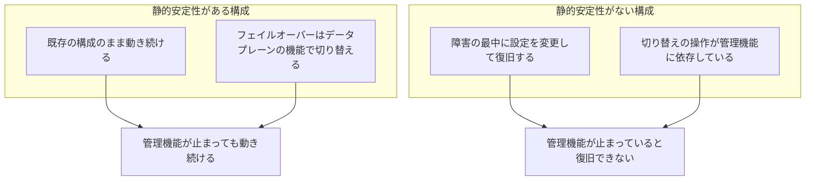

# 静的安定性と障害時の備え

## 1. 概要

静的安定性は、依存先の管理機能が止まっても、何も変更せずに動き続けられる性質である。障害のときに「設定を変えて復旧する」手順が、止まっている管理機能そのものに依存していると、復旧できない。静的安定性を保つことは、障害への備えの中心になる。

障害への備えは、障害が起きてから考えるものではない。ふだんの設計の段階で、復旧手順やフェイルオーバーの操作が、止まる可能性のある管理機能に依存していないかを確認しておく。フェイルオーバーは、データプレーンの機能で行う。認証情報の取得やコンソールの開き方、ログの記録先など、ふだんの操作にも、障害の影響を受けない工夫ができる。

## 2. 基本概念

- **静的安定性（static stability）**：依存先の管理機能が止まっても、何も変更せずに動き続けられる性質。設定を変更しなくても、既存の構成のまま動き続けることを指す。
- **コントロールプレーン**：サービスの管理機能。設定の作成・変更・削除などを行う側である。詳しくは [コントロールプレーンとデータプレーンの分離](control-plane-and-data-plane-separation.md) を参照すること。
- **データプレーン**：実際に処理を行う側。名前解決、コンテンツの配信、認証の確認など、ふだんの利用の処理を行う。
- **フェイルオーバー**：障害が起きたときに、待機側の構成へ切り替えること。切り替えの操作そのものが、止まっている管理機能に依存していると、切り替えられない。
- **ARC（Application Recovery Controller）**：AWS の復旧支援サービス。ルーティングコントロールなどの機能を持ち、データプレーン側の機能で切り替えを行うことができる。
- **STS（Security Token Service）**：一時的な認証情報を発行する AWS のサービス。リージョナルエンドポイントを使うことで、認証情報の取得を特定のリージョンで完結させることができる。
- **CloudTrail**：AWS の操作履歴を記録するサービス。証跡（trail）を作ることで、API 呼び出しの記録を残すことができる。

## 3. 詳細解説

障害への備えで大切なのは、障害の最中に「何ができるか」を、事前に知っておくことである。コントロールプレーンが止まると、設定の変更はできなくなる。そのため、障害の最中に設定を変更して復旧する手順は、使えない場合がある。

静的安定性は、この問題に対する考え方である。依存先の管理機能が止まっても、何も変更せずに動き続けられる状態にしておく。既存の構成のまま動き続けるのであれば、管理機能が止まっていても、サービスは動き続ける。

復旧手順についても、同じ考え方が当てはまる。復旧のための操作が、止まっている管理機能に依存していると、復旧できない。復旧手順を作るときは、その手順の一つひとつの操作が、どの管理機能に依存しているかを確認する。依存している操作がある場合は、その操作を使わない復旧手順を考えておく。

フェイルオーバーについても、切り替えの操作が管理機能に依存していないかを確認する。Route 53 のヘルスチェックや、ARC のルーティングコントロールなど、データプレーン側の機能で切り替える方法がある。データプレーンの機能で切り替えれば、管理機能が止まっていても、切り替えができる。

ふだんの操作にも、障害の影響を受けない工夫ができる。STS は東京のリージョナルエンドポイント（`sts.ap-northeast-1.amazonaws.com`）を使うことで、認証情報の取得を東京で完結させることができる。コンソールは、リージョン指定 URL から開くことで、グローバルの経路を通らずに開くことができる。CloudTrail は、全リージョン対象の証跡にすることで、記録の対象を全リージョンにしておくことができる。

2025年10月の us-east-1 の大規模障害では、東京の利用者が影響を受ける経路が3つあった。自社システムが us-east-1 で動いている場合、依存している SaaS や API が us-east-1 で動いている場合、グローバル機能を通じた影響を受ける場合である。備えを考えるときは、この3つの経路のそれぞれについて、影響を受けるかどうかを確認する。

## 4. 仕組み・構造

静的安定性のある構成と、ない構成の違いを図にすると、次のとおりである。

静的安定性がある構成では、障害の最中に何も変更しなくても、既存の構成のまま動き続ける。フェイルオーバーも、データプレーンの機能で切り替えるため、管理機能が止まっていても切り替えができる。

静的安定性がない構成では、障害の最中に設定を変更して復旧しようとするが、その変更操作自体が止まっている管理機能に依存しているため、復旧できない。切り替えの操作が管理機能に依存している場合も、同じように切り替えができない。

## 5. メリット・デメリット

### メリット

- **障害の最中に復旧できる**：復旧手順やフェイルオーバーの操作が、止まっている管理機能に依存していなければ、障害の最中でも復旧や切り替えができる。
- **障害の影響を小さくできる**：何も変更せずに動き続けられる状態にしておくことで、障害が起きても、既存のサービスは動き続ける。
- **ふだんの操作にも応用できる**：STS のリージョナルエンドポイントや、コンソールのリージョン指定 URL、CloudTrail の全リージョン対象の証跡など、ふだんの操作にも、障害の影響を受けない工夫ができる。

### デメリット・注意点

- **事前の確認が必要である**：復旧手順やフェイルオーバーの操作が、どの管理機能に依存しているかは、事前に確認しておく必要がある。障害が起きてから確認しても、遅い場合がある。
- **ログの置き場所にも注意が必要である**：障害の最中に確認したいログが、障害の影響を受ける場所に置かれていると、障害の最中にログを確認できない場合がある。CloudTrail を全リージョン対象の証跡にしておくなど、記録先の設計も備えに含める。
- **確認できていないこともある**：CloudFront 標準ログの CloudWatch Logs への送り先となるロググループのリージョンや、障害の最中にログがどう振る舞うかについては、記事内では確認できていないとされている。確認できていないことは、そのまま確認できていないと記録し、推測で補わない。

## 6. 活用例

- **復旧手順の依存先を確認する**：復旧手順の一つひとつの操作について、どの管理機能に依存しているかを書き出す。止まる可能性のある管理機能に依存する操作がある場合は、その操作を使わない復旧手順を考えておく。
- **フェイルオーバーをデータプレーンの機能で行う**：Route 53 のヘルスチェックや、ARC のルーティングコントロールなど、データプレーン側の機能で切り替える方法を使う。切り替えの操作が管理機能に依存していないかを確認する。
- **STS は東京のリージョナルエンドポイントを使う**：`sts.ap-northeast-1.amazonaws.com` を使うことで、認証情報の取得を東京で完結させる。
- **コンソールはリージョン指定 URL から開く**：グローバルの経路を通らず、対象リージョンを指定した URL から開く。
- **CloudTrail は全リージョン対象の証跡にする**：記録の対象を全リージョンにしておくことで、障害の最中にも操作履歴が残るようにする。
- **影響を受ける経路を3つに分けて確認する**：自社システムが us-east-1 で動いている場合、依存している SaaS や API が us-east-1 で動いている場合、グローバル機能を通じた影響を受ける場合の、それぞれについて影響を確認する。
- **Route 53 のスタンバイ用コントロールプレーンエンドポイントを知っておく**：2025年12月から、Route 53 パブリックホストゾーンのレコードは、us-west-2 のスタンバイ用コントロールプレーンエンドポイントからも作成・更新・削除できる。管理機能の代替手段がある場合は、その存在を知っておく。

## 7. 関連する知識

- [コントロールプレーンとデータプレーンの分離](control-plane-and-data-plane-separation.md)：管理機能と処理を行う機能の分離についての知識。静的安定性は、この分離を前提にしている。コントロールプレーンが止まってもデータプレーンが動き続けることを理解したうえで、復旧手順やフェイルオーバーの設計を考える。

## 8. 参照した情報源

- [sources/articles/2026-11-06-aws-us-east-1-dependency-from-tokyo-region.md](../../sources/articles/2026-11-06-aws-us-east-1-dependency-from-tokyo-region.md)
