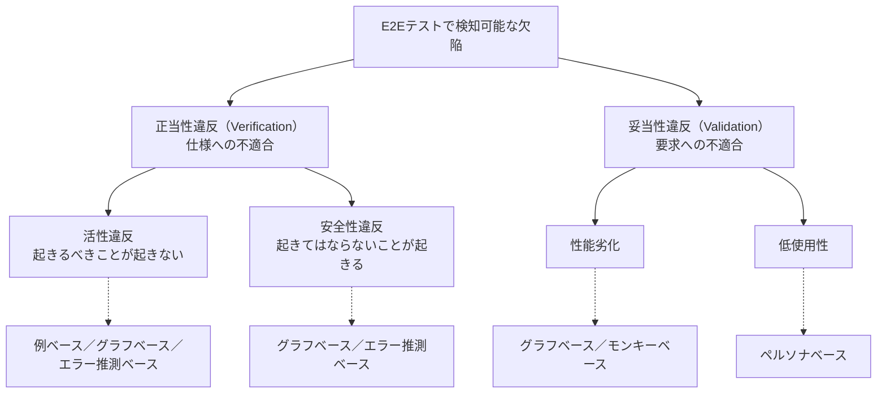

# E2Eテストで検知できる欠陥の分類

## 1. 概要

E2Eテストで検知できる欠陥は、正当性違反と妥当性違反に大別できる。正当性違反は仕様への不適合であり、Boehm の Verification に対応する。妥当性違反は要求への不適合であり、Validation に対応する。正当性違反はさらに、活性違反と安全性違反に分かれる。

この分類の前提として、E2Eテストの定義と境界を押さえる必要がある。E2Eテストとは、利用者インターフェースから永続化層まで、すべての構成要素を結合し、インターフェース側から操作・検証するテストである。何を E2E と呼ぶかが曖昧だと、検知できるはずの欠陥を取りこぼしたり、逆に E2E で見るべきでないものまで抱え込んだりする。

この分類は、テスト手法の選択の土台になる。手法ごとに検知できる欠陥の種類が異なるため、「どの欠陥を検知したいか」から手法を選ぶことができる。

## 2. 基本概念

- **E2Eテスト**：利用者インターフェースから永続化層まで、すべての構成要素を結合し、インターフェース側から操作・検証するテストである。自組織の制御外にあるコンポーネントは、テストダブルへの差し替えが許容される。
- **UIテストとの違い**：UIテストは画面や部品そのものを対象とするテストであり、E2E とは限らない。たとえば UI カタログ上で見た目を比較する Visual Regression Testing は、バックエンドと結合していないため E2E ではない。逆に、インターフェースが API やバッチ処理であれば、UI を操作しなくても E2E になりうる。
- **正当性（Verification）**：仕様どおりに作れているか。正当性違反は仕様への不適合を指す。
- **妥当性（Validation）**：要求に合ったものを作れているか。妥当性違反は要求への不適合を指す。仕様どおりでも要求を満たさない場合が含まれる。
- **活性違反**：受け付けるべき操作を拒否してしまう欠陥。「起きるべきことが起きない」種類の欠陥である。活性性（liveness）の概念に対応する。
- **安全性違反**：発生してはならない状態遷移が起きる、あるいは受け付けてはならない操作を受け付けてしまう欠陥。「起きてはならないことが起きる」種類の欠陥である。安全性（safety）の概念に対応する。
- **性能劣化**：応答時間や処理能力が要求を満たさなくなる妥当性違反である。
- **低使用性**：機能は仕様どおりでも、使いにくさのために要求を満たさない妥当性違反である。

## 3. 詳細解説

### 定義と境界が先に来る理由

欠陥の分類は、「E2Eテストとは何か」が定まって初めて意味を持つ。定義の要点は、結合の範囲と、操作・検証の入口の二つである。部分的な結合（画面だけ、API だけ）では、コンポーネント間の不整合という E2E 特有の欠陥は検知できない。また、内部の関数を直接呼ぶ検証は、利用者が実際にたどる経路を通らないため、インターフェース越しでなければ現れない欠陥を取りこぼす。

境界線として重要なのは、制御外コンポーネントのテストダブルへの差し替えが許容される点である。外部サービスまで実物に結合しなければ E2E でない、という厳密さは要求されていない。逆にいえば、自組織の管理下にある構成要素を安易にダブルへ差し替えると、結合の範囲が縮み、E2E と呼ぶ根拠が弱くなる。

### 正当性違反：活性違反と安全性違反

正当性違反の切り分けは、踏切と自動販売機のような制御システムを思い浮かべると分かりやすい。

活性違反は「起きるべきことが起きない」欠陥である。列車が来ていないのに遮断機が上がらない、正しい金額を入れたのに商品が買えない、といった形で現れる。利用者から見ると「正しい操作が拒否される」状態である。

安全性違反は「起きてはならないことが起きる」欠陥である。列車が接近しているのに遮断機が上がっている、お金を入れていないのに商品が出る、といった形で現れる。利用者から見ると「禁止された状態や操作が許されている」状態である。

この二つは、テストの書き方にも影響する。活性違反は「正しい操作列を与えて、期待どおり進むか」を見れば検知できる。一方、安全性違反は「起きてはならない操作や遷移が、本当に起きないか」を確かめる必要があり、正常系のシナリオをなぞるだけでは検知しにくい。後の手法分類で、例ベースが主に活性違反を対象とし、状態遷移モデルを使うグラフベースが安全性違反まで検知できるのは、この違いによる。

### 妥当性違反：性能劣化と低使用性

妥当性違反は、仕様への適合とは別の軸である。仕様どおりの結果を返していても、応答が遅すぎれば性能劣化であり、操作に迷って目的を達成できなければ低使用性である。

この2つは、正当性違反とは検知の方法が異なる。性能劣化は実行時間の計測で、低使用性はゴール到達の可否と到達コストの評価で検知する。シナリオの期待結果との一致だけを見るテストでは、どちらも素通りしてしまう。

### 分類と手法の対応

欠陥の種類と、それを検知できる手法の対応はおおよそ次のとおりである（手法の詳細は [E2Eテストの分類体系と手法の選択](e2e-test-taxonomy-and-method-selection.md) を参照）。

- 活性違反：例ベース、グラフベース、エラー推測ベース。
- 安全性違反：グラフベース、エラー推測ベース（過去類型に沿うもの）。
- 性能劣化：グラフベース、モンキーベース（実行中の計測による）。
- 低使用性：ペルソナベース。

「E2Eテストを書いた」だけでは、4種類すべての欠陥を検知できるわけではない。検知したい欠陥から逆算して手法を選ぶ必要がある。

## 4. 仕組み・構造

欠陥分類の構造を図にすると、次のとおりである。

分類は木構造であり、各葉に主な検知手法が対応する。テスト計画の段階では、まず「どの葉の欠陥を検知したいか」を決め、それから手法を選ぶ順序になる。

## 5. メリット・デメリット

### この分類を使うメリット

- **検知可能性を見極められる**：書きたいテストが、どの種類の欠陥を検知できるのかを事前に言語化できる。「E2E を書いたから安心」という誤解を防げる。
- **手法選択に接続できる**：欠陥の種類から対応する手法を引けるため、テスト戦略の議論が具体化する。
- **UIテストとの混同を正せる**：定義と境界を先に置くことで、Visual Regression Testing のような UIテストを E2E と数えてしまう誤りを避けられる。

### 注意点・限界

- **分類は「検知できる欠陥」の整理であって、コストの整理ではない**：検知できることと、現実的なコストで検知できることは別である。コストの側面は [E2Eテストの数理的制約](e2e-test-mathematical-constraints.md) を併せて見る必要がある。
- **境界はシステムごとに引く必要がある**：制御外コンポーネントの範囲は組織やシステムによって異なるため、ダブルへの差し替え範囲は個別に判断することになる。
- **妥当性違反は自動検知しにくい**：とくに低使用性は、ペルソナによる評価のような仕組みを別途用意しなければ検知できない。

## 6. 活用例

- **テスト計画の初期整理**：新規に E2Eテストを導入するとき、検知したい欠陥をこの分類で洗い出し、活性違反だけなのか、安全性違反や性能まで含むのかを先に決める。
- **既存テストの棚卸し**：既存の「E2Eテスト」と呼ばれるものが、実際には UIテストや部分結合のテストでないかを、定義と照らして確認する。
- **レビューの観点**：テストケースのレビューで、「このケースはどの種類の欠陥を検知するものか」を問うことで、正常系シナリオへの偏りを検出する。
- **欠陥報告の切り分け**：本番で見つかった欠陥を活性違反・安全性違反・妥当性違反に分類し、どのテスト層で防ぐべきだったかを振り返る。

## 7. 関連する知識

- [E2Eテストの数理的制約](e2e-test-mathematical-constraints.md)：検知できる欠陥が分かっても、実行・保守・不確実性のコストが E2E の適用範囲を制限する。その数理的な根拠を整理した知識。
- [E2Eテストの分類体系と手法の選択](e2e-test-taxonomy-and-method-selection.md)：欠陥の種類に対応する5つの手法の分類と、併用の戦略を整理した知識。
- [自動E2Eテストの実装パターンと実行タイミング](e2e-test-implementation-patterns-and-timing.md)：検知の仕組みを実装に落とすためのパターンと、書くタイミングの判断を整理した知識。

## 8. 参照した情報源

- [E2Eテスト大全（あなたの知らない、E2Eテスト周辺の理論）](../../sources/technical/2026-11-04-e2e-testing-taizen.md)
