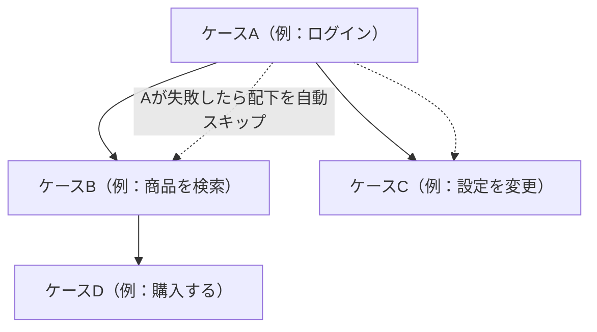

# 自動E2Eテストの実装パターンと実行タイミング

## 1. 概要

自動E2Eテストの実装には、保守コストを下げるためのパターンが4つ整理されている。ReusableOperator、ContextStream、Record & Playback、テストケース連鎖である。このうち ReusableOperator、ContextStream、テストケース連鎖は、Kuniwak の記事における筆者独自の用語である。Fowler の PageObject パターンは、ReusableOperator を画面・コンポーネント単位にグループ化したものとして位置づけられる。

また、E2Eテストを「いつ書くか」には、実装前に書く先行実行と、結合後に書く追認実行の2つの立場があり、それぞれ利点とリスクが異なる。とくに追認実行には、実装の挙動を無批判に正解化し、バグを正解として固定してしまうリスクがある。

実装パターンは [E2Eテストの数理的制約](e2e-test-mathematical-constraints.md) でいう保守コストへの対処であり、実行タイミングは「何をオラクルにするか」という設計判断である。両者は、E2E を少数に厳選したうえで、その少数をどう持続可能にするかという問題に答えるものである。

## 2. 基本概念

- **ReusableOperator（筆者独自の用語）**：低レベルの操作を、イベントから操作への対応表 `Map<Event, Operator>` として分離するパターン。シナリオはイベント名で操作を呼ぶ。
- **PageObject パターン（Fowler 2013）**：画面やコンポーネントごとに、要素へのアクセスと操作をクラスにまとめるパターン。ReusableOperator のグループ化として理解できる。
- **ContextStream（筆者独自の用語）**：画面遷移を `(Screen, Context) → Promise<[次のScreen, 次のContext]>` という非同期関数として定義し、コンビネータで合成するパターン。遷移の前後関係を型で表す。
- **Record & Playback**：操作履歴を構造化データとして保存し、再生することでテストとする方式。
- **テストケース連鎖（筆者独自の用語）**：ケース間に依存関係を持たせ、成功したケースの終了状態を引き継いで次のケースを開始するパターン。実行計画は依存グラフから作る接頭辞木（Trie）で表される。
- **先行実行**：実装前に E2Eテストを書く進め方。トップレベルの仕様を固定する役割を持つ。
- **追認実行**：結合後に、実装の挙動に合わせて E2Eテストを書く進め方。実装を正解として記録する側面を持つ。
- **セレクタ**：画面要素を特定するための指定（CSS セレクタ等）。UI の変更で最も壊れやすい部分であり、保守コストの中心である。

## 3. 詳細解説

### ReusableOperator と PageObject

E2Eテストの保守で最も頻繁に起きるのは、セレクタの変更に伴う修正である。シナリオの中にセレクタが散らばっていると、1回の UI 変更で多数のファイルを直すことになる。

ReusableOperator は、低レベル操作をイベント名で引ける辞書（`Map<Event, Operator>`）に分離し、シナリオ側はイベント名だけを書く構成にする。セレクタ変更の修正は辞書の1箇所で済む。

PageObject パターンは、この分離を画面・コンポーネント単位のクラスとしてグループ化したものと位置づけられる。既存の PageObject の実践は、ReusableOperator の考え方を組織化したものとして読み替えられる。

### ContextStream

ContextStream は、画面遷移そのものを型付きの関数として定義するパターンである。各遷移は「現在の画面と文脈を受け取り、次の画面と文脈を返す非同期関数」であり、`compose` で合成して一連のフローを組み立てる。

利点は、遷移の前後関係が型に現れることである。ありえない順序の遷移はコンパイル時に検出できる。シナリオの誤りの一部を、実行前に型検査で弾ける点が、他のパターンにはない特徴である。

### Record & Playback

Record & Playback は、操作を記録して構造化データとして保存し、再生する方式である。テストを書く初速は最も速い。しかし、DOM の構造変更やタイミングの変化に脆く、変更のたびに再記録や手直しが必要になりやすい。導入の速さと保守の重さがトレードオフになる。

### テストケース連鎖

テストケース連鎖は、ケース A の成功を前提に、その終了状態からケース B を始める依存連鎖である。ログイン済み状態の用意のような共通の前手順を、ケースごとに繰り返さずに済むため、実行は速くなる。

ランナーは依存グラフから接頭辞木（Trie）を構成し、共通の接頭辞を一度だけ実行する実行計画を作る。先行ケースが失敗した場合は、依存する後続ケースを自動でスキップする。

代償として、状態の共有は副作用の共有でもある。前のケースの副作用が後のケースの結果を左右すると、偽陽性・偽陰性が生じる。前提となる状態の管理（何が引き継がれ、何が初期化されるか）が、このパターンの成否を分ける。

### 実行タイミング：先行実行と追認実行

| 観点 | 先行実行（実装前に書く） | 追認実行（結合後に書く） |
|---|---|---|
| 仕様への効果 | トップレベル仕様を固定する物差しになる | 実装の挙動をそのまま正解として記録する |
| 進捗の把握 | 全体の進捗を客観的に測れる | 終盤まで全体検証ができない |
| 手戻り | 仕様変更のたびに書き直しが発生する | 手戻りは少ない |
| 主なリスク | 仕様が固まっていない段階では書き直しが頻発する | バグを正解化するリスク（無批判な追認） |
| 向く場面 | 仕様が固い基幹業務、グラフベースの手法 | 探索的な開発、リグレッション防止 |

先行実行は、テストが「検証の基準」として先に存在する進め方であり、グラフベースのようにモデル自体が仕様資産になる手法と相性がよい。追認実行は、既にある挙動の固定が目的であり、リグレッション検出には有効だが、「その挙動が正しいか」は別の手段で担保しなければならない。

## 4. 仕組み・構造

テストケース連鎖の実行計画の構造を図にすると、次のとおりである。

依存グラフを接頭辞木として走査することで、共通の接頭辞（ケースA）は一度だけ実行され、各分岐がその終了状態から始まる。失敗時のスキップも、木の部分木ごとに行える。

パターンの選択は、「何が変わりやすいか」で決まる。変わりやすいのが要素の特定方法なら ReusableOperator / PageObject、フローの順序の正しさが問題なら ContextStream、初期の立ち上げ速度が問題なら Record & Playback、実行時間と前手順の重複が問題ならテストケース連鎖、という対応である。

## 5. メリット・デメリット

### パターンごとの長所と短所

- **ReusableOperator**：セレクタ変更に強く、修正が1箇所に閉じる。反面、辞書の設計（イベントの粒度）を誤ると、抽象化が形だけになる。
- **PageObject**：実績が多く、画面単位の責務が明確。反面、画面をまたぐフローや状態の受け渡しは別途設計が要る。
- **ContextStream**：遷移の誤りを型で防げる。反面、型付けの負担があり、小規模なテストでは過剰になりうる。
- **Record & Playback**：初速が速い。反面、DOM・タイミング変更に脆く、長期保守には向かない。
- **テストケース連鎖**：前手順の重複をなくし実行が速い。反面、副作用による偽陽性・偽陰性のリスクと、前提管理の複雑さを引き受けることになる。

### 実行タイミングの注意点

- 先行実行は、仕様変更の頻度が高い局面では書き直しコストが膨らむ。仕様の固さを見極めて採用する。
- 追認実行は、バグの正解化を防ぐ仕組み（レビューで期待結果の妥当性を確認する等）とセットでなければ、検証ではなく記録になってしまう。
- どちらのタイミングでも、E2E の件数は [E2Eテストの数理的制約](e2e-test-mathematical-constraints.md) の範囲内に抑える前提は変わらない。

## 6. 活用例

- **セレクタ変更の頻繁なプロダクト**：ReusableOperator（または PageObject）で操作を分離し、UI 変更の影響を辞書の修正に閉じ込める。
- **画面遷移が複雑な業務アプリ**：ContextStream で遷移を型付き関数として定義し、ありえない遷移をコンパイル時に弾く。
- **デモや検証用の短期テスト**：Record & Playback で素早く作り、長期保守が必要になった時点で他のパターンへ移行する。
- **前手順が高コストなフロー**：テストケース連鎖でログインや初期データ投入を共通接頭辞として共有し、実行時間を短縮する。ただし引き継ぐ状態の範囲を明示する。
- **基幹業務の更改**：先行実行でトップレベル仕様を固定し、状態遷移モデル（グラフベース）と組み合わせて進捗を測る。
- **探索的な新規開発**：追認実行でリグレッション防止のネットを張りつつ、期待結果の妥当性はレビューで担保する。

## 7. 関連する知識

- [E2Eテストで検知できる欠陥の分類](e2e-test-detectable-defects.md)：実装するテストが、どの欠陥を検知するものなのかを決める分類。
- [E2Eテストの数理的制約](e2e-test-mathematical-constraints.md)：パターンで下げようとしている保守コストの、数理的な背景。
- [E2Eテストの分類体系と手法の選択](e2e-test-taxonomy-and-method-selection.md)：実装パターンと組み合わせる手法（グラフベース等）の選択。

## 8. 参照した情報源

- [E2Eテスト大全（あなたの知らない、E2Eテスト周辺の理論）](../../sources/technical/2026-11-04-e2e-testing-taizen.md)
