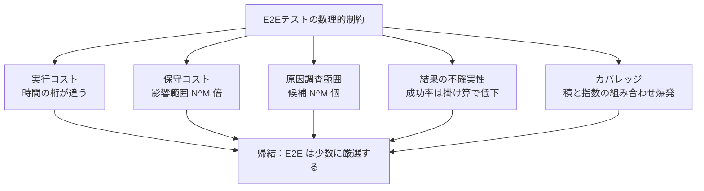

# E2Eテストの数理的制約

## 1. 概要

E2Eテストには、ツールの改良や書き手の努力では解消できない、数理的と呼べる制約が5つある。実行コスト、保守コスト、原因調査範囲、結果の不確実性、カバレッジの組み合わせ爆発である。

これらの制約は、テスト対象の規模を表す単純なモデル（各コンポーネントが下位 N 個を結合する M 層のシステムなど）から導かれる。「E2E が遅い・不安定・重い」という現場の感覚は、この制約の現れとして説明できる。

重要な帰結は二つある。第一に、E2Eテストの適用範囲は「書けるかどうか」ではなく、この制約から決まる上限で絞るべきだということ。第二に、制約はテストの作成者が人間でも AI でも変わらないため、AI 時代のテスト戦略でも前提として残るということである。

## 2. 基本概念

- **M 層モデル**：各コンポーネントが下位の N 個のコンポーネントを結合する、M 層からなるシステムのモデル。全体の組み合わせは N^M（N の M 乗）になる。保守コストと原因調査範囲の議論の土台である。
- **K**：1つのコンポーネントの変更に対して、単体テスト側で再確認が必要になる件数を表す量。影響範囲の比較に使う。
- **Flakyテスト**：同じコードに対して成功したり失敗したりする不安定なテスト。個々の事象の小さな失敗率が、直列実行の掛け算で増幅されることが原因の一つである。
- **組み合わせ爆発**：組み合わせの総数が、要素の数に対して積や指数のオーダーで増大し、全数を確認できなくなる現象。
- **忠実度とのトレードオフ**：E2E の前処理を省略（バイパス）すれば実行は速くなるが、実物に近い条件で検証する度合い（忠実度）は下がる。速度と忠実度は同時に最大化できない。

## 3. 詳細解説

### 制約1：実行コスト

単体テストは1件あたりミリ秒単位で終わるが、E2Eテストは1件あたり数十秒かかることがある。比率にして4〜5桁の差である。

CI の実行枠（時間やマシン）が一定である以上、この差はそのまま「実行できるケース数の差」になる。単体テストと同じ感覚でケースを増やすことは、原理的にできない。前処理のバイパスで短縮する手はあるが、それは忠実度を下げることと引き換えである。速くした E2E は、そのぶん実物から離れた検証になる。

### 制約2：保守コスト

M 層モデルで、1つのコンポーネントを変更したときの影響を考える。単体テストでは、そのコンポーネントに対応する K 件の再確認で済む。一方、E2Eテストは組み合わせ全体を通るため、最大で N^M × K 件が影響を受けうる。

N・M・K がすべて4の例では、N^M = 256 であり、影響範囲は単体テストの256倍になる。コンポーネントの数が増えるほど、この倍率は指数的に開く。E2E の保守が重いのは、件数の多さそのものよりも、1回の変更が波及する範囲の広さに起因する。

### 制約3：原因調査範囲

E2Eテストが失敗したとき、原因は結合されたコンポーネントのどこにあってもおかしくない。候補は最大で N^M 個になる。上記の例では、単体テストの失敗に比べて256倍の範囲を調べることになる。

これは、E2E の失敗1件あたりの調査コストが高いことを意味する。失敗の検知はできても、切り分けは別の作業になる。E2E の件数を増やす判断では、実行時間だけでなく、失敗時に誰がどこまで調べるかも含めて見積もる必要がある。

### 制約4：結果の不確実性

E2Eテストの実行は、多くの事象が直列につながったものである。各事象に小さな失敗率があっても、全体の成功率は掛け算で低下する。

失敗率0.1%の事象が直列に100個並ぶ場合、成功率は (1 − 0.001)^100 ≒ 90.5% である。コードに欠陥がなくても、約1割は失敗しうる計算になる。これが Flakyテストの確率的な正体であり、Google の Micco（2016）が指摘した問題でもある。

帰結として、E2E の失敗は「欠陥がある」ことの証明にはならず、再実行や切り分けを前提とした運用設計が必要になる。失敗をすべて欠陥として扱う運用は、この確率の前では破綻する。

### 制約5：カバレッジの組み合わせ爆発

分岐の網羅を考えると、単体テストでは対象が N + M のオーダー（和）で済むのに対し、E2Eテストでは N × M（積）になり、直列に連なる要素が増えると指数的に増大する。

つまり、E2E で分岐網羅を狙うことは原理的に不可能である。分岐の網羅は単体テストの仕事であり、E2E は代表的な組み合わせ（主要フロー）に絞るしかない。これは好みの問題ではなく、数え上げの問題である。

### AI時代でも不変である理由

これらの制約は、物理的な遅延（実行時間）、確率（失敗率の掛け算）、組み合わせの数理（積と指数）に由来する。テストコードの作成者が人間から AI に変わっても、この3つは変わらない。

むしろ、AI に E2Eテストの生成・修正ループを回させる場合は、1回の検証に数十秒の待ち時間がかかる分、ループが遅くなる。単体テスト中心のループより反復速度で不利になるため、AI 開発でも「単体で速く回し、E2E は絞る」という配置が合理的になる。

## 4. 仕組み・構造

5つの制約を、規模を表す式とともに整理すると次のとおりである。

| 制約 | 規模の目安 | 単体テストとの対比 |
|---|---|---|
| 実行コスト | 1件あたり数十秒 | 単体はミリ秒単位（4〜5桁の差） |
| 保守コスト | 変更の影響は最大 N^M × K 件 | 単体は K 件（例では256倍） |
| 原因調査範囲 | 候補は最大 N^M 個 | 単体は対象コンポーネント内（例では256倍） |
| 結果の不確実性 | 成功率は (1 − p)^n（直列 n 事象） | 単体は外部事象が少なく安定 |
| カバレッジ | 組み合わせは N × M から指数増大 | 単体は N + M のオーダー |

5つの制約は独立ではなく、すべて「結合の範囲が広い」という E2E の定義そのものから出てくる。結合を広げるほど忠実度は上がるが、同時にすべての制約が強まる。

## 5. メリット・デメリット

### この制約を理解するメリット

- **判断の上限が引ける**：「E2E を何件までにするか」を、感覚ではなく実行枠と影響範囲の計算から決められる。
- **Flaky への態度が決まる**：不確実性を確率として見積もれるため、再実行ポリシーや失敗の扱いを設計できる。
- **改善の方向を誤らない**：遅さや重さの原因が構造にあると分かれば、ツールの買い替えではなく、配置（ピラミッド）の見直しに投資できる。

### 注意点・限界

- **E2E 不要論ではない**：制約は「絞る」根拠であって「なくす」根拠ではない。結合バグの検出や忠実度といった利点は、少数でも E2E を持つ理由になる。利点は [E2Eテストで検知できる欠陥の分類](e2e-test-detectable-defects.md) と、元 Source の利点の節を参照。
- **モデルは単純化である**：N^M のモデルは最悪ケースの目安であり、実際の影響範囲は設計の局所性によって変わる。数字は桁感をつかむために使う。
- **数値は前提依存**：成功率90.5%の計算は、失敗率0.1%・直列100事象という前提の例である。自システムの失敗率と直列数で計算し直す必要がある。

## 6. 活用例

- **CI の時間予算の見積もり**：E2E の単価（数十秒）と CI の枠から、実行可能な件数の上限を先に決め、その範囲でケースを選ぶ。
- **Flaky 率の試算**：個々のステップの失敗率と直列数から全体の成功率を見積もり、再実行の回数や許容する失敗率の基準を設ける。
- **変更影響の見積もり**：大きなコンポーネント変更の前に、影響を受ける E2E の範囲を見積もり、必要なら変更を分割する。
- **AI への指示の設計**：AI にテスト修正ループを回させるとき、検証の中心を単体テストに置き、E2E の実行は節目に絞ることで、ループの待ち時間を抑える。

## 7. 関連する知識

- [E2Eテストで検知できる欠陥の分類](e2e-test-detectable-defects.md)：制約の範囲内で「何を検知するか」を決めるための欠陥分類。
- [E2Eテストの分類体系と手法の選択](e2e-test-taxonomy-and-method-selection.md)：制約を踏まえた手法の選び方と、テストピラミッドに基づく役割分担。
- [自動E2Eテストの実装パターンと実行タイミング](e2e-test-implementation-patterns-and-timing.md)：保守コストを下げるための実装上の工夫と、その限界。

## 8. 参照した情報源

- [E2Eテスト大全（あなたの知らない、E2Eテスト周辺の理論）](../../sources/technical/2026-11-04-e2e-testing-taizen.md)
