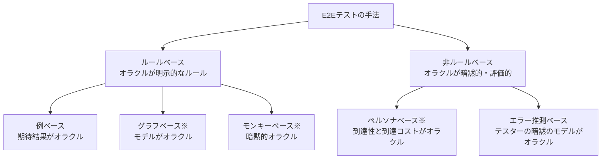

# E2Eテストの分類体系と手法の選択

## 1. 概要

E2Eテストの手法は、例ベース、グラフベース、モンキーベース、ペルソナベース、エラー推測ベースの5つに分類できる。このうちグラフベース、モンキーベース、ペルソナベースは、Kuniwak の記事における筆者独自の用語である（一般的な用語ではない）。

分類の軸は、「何を入力とし、何をテストオラクル（判定基準）とするか」である。各手法は、検知できる欠陥の種類と、カバレッジの増やし方が異なるため、単独で万能な手法はない。実務では、高価値シナリオの例ベースを土台に、状況に応じて他の手法を併用する組み合わせが推奨される。

また、手法の選択はテストピラミッドの役割分担と一体である。単体テストが論理と分岐網羅を担い、形式手法による設計検証が仕様間の不整合を事前に排除し、E2E は厳選した範囲で仕様間整合と忠実度を担う。

## 2. 基本概念

- **テストオラクル**：テストの成否を判定するための基準・仕組み。手法の違いは、突き詰めるとオラクルの違いである。
- **ルールベース / 非ルールベース**：オラクルが明示的なルール（期待結果やモデル）として与えられる手法がルールベース、テスターの暗黙のモデルやペルソナの評価に依存する手法が非ルールベースである。
- **暗黙的オラクル（Barr et al. 2015）**：明示的な期待結果ではなく、クラッシュや未処理例外など「一般的に起きてはならないこと」の不在で判定するオラクルである。
- **状態遷移モデル**：システムの状態と、イベントによる状態遷移を記述したモデル。CSP などで記述され、グラフベースの入力になる。
- **トレース集合・失敗集合**：モデルから導かれる、起きてよい振る舞い（トレース集合）と、起きてはならない振る舞い（失敗集合）。グラフベースのオラクルである。
- **ペルソナ**：想定利用者の属性・目的・行動傾向を記述したもの。ペルソナベースの入力になる。
- **テストピラミッド（Cohn 2009、Fowler 2012）**：単体テストを多く、E2Eテストを少なく配置する考え方。役割分担の土台である。
- **高価値シナリオ**：事業上・利用上とくに重要な一連の操作。どの手法と組み合わせる場合でも、例ベースで明示的に押さえる対象である。

## 3. 詳細解説

### 5手法の比較

各手法を、入力・テストオラクル・仕組み・検知可能な欠陥・カバレッジの増やし方で比較すると、次のとおりである。

| 手法 | 入力 | テストオラクル | 仕組み | 検知可能な欠陥 | カバレッジの増やし方 |
|---|---|---|---|---|---|
| 例ベース（ルールベース） | イベント列＋期待結果の組 | シナリオの期待結果 | シナリオどおりに実行し結果を比較する | 主に活性違反 | シナリオ数を増やす |
| グラフベース※（ルールベース） | 状態遷移モデル（CSP 等） | トレース集合と失敗集合 | 安全性→活性の検査を反復し、探索アルゴリズムで次のイベントを選ぶ（ランダムウォーク＋定期リセット） | 活性違反・安全性違反・性能劣化 | 実行時間を延ばす |
| モンキーベース※（ルールベース） | 実装のみ | 暗黙的オラクル | 操作可能要素を自動抽出して連続実行する | クラッシュ・未処理例外・500 などの一般的欠陥、性能劣化 | 実行時間を延ばす |
| ペルソナベース※（非ルールベース） | ペルソナ記述 | 二層オラクル（ゴール到達性／到達コスト） | ペルソナに沿った利用を再現し、到達可否とコストを評価する | 低使用性 | ペルソナのバリエーションを増やす |
| エラー推測ベース（非ルールベース） | 過去の欠陥統計 | テスターの暗黙のモデル（ISTQB の経験ベース技法） | 欠陥が集中しやすい箇所を狙って設計する | 過去類型の活性違反・安全性違反 | 時間とシナリオの拡充 |

※は筆者独自の用語。

読み方の要点は3つある。第一に、例ベース以外は「シナリオを書く」以外の方法でカバレッジを増やす（実行時間、バリエーション、統計）。第二に、安全性違反まで届くのはモデルを持つグラフベースと、過去類型に限るエラー推測ベースである。第三に、低使用性を対象にできるのはペルソナベースだけである。検知したい欠陥から逆算すると、手法の候補はかなり絞られる。

### 手法の選択と併用戦略

推奨される組み合わせは、グラフベース＋高価値シナリオの例ベースである。状態遷移モデルは、テスト入力であると同時に、AI や実装者への厳密な仕様資産になるため、作成コストに見合う二重の価値がある。ただし、グラフベースだけでは高価値シナリオを確実に実行する保証がないため、重要なシナリオは例ベースで明示的に固定する。

モデル作成コストを払えない場合は、次善としてエラー推測ベース＋高価値シナリオがある。過去の欠陥統計が存在することが前提であり、統計がない新規システムでは使えない。

新規システムの簡易な導入としては、モンキーベース＋高価値シナリオがある。モデルも統計もない段階で、暗黙的オラクルによる広範な検知と、重要シナリオの保証を両立させる組み合わせである。

使用性の検証が必要な場合は、いずれの組み合わせにもペルソナベースを追加する。AI によるペルソナの再現は、人間のユーザビリティテストの前段階のスクリーニングとして位置づけられる。

### テストピラミッドと役割分担

手法の選択は、テスト全体の配置の中で行う。役割分担は次のとおりである。

- 単体テスト：論理的正確性と分岐網羅。速く、多数を回す。
- 結合・E2Eテスト：仕様間の整合と忠実度。コストが高いため厳選する。
- 設計検証（形式手法）：CSP や契約による設計で、仕様間の不整合＝結合バグの原因を実装前に排除する。

ポイントは、結合バグを E2E で「検出する」のは本来の姿ではなく、設計検証で「発生させない」のが第一だという点である。E2E での検出は、設計検証をすり抜けたものの持ち越し検知として扱う。

### AI 開発への誘導の例

この役割分担は、AI への指示の出し方にも直結する。E2E中心の指示（パターンA）は、ブラウザ実行の反復が多く、開発ループが遅くなる。対して、関心事をストラテジーパターンで分離し、分岐網羅を単体テストに寄せ、E2E は代表1シナリオに絞る指示（パターンB）は速く回る。AI に任せる場合ほど、どの層で何を検証するかを先に決めて指示する必要がある。

## 4. 仕組み・構造

分類の構造を図にすると、次のとおりである。

※は筆者独自の用語。

併用戦略の構造は、「高価値シナリオの例ベース」を共通の土台とし、そこへ状況に応じて1つの手法を重ねる形である。状況とは、モデルを作れるか（グラフベース）、欠陥統計があるか（エラー推測ベース）、どちらもないか（モンキーベース）、の見極めである。

## 5. メリット・デメリット

### この分類体系を使うメリット

- **選択の判断軸ができる**：「どの欠陥を検知したいか」「モデルや統計の資産があるか」から、採用する手法を説明可能な形で選べる。
- **AI への指示の語彙になる**：手法名と役割分担が共有できると、AI へのテスト作成の指示が具体的になる。
- **仕様資産の副産物**：グラフベースの状態遷移モデルは、テスト以外（実装・レビュー・AI への指示）にも使える資産になる。

### 注意点・限界

- **独自用語は定義込みで使う必要がある**：グラフベース・モンキーベース・ペルソナベースは筆者独自の用語であり、単語だけを AI や他者に渡しても一般概念として伝わらない。定義文やコード例を添える必要がある、と元記事でも注意されている。
- **モデル作成コストは無視できない**：グラフベースの前提である状態遷移モデルの作成・維持にはコストがかかり、払えない場合は次善の組み合わせに切り替える判断が要る。
- **分類は静的な整理である**：実際のシステムでは、手法の境界（例ベースのシナリオを探索に使う等）は混ざりうる。分類は選択の出発点として使う。

## 6. 活用例

- **新規プロダクトの立ち上げ**：モンキーベース＋高価値シナリオで始め、欠陥統計やモデルが育ってきたら、エラー推測ベースやグラフベースへ移行する。
- **基幹システムの更改**：仕様が固くモデル資産の価値が高いため、グラフベース＋高価値シナリオを採用し、モデルを仕様資産として保守する。
- **使用性が問われるプロダクト**：上記にペルソナベースを加え、リリース前に AI ペルソナでスクリーニングし、人間のユーザビリティテストにつなげる。
- **AI 駆動開発の指示書**：パターンBの形（分離＋単体で分岐網羅＋E2E は代表シナリオ）を指示のひな形にし、E2E の本数を増やさないよう明示する。

## 7. 関連する知識

- [E2Eテストで検知できる欠陥の分類](e2e-test-detectable-defects.md)：手法選択の出発点になる、検知可能な欠陥の分類。
- [E2Eテストの数理的制約](e2e-test-mathematical-constraints.md)：手法を「厳選」しなければならない理由である、5つの数理的制約。
- [自動E2Eテストの実装パターンと実行タイミング](e2e-test-implementation-patterns-and-timing.md)：選んだ手法を実装に落とすためのパターンと、実行タイミングの判断。

## 8. 参照した情報源

- [E2Eテスト大全（あなたの知らない、E2Eテスト周辺の理論）](../../sources/technical/2026-11-04-e2e-testing-taizen.md)
