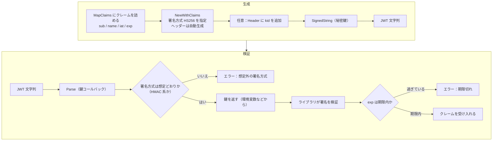

# GoでのJWT生成と検証

## 1. 概要

Go で JWT を扱うライブラリ golang-jwt を使った、トークンの生成と検証の実装パターンである。生成は「クレームを詰める → 署名方式を指定する → 鍵で署名する」の3ステップ、検証は「署名方式を確認して鍵を返すコールバックを渡してパースする → クレームを取り出して追加確認する」という流れが骨格になる。

この知識は、zono0013 の Qiita 記事「JWTって何？」に掲載されたコード例をもとに、再利用可能な形に整理したものである。JWT の構造そのものについては [JWTの構造とクレーム](jwt-structure-and-claims.md) を参照すること。

## 2. 基本概念

- **golang-jwt**：Go で JWT の生成と検証を行うライブラリである。記事のコードでは `jwt` パッケージとして使われている。
- **MapClaims**：クレームを `map` として保持する型である。キーにクレーム名、値に内容を入れる。
- **NewWithClaims**：署名方式とクレームからトークンオブジェクトを作る関数である。ヘッダー（alg / typ）はライブラリが自動生成する。
- **SignedString**：鍵を渡してトークンに署名し、文字列の JWT を返すメソッドである。
- **SigningMethodHS256**：HMAC + SHA-256 の署名方式を指定する値である。共通鍵方式であり、生成と検証で同じ秘密鍵を使う。
- **Parse と鍵コールバック**：`jwt.Parse` は、トークン文字列と「鍵を返す関数」を受け取り、署名を検証しながらパースする。コールバックは、署名方式の確認と鍵の選択を行う場所になる。
- **kid（Key ID）**：ヘッダーに追加できる鍵の識別子である。`token.Header["kid"]` への代入で設定する。

## 3. 詳細解説

### 生成のパターン

生成側の関数は、おおむね次の形になる。

1. クレームを用意する。`jwt.MapClaims` に、sub（ユーザー ID）、name（ユーザー名）、iat（発行日時）、exp（有効期限）などを入れる。有効期限は、現在時刻に有効期間（記事の例では24時間）を加えた UNIX 時刻で指定する。
2. 署名方式を指定してトークンを作る。`jwt.NewWithClaims(jwt.SigningMethodHS256, claims)` とすると、ライブラリが `{"alg": "HS256", "typ": "JWT"}` のヘッダーを自動で用意する。
3. 署名する。`token.SignedString([]byte(secret))` で秘密鍵を渡し、文字列のトークンを得る。

ヘッダーをカスタマイズしたい場合は、署名の前に `token.Header["kid"] = "custom-key-id"` のように項目を追加する。kid を付けておくと、検証側は「どの鍵で署名されたトークンか」を判別でき、鍵のローテーションや複数鍵の運用に対応しやすくなる。

### 検証のパターン

検証側の関数は、おおむね次の形になる。

1. `jwt.Parse(tokenString, keyFunc)` を呼ぶ。keyFunc は、パース中のトークンを受け取り、検証に使う鍵を返すコールバックである。
2. keyFunc の中で署名方式を確認する。`token.Method` が想定する方式（記事の例では HMAC 系）でなければ、想定外の署名方式としてエラーを返す。これは、トークン側のヘッダーが名乗るアルゴリズムを鵜呑みにしないための重要な防御である。
3. 署名方式が正しければ鍵を返す。記事の検証例では、秘密鍵を環境変数から読み込んで返している。ライブラリは返された鍵で署名を検証する。
4. パース結果が有効（`token.Valid`）であれば、`jwt.MapClaims` としてクレームを取り出す。さらに追加の検証として、`exp` を現在時刻と比較し、期限切れならエラーにする、という明示的な確認が記事の例には含まれている。
5. どの段階で失敗しても、無効なトークンとしてエラーを返し、クレームは信用しない。

### 実装上の注意（元記事のコードから読み取れること）

元記事のコードには、手本にする際に注意したい点が2つある。

- 生成側の例では、秘密鍵が文字列リテラルとしてコードに直接書かれている。一方、検証側の例では環境変数から読み込んでいる。実務では生成側も環境変数や秘密情報の管理機構から読み込み、コードに鍵を書かない形に統一すべきである。
- 生成側の例では、発行日時のクレーム名が標準の `iat` ではなく `ita` と書かれており、値も UNIX タイムスタンプではなく時刻オブジェクトが入っている。クレーム名の綴りと値の形式は標準に合わせないと、検証側や他システムとの相互運用で問題になる。

## 4. 仕組み・構造

生成と検証の対応関係は次のとおりである。

生成と検証は、同じ署名方式と同じ鍵を共有することが前提である。検証の成否は、署名方式の確認、署名の一致、クレームの有効性（期限など）の3段階で決まる。

## 5. メリット・デメリット

メリット：

- 生成は3ステップで完結し、ヘッダーの組み立てもライブラリが担うため、実装が短く済む。
- 検証の鍵コールバックが、署名方式の確認と鍵の選択を1か所に集約する設計になっており、防御の要点を差し込みやすい。
- MapClaims を使うと、クレームの追加や変更が map の操作として素直に書ける。

デメリット：

- MapClaims は型が緩いため、クレーム名の綴り間違いや値の型の誤りに気づきにくい（元記事の `ita` のような誤りがそのまま通ってしまう）。
- 署名方式の確認を書き忘れると、想定外アルゴリズムの受け入れにつながる。骨格として必ず含める必要がある。
- 秘密鍵の渡し方を誤ると（コードへの直書きなど）、実装パターン以前の管理上の問題になる。

## 6. 活用例

- ログイン成功時にユーザー ID を sub に入れたトークンを発行し、24時間などの有効期限を設定してクライアントに返す。
- API の認証ミドルウェアで、リクエストのトークンをこの検証パターンで確認し、クレームからユーザー ID を取り出して処理を続ける。
- 鍵を差し替える際に、新しい鍵で生成するトークンへ kid を付け、検証側が kid を見て鍵を選べるようにする。
- 有効期限の確認を明示的に書くことで、ライブラリの既定動作に任せきりにせず、期限切れの扱いをコード上で明確にする。

## 7. 関連する知識

- [JWTの構造とクレーム](jwt-structure-and-claims.md) — JWT の3部構成、Base64Url、署名による検証、標準クレームを整理した知識。

## 8. 参照した情報源

- [JWTって何？](../../sources/technical/2024-12-12-jwt-qiita.md) — zono0013 による Qiita 記事（2024-12-12）。golang-jwt による生成（generateToken）と検証（validateToken）のコード例の出典である。
