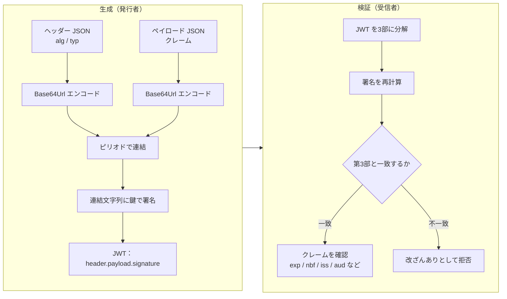

# JWTの構造とクレーム

## 1. 概要

JWT（JSON Web Token）は、情報を JSON オブジェクトとして安全に転送するための、コンパクトで自己記述的なトークン形式である。トークンは、ヘッダー、ペイロード、署名の3つの部分をピリオド（`.`）で連結した1本の文字列であり、各部分は Base64Url でエンコードされている。

JWT の信頼性の根拠は署名にある。ペイロードはエンコードされているだけで暗号化されていないため、内容は誰でも読める。JWT が担保するのは、内容の秘匿性ではなく、改ざんされていないこと（完全性）と、発行者が正しい鍵を持っていることの検証である。この区別が、JWT を理解するうえで最も重要である。

## 2. 基本概念

- **JWT（JSON Web Token）**：JSON オブジェクトを署名付きの文字列として受け渡す形式。主体同士で情報を安全に転送するために使う。
- **ヘッダー（Header）**：トークンのタイプ（`typ`）と署名アルゴリズム（`alg`）を指定する JSON。例：`{"alg": "HS256", "typ": "JWT"}`。
- **ペイロード（Payload）**：クレームの集合を格納する JSON。トークンで伝えたい情報そのものが入る。
- **署名（Signature）**：エンコード済みのヘッダーとペイロードを連結した文字列に対して、アルゴリズムと鍵で生成される値。改ざん検出の根拠になる。
- **クレーム（Claim）**：ペイロードに含まれる個々の情報（要求）。発行者、対象者、有効期限などを表す。
- **Base64Url**：Base64 の変種で、URL に使えない文字を避けたエンコード方式。可逆な変換であり、暗号化ではない。
- **標準クレーム**：仕様で名前と意味が予約されているクレーム群。iss、sub、aud、exp、nbf、iat、jti の7つが代表的である。
- **kid（Key ID）**：ヘッダーに任意で追加できる鍵の識別子。検証側が鍵を選ぶ手がかりになる。

## 3. 詳細解説

### 3つの部分の役割

ヘッダーは「このトークンが何で、どう署名されているか」を宣言する部分である。署名アルゴリズムをトークン自身が名乗るため、検証側はヘッダーを読んで検証手順を決める。裏返すと、検証側はヘッダーの宣言を無条件に信じてはいけない。想定外のアルゴリズムを名乗るトークンを受け付けないよう、検証側で許容する方式を確認する必要がある。

ペイロードは「何を主張するトークンか」を表す部分である。ユーザー ID や有効期限など、アプリケーションが判断に使う情報がクレームとして入る。ただし、ペイロードは Base64Url でエンコードされているだけであり、鍵がなくても誰でもデコードして読める。したがって、パスワードや個人情報のような、読まれて困る情報をペイロードに入れてはならない。

署名は「この内容が、鍵を持つ発行者によって作られ、その後書き換えられていないこと」を裏付ける部分である。検証側は、受け取ったヘッダーとペイロードから署名を再計算し、トークンの第3部と一致するかを確認する。ペイロードを1文字でも書き換えれば再計算結果は一致しなくなるため、改ざんを検出できる。

### 標準クレームの読み方

標準クレームは、トークンの出自と有効性を判断するための共通語彙である。

| クレーム | 名称 | 意味 |
| --- | --- | --- |
| iss | Issuer | トークンの発行者 |
| sub | Subject | トークンの対象者。通常はユーザー ID など |
| aud | Audience | トークンの受信者。サービスやアプリケーションの識別子 |
| exp | Expiration | 有効期限。UNIX タイムスタンプ形式。この時刻を過ぎたら無効 |
| nbf | Not Before | 有効開始時刻。この時刻より前は無効 |
| iat | Issued At | トークンが発行された日時 |
| jti | JWT ID | トークンの一意な識別子。リプレイ攻撃を防ぐために使われることがある |

検証の観点では、exp と nbf が時間による有効範囲を、iss と aud が「誰が発行し、誰宛てのトークンか」を、sub が「誰についてのトークンか」を決める。カスタムクレーム（name のような任意の項目）も追加できるが、標準クレームの意味を上書きするような使い方は避ける。

### 署名アルゴリズムと鍵

記事の例で使われている HS256 は、HMAC と SHA-256 を組み合わせた共通鍵方式であり、署名と検証に同じ秘密鍵を使う。共通鍵方式では、検証できる主体はすべて署名もできてしまうため、鍵の共有範囲がそのまま信頼範囲になる。署名方式の選択と鍵の管理は、JWT の運用における中核的な論点である。

## 4. 仕組み・構造

JWT の生成と検証の流れは次のとおりである。

- 生成：ヘッダーとペイロードの JSON をそれぞれ Base64Url エンコードし、ピリオドで連結した文字列を入力として、鍵で署名する。署名も Base64Url エンコードして第3部に置く。
- 検証：トークンを3部に分解し、第1部と第2部の連結から署名を再計算して第3部と照合する。一致したら、クレームの内容（有効期限、発行者、宛先など）を確認して受け入れる。

## 5. メリット・デメリット

メリット：

- トークン自体に情報と署名が自己完結して入っているため、受け手はデータベース等を参照しなくても検証できる（自己記述的である）。
- JSON ベースで言語やプラットフォームを問わず扱え、テキスト1本で転送できるためコンパクトである。
- 署名により、改ざんの検出と発行者の確認ができる。
- 標準クレームという共通語彙があり、発行者・対象者・有効期限の解釈がそろう。

デメリット：

- ペイロードは暗号化されていないため、内容は誰でも読める。秘匿したい情報を入れる用途には使えない。
- 署名の安全性は鍵の管理に依存する。鍵が漏れれば、誰でも正規のトークンを偽造できる。
- トークンは有効期限が切れるまで原則として有効であり、発行後の失効（取り消し）が仕組みだけでは難しい。
- 検証側が署名方式の確認を怠ると、想定外のアルゴリズムを受け付けるなどの不備につながる。

## 6. 活用例

- ログイン後の認証トークンとして発行し、API リクエストのたびに提示させることで、サーバー側にセッション状態を持たずに認証する。
- サービス間で、発行者（iss）と宛先（aud）を明記したトークを受け渡し、呼び出し元の身元と宛先の正しさを確認する。
- 短い有効期限（exp）のトークンを一時的なアクセス許可として使い、漏れた場合の影響時間を限定する。
- Go での具体的な生成と検証の実装は [GoでのJWT生成と検証](jwt-generation-and-validation-in-go.md) を参照すること。

## 7. 関連する知識

- [GoでのJWT生成と検証](jwt-generation-and-validation-in-go.md) — golang-jwt を使った生成と検証の実装パターンを整理した知識。

## 8. 参照した情報源

- [JWTって何？](../../sources/technical/2024-12-12-jwt-qiita.md) — zono0013 による Qiita 記事（2024-12-12）。JWT の定義、3部構成、標準クレーム、署名の仕組みの出典である。
