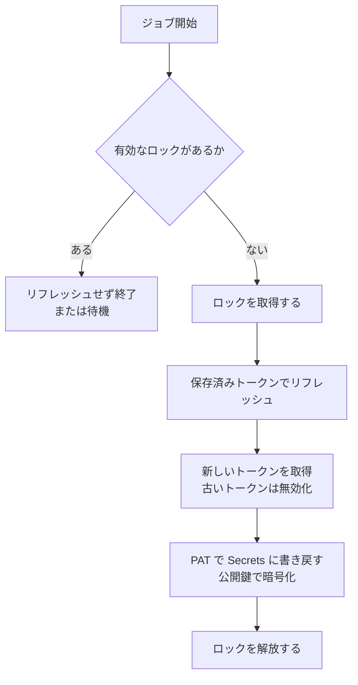

# OAuthリフレッシュトークンのローテーション競合とSecretsへの書き戻し

## 1. 概要

OAuth 2.0 のリフレッシュトークンがローテーション方式（リフレッシュのたびに新しいトークンが発行され、古いトークンが無効になる方式）の API を、CI などの自動実行環境から使い続けるときに起きる競合と、その対処を整理した知識である。

問題はこうである。自動実行のジョブがリフレッシュすると、手元のリフレッシュトークンはその瞬間に無効になり、新しいトークンに置き換わる。並列に走った別のジョブが、同じ古いトークンでリフレッシュしようとすると失敗する。さらに、ジョブが得た新しいトークンを次回の実行へ引き継ぐ仕組みがなければ、自動実行は一度きりで止まる。

対処は3点セットである。リフレッシュ処理にロックを掛けて並列実行の競合を防ぐこと。得た新しいトークンを、実行環境の秘密情報ストア（GitHub Actions なら GitHub Secrets）に API で書き戻すこと。その書き戻しに使う資格情報（PAT）の権限を、秘密情報の読み書きだけに最小化することである。

この知識は、X API v2 のブックマーク取得を GitHub Actions で毎日自動実行した実践（amu_lab の Zenn 記事）で、著者が「一番ハマったポイント」として記録した内容をもとに整理した。

## 2. 基本概念

- **リフレッシュトークンのローテーション**：リフレッシュのたびに新しいリフレッシュトークンが発行され、古いものが無効になる方式。漏れたトークンの悪用を難しくするための設計だが、トークンの保持側には「常に最新を保持し続ける」義務が生じる。
- **競合（レース）**：並列に走る複数のジョブが、同じ古いトークンでリフレッシュを試みる状態。先に成功したジョブの時点で古いトークンは無効になるため、後発は失敗する。
- **ロック（状態ファイル方式）**：リフレッシュ処理の前後で、ロックファイルの有無により排他する仕組み。ロック取得時刻を記録し、一定時間（事例では5分）を過ぎた古いロックは無効として扱うことで、異常終了したジョブのロックが残り続けることを防ぐ。
- **Secrets への書き戻し**：実行中に得た新しい秘密情報を、プラットフォームの API を使って秘密情報ストアに保存し直す処理。GitHub Secrets の場合、リポジトリの公開鍵で暗号化してから更新 API に送る。
- **PAT の最小権限**：書き戻しに使う Personal Access Token の権限を、対象リポジトリの Secrets の読み書きのみに絞ること。書き戻し用の資格情報自体が強い権限を持つと、それが漏れたときの影響が大きくなるためである。
- **offline.access スコープ**：リフレッシュトークンを取得するために必要な OAuth スコープ。これを付け忘れると、アクセストークンの有効期限（X API では2時間）のあとに自動更新ができなくなる。

## 3. 詳細解説

### 競合の発生条件

競合が起きるのは、次の条件が重なったときである。

1. API のリフレッシュトークンがローテーション方式で、使い捨てである。
2. 実行基盤が、ジョブを並列に走らせることがある（GitHub Actions では、スケジュール実行と手動実行の重なりや、再実行などで起こりうる）。
3. すべてのジョブが、同じ保存済みリフレッシュトークンから出発する。

ジョブ A がトークン v1 でリフレッシュして v2 を得ると、その時点で v1 は無効になる。ジョブ B が v1 でリフレッシュしようとすると、すでに無効なため失敗する。単発の実行では現れないため、仕組みが動き始めてから気づく種類の問題である。

### 対処1：ロックで直列化する

事例の対処は、状態ファイルによるロックである。リフレッシュの前にロックファイルを確認し、有効なロックがあればリフレッシュを行わない。ロックには取得時刻とジョブ ID を書き、5分（300秒）のタイムアウトを設けて、タイムアウトを過ぎたロックは古いものとして無視する。タイムアウトがあることで、ジョブが異常終了してロックが残っても、仕組み全体が止まり続けることはない。

なお、ロックは競合の確率を下げる実務的な対処であり、分散システムの厳密な排他制御ではない。実行間隔が空いた定期実行（毎日のバッチなど）では、この程度の対処で足りる、というのが事例の位置づけである。

### 対処2：新しいトークンを Secrets に書き戻す

ローテーション方式では、リフレッシュで得た新しいトークンを、次回の実行が読める場所に保存し直さなければ、自動実行はその回で終わる。GitHub Actions の場合、保存先は GitHub Secrets であり、ワークフローの中から Secrets を更新するには、Secrets の更新 API を叩くための PAT が別途必要になる。

更新の手順は次のとおりである。

1. 対象リポジトリの公開鍵を API で取得する。
2. 新しいトークンを、libsodium の Sealed Box でその公開鍵を使って暗号化する。
3. 暗号化した値と鍵 ID を、Secrets の更新 API に送る。

### 対処3：PAT の権限を最小化する

書き戻し用の PAT は、Secrets を書き換えられる強い資格情報である。漏れた場合の影響を抑えるため、権限は対象リポジトリの Secrets の読み書きのみに絞る。他の権限は不要であり、付けないことが、事例でも強く求められている。

### あわせて押さえる前提

- **offline.access スコープ**：そもそもリフレッシュトークンを得るには、初回認証でこのスコープが必要である。アクセストークンの有効期限は X API では2時間で、このスコープがないと、その後の自動更新ができない。
- **未使用での失効**：リフレッシュトークンは、長期間使われないと失効する場合がある。事例では、最低でも週1回の実行を維持することが対処として挙げられている。定期実行の間隔は、トークンの寿命からも決まる。
- **初回認証は手動**：PKCE フローの初回認証（ブラウザでの承認）だけは人の操作が要り、得たリフレッシュトークンを Secrets に初期設定するところから自動化が始まる。

## 4. 仕組み・構造

| 問題 | 対処 | 要点 |
| --- | --- | --- |
| 並列ジョブが同じトークンでリフレッシュする | ロックで直列化 | タイムアウト付きにし、残ったロックで止まり続けない |
| 新しいトークンが次回に引き継がれない | Secrets へ書き戻す | 公開鍵で暗号化して更新 API へ |
| 書き戻し用 PAT の漏洩影響 | 最小権限 | 対象リポジトリの Secrets 読み書きのみ |
| リフレッシュトークン自体が得られない・失効する | スコープと実行間隔 | offline.access を付ける。最低週1回の実行を維持 |

## 5. メリット・デメリット

この対処の組み合わせのメリット：

- ローテーション方式の API でも、人の介入なしに自動実行を継続できる。
- ロックとタイムアウトにより、並列実行の競合と、異常終了によるロック残りの両方に対処できる。
- PAT の権限を絞ることで、自動化のために増やした資格情報のリスクを、その用途の範囲に閉じ込められる。

注意点：

- 状態ファイルによるロックは、同一リポジトリ内での実務的な排他であり、厳密な分散ロックではない。実行頻度が高い場合や、失敗が許されない処理では、より強い仕組みが要る。
- Secrets の書き戻しは、プラットフォームの API 仕様（公開鍵の取得と暗号化）に依存する。GitHub 以外の CI では、相当する仕組みがあるかを確認する必要がある。
- ローテーション方式かどうかは API ごとに異なる。使い捨てでない API にこの対処を持ち込む必要はない。まず対象 API のトークン仕様を確認することが先である。

## 6. 活用例

- **X API の定期取得を GitHub Actions で回す**：事例そのものの形である。ブックマーク取得の毎日のバッチで、リフレッシュ前にロックを取り、得た新しいトークンを Secrets に書き戻し、PAT は Secrets の読み書きのみに絞る。
- **他のローテーション方式 API の自動化**：OAuth のリフレッシュで古いトークンが無効になる API は他にもある。CI で継続利用する場合は、並列実行の可能性、トークンの保存先の更新手段、その資格情報の権限範囲を、設計の初期に確認するチェックリストとして使える。

## 7. 関連する知識

- [JWTの構造とクレーム](jwt-structure-and-claims.md) — トークンそのものの構造を整理した知識。この知識が扱うのは、トークンの検証ではなく、リフレッシュトークンの寿命と引き継ぎという運用側の問題である。

## 8. 参照した情報源

- [X.comブックマークをGitHub Actions × Claude Codeで自動キュレーションする](../../sources/technical/2026-03-30-x-bookmark-curation-gha-claude-code.md) — amu_lab の Zenn 記事（2026-03-30）。「OAuth2トークンリフレッシュの競合問題」の節が、この知識の元になっている。
