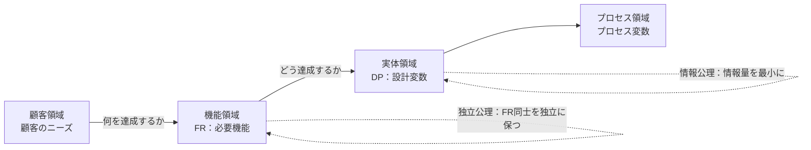

# 設計理論の考察（公理的設計：まとめ）

## 1. 概要

製造業で設計に従事する著者・涼介による、公理的設計（Axiomatic Design）についての日本語のまとめ記事である。note に 2024-03-24 に公開され、ページ上は 2026-06-13 の更新が表示されている。

構成は、（1）設計の概念と4つの領域、（2）公理的設計に関する文献調査、（3）設計公理（独立公理・情報公理）と系1〜8のまとめ、（4）設計者が陥りやすい共通の失敗の考察、（5）タグチメソッドや TRIZ など他の方法論との関係、からなる。土台となる文献は、Nam P. Suh の邦訳『公理的設計』（森北出版、2004年、中尾政之・飯野謙次・畑村洋太郎 共訳）と『設計の原理』（朝倉書店、1992年、畑村洋太郎 訳）であり、引用にはページ番号まで付されている。

公理的設計そのものの原典は Suh の著作であるが、本記事は日本語で一気に読める入口として、文献の当たり方をたどれる形に整理されている点に価値がある。

## 2. 要約

要点は次のとおりである。

- **設計とは写像である**。設計は、顧客の声から始まり、機能領域の FR（Functional Requirement、必要機能）を満たす実体領域の DP（Design Parameter、設計変数）を選択し、FR と DP の間の写像によって解を形にする行為である。領域は顧客・機能・実体（物理）・プロセスの4つがあり、左側の領域が「何を達成したいのか」を、右側の領域が「どう達成するのか」を表す。
- **良い設計は2つの公理で判定できる**。独立公理（FR の独立を保つこと）と情報公理（情報量を最小にすること）であり、この2公理から定理と系1〜8（干渉設計の独立化、FR の最小化、部品の統合、標準の利用、対称性の利用、設計許容範囲の最大化、情報量の小さい独立設計、有効なスカラー直角率）が展開される。
- **設計者が陥りやすい共通の失敗は2種類である**。FR に比べて DP が不足して干渉する「干渉設計」と、DP が過多な「冗長設計」である。また、生産システムで作れないほど許容範囲を小さくすると情報量が増大し、情報公理に反する。
- **公理的設計はロバスト設計を導き、タグチメソッドや TRIZ と親和性が高い**。タグチメソッドは多くの DP の中から主要な DP を決める方法として、TRIZ は FR と制約条件の両方を満たす DP を提案する道具として、それぞれ公理と整合すると整理されている。

## 3. 背景・前提知識

- **公理的設計（Axiomatic Design）**：Nam P. Suh が提唱した設計理論。証明はできないが反例が知られていない原理・原則（公理）を置き、そこから設計の良し悪しを論理的に判定しようとする枠組み。具体的な設計手順（方法論）というより、概念的な理論として位置づけられる、と記事は述べる。
- **FR（Functional Requirement、機能要求・必要機能）**：設計が達成すべき「何を」を表す、機能領域の変数。
- **DP（Design Parameter、設計パラメータ・設計変数）**：FR を満たすために選ぶ「どうやって」を表す、実体領域の変数。
- **設計方程式と写像行列**：FR と DP の関係は {FR} = [A]{DP} という行列方程式で表される。行列 A の成分が、どの DP がどの FR に関連するかを示す。
- **独立公理**：FR が互いに独立であり、かつ FR と DP の数を一致させること。これを満たす設計を独立設計と呼ぶ。
- **情報公理**：情報量を最小化すること。情報量は I = log（システム範囲／共通範囲）のように、設計範囲と実現可能な範囲（システム範囲）の重なり（共通範囲）から測る。
- **大富（2005）**：東芝レビューの「製品開発における上流設計の重要性とその方法」。製品のライフサイクルコストの大部分は設計段階で決まるため、上流設計がプロジェクトの成否に大きく影響する、という文脈で引かれている。

## 4. 詳細解説

記事はまず「設計」という言葉の概念から始める。設計にはプロダクト設計、プロセス設計、建築の設計など幅があるため理論化が難しいが、本記事では製造系の設計（プロダクト／プロセス）を対象にする。Suh の定義では、設計とは FR を満たす DP を選択し、FR と DP の間の写像によって、製品・製造プロセス・システムなどの形で解を総合する行為である。設計は4つの領域（顧客領域、機能領域、実体領域、プロセス領域）を順に写像していく行為として描かれ、左の領域が課題（何を達成したいのか）を、右の領域が解（左の要求をどう満たすのか）を表す、という双方向の関係が説明される。

次に文献調査として、公理的設計とその周辺の文献がレビューされる。中沢「公理論的設計法」（精密機械 50巻2号、pp341-346）は、機能的要求の独立性と情報量の最小化という2つの設計公理に焦点を当て、情報量による設計評価を紹介した初期の文献として挙げられる。吉川「設計とは何か：一般設計学の試み」は、設計を機能や要求仕様を満たす知的活動として捉える一般設計学の文脈である。大隈・藤本（2006）は、公理的設計を基礎に設計プロセスのシミュレーションモデルを構築し、モジュラー型とインテグラル型の製品アーキテクチャの違いが開発リードタイムに与える影響を分析した研究として紹介される。このほか、「タイム・コンサルタントの日誌から」の AI による設計自動化を論じた記事群や、山口の博士論文（2019、公理的設計を含む複数の設計方法論を比較し、品質工学の基本機能の数理的基礎付けを試みたもの）が取り上げられている。

設計公理の節では、Suh の邦訳2冊をもとに2公理がまとめられる。2公理からは系と定理が展開されるが、記事は付録の系1〜8を列挙し、「詰まるところ2公理に尽きる」と整理する。例として、日本で過去に見られた職人技の工程に頼る設計は、許容範囲が小さい点で情報公理（公理2）に反している、という指摘が紹介される（ただし当時はそれでよかったのかもしれない、という留保も添えられている）。

失敗の考察では、『公理的設計』p62 にある「設計者が陥りやすい共通の失敗」が取り上げられる。失敗は、FR に比べて DP 数が不十分で干渉するか、DP 数が過多で冗長であるか、のいずれかであり、それぞれ干渉設計と冗長設計を示唆する、という整理である。もう一つの失敗は、実際の生産システムでは製作不可能なほど許容範囲を小さくしてしまうことで、情報量が大きくなり、考慮すべき変数やパラメータが増えて複雑化を招く。情報量の具体例として、『設計の原理』p147 のブリネル硬さの例が引かれる。設計範囲が 200±10kg/mm2、熱処理プロセスのシステム範囲が 190±20kg/mm2 のとき共通範囲は 20kg/mm2 となり、情報量は I = log（システム範囲／共通範囲）で表される。共通範囲を大きくできれば情報量は小さくなるため、「FR を設定するときは許容範囲を可能な限り大きくせよ」（系6：設計許容範囲の最大化）が設計ルールとして働く。

最後に他の方法論との関係が述べられる。公理的設計は2公理から定理と系を引き出し、結果的にロバスト設計を導くため、タグチメソッドと TRIZ との親和性が非常に高い。タグチメソッドは、考えられる多くの DP の中から主要な DP を決定する方法であり設計公理に従っている。TRIZ は、矛盾の法則に基づいて FR と制約条件 C の両方を満足する DP を提案するために用いられる。まとめとして、背景に AI の発展という視点を加える必要はあるものの、公理的設計の論理的で効率的な構造は変わらず、成功の鍵はユーザーのニーズを最優先に考え、各段階で公理を念頭に置くことにある、と記事は結ぶ。

なお、Source としての観察を記録しておく。本記事は個人の note であり、冒頭にアフィリエイトプログラムの利用表記がある。細かい誤記も見られる。たとえば Suh を「Shu」とした箇所や、失敗の節で DP を「DR」と書いた箇所など、表記揺れがある。一方で、文献引用には書名・出版年・ページ番号まで付されており、原典をたどれる丁寧な構成である。内容を参照する際は、公理や系の正確な定義については邦訳書側で確認するのが安全である。

## 5. 重要なポイント

- 設計は「何を達成するか（FR）」から「どう達成するか（DP）」への写像であり、4つの領域（顧客・機能・実体・プロセス）で捉える。
- 良い設計の判定基準は2公理に集約される。独立公理（FR の独立を保ち、FR と DP の数を一致させる）と情報公理（情報量を最小にする）である。
- 系1〜8は2公理の実務的な言い換えであり、干渉設計の独立化、FR の最小化、設計許容範囲の最大化などが含まれる。
- 共通の失敗は、DP 不足による干渉設計と、DP 過多による冗長設計、そして許容範囲を小さくしすぎて情報量を増やすことである。
- 情報量は共通範囲の大きさで決まる。許容範囲を大きく取ることは、情報公理に沿う具体的な設計ルールになる。
- 公理的設計はロバスト設計と地続きであり、タグチメソッドや TRIZ は公理と矛盾しない道具として位置づけられる。

## 6. 図解

## 7. 自分なりの考察

以下はAIによる考察であり、元記事の主張ではない。

この記事の価値は、公理的設計そのものの紹介よりも、「日本語で読める入口と文献地図」を提供している点にあると考える。公理的設計は邦訳書こそあるものの、日本語の入門的な Web 記事は乏しく、原典にたどり着くまでの距離が遠い。本記事は中沢（1984）から山口（2019）まで文献を並べ、ページ番号つきで邦訳書を引くため、次に読むべきものを判断しやすい。

一方で、記事の中心はあくまで文献の整理であり、設計行列の3分類（対角・三角・それ以外）のような判定の手続きは、この記事自体では前面に出てこない。その部分は邦訳書や海外の講義資料で補う必要がある。また、記事が扱うのは製造系の設計であり、ソフトウェアのような非物理の対象へそのまま当てはめられるかは記事の範囲外である。この点は Knowledge 側で、出典の事実と分けて別途整理する。

## 8. 学んだこと

- 設計は FR から DP への写像であり、「何を」と「どうやって」を分けて考えることが公理的設計の出発点である。
- 独立公理と情報公理の2つで、設計の良し悪しを判定する物差しが作れる。
- 失敗は「DP 不足で干渉する」「DP 過多で冗長になる」「許容範囲が小さすぎて情報量が増える」に整理できる。
- 許容範囲を大きく取ることは、情報量を下げる具体的な行動になる。
- 公理的設計はタグチメソッドや TRIZ と対立するものではなく、ロバスト設計を導く土台として接続している。

## 9. 関連情報

- [公理的設計：機能要求の独立を保つ](../../knowledge/design/axiomatic-design-independence.md) — 本記事から抽出した Knowledge。
- [デザインエンジニアリング](../../topics/design-engineering.md) — Design カテゴリの横断 Topic。本記事は、UI の質を扱う既存の情報源とは別系統の、古典的な設計理論の情報源として位置づく。
- 記事が土台とする邦訳書：Nam P. Suh『公理的設計』（森北出版、2004年、ISBN 9784627664814）、Nam P. Suh『設計の原理』（朝倉書店、1992年）。

## 10. 原文

元URL：https://note.com/happy_impala205/n/ndfb89d32b555
