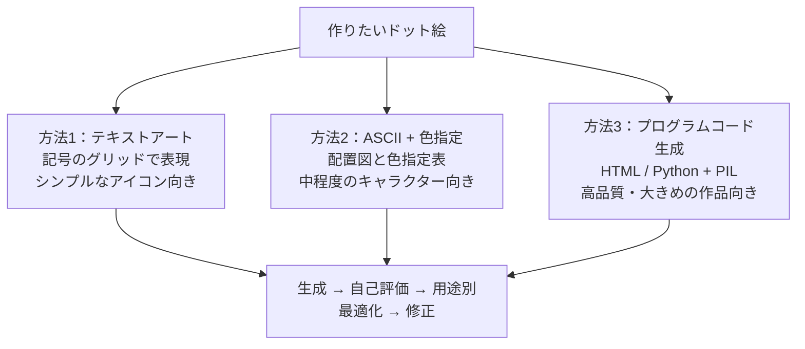

# ChatGPT×ドット絵ピクセルアートの作成手順やプロンプト完全ガイド

## 1. 概要

ChatGPT を使ってドット絵（ピクセルアート）を作る手順と、効果的なプロンプトの書き方をまとめたガイドである。掲載メディアは AI 情報メディア「キレカク」。著者は AI 導入コンサルタントを名乗り、ビジネス活用を念頭に書いている（著者名は記事中に明記されていない）。

内容は、ドット絵の基礎、ChatGPT で作る3つの方法、用途別のプロンプト例、制作の効率化、品質の検証と修正、プロンプトの黄金法則、よくある問題への対処、商用利用の注意点までを扱う。実践例として、猫のキャラクターを 16×16 ピクセルで作る例も載っている。

なお、記事中のビジネス効果の数字（フォロワー増加率、コスト削減率など）は、著者が支援事例として紹介している主張であり、第三者による検証は記事中では示されていない。本ファイルでは、著者の主張として区別して記録する。

## 2. 要約

記事の要点は次のとおりである。

- **ドット絵がビジネスで注目される理由（著者の主張）**：デザイナーへの依頼（1点あたり5,000〜30,000円）と比べ、ChatGPT Plus（月額20ドル）なら低コストで何点でも作れる。特徴的な見た目が SNS のタイムラインで目立ち、著者の支援した中小企業ではフォロワー数が3ヶ月で150％増えたという。また、アプリや社内システムにドット絵キャラクターを入れると利用者の継続率が上がる（教育系スタートアップで40％向上したという）事例が紹介されている。
- **作り方は3つ**：(1) 記号によるテキストアート生成、(2) ASCII 文字と色指定の組み合わせ、(3) HTML や Python などのプログラムコード生成。品質と再現性を求めるなら (3) が最も向くとされている。
- **方法1の実践例**：16×16 ピクセル、4色（黒・白・オレンジ・ピンク）、レトロゲーム風で「可愛い猫の顔」を作るプロンプト例と、記号による出力例が載っている。改良のコツは、色を具体的に指定すること、参考作品を例示すること、小さいサイズから段階的に拡大することである。
- **効率化の3点**：複数のドット絵を作るときは、最初に統一カラーパレットを決める。ベースのキャラクターから表情・服装のバリエーションを派生させる。歩行などのアニメーションは、フレームを横並びにしたスプライトシートとして生成させる。
- **品質の検証プロセス**：初回生成を技術的品質（ピクセルの整列、色の統一、サイズ感）とデザイン品質（視認性、魅力度、用途への適合性）で5段階評価し、評価が低い項目は改善案を出させる。次に用途別（SNS アイコン、印刷物、ファビコン）に最適化し、最後に A/B テスト用のバリエーションを作る。
- **プロンプトの黄金法則**：5W1H と技術仕様を明確にすること。コンセプト確認→詳細設計→最終調整と、段階的に詳しくすること。制約条件には優先順位を付けること。
- **よくある問題への対処**：ぼやける場合はアンチエイリアスの禁止を明示する。色数が増える場合は、使用できる色を HEX コードで列挙し、それ以外を禁止する。比率がおかしい場合は、キャンバス内の領域配分（頭・胴体・脚が何行目か）を数値で指定する。
- **商用利用（著者の見解）**：2025年1月時点の著者の整理では、生成されたコンテンツは基本的に著作権フリーで、ChatGPT Plus 契約下では商用利用に制限がないとされている。ただし、プロンプトの記録、既存キャラクターとの類似性確認、商標の抵触確認、必要に応じた法的レビューがチェックリストとして挙げられている。

## 3. 背景・前提知識

- **ドット絵（ピクセルアート）**：小さな正方形（ピクセル）を組み合わせて描くデジタルアート。限られた色数と解像度の中で表現する。ゲームのキャラクター、SNS アイコン、ファビコン、ロゴなどに使われる。
- **テキストアート**：■や□などの記号の並びで絵を表現する手法。記号ごとに色を割り当てることで、ドット絵の配置図になる。
- **ASCII + 色指定**：アルファベットや記号の配置図と、各記号に対応する色の表を組み合わせて、キャラクターを定義する手法。
- **カラーパレット**：作品に使う色の集合。先に決めて統一すると、複数の作品やバリエーションに一貫性が出る。
- **アンチエイリアス**：境界を滑らかに見せるための中間色の処理。ドット絵ではピクセルの境界がぼやける原因になる。
- **スプライトシート**：アニメーションの各フレームを1枚の画像に横並びに配置したもの。ゲームエンジンなどで読み取って再生する。
- **ChatGPT Plus**：記事で前提とされている有料プラン（月額20ドル）。記事中の商用利用の整理は、このプランの利用規約を前提としている。

## 4. 詳細解説

### 3つの作り方

記事では、ChatGPT でドット絵を作る方法が3つに整理されている。

1. **テキストアート生成**：■□●○などの記号で絵を表す。難易度は最も低く、シンプルなアイコンやロゴに向く。プロンプトでは、作成対象、サイズ（例：16×16）、色数、スタイル、用途、出力形式（どの記号が何色か）を指定する。
2. **ASCII + 色指定**：記号の配置図と色指定表を組み合わせる。中程度の複雑さのキャラクターに向く。キャラクター設定（名前、性格、服装など）と技術仕様（サイズ、色パレットを HEX コードで、アニメーションの有無）を分けて書き、出力には制作意図の説明も含めさせる。
3. **プログラムコード生成**：HTML テーブルや Python + PIL のコードを生成させる。最も高品質で大きなサイズにも向くとされる。各ピクセルに色を設定し、アンチエイリアスなしで拡大表示する要件をコードに含める。

### 方法1の実践例：猫のキャラクター

方法1の例として、16×16 ピクセル、4色（黒、白、オレンジ、ピンク）で猫の顔を作るプロンプトと、9×9 の記号グリッドによる出力例が載っている。プロンプト改良のコツとして、次の3点が挙げられている。

- 色は「赤」のような抽象的な指定ではなく、「レンガ色」「朱色」のように具体的に指定する。
- 「ファミコンのマリオのような」など、既存作品を参考イメージとして示す。
- まず 8×8 で試し、満足したら 16×16、32×32 へと段階的に拡大する。

### 効率化：パレット統一、バリエーション、アニメーション

複数のドット絵を制作する際は、統一されたカラーパレットを最初に決定することが重要だとされている。パレット作成自体もプロンプトで行い、色名と HEX コード、使用用途、組み合わせ例を出させる。

バリエーションは、一つのベースキャラクターから派生させる。表情（基本、喜び、怒り、悲しみ、驚き）や服装のパターンを列挙し、変更点を明確にして統一感を保たせる。

アニメーションは、歩行なら4フレームのスプライトシートとして生成させる。各フレームの個別表示、横並びのシート、フレーム間の差分説明、推奨フレームレートを出力に含める。左向きは反転処理で作る。

### 品質向上のための検証・修正プロセス

記事では、生成後の検証を3ステップで回す方法が示されている。

1. **初回生成と基本評価**：技術的品質（ピクセルの整列性、色使いの統一性、サイズ感の適切性）とデザイン品質（視認性、魅力度、用途への適合性）を5段階で自己評価させ、3以下の項目には具体的な改善案を出させる。
2. **用途別最適化**：SNS アイコン（64×64 表示）、印刷物（名刺サイズ）、Web ファビコン（16×16）など、用途ごとに問題点と修正版を作らせる。
3. **A/B テスト用バリエーション**：現在のデザイン、親しみやすさ重視、プロフェッショナルさ重視などのパターンを作り、変更点と想定効果を比較できる形にする。

### プロンプトの黄金法則

著者は、多数の制作支援の経験から、効果的なプロンプトの共通パターンとして3つを挙げている。

1. **5W1H + 技術仕様の明確化**：What（何を）、Who（誰が使う）、When（いつ使う）、Where（どこで使う）、Why（なぜ作る）、How（サイズや色数などの技術的な実現方法）を書く。
2. **段階的詳細化**：第1段階でコンセプトを複数パターン出させ、第2段階で採用したパターンの詳細仕様を詰め、第3段階で完成品の具体的な修正点を伝える。
3. **制約条件の優先順位明示**：ファイルサイズ、色数、視認性、デザイン性などの制約に「最優先」「優先」「重要」「希望」と順位を付け、制約が競合した場合は優先順位に従わせる。

### トラブルシューティング

記事で挙げられている、よくある問題と解決法は次の3件である。

- **問題1：ぼやけている**。原因は、ChatGPT が自動的にアンチエイリアスを適用することだとされる。解決法は、アンチエイリアス完全無効、シャープなピクセル境界、色混合なし、各ピクセル単色、を必須条件として明示し、「ぼかし」「グラデーション」「滑らか」な処理を使わないよう指示すること。
- **問題2：色数が指定より多くなる**。原因は、色指定が曖昧なことだとされる。解決法は、使用可能色を HEX コードで列挙し（例：#000000、#FFFFFF など）、それ以外の色、濃淡の調整、透明度の変更をすべて禁止すること。各ピクセルがどの色番号かも配置図に明記させる。
- **問題3：キャラクターの比率がおかしい**。原因は、サイズ制約内での描画の優先順位が不明確なことだとされる。解決法は、領域配分を数値で指定すること。記事の例では、32×32 の場合、頭部は1〜12行目、胴体は13〜24行目、脚部は25〜32行目、横幅は中央24ピクセル（左右余白各4ピクセル）と指定している。

### 商用利用時の注意点

著者の整理（2025年1月時点）では、生成されたコンテンツは基本的に著作権フリー、プロンプト自体に創作性がある場合は著作権の対象になりうる、ChatGPT Plus 契約下では商用利用に制限がない、とされている。安全な商用利用のチェックリストとして、Plus 契約の有効性、生成時プロンプトの記録・保存、他社の著作物を参考にしていないこと、既存キャラクターとの類似性確認、商標登録の抵触確認、必要に応じた法的レビューが挙げられている。独自性確保のため、既存キャラクターとの類似性を避け、独特な特徴を最低3つ入れることも推奨されている。

なお、これらは著者の見解であり、法的な助言ではない。実際の権利関係は、利用するサービスの規約と法令をその都度確認する必要がある。

## 5. 重要なポイント

- ChatGPT でドット絵を作る方法は、テキストアート、ASCII + 色指定、プログラムコード生成の3つであり、品質を求めるならコード生成が向く。
- 色は具体的に（できれば HEX コードで）指定し、使用できる色を列挙して、それ以外を禁止すると、色数の暴走を防げる。
- ぼやけの対策は、アンチエイリアスの禁止と、各ピクセル単色の明示である。
- 比率の崩れの対策は、頭・胴体・脚などの領域配分を行番号で数値指定することである。
- プロンプトは、5W1H + 技術仕様を書き、コンセプト→詳細→調整の段階を踏み、制約には優先順位を付ける。
- 複数の作品を作るなら、最初に統一カラーパレットを決め、ベースからバリエーションを派生させる。
- 生成後は、技術的品質とデザイン品質の自己評価、用途別最適化、A/B バリエーションの3ステップで検証と修正を回す。
- アニメーションは、フレームを横並びにしたスプライトシートとして生成させる。
- 記事中のビジネス効果（フォロワー150％増、継続率40％向上、コスト90％以上の削減など）は、著者が紹介する事例・主張であり、検証済みの事実としては扱わない。
- 商用利用の可否についての記述は著者の見解（2025年1月時点）であり、確認はサービスの規約と法令で行う必要がある。

## 6. 図解

3つの作り方の関係を図にすると、次のとおりである。

## 7. 自分なりの考察

以下は、AIによる考察である。元記事の主張とは区別して読むこと。

この記事の方法3（プログラムコード生成）は、いま muse-playground で進めているドット絵猫ジェネレーターの作り方とちょうど同じである。文字マップでピクセル配置を定義し、コードで色を割り当てて描画する方式は、再現性が高く、組み合わせ生成やバリエーション展開にも向いている。記事が方法3を「最も高品質」と位置づけているのは、この再現性と制御の細かさによるものと考えられる。

記事のトラブルシューティングは、ピクセル単位で制御する作業全般に転用できる。特に「比率がおかしい場合は、領域配分を行番号で指定する」という対処は、プロンプト経由でなく直接マップを描く場合でも有効である。おさんぽポーズの描き直しでは、頭・体・脚の行配分を先に決めてから描くことで、全体のバランスを取りやすくなった。

一方で、記事のビジネス効果の数字（フォロワー150％増、コスト94〜98％削減、NFT 市場300％成長など）は、根拠の内訳が示されていない著者の主張である。手法のガイドとしては有用でも、効果の見積もりには使わないほうがよい。また、商用利用に関する法的な整理は簡略化されており、2025年1月時点の見解として記録するに留める。

## 8. 学んだこと

- AI でドット絵を作る方法は、テキストアート、ASCII + 色指定、プログラムコード生成の3つに整理できる。コード生成は再現性と制御の細かさで優れる。
- 色数の暴走は、使用可能色を HEX コードで列挙し、それ以外（濃淡・透明度を含む）を禁止することで防げる。
- ぼやけはアンチエイリアスが原因であり、禁止を明示し、各ピクセル単色を指定することで防げる。
- 比率の崩れは、頭・胴体・脚などの領域配分を行数で指定することで防げる。
- プロンプトは、5W1H + 技術仕様、段階的詳細化、制約の優先順位明示が要点である。
- バリエーションはゼロから作り直すのではなく、統一パレットのもとでベースから派生させるのが効率的である。

## 9. 関連情報

- 掲載メディア：キレカク（AI情報メディア）。記事中に著者名の明記はない。
- 関連する Knowledge は、抽出後にこの節へ追加する。

- [AIでドット絵を作る3つの方法](../../knowledge/ai/ai-pixel-art-generation-methods.md)
- [ドット絵生成のプロンプト設計](../../knowledge/ai/pixel-art-prompt-design.md)

## 10. 原文

元URL：https://kirekaku.com/770/
