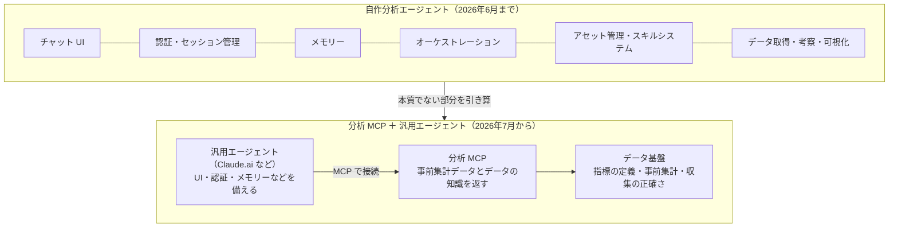

# 自作AIエージェントの開発をやめた

## 1. 概要

ブログ「無駄と文化」に掲載された記事で、データ分析用途の AI エージェント（分析エージェント）をスクラッチで開発していた著者が、2026年6月まででその開発をやめ、7月からは分析用の MCP として作り直した経緯と振り返りをまとめたものである。公開日は 2026-11-05 である。

中心となる主張は三つある。第一に、AI エージェントの全体を自作すると、本質的なタスク（データ分析）ではない部分の実装コストがかかりすぎる。第二に、必要な部分だけを MCP 化し、残りを汎用エージェント（Claude.ai など）に任せる構成で、著者の用途では十分に機能した。第三に、良い分析体験の決め手はエージェントそのものではなく、エージェントが動く手前にあるデータ基盤（指標の定義、事前集計、データ収集の正確さ）にある。

なお、著者名は記事ページからは確認できなかったため、Front Matter の著者は空欄にしている。

## 2. 要約

- **分析エージェントから分析 MCP へ**：もともと作ろうとしていたのは、チャット UI で分析を依頼すると、データ取得・考察・結果の可視化までを担うエージェントだった。しかし全体を自作するには構成要素が多すぎたため、2026年7月からは、事前集計されたデータを返したり、各データについての知識を的確に返したりする MCP として作り直した。汎用エージェントにこの MCP を接続するだけで、基礎的なデータ分析を担うエージェントとして使えそうだ、という感触を得ている。
- **自作エージェントの守備範囲**：分析エージェントは Google Agent Development Kit（ADK）を使って作っていた。ADK はマルチエージェントシステムを構築・デプロイするためのフレームワークで、サブエージェントの定義やタスク分担・オーケストレーションを手軽にできる。それでも、UI、認証基盤、セッション管理、メモリー、サブエージェントのオーケストレーションルール、アセットのアップロード、アセット管理、スキルシステムなどは自作する必要があった。これらは無くても分析エージェントとしては成り立つが、普段使っている Claude.ai、ChatGPT、Gemini などと比べてしまうと物足りないものになる。
- **メモリーという難所**：セッションをまたいでユーザーの関心事ややりとりの注意点を記憶させる仕組みは、特に難しい。仕組み自体は「会話から覚えておくべきことを抽出する」「データベースに永続化する」「しかるべきタイミングで検索し、適切に参照させる」という単純なものだが、その一つひとつが奥深い。mem0 などのサードパーティ製 API で楽をしても、過去のメモリーの訂正や忘却は実装側で工夫する必要がある。最大の欠点は、ユーザーが普段使っている AI エージェントとの間でメモリーが共有されないことで、どれだけ良いエージェントを自作しても、メモリーが引き継がれないことが乗り換えの障壁になりうる。
- **汎用エージェントに任せられること**：分析 MCP を接続することで、汎用エージェントが「分析エージェント化」した感覚が得られた。データ表示の UI は手放しでも改善されていく（最近の Claude.ai は Artifacts でインタラクティブな可視化もしてくれる）。認証基盤・メモリー・アセット管理・スキルシステムも、普段使い慣れた仕組みをそのまま分析業務に活用できる。これらの備え付けられた便利な仕組みを捨ててまで、自作エージェントをゼロから作る動機を著者は見出せなかった。
- **分析の手応えとデータ基盤**：当初は「BigQuery の execute_sql ツールを AI に繋げば良い感じの洞察を語ってくれる」と考えていたが、これは違った。工夫のないデータを渡すだけでは、「朝晩は電車が混むようです」「冬はおでんが売れるようです」といった分かりきったことしか言わない。前進の感覚が得られたのは、注目すべき指標を定義してチームで合意したとき、その指標が日々事前集計されるよう仕組み化したとき、その指標が正確になるようデータの収集方法を見直したときだった。どれも AI 以前の工程であり、有用な分析エージェントには有用なデータ基盤が必要だった。
- **MCP への移行は引き算で進んだ**：コードの多くは分析エージェント時代のものを流用でき、リライトで整理整頓もできた。MCP のベースには FastMCP を使っている。Google ADK も FastMCP もベースには FastAPI があるため、コードが似通っており、ドメインモデルの面でも実装の面でも移行は難しくなかった。
- **使ってもらえる場所に届ける**：チーム内で MCP を共有し、Claude.ai のコネクタとして接続して使ってもらったところ、普段使っている Claude.ai が突然分析エージェントとして振る舞い出すことが面白がられ、活用例がシェアされた。自作分析エージェントを作り続けていたら、この驚きと品質は提供できていなかった、と著者は振り返っている。

## 3. 背景・前提知識

- **AI エージェント**：指示を受けて、データ取得や考察などのタスクを自律的に進める AI システム。この記事では、チャット UI で分析を依頼できる専用の分析エージェントが主題である。
- **MCP（Model Context Protocol）**：AI アプリケーションが外部のデータやツールと接続するための仕組み。この記事では、分析に必要なデータや知識だけを MCP として切り出し、汎用エージェントから使えるようにする構成が採られている。
- **汎用エージェント**：Claude.ai、ChatGPT、Gemini のように、特定用途に限らず広く使われる AI エージェント・チャットサービスの総称として、記事中で使われている言い方である。UI、認証、メモリーなどの基盤があらかじめ備わっている。
- **Google ADK（Agent Development Kit）**：マルチエージェントシステムを構築・デプロイするためのフレームワーク。著者が自作分析エージェントの開発に使っていた。
- **FastMCP**：MCP サーバーを構築するためのフレームワーク。著者が分析 MCP のベースに使っている。ベースに FastAPI がある。
- **FastAPI**：Python の Web フレームワーク。Google ADK も FastMCP もベースに FastAPI があることが、移行時のコードの似通いにつながった、と記事では説明されている。
- **メモリー**：セッションをまたいで、ユーザーの関心事ややりとりの注意点を記憶しておく仕組み。抽出、永続化、検索と参照、訂正、忘却といった要素からなる。
- **mem0**：メモリー機能を提供するサードパーティ製の API。使えば楽はできるが、訂正や忘却など開発者側の工夫は残る、と記事では述べられている。
- **Artifacts**：Claude.ai の機能で、インタラクティブな可視化などを含む成果物を表示できる。汎用エージェント側の UI が手放しでも改善されていく例として挙げられている。
- **事前集計**：分析に使うデータを、あらかじめ集計しておくこと。注目すべき指標が日々事前集計されるよう仕組み化することが、分析の前進につながったとされている。

## 4. 詳細解説

### 分析エージェントから分析 MCP へ

著者がもともと作ろうとしていたエージェントは、チャット UI で分析を依頼すると、データ取得・考察・結果の可視化までを担うものだった。ところが、AI エージェント全体を作ろうとすると、自作しなければならない構成要素が多すぎる。すべてに注力するには時間がかかり、限られた時間で多くのものを作ろうとすると、一つひとつの品質は下がってしまう。

そこで 2026年7月からは、分析 MCP として作り直すことにした。事前集計されたデータを返したり、各データについての知識を的確に返したりする MCP である。著者の用途では、MCP を作り込むので十分だという感触を得ており、汎用エージェント（Claude.ai など）に MCP を接続するだけで、基礎的なデータ分析を担うエージェントとして使えそうだ、と述べている。

### 自作エージェントの守備範囲

分析エージェントは Google ADK を使って作っていた。ADK はマルチエージェントシステムを構築・デプロイするためのフレームワークで、サブエージェントを定義してタスク分担やオーケストレーションを手軽にできるようになる。

とはいえ、AI エージェントを自作するとなると、賄わなければならない領域は多岐にわたる。記事では、UI、認証基盤、セッション管理、メモリー、サブエージェントのオーケストレーションルール、アセットのアップロード、アップロードされたアセットの管理、スキルシステムが挙げられている。

これらは、UI 以外は無くても分析エージェントとして成り立つものである。ただし、普段使っている Claude.ai、ChatGPT、Gemini などと比較してしまうと、物足りないものになる、というのが著者の実感である。

### メモリーという難所

特に難しいのがメモリーである。セッションをまたいで、ユーザーの関心事ややりとりの注意点を記憶させておく仕組みを指す。

仕組み自体はシンプルで、ユーザーとの会話から覚えておくべきことを抽出し、何らかのデータベースに情報を永続化し、しかるべきタイミングでデータベースを検索して適切に参照させる、というものだ。しかし、「覚えておくべきことを抽出する」「しかるべきタイミングで検索する」「適切に参照させる」の一つひとつが奥深すぎる、と著者は述べている。

mem0 などのサードパーティ製 API を使って楽をすることはできるが、開発者側でやるべきことは残る。過去のメモリーを訂正すること、過去のメモリーを忘却させることなどは、実装側で工夫する必要がある。

そして最大の欠点として挙げられているのが、メモリーの非共有である。ユーザーが普段使っている AI エージェントとの間でメモリーが共有されないため、どれだけ良い AI エージェントを自作しても、メモリーが引き継がれないことが乗り換えの障壁になりうる。

### 汎用エージェントに任せられること

自作エージェントでは、本質的なタスク（データ分析など）でない部分に実装コストがかかりすぎる。一方で、必要な部分だけを MCP 化し、残りを汎用エージェントに任せる構成は、著者の場合とてもうまく機能している。作り直した分析 MCP を接続することで、汎用エージェントが「分析エージェント化」した感覚だという。

具体的には、データを表示する UI は手放しでも改善されていく。最近の Claude.ai は Artifacts でインタラクティブな可視化もしてくれる。認証基盤、メモリー、アセット管理、スキルシステムも、普段使い慣れた仕組みをそのまま分析業務にも活用できる。

これらの「備え付けられた」便利な仕組みを捨ててまで、自作エージェントをゼロから作る動機を、著者は見出せなかった。

### 分析の手応えとデータ基盤

では、自作の分析エージェント作りは全くの無駄だったのかというと、そうでもない。分析エージェントを作る中で、分析業務に本質的に重要な部分と、汎用の仕組みを活用すべき部分が見分けられるようになったからである。

最初は、BigQuery の execute_sql ツールを AI に繋げば、良い感じの洞察を語ってくれるのではないかと考えていた。しかしこれは全然違った。当たり前のデータを渡すだけでは、当たり前のことしか言わないのが AI である。何の工夫もしなければ、「朝晩は電車が混むようです」「冬はおでんが売れるようです」などの分かりきったことしか言わない。

むしろ、分析エージェントとして前進している感覚が得られたのは、注目すべき指標をしっかり定義しチームで合意したとき、注目すべき指標が日々事前集計されるよう仕組み化したとき、注目すべき指標が正確になるようにデータの収集方法を見直したときだった。

これらはどれも AI 以前の工程であり、データ基盤として当たり前のことを地道にやる類の作業である。つまり、有用な分析エージェントを作るためには有用なデータ基盤が必要で、エージェントを作っている場合ではなかった、というのが著者の結論である。

### 引き算で進んだ MCP への移行

分析エージェントをやめて分析 MCP を作った結果、コードの多くは分析エージェント時代のものを流用できている。リライトにあたって整理整頓できたのも良かったという。

MCP のベースには FastMCP を使っている。Google ADK も FastMCP もベースには FastAPI があるため、コードがとても似通ったものになる。そのため、ドメインモデルの面でも実装の面でも、移行は難しくなかった。

### 使ってもらえる場所に届ける

先日、チーム内で MCP を共有し、Claude.ai のコネクタとして接続して使ってもらった。普段使っている Claude.ai が突然分析エージェントとして振る舞い出すのは、皆にとっても面白かったらしく、「こんな感じで使ってみました」と活用例がシェアされてきた。

著者がずっと自作分析エージェントを作っていたとしても、このような驚きと品質を提供できていなかったと思う、と振り返っている。技術を使うべき正しい場所をようやく見つけ出したような気分になっている、という言葉で記事は締めくくられている。

## 5. 重要なポイント

- AI エージェント全体の自作は、本質的なタスク以外の構成要素（UI、認証、セッション管理、メモリー、オーケストレーション、アセット管理、スキルシステム）の実装コストがかかりすぎる。
- 必要な部分だけを MCP 化し、残りを汎用エージェントに任せる「引き算」の構成で、著者の用途では十分に機能した。
- メモリーは自作の難所であり、抽出・検索・参照の難しさに加え、訂正と忘却の工夫が残り、さらに普段使いのエージェントと共有されないことが乗り換えの障壁になる。
- 良い分析体験の決め手はエージェントではなく、その手前のデータ基盤にある。指標の定義と合意、日々の事前集計、データ収集の正確さが前進の実感につながった。
- 汎用エージェント側の仕組み（UI の改善、Artifacts による可視化、認証、メモリーなど）は手放しでも良くなっていくため、自作で置き換える動機は弱い。
- 届け先は、ユーザーが普段使っている場所である。使い慣れた汎用エージェントに接続できる形で届けることで、使ってもらえる機会と驚きが生まれた。

## 6. 図解

## 7. 自分なりの考察

以下は AI による考察であり、元記事の主張とは区別する。

この記事の判断は、「作れるかどうか」ではなく「どこに注力すべきか」という配分の問題として読める。自作の守備範囲の広さは、フレームワーク（ADK）を使ってもなお残るものであり、フレームワークが肩代わりするのはオーケストレーションなどの一部に限られる、という点は、他の用途の専用エージェントを検討するときにも当てはまる見方だと考えられる。

また、メモリーの非共有が乗り換えの障壁になるという指摘は、機能の優劣とは別の、利用の定着の問題を指している。専用エージェントの価値を考えるときは、機能そのものに加えて、利用者が普段の場所から移ってくるコストまで含めて見積もる必要がある、という示唆として整理できる。

データ基盤の話は、エージェントの出力の質が、入力されるデータの整い具合でほぼ決まるという話でもある。ツールを繋ぐだけでは洞察は生まれず、指標の定義という人間側の合意形成が先に必要だった、という順序は、分析以外のエージェント用途でも参考になる可能性がある。ただし、これは著者の分析用途での経験にもとづくものであり、あらゆる用途にそのまま当てはまるとは限らない。

## 8. 学んだこと

- 専用エージェントの自作では、本質的なタスク以外の基盤部分（UI、認証、セッション管理、メモリー、オーケストレーション、アセット管理、スキルシステム）が実装コストの中心になりうる。
- 必要な機能だけを MCP として切り出し、汎用エージェントに接続する構成は、自作の守備範囲を引き算する現実的な選択肢である。
- エージェントのメモリーは、抽出・永続化・検索と参照という仕組み自体は単純でも、その精度と、訂正・忘却の運用が難しい。さらに、他のエージェントと共有されないことは定着の障壁になる。
- 分析エージェントの出力の質は、データ基盤で決まる。指標の定義と合意、事前集計の仕組み化、データ収集の正確さが先に必要である。
- 成果物は、利用者が普段使っている場所に届けることで使われやすくなる。汎用エージェントへのコネクタという形は、そのための届け方の一つである。

## 9. 関連情報

- [専用エージェントを自作せず、汎用エージェントと MCP で構成する判断](../../knowledge/ai/custom-agent-vs-general-agent-with-mcp.md)
- [エージェントのメモリー設計の難所](../../knowledge/ai/agent-memory-design-challenges.md)
- [分析エージェントの価値はデータ基盤で決まる](../../knowledge/ai/data-foundation-for-analysis-agents.md)
- [人工知能](../../topics/artificial-intelligence.md)

## 10. 原文

元URL：https://blog.mudatobunka.org/entry/2026/11/05/100000
