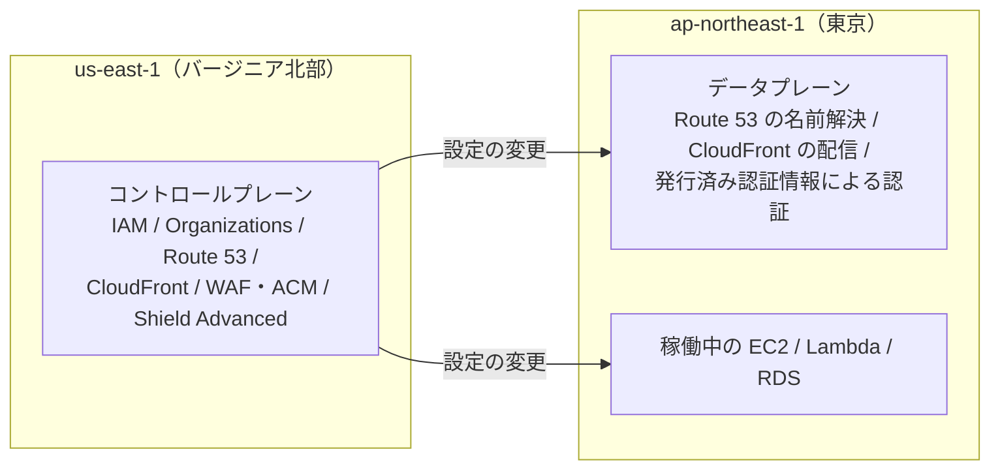
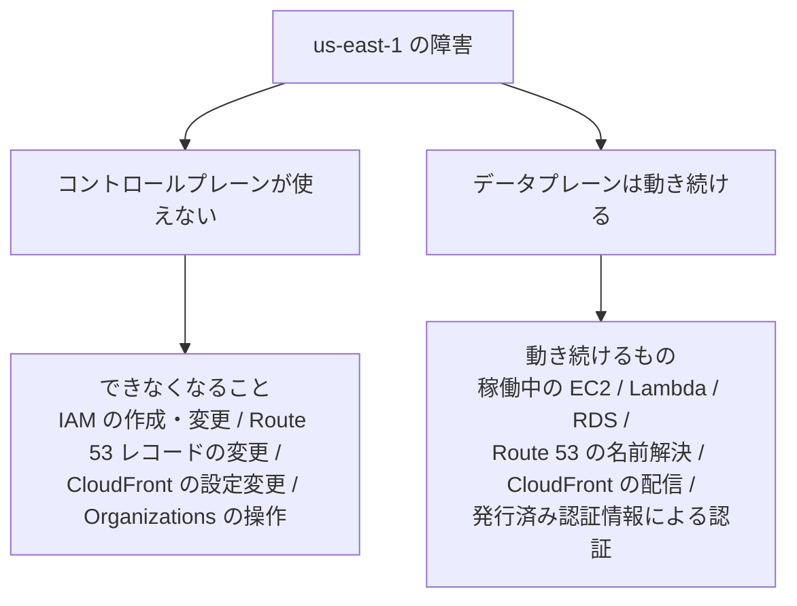

# 東京リージョンで使っていてもバージニア北部に依存しているもの

## 1. 概要

東京リージョン（ap-northeast-1）でシステムを動かしていても、バージニア北部リージョン（us-east-1）に依存しているものがある、という話である。AWS公式ホワイトペーパー「AWS Fault Isolation Boundaries」と、2025年10月20日に起きた us-east-1 の大規模障害の事後報告に基づいている。

中心となる考え方は、コントロールプレーンとデータプレーンの分担である。グローバルサービスの管理機能（コントロールプレーン）は us-east-1 にあり、実際に処理を行う側（データプレーン）は各リージョンに分散している。そのため、東京でサービスを使っていても、設定の変更や一部の操作は us-east-1 を通る。us-east-1 が障害を起こすと、東京で動いているものが止まらなくても、変更ができなくなる場合がある。

著者は、業務で敢えてバージニア北部リージョンを使うことがあり、振り返りを兼ねてこの記事を書いた、と結んでいる。

## 2. 要約

東京リージョンでシステムを動かしていても、次のようなものが us-east-1 に依存している。

- **グローバルサービスのコントロールプレーン**：IAM、AWS Organizations、Route 53、CloudFront、CloudFront 用の WAF・ACM、Shield Advanced などの管理機能は us-east-1 にある。データプレーンは各リージョンに分散しているため、ふだんの利用は東京でできる。
- **us-east-1 にしかないサービス**：請求・コスト管理、Billing Conductor、Marketplace の一部の API などは、us-east-1 にしかない。
- **東京で使っていても us-east-1 に置くログ**：Route 53 クエリログ、CloudFront 用 WAF のログ、CloudFront 標準ログ（v2）、CloudTrail のグローバルサービスイベント、請求額メトリクス EstimatedCharges などがある。
- **us-east-1 障害時に東京の利用者に起きること**：稼働中の EC2 / Lambda / RDS、Route 53 の名前解決、CloudFront の配信、発行済み認証情報による認証は基本的に動き続ける。一方で、IAM の作成・変更、Route 53 レコードの変更、CloudFront の設定変更、Organizations の操作はできなくなる可能性がある。
- **東京で呼び出しても us-east-1 に依存する操作**：S3 バケットの作成・削除や設定変更、API Gateway のエッジ最適化エンドポイントの作成、ELB / RDS などの DNS 登録などがある。
- **2025年10月の障害**：米国太平洋夏時間 2025年10月19日23:48〜10月20日14:20（日本時間 2025年10月20日15:48〜10月21日6:20）に起きた。発端は、DynamoDB の DNS を管理する仕組みの競合状態で、`dynamodb.us-east-1.amazonaws.com` の DNS レコードが空になったことである。us-east-1 以外にも、コンソールのサインイン、Redshift の IAM 認証クエリ、DynamoDB グローバルテーブルの複製遅延、Support Center などに影響が出た。
- **備え**：静的安定性を保つこと、復旧手順にコントロールプレーンを組み込まないこと、フェイルオーバーはデータプレーンの機能で行うこと、STS は東京のリージョナルエンドポイントを使うこと、コンソールはリージョン指定 URL から開くこと、CloudTrail は全リージョン対象の証跡にすること、などが挙げられている。

## 3. 背景・前提知識

- **リージョン**：AWS のサービスを提供する地理的な単位。東京リージョンは `ap-northeast-1`、バージニア北部リージョンは `us-east-1` である。AWS のサービスは、リージョンごとに独立して動くものと、全リージョンで共通に動くものがある。
- **コントロールプレーン**：サービスの管理機能。設定の作成・変更・削除などを行う側である。たとえば、IAM ユーザーを作る、Route 53 のレコードを変更する、といった操作がこれにあたる。
- **データプレーン**：実際に処理を行う側。名前解決、コンテンツの配信、認証の確認など、ふだんの利用の処理を行う。コントロールプレーンが止まっても、データプレーンが動いていれば、既存のものは動き続ける場合がある。
- **グローバルサービス**：リージョンをまたいで共通に使われるサービス。IAM、Route 53、CloudFront などがこれにあたる。管理機能は us-east-1 に集まっているものが多い。
- **静的安定性（static stability）**：依存先の管理機能が止まっても、何も変更せずに動き続けられる性質。障害のときに「設定を変えて復旧する」手順が、管理機能そのものに依存していると、復旧できなくなる。これを避ける考え方である。
- **フェイルオーバー**：障害が起きたときに、待機側の構成へ切り替えること。切り替えの操作そのものが止まっている管理機能に依存していると、切り替えられない。
- **CloudTrail**：AWS の操作履歴を記録するサービス。証跡（trail）を作ることで、API 呼び出しの記録を残すことができる。
- **EstimatedCharges**：請求額の見積もりを示す CloudWatch のメトリクスである。

## 4. 詳細解説

### コントロールプレーンとデータプレーンの分担

AWS のサービスの多くは、管理する側（コントロールプレーン）と、実際に処理する側（データプレーン）に分かれている。グローバルサービスでは、この分担がリージョンをまたぐ形になっている。

IAM、AWS Organizations、Route 53、CloudFront、CloudFront 用の WAF・ACM、Shield Advanced などのコントロールプレーンは us-east-1 にある。一方で、データプレーンは各リージョンに分散している。たとえば Route 53 の名前解決や CloudFront の配信は、東京の利用者に対しても東京に近い場所で処理される。

このため、東京リージョンでシステムを動かしていても、ふだんの利用は東京で完結するように見える。しかし、設定を変更する操作は us-east-1 を通る。us-east-1 が使えなくなると、新しい設定を作ったり、既存の設定を変えたりすることができなくなる。

### us-east-1 にしかないサービス

us-east-1 にしかないサービスもある。請求・コスト管理、Billing Conductor、Marketplace の一部の API などが挙げられている。これらは東京リージョンにはなく、利用するには us-east-1 を通る必要がある。

### 東京で使っていても us-east-1 に置くログ

ログの置き場所も、利用しているリージョンとは別になる場合がある。東京で使っていても、us-east-1 に置かれるログとして、次のものが挙げられている。

- Route 53 クエリログ
- CloudFront 用 WAF のログ
- CloudFront 標準ログ（v2）
- CloudTrail のグローバルサービスイベント（2021年11月22日以降、IAM・STS・CloudFront のイベントは us-east-1 で記録される）
- 請求額メトリクス EstimatedCharges

なお、CloudFront 標準ログの CloudWatch Logs への送り先となるロググループのリージョンについては、記事内では確認できていないと書かれている。障害の最中にログがどう振る舞うかについても、記事内では確認できていないとされている。ここでは、確認できていないことはそのまま確認できていないと記録しておく。

### us-east-1 障害時に東京の利用者に起きること

us-east-1 で障害が起きたとき、東京の利用者に起きることは、「動き続けるもの」と「できなくなるもの」に分かれる。

動き続けるものとして挙げられているのは、稼働中の EC2 / Lambda / RDS、Route 53 の名前解決、CloudFront の配信、発行済み認証情報による認証である。これらはデータプレーンで処理されており、コントロールプレーンが止まっても、既存のものは基本的に動き続ける。

一方で、できなくなる可能性があるものとして挙げられているのは、IAM の作成・変更、Route 53 レコードの変更、CloudFront の設定変更、Organizations の操作である。これらはコントロールプレーンの操作であり、us-east-1 が使えないと行えない。

### 東京で呼び出しても us-east-1 に依存する操作

東京リージョンを指定して呼び出しても、裏側で us-east-1 に依存する操作がある。S3 バケットの作成・削除や設定変更、API Gateway のエッジ最適化エンドポイントの作成、ELB / RDS などの DNS 登録などが挙げられている。呼び出し先のリージョンと、実際に処理が行われる場所は、必ずしも同じではない。

### 2025年10月の us-east-1 大規模障害

2025年10月20日に、us-east-1 で大規模な障害が起きた。期間は米国太平洋夏時間 2025年10月19日23:48〜10月20日14:20（日本時間 2025年10月20日15:48〜10月21日6:20）である。

発端は、DynamoDB の DNS を管理する仕組みの競合状態で、`dynamodb.us-east-1.amazonaws.com` の DNS レコードが空になったことである。DNS レコードが空になると、名前から IP アドレスが引けなくなり、DynamoDB に接続できなくなる。そこから影響が広がった、という流れである。

us-east-1 以外への影響として、コンソールのサインイン、Redshift の IAM 認証クエリ、DynamoDB グローバルテーブルの複製遅延、Support Center などが挙げられている。東京の利用者が影響を受ける経路は、次の3つに整理されている。

1. 自社システムが us-east-1 で動いている場合
2. 依存している SaaS や API が us-east-1 で動いている場合
3. グローバル機能を通じた影響を受ける場合

### 障害への備え

記事では、障害への備えとして、次のことが挙げられている。

- **静的安定性を保つ**：依存先の管理機能が止まっても、何も変更せずに動き続けられる状態にしておく。
- **復旧手順にコントロールプレーンを組み込まない**：復旧のための操作が、止まっている管理機能に依存していると、復旧できない。
- **フェイルオーバーはデータプレーンの機能で行う**：Route 53 のヘルスチェックや、ARC（Application Recovery Controller）のルーティングコントロールなど、データプレーン側の機能で切り替える。
- **STS は東京のリージョナルエンドポイントを使う**：`sts.ap-northeast-1.amazonaws.com` を使うことで、認証情報の取得を東京で完結させる。
- **コンソールはリージョン指定 URL から開く**：グローバルの経路を通らず、対象リージョンを指定した URL から開く。
- **CloudTrail は全リージョン対象の証跡にする**：記録の対象を全リージョンにしておく。

また、2025年12月から、Route 53 パブリックホストゾーンのレコードは、us-west-2 のスタンバイ用コントロールプレーンエンドポイントからも作成・更新・削除できるようになった、と書かれている。

## 5. 重要なポイント

- グローバルサービスのコントロールプレーンは us-east-1 にあり、データプレーンは各リージョンに分散している。
- 東京リージョンで動かしていても、設定の変更は us-east-1 を通る場合がある。
- us-east-1 にしかないサービス（請求・コスト管理、Billing Conductor、Marketplace の一部の API）がある。
- 東京で使っていても us-east-1 に置かれるログがある（Route 53 クエリログ、CloudFront 用 WAF のログ、CloudFront 標準ログ（v2）、CloudTrail のグローバルサービスイベント、EstimatedCharges）。
- us-east-1 の障害時も、稼働中の EC2 / Lambda / RDS、Route 53 の名前解決、CloudFront の配信、発行済み認証情報による認証は基本的に動き続ける。
- us-east-1 の障害時は、IAM の作成・変更、Route 53 レコードの変更、CloudFront の設定変更、Organizations の操作ができなくなる可能性がある。
- 東京で呼び出しても us-east-1 に依存する操作がある（S3 バケットの作成・削除や設定変更、API Gateway のエッジ最適化エンドポイントの作成、ELB / RDS などの DNS 登録）。
- 2025年10月の障害の発端は、DynamoDB の DNS を管理する仕組みの競合状態で、`dynamodb.us-east-1.amazonaws.com` の DNS レコードが空になったことである。
- 東京の利用者が影響を受ける経路は3つある（自社システムが us-east-1 で動いている、依存 SaaS / API が us-east-1、グローバル機能を通じた影響）。
- 備えの中心は静的安定性であり、復旧手順にコントロールプレーンを組み込まないこと、フェイルオーバーはデータプレーンの機能で行うことである。
- 2025年12月から、Route 53 パブリックホストゾーンのレコードは us-west-2 のスタンバイ用コントロールプレーンエンドポイントからも作成・更新・削除できる。

## 6. 図解

コントロールプレーンとデータプレーンの分担を図にすると、次のとおりである。

us-east-1 の障害時に起きることを図にすると、次のとおりである。

## 7. 自分なりの考察

以下は、AIによる考察である。元記事の主張とは区別して読むこと。

この記事の要点は、「使っているリージョン」と「依存しているリージョン」は別物だ、ということである。東京リージョンを指定してリソースを作れば、東京で完結しているように見える。しかし、管理機能の置き場所や、ログの置き場所、グローバルサービスの仕組みまで含めて見ると、us-east-1 に依存している部分が残る。

設計の場面では、「この操作は、障害の最中にも行えるか」という問いが役に立つと考えられる。たとえば、障害が起きた後に設定を変更して復旧する手順を考えている場合、その変更操作自体が us-east-1 のコントロールプレーンに依存していないかを確認する必要がある。依存している場合は、障害の最中にその手順は使えない。

また、ログの置き場所も、障害の最中に確認したい情報ほど、障害の影響を受けない場所にあるかどうかが問われる。CloudTrail を全リージョン対象の証跡にしておく、という備えは、この考え方に沿ったものである。

ただし、これらの考察は、元記事の内容をもとに AI が整理したものである。実際の AWS の仕組みは、サービスの更新で変わることがある。設計に使う場合は、最新の公式ドキュメントで確認することが望ましい。

## 8. 学んだこと

- コントロールプレーンとデータプレーンを分けて考えることで、障害時に「動き続けるもの」と「できなくなるもの」を整理できる。
- グローバルサービスでは、管理機能が us-east-1 に集まっている場合がある。利用しているリージョンとは別に、管理機能の置き場所を確認する必要がある。
- ログや監視の置き場所も、利用しているリージョンとは別になる場合がある。障害の最中に確認したい情報ほど、障害の影響を受けない場所にあるかを確認する必要がある。
- 静的安定性（依存先の管理機能が止まっても、何も変更せずに動き続けられる性質）は、障害への備えの中心になる。
- 復旧手順やフェイルオーバーの操作が、止まっている管理機能に依存していないかを確認する必要がある。フェイルオーバーはデータプレーンの機能で行う。
- STS の認証情報の取得やコンソールの開き方など、ふだんの操作にも、リージョンへの依存が入り込む場合がある。

## 9. 関連情報

参考資料（記事内で紹介されているもの。リンク先の URL は、確認したページにはタイトルしか表示されていなかったため、ここではタイトルだけを記録する。URL を推測して書かない）：

- AWS公式ホワイトペーパー「AWS Fault Isolation Boundaries」
- 2025年10月20日の us-east-1 大規模障害の事後報告

関連する Knowledge は、抽出後にこの節へ追加する。

- [コントロールプレーンとデータプレーンの分離](../../knowledge/infrastructure/control-plane-and-data-plane-separation.md)
- [静的安定性と障害時の備え](../../knowledge/infrastructure/static-stability-and-outage-preparedness.md)

## 10. 原文

元URL：https://qiita.com/yama3133/items/5416c243e14a5406dd6f
