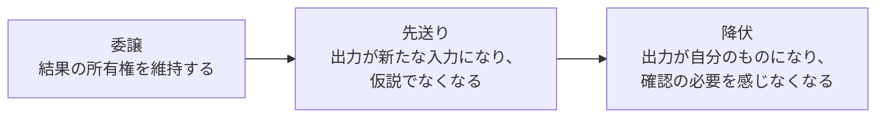

# Critical thinking when agents do the work

## 1. 概要

このファイルは、Addy Osmani による X の長文記事の情報源（Source）である。著者欄には Addy Osmani（@addyosmani）と Claude Code @anthropicai が表示されている。投稿日は 2026-11-03 16:01 で、ページ表示どおりである。タイムゾーンはページに明示されていないため、ここでは日付のみを記録する。読了時間はページ表示で14分である。引用ポストはない。

ヘッダー画像は1点あり、タイトル文字と、委譲の度合いが深まるにつれて下がる曲線の図が描かれている。

主題は、AIエージェントに仕事を任せるときに、自分の思考をどう守るか、である。エージェントがコードを書く量が増えるほど、人は理解や判断を手放しやすくなる。記事は、その手放し方には段階があること、そして検証や判断の習慣をどう残すかを、具体的な実践とともに説明している。

## 2. 要約

エージェントに作業を任せることは、便利さと引き換えに、自分の理解を少しずつ手放すことでもある。記事は、その手放しを三つの段階で捉えている。最初の段階では、人は作業を委譲しながらも、結果の所有権を自分に残している。次の段階では、エージェントの出力がそのまま次の入力になり、出力はもはや仮説ではなくなる。最後の段階では、出力がすっかり自分のものになり、確認の必要すら感じなくなる。

この最後の段階に名前が与えられている。Wharton の Steven Shaw と Gideon Nave による「認知的降伏」という考え方である。似た考え方として、Jeremy Twei による「認知的負債」や「理解の負債」もある。Margaret-Anne Storey の共有システム理論の考え方を借りれば、人はシステムについての理解を少しずつ失い、それが積み重なっていく。

だからといって、すべてを自分で理解し直す必要はない。大規模なコードベースの全体像を常に頭の中に保つことはできない。ただ、必要になったときに理解を再構築できる状態は保てる。低リスクの作業なら全面的に委譲してよい。一方で、他者に影響する判断では、推論を手元に残す必要がある。

記事が繰り返し求めるのは、検証を習慣にすることである。依頼する前に自分の仮説を立てること、反対意見を聞くこと、エージェントが下した決定や前提を列挙させること、自分をクイズで試すこと。検証のしかたを事前に決めておくことも含まれる。緑のチェックは、確認できた性質が一つあることしか示さない。600行のプルリクエストのレビューは、確認したつもりでもゴム印になりやすい。

さらに、エージェントの利用には見えにくい費用もある。生成された量と、自分の名前を付けられる量の差、意図の負債、そして監督そのものの逆説である。Anthropic の研究によれば、Claude を監督するにはコーディング技能自体が必要だが、その技能は AI の過剰な使用で衰えるかもしれない。責任は委譲できない、というのが記事の結論に近い。週に一度エージェントなしでコードを書くなど、日常の実践で思考の筋力を保つことが提案されている。

## 3. 背景・前提知識

この記事を理解するために必要な背景を整理する。

- **エージェント**：ここでは、指示を受けて自律的に作業を進める AI システムを指す。コードの作成や変更、テストの実行などを行う。
- **委譲**：人にせよ AI にせよ、作業を他者に任せること。任せた側は、結果の責任や判断をどこまで残すかを決める必要がある。
- **検証**：出力が正しいか、意図に沿っているか、副作用がないかを確かめる行為。テストの通過や目視の確認などが含まれる。
- **プルリクエスト**：コードの変更を提案し、他の人がレビューしてから取り込むための仕組み。変更の内容と意図がまとめて確認できる。
- **コードレビュー**：他人のコード変更を読み、問題や改善点を確認する作業。品質と知識の共有の両方の役割がある。
- **認知的降伏・認知的負債・理解の負債**：いずれも、AI に頼ることで自分の理解や思考力が少しずつ失われていく状態を指す言葉である。記事では、それぞれ異なる研究者や書き手の用語として紹介されている。

## 4. 詳細解説

### 委譲のスペクトル

記事の中心にあるのは、委譲の度合いを示す三段階のスペクトルである。

最初の段階は、作業を委ねながらも結果の所有権を自分が持つ状態である。エージェントにコードを書かせても、人は何を作ったのか、なぜその作り方なのかを把握している。出力は自分の判断で受け入れたものであり、間違いがあれば自分で気づける。

次の段階では、エージェントの出力がそのまま次の作業の入力になる。出力は検証される前に前提として使われ、仮説ではなくなる。人は出力の細部を追わなくなり、流れだけをなぞるようになる。

最後の段階では、出力がすっかり自分のものになる。確認の必要すら感じなくなる。人は出力を疑わず、自分の判断として扱う。ここで起きているのが、Wharton の Steven Shaw と Gideon Nave が名付けた「認知的降伏」である。思考を委ねた結果、考えること自体を手放してしまう状態である。

### 借金としての理解の損失

似た考え方として、Jeremy Twei による「認知的負債」と「理解の負債」がある。Margaret-Anne Storey の共有システム理論の考え方を借りると、人はシステムについての理解を共有しながら持っているが、その理解は少しずつ浸食されていく。借金という言葉が示すとおり、失われた理解はあとで返済が必要になる。変更や不具合が起きたときに、理解の不足がまとめて姿を現す。

### 全体像は保てないが、再構築はできる

大規模なコードベースの全体像を、常に頭の中に保つことはできない。記事はこの点を認めたうえで、別の目標を示す。必要なのは全体像の常時保持ではなく、必要になったときに理解をオンデマンドで再構築できることである。どこに何があるか、どういう流れで動くか、どこを確認すればよいかが分かれば、理解は取り戻せる。

### どこまで委譲してよいか

委譲の判断は、リスクで分ける。低リスクの作業なら、全面的に委譲してよい。失敗しても影響が小さく、やり直しがきくからである。一方で、他者に影響する判断では、推論を手元に残す必要がある。結論だけを受け取るのではなく、なぜその結論になったのかを自分でたどれる状態を保つ。

依頼する前に、自分の仮説を立てることも大切である。何が起きるはずか、どういう結果を期待するかを先に言葉にしておく。そうすれば、出力が仮説と違うときに気づける。仮説がないまま出力を受け取ると、出力がそのまま正解に見えてしまう。

Thariq Shihipar による「死角の確認」という実践も紹介されている。見落としがないか、意図的に死角を探すための一手間である。考えるのを助けてもらうのか、考えること自体を委譲するのか。その区別を意識することも、同じく大切である。助けてもらう場合は、考える主体は自分のままである。委譲する場合は、主体が移ってしまう。

反対意見を聞くことも、思考を守る方法の一つである。自分の考えに沿う出力だけを受け取っていると、見落としに気づけない。反対の立場からの指摘は、判断の偏りを正す。

判断の基準として、保守する人の前で賭けられるかどうか、という問いも挙げられている。その変更を実際に保守する人の前で、自分の判断として賭けることができるか。できないなら、理解が足りていないか、判断を委ねすぎている。

### 検証を習慣にする

検証は、気が向いたときだけ行うものではなく、習慣にする。Boris Cherny の言葉として、Claude に自分の仕事を検証する方法を与えることが紹介されている。検証の手段をエージェントに渡しておくことで、出力の確認が作業の流れに組み込まれる。

ただし、緑のチェックは一つの性質しか示さない。テストが通ったことは、そのテストで確認した範囲が通ったことであり、すべてが正しいことの証明ではない。何を検証したのか、を事前に決めておく必要がある。「検証済み」の定義を先に決めておくことで、確認の抜け漏れに気づける。

600行のプルリクエストのレビューは、ゴム印になりやすい。量が多すぎると、人は細部を読まずに承認してしまう。記事は、レビューの負担を減らす工夫として、エージェントに下した決定や前提を列挙させることを挙げている。何を決めたのか、何を前提にしたのかが一覧になれば、レビューする人は要点を確認できる。

自分をクイズで試すことも、理解を確認する方法である。出力の内容について、自分に問いを立てて答えてみる。答えられなければ、理解が足りていない。答えられるようになれば、その部分は自分のものになったといえる。

### 見えにくい費用

エージェントの利用には、見えにくい費用がある。一つは、生成された量と、自分の名前を付けられる量の差である。大量のコードが生成されても、そのすべてに自分の名前を付けられるわけではない。責任を持てる範囲を超えた生成は、かえって負担になる。

もう一つは、意図の負債である。意図が曖昧なまま作業を進めると、意図と出力のずれが積み重なる。あとで意図を明確にしようとしても、すでに作られたものとの差を埋める必要が出てくる。

Andy Clark による、委譲と協働の区別も紹介されている。委譲は作業を渡すことであり、協働は一緒に考えることである。エージェントとの関係を協働として保つことで、思考の主体を自分に残せる。

さらに、Anthropic の研究による「監督の逆説」がある。Claude を監督するには、コーディング技能自体が必要である。しかし、その技能は AI の過剰な使用によって衰えるかもしれない。監督する力を保つには、監督される側の技能も保つ必要がある、という逆説である。

責任は委譲できない、というのが記事の結論に近い。エージェントが作ったものであっても、最終的な責任は人にある。だからこそ、週に一度エージェントなしでコードを書くなど、日常の実践で思考の筋力を保つことが提案されている。

## 5. 重要なポイント

- 委譲には、所有権を残す段階、出力が前提になる段階、確認の必要を感じなくなる段階がある。
- 確認の必要を感じなくなる状態は「認知的降伏」と呼ばれ、Wharton の Steven Shaw と Gideon Nave による用語である。
- Jeremy Twei による「認知的負債」「理解の負債」は、理解の浸食が積み重なることを示す。
- 大規模なコードベースの全体像は保てないが、必要時に理解を再構築できる状態は保てる。
- 低リスクなら全面的に委譲してよいが、他者に影響する判断では推論を手元に残す。
- 依頼前に仮説を立てること、反対意見を聞くこと、保守する人の前で賭けられるかという基準が、判断を守る。
- 検証を習慣にすること。緑のチェックは一つの性質しか示さない。「検証済み」の定義を事前に決める。
- 600行のプルリクエストのレビューはゴム印になりやすい。エージェントに決定や前提を列挙させる。
- 生成量と自分の名前を付けられる量の差、意図の負債、監督の逆説といった見えにくい費用がある。
- 委譲と協働は区別する。責任は委譲できない。週に一度エージェントなしで書くなどの実践で思考を保つ。

## 6. 図解

委譲のスペクトルは次のとおりである。

## 7. 自分なりの考察

以下はAIによる考察である。原文の主張ではなく、仕様書と与えられた事実をもとにAIが考えた内容である。

この記事で印象に残るのは、委譲を「するか・しないか」ではなく「どの段階まで進んでいるか」で捉える視点である。所有権を残す段階と、確認の必要を感じなくなる段階では、同じ委譲でも意味がまったく違う。だからこそ、検証の習慣や仮説を立てるといった小さな実践が、段階の進行を食い止める手がかりになるのだと考えられる。

また、「緑のチェックは一つの性質しか示さない」という指摘は、テストや自動チェックへの過信を戒めるものとして重要だと考える。確認できた範囲を明示し、「検証済み」の定義を事前に決めておくことは、自分のチームのレビュー運用にもそのまま応用できる。

一方で、週に一度エージェントなしで書くという実践は、単なる技能維持ではなく、自分の判断の基準を保つためのものでもあると考える。自分の手で書くことで、どこが分かり、どこが分からないのかがはっきりする。その感覚が、エージェントの出力を監督する力の土台になるのではないか。

## 8. 学んだこと

- 委譲の度合いを段階で捉え、確認の必要を感じなくなったときに立ち止まる。
- 依頼前に仮説を立て、出力と仮説の違いに気づける状態を作る。
- 検証の定義を事前に決め、緑のチェックの意味を過大に受け取らない。
- エージェントに決定や前提を列挙させ、レビューの負担を減らす。
- 生成量と自分の名前を付けられる量の差を意識し、責任を持てる範囲で委譲する。
- 委譲と協働を区別し、考える主体を自分に残す。
- 週に一度エージェントなしで書くなど、日常の実践で思考の筋力を保つ。

## 9. 関連情報

- 原文：https://x.com/addyosmani/status/2117512471930167377
- 確認済みの関連リンク：
  - https://addyosmani.com/blog/cognitive-surrender/
  - https://ssrn.com/abstract_id=6097646
  - https://margaretstorey.com/blog/2026/02/09/cognitive-debt/
  - https://addyosmani.com/blog/comprehension-debt/
  - https://claude.dev/blog/solving-code-review-at-anthropic/

上記の関連リンクについて、リンク先の内容を推測して説明しない。内容を確認する場合は、各リンク先を直接参照すること。

## 10. 原文

元URL：https://x.com/addyosmani/status/2117512471930167377
