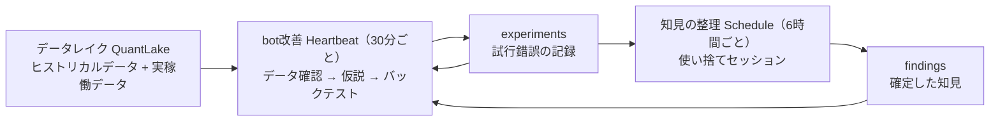

# LLM エージェントを活用した高頻度売買システムの自己改善ワークフロー構築

## 1. 概要

おもしろフラッシュトレード倉庫（@supermomonga）による X の長文記事（X Articles）である。著者は、暗号資産・為替などで HFT（高頻度取引）やアービトラージを主とするシステムトレードを行っている。本記事は、ほぼ人間の介入なしに、自己改善ループによって取引モデルを改善し続ける HFT トレーディング bot を作る実験の記録であり、備忘録を兼ねて現時点での知見を共有するものだとされている。

内容は、自己改善ワークフローの全体構成（AI ハーネス、データレイク、ナレッジベースの3要素）、エージェントに定期実行させる仕組み（Heartbeat と Schedule の使い分け）、複数 bot の間で知見を共有する方法、そして付録として、バックテストの精度を上げるためのレイテンシ補正の方法と、Heartbeat に運用保守の作業を任せる方法を扱う。

記事の冒頭には、成果を示す埋め込みポストが並んでいるが、それらの本文は取得できなかったため、具体的な数値や成果の内容はここでは記録しない。投稿本文には、取引所の関係者にマーケットメイクのオファーを求める一文も添えられている。取得時点で、表示は約21.9万回、いいねは1,453、ブックマークは3,405だった。

なお、メタデータの取得は register_url.py による直接取得（direct）で行い、記事本文の取得には fxtwitter の公開 API を使った。

## 2. 要約

記事の要点は次のとおりである。

- **ワークフローは3要素で構成される**：(1) AI ハーネス「Paseo」の中で Claude Code を動かし、bot ごとの監視と改善、知見の整理を定期実行する。(2) データレイク「QuantLake」に、ヒストリカルデータと実稼働データを蓄積する。(3) ナレッジベース（Obsidian の vault）に、全 bot の実験結果と確定した知見を集約し、bot 間で共有する。
- **bot は複数並行で開発し、bot ごとに Git リポジトリを分ける**。各 bot の改善は個別に自動で回しながら、知見だけは1か所に集めて共有できるようにしている。
- **Heartbeat と Schedule の使い分け**：Paseo の Heartbeat は既存のセッションに定期処理をアタッチする仕組みで、再起動しても処理が残る（永続的）。Claude Code 組み込みの loop は再起動で消える（揮発性）。一方 Schedule は毎回新しいセッションを作る。bot 改善は Heartbeat（bot ごとに長期間動かすセッション）、知見の整理は Schedule（使い捨てセッションで、終わったらアーカイブ）で回す。
- **Heartbeat の間隔は30分**。著者の認識では Claude の prompt cache の有効期間は60分であり、キャッシュを切らさないよう間隔は59分以内が推奨され、著者は30分に設定している。
- **bot 改善セッションの処理**：30分ごとにデータレイクの新しいデータを確認し、仮説を立て、ヒストリカルデータでバックテストする。他の bot の experiments や整理済みの findings も参照する。試行錯誤の結果は experiments として vault に保存する。
- **知見の整理セッションの処理**：6時間ごとに Schedule で起動し、全 bot の experiments の中から確定した新しい知見を抜き出して findings として保存する。
- **データレイクの2機能**：Tardis や Databento からヒストリカルデータをダウンロードして Parquet で提供することと、稼働中の bot のリアルタイムデータや取引履歴を S3 経由で30分ごとに自動ダウンロードすること。
- **Agent Skills が接着剤になる**：Claude Code は何も指示しなければリポジトリ外のデータレイクやナレッジベースを使わない。そこで、データレイク用とナレッジベース用の2つの Agent Skills を用意して読み込ませている。
- **付録1：バックテストのレイテンシ補正**。購入したヒストリカルデータには、bot が実際に受信するデータに含まれるレイテンシがない。そのまま使うと実トレードとの差が大きくなるため、実機で1〜2日分のリアルタイムデータを保存し、同じ期間のヒストリカルデータと比較してレイテンシをパラメータ化し、ヒストリカルデータに適用してからバックテストする。遅延の種類は、マーケットデータの受信遅延、発注遅延、イベント受信までの遅延の3つ。高度な方法として、jitter（遅延のばらつき）もパラメータに含める。
- **付録2：運用保守も Heartbeat に任せる**。Heartbeat のプロンプトに運用保守の指示を加えると、取引所のメンテナンス確認と期間中の bot 一時停止、フィード遅延が一定以上のときの停止、さらに異常時に LLM 自身の判断で bot を一時停止・完全停止することまで許可できる。
- **結果として**、この自己改善ループにより、基本的に 24/365 でエージェントがシステムトレードの運用を行い、メンテナンス工数が減るため、1人でも複数のモデルの開発・保守ができるようになった、と著者は述べている。

## 3. 背景・前提知識

- **HFT（高頻度取引）**：コンピュータが高速に大量の売買を繰り返す取引手法。わずかな遅延や価格差が結果を左右するため、データの鮮度と遅延の扱いが重要になる。
- **アービトラージ**：取引所間などの価格差を利用して利益を得る手法。
- **バックテスト**：過去の市場データを使って、取引モデルの有効性を検証すること。本記事では、バックテストの精度が自己改善ループの信頼性を決める前提になっている。
- **レイテンシ**：データの受信や注文の発注にかかる遅延。HFT では、実稼働データとヒストリカルデータの差の主因になる。
- **jitter**：遅延のばらつき。平均的な遅延だけでなく、変動まで再現すると、遅延の変動に強いシステムを検証できる。
- **データレイク**：分析用のデータを大量に蓄積する保管場所。本記事の QuantLake は著者の独自構築で、Tardis・Databento のヒストリカルデータと、bot の実稼働データを Parquet 形式で扱う。
- **Paseo**：AI のハーネス（エージェント実行基盤）。誰でも無料でダウンロードして使えるとされ、著者はその中で Claude Code を動かしている。Heartbeat（永続的な定期実行を MCP tool として提供）と Schedule（毎回新しいセッションを作る定期実行）の2つの定期実行機能を持つ。
- **prompt cache**：LLM への入力の一部を再利用して、応答の高速化やコスト削減を行う仕組み。有効期間内に次の実行が来れば、キャッシュが効いた状態で処理を続けられる。
- **Obsidian vault**：Obsidian（ノートアプリ）のノート群の保管単位。本記事では素の vault をナレッジベースとして使い、エージェントの検索性能を上げるために qmd（github.com/tobi/qmd）を別途導入している。
- **experiments / findings**：本記事のナレッジベースにおける区別。experiments は各 bot の試行錯誤の記録、findings はその中から確定した知見として整理されたもの。
- **Agent Skills**：Claude Code に読み込ませる追加の指示・手順のまとまり。本記事では、リポジトリ外のリソース（データレイク、ナレッジベース）をエージェントに使わせるために用いる。

## 4. 詳細解説

### 全体構成

ワークフローは次の3つの要素で構成される。

| 要素 | 使っているもの | 役割 |
| --- | --- | --- |
| AI の harness | Paseo + Claude Code | bot ごとの監視と改善、知見の整理を定期的に実行する |
| データレイク | Tardis、Databento、S3、Parquet | ヒストリカルデータと実稼働データを蓄積する |
| ナレッジベース | Obsidian vault + qmd | 全 bot の実験結果と確定した知見を集約し、bot 間で共有する |

著者は複数の bot を並列して開発しており、bot ごとに Git リポジトリを分けている。ワークフローは、各 bot の改善を個別に自動で回しながら、bot 間で知見を共有できるように設計されている。

### Paseo と Heartbeat

Paseo は AI の harness で、著者はその中で Claude Code を動かしている。

Claude Code には組み込みの loop スキルがあり、1つのセッション内で処理を定期実行できる。ただし loop の定期処理は揮発性で、Claude Code を再起動すると消える。Paseo の Heartbeat は loop とほぼ同じ機能だが永続的で、Claude Code や Paseo を再起動しても定期処理が残る。

|  | Claude Code の loop | Paseo の Heartbeat |
| --- | --- | --- |
| 提供元 | Claude Code の組み込みスキル | Paseo（MCP tool として Claude Code に渡される） |
| 再起動後 | 定期処理が消える | 定期処理が残る |

Heartbeat は MCP tool として Claude Code に渡されるため、Claude Code に「Heartbeat で自己改善ワークフローを回して」と依頼すれば、改善処理が自動で回り続ける。

間隔については、著者の認識では Claude の prompt cache の有効期間は60分であり、キャッシュを切らさないように Heartbeat の間隔は59分以内に設定することが推奨されている。著者は30分ごとに設定している。

### Heartbeat と Schedule の使い分け

Paseo には Heartbeat とは別に Schedule という定期実行の機能もある。違いは、既存のセッションにアタッチするか、毎回新しいセッションを作るかである。

|  | bot 改善 | 知見の整理 |
| --- | --- | --- |
| 使う機能 | Heartbeat | Schedule |
| 間隔 | 30分ごと | 6時間ごと |
| セッション | bot ごとに1つ、長期間動かし続ける | 全 bot 共通で1つ。毎回新しく作り、終了後にアーカイブする |
| 主な処理 | 本番 bot の監視、ロジックの改善、仮説のバックテスト | 全 bot の experiments から確定した知見を抜き出す |
| ナレッジベースから読むもの | 自分と他の bot の experiments、findings | 全 bot の experiments |
| 出力 | experiments | findings |

bot 改善の Heartbeat は、bot ごとに別々のセッションで動かす。各セッションは、AWS の EC2 インスタンスなどで稼働している担当 bot の監視と、ロジックの自己改善を行う。具体的には、データレイクに蓄積されたデータを30分ごとに確認して新しい発見がないか調べ、立てた仮説が正しいかをヒストリカルデータでバックテストする。このとき、他の bot が保存した experiments や、整理済みの findings もナレッジベースから参照する。試行錯誤の結果は、30分ごとに experiments として vault に保存する。

知見の整理は、bot の開発とは別の定期処理である。Schedule で使い捨てのセッションを立ち上げ、全 bot の experiments の中に確定した新しい知見があれば、findings として保存する。このセッションは終了したらアーカイブしてほしいので、Heartbeat ではなく Schedule を使う。

### データレイク（QuantLake）

QuantLake は著者が独自に構築したデータレイクで、いずれ OSS にするつもりだとされている。機能は2つある。

1つ目は、Tardis や Databento からヒストリカルデータをダウンロードし、Parquet ファイルとして提供する機能である。2つ目は、稼働中の bot がライブ取引中に取得したリアルタイムデータや取引履歴を、S3 経由でローカルに自動ダウンロードする機能である。このダウンロードは、bot 改善の Heartbeat と同じ30分間隔で実行している。

この2つにより、あらかじめリクエストしておいた銘柄と取引所について、ヒストリカルデータと実稼働データが随時蓄積されていく。

### ナレッジベース

ナレッジベースは、基本的には素の Obsidian vault である。エージェントの検索性能を上げるために、qmd を別途導入している。

bot ごとに Git リポジトリが分かれているので、知見をリポジトリ内に保存すると、その bot からしか参照できない。bot の開発や自己改善ワークフローで得た知見や試行錯誤の結果は、1か所にまとめて整理すべきだという考えから、すべての情報を Obsidian vault に反映させている。

各 bot の改善セッションは、vault に experiments を保存するだけでなく、他の bot が保存した experiments や整理済みの findings も参照する。たとえば bot A の改善中に得た知見を、bot B の改善セッションが次の仮説づくりに使える。

### Agent Skills

Claude Code は、何も指示しなければリポジトリ外にあるデータレイクやナレッジベースを使わない。そこで、次の2つの Agent Skills を用意して Claude Code に読み込ませている。

1. データレイクを使わせるための Agent Skills
2. ナレッジベースを使わせるための Agent Skills

### 付録1：バックテストにおけるレイテンシの補正

Databento や Tardis では長期間のヒストリカルデータを購入できる。しかし HFT では、購入したヒストリカルデータをそのままバックテストに使うと、実際のトレードとの状況の差が大きくなる。bot が実際に受信するデータには、ヒストリカルデータにはないレイテンシが含まれるからである。

マーケットデータの補正は、次の手順で行う。

1. bot を実際に動かす EC2 インスタンスなどで、1〜2日分のリアルタイムデータを保存する。期間は、Databento や Tardis で購入できるヒストリカルデータと重なるようにする。
2. 保存したリアルタイムデータと、同じ期間のヒストリカルデータを比較する。
3. レートの受信などで生じるレイテンシの差を、パラメータとして算出する。
4. 算出したパラメータをヒストリカルデータに適用する。
5. 補正したデータを使ってバックテストする。

対象とする遅延のパラメータは次の3つである。

| パラメータ | 内容 |
| --- | --- |
| マーケットデータの受信遅延 | ヒストリカルデータと、bot が実際に受信するデータとの時刻差 |
| 発注遅延 | 注文を発注したときに生じる遅延 |
| イベント受信までの遅延 | 発注時刻から、発注したことを示すイベントを手元で受信するまでの遅延 |

マーケットデータ以外の遅延も、パラメータとして定量化してバックテストエンジンに組み込む。さらに高度な方法として、単純な遅延だけでなく jitter（遅延のばらつき）もパラメータとして反映させる方法がある。jitter を含めて検証すると、遅延の変動に強いシステムを作れる。

### 付録2：Heartbeat に運用保守の作業も任せる

30分ごとの Heartbeat で渡すプロンプトには、トレードシステムの改善だけでなく、bot の運用保守に関する指示も追加できる。これにより、これまで人間が手作業で管理していた運用作業も自動化できる。

取引所のメンテナンス対応では、bot が取引する取引所のメンテナンス予定が掲載されている Web ページの URL をプロンプトに埋め込み、Heartbeat の処理に「メンテナンス情報をチェックする」と「メンテナンス期間中は bot を一時停止する」を加える。

メンテナンス以外の運用タスクも任せられる。たとえば、リアルタイムデータの受信フィードの遅延が一定以上になったら、一定時間 bot を停止させることができる。さらに、異常事態が発生したときに、LLM が自分の判断で bot を一時停止または完全に停止することを許可しておく。この権限を与えておくと、人間が想定していなかった事態が起きても、LLM がその場で状況を判断して運用作業を行う。

記事には、Heartbeat のプロンプトに追加する運用保守の指示の例も載っている（メンテナンスページの確認、期間中の bot 一時停止、フィード遅延時の停止、異常時の判断による停止許可）。

### 終わりに

著者は、この自己改善ループのワークフローを構築することで、基本的に 24/365 でエージェントがシステムトレードの運用を行うようになったと述べている。メンテナンスにかける工数が削減されることで、同時に複数のモデルの開発・保守ができるようになり、1人でもちょっとしたトレーディング・カンパニーのようなものを運営できるようになった、という。

## 5. 重要なポイント

- 自己改善ループは「定期実行の仕組み」「データの蓄積」「知見の集約」の3要素に分けると設計しやすい。本記事では、それぞれ Paseo の Heartbeat / Schedule、QuantLake、Obsidian vault が担う。
- 定期処理を再起動後も残したいなら、揮発性の loop ではなく永続的な Heartbeat を使う。セッションの性質でも使い分け、長期間の文脈を持つ改善は既存セッションへのアタッチ、使い捨ての整理作業は毎回新しいセッションが向く。
- 定期実行の間隔は、LLM の prompt cache の有効期間内に収めると、キャッシュが効いて効率がよい（著者は有効期間60分という認識のもと、30分間隔を採用）。
- 試行錯誤の記録（experiments）と確定した知見（findings）を分けて保存し、整理は別の定期処理で行う。記録する側と整理する側を分けることで、知見が再利用可能な形になる。
- 複数のエージェント（bot）で知見を共有するには、リポジトリの外に共通のナレッジベースを置く必要がある。リポジトリ内に閉じると、そのエージェントからしか参照できない。
- エージェントは既定ではリポジトリ外のリソースを使わない。使わせたいリソースごとに Agent Skills を用意して読み込ませる必要がある。
- HFT のバックテストでは、ヒストリカルデータに実稼働のレイテンシが含まれていないことが精度の落とし穴になる。実測した遅延パラメータ（受信・発注・イベント受信、さらに jitter）で補正してから検証する。
- 定期実行のプロンプトには、改善だけでなく運用保守（メンテナンス対応、異常時の停止判断）も載せられる。異常時にエージェント自身の判断で止める権限まで与える設計が示されている。
- Paseo が無料で使えること、prompt cache の有効期間が60分であることは、著者の記述・認識に基づくもので、公式情報として検証したものではない。

## 6. 図解

自己改善ループの流れを図にすると、次のとおりである。

## 7. 自分なりの考察

以下は、AIによる考察である。元記事の主張とは区別して読むこと。

この記事の自己改善ループが興味深いのは、改善の各サイクルに検証（バックテスト）が組み込まれている点である。Addy Osmani の記事が論じた「認知的降伏」の観点では、エージェントが自律的に回すループほど、検証の質がそのまま全体の信頼性を決める。本記事が付録でレイテンシ補正に紙幅を割いているのは、その検証の前提（バックテストが現実をどれだけ再現しているか）を固める作業であり、自己改善ループの実効性を支える部分だと考えられる。

また、experiments と findings の分離は、この knowledge-vault における Source と Knowledge の分離とよく似ている。生の試行錯誤をそのまま共有するのではなく、確定した知見に整理してから次の仮説に使う、という二層構造が、複数のエージェント間で知見を腐らせずに回すための要点になっているように見える。

一方で、異常時に LLM の判断で本番 bot を完全停止まで許可する設計は、権限の範囲が大きい。著者はそれを意図的に与えているが、一般化する場合は、停止の条件や復旧の手順、人間への通知など、権限の境界を先に決めておく必要があるだろう。また、記事冒頭の成果を示す埋め込みポストの本文は取得できなかったため、「ある程度の成果」の具体的な中身（収益や勝率など）は未確認である。ワークフローの設計知見としての価値と、運用実績の評価は分けて読むべきである。

## 8. 学んだこと

- エージェントの自己改善ループは、定期実行（Heartbeat / Schedule）、データレイク、ナレッジベースの3要素で構成できる。
- 永続的な定期実行と揮発性の loop の違い、既存セッションへのアタッチと新規セッションの使い分けが、定期処理の設計の要点になる。
- 定期実行の間隔は prompt cache の有効期間を意識して決める（著者は30分）。
- 試行錯誤（experiments）と確定した知見（findings）を分け、整理専用の定期処理で知見化すると、複数エージェントで知見を共有できる。
- エージェントにリポジトリ外のリソースを使わせるには、リソースごとの Agent Skills が必要になる。
- バックテストの精度は、ヒストリカルデータへのレイテンシ補正（受信遅延・発注遅延・イベント受信遅延・jitter）で大きく変わる。
- 定期実行のプロンプトに運用保守の指示と異常時の停止権限を含めると、運用作業まで自動化できる。

## 9. 関連情報

- 記事は X Articles として公開されている。投稿本文：https://x.com/supermomonga/status/2120375864408129846
- Paseo：https://paseo.sh/
- qmd：https://github.com/tobi/qmd
- 関連する Knowledge は、抽出後にこの節へ追加する。

- [エージェント自己改善ループの設計](../../../knowledge/ai/agent-self-improvement-loop-design.md)
- [バックテストにおけるレイテンシ補正](../../../knowledge/ai/backtest-latency-correction.md)

## 10. 原文

元URL：https://x.com/supermomonga/status/2120375864408129846

