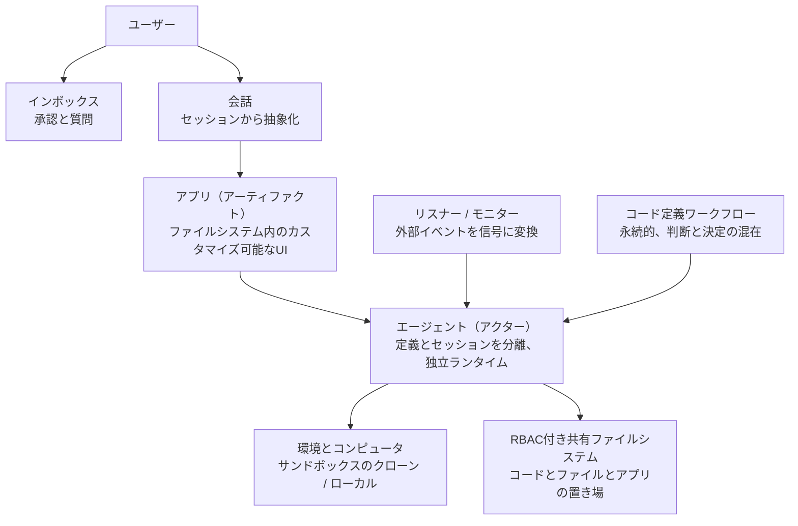

# Agent platform of 2027

## 1. 概要

John Suh（@john_ssuh）による X の長文ポストである。著者は Long Lake の創業チーム出身で、現在は新しいプロダクトを開発中とプロフィールに記している。内容は「Agent platform of 2027」と題した、2027年のエージェントプラットフォームの設計図（ブループリント）の提示である。

ポスト本文は導入にあたる主張の提示で、設計図の本体は添付された画像4枚に書かれている。画像には、エージェントの実行モデル、環境、ファイルシステム、ユーザーインターフェース、イベント処理、ワークフロー、アプリのあり方という8つの設計要素が、現状分析と「あるべき姿」、関連プロダクトへの言及とともに記されている。

著者の中心的な主張は、アプリケーション層のソフトウェアは最終的に単一のエージェント基盤（エージェントOS）に収束し、それ以外のソフトウェアはその層のためのデータベースになる、というものである。ChatGPT や Claude のアプリケーション層もこの姿を目指しているとしつつ、著者はこの層を所有するのは独立企業になるだろうと予測する。勝つプラットフォームの比喩として、著者は「工場の工場（factory of a factory）」よりも「庭の土台」を挙げる。顧客が自分たちの「種」を植え、エージェントと人間、そして事業のセンサーからの信号によって育てていく土台である。

取得時点で、表示は約120万回、いいねは6,337、ブックマークは18,659だった。なお、本文と画像の取得には fxtwitter の公開 API を使い、画像の内容は画像テキストを読み取って記録した。

## 2. 要約

要点は次のとおりである。

- **アプリケーション層は単一のエージェント基盤に収束する**。他のソフトウェアはその下のデータベースになり、無数のエージェントの群れ（swarm）がその上で働く。これが「エンドゲーム」であり、ChatGPT と Claude のアプリケーション層のビジョンでもあるが、所有するのは独立企業だと著者は見る。
- **勝つ基盤は「庭の土台」である**。顧客が固有の「種」（自社の業務やエージェント）を植え、エージェント・人間・事業のセンサー信号で育て、進化させる場所になる。
- **設計図は8つの要素からなる**：(1) エージェントはアクターとして動く、(2) 環境とコンピュータ、(3) RBAC 付きファイルシステム、(4) セッションと会話の分離、(5) インボックス、(6) リスナーとモニター、(7) コードで定義するワークフロー、(8) アプリ（アーティファクト）。
- **既存の ADE（エージェント開発環境）や垂直 SaaS の多くは焦点が狭すぎる**、というのが著者の評価である。特に、コーディングエージェントのセッションをそのままユーザーに見せる設計と、ドラッグ＆ドロップ型のワークフロー自動化は、移行期の姿として批判されている。

## 3. 背景・前提知識

- **アクターモデル**：独立した実行単位（アクター）がそれぞれ状態と実行環境を持ち、メッセージで連携する並行計算のモデル。エージェントごとにランタイムを分離できる点が、ここでは重要になる。
- **Temporal**：長時間動く処理を確実に実行するためのワークフロー基盤。現在のスケーラブルなエージェント実行の標準的な選択肢として引き合いに出されている。
- **自己改善ハーネス（self-improving harness）**：エージェントが自分の拡張やフックをその場で書き換えながら動く実行基盤。安全に共存させるには実行環境の分離が要る、というのが著者の論点である。
- **RBAC（役割ベースアクセス制御）**：ユーザーや主体の役割に応じて権限を割り当てる方式。
- **POSIX ファイルシステム**：Unix 系の標準的なファイル操作の体系。ここでは、エージェントの群れが共有するクラウド上のファイル基盤を指す。
- **ADE（agent development environment）**：エージェント開発・実行のための環境や製品群の総称として著者が使っている語。
- **セッションと会話**：本ポストの区別では、セッションはエージェントの実行そのもの（ツール呼び出しなどの中間過程を含む）、会話はユーザーが触れる抽象化されたやり取りを指す。
- **リスナー / モニター**：外部のイベントストリームを購読し、エージェントが行動できる信号に変換する仕組み。cron（定期実行）や webhook 連携を包含する概念として提示されている。
- **アーティファクト（Artifacts）**：チャットの中で生成され、その場で操作できるアプリ状の成果物。Claude Artifacts や ChatGPT Apps などが例に挙がる。
- **垂直 SaaS（vertical SaaS）**：特定業界向けに特化した SaaS。前提は「同じ業界の会社は業務が似ているので、表現方法も共通化できる」というもので、著者はこの前提を批判する。
- **イノベーターのジレンマ**：既存の成功モデルに適応した企業ほど、次の変化に対応できずに淘汰されるという古典的な理論。セッション露出型の ADE の将来予測に使われている。

## 4. 詳細解説

### 全体像：エージェントOSとしてのプラットフォーム

著者の描く最終形は、アプリケーション層に立つ単一のエージェント基盤である。既存のソフトウェアは、その基盤から使われるデータベースへと位置づけが変わり、基盤の上では大量のエージェントが群れとして働く。各顧客は基盤の上に自社の「種」を植える。つまり、基盤は完成品のアプリを提供する場所ではなく、顧客ごとの業務やエージェントが生え、エージェントと人間と事業の信号によって育ち続ける土台になる。この「庭」の比喩が、以下の8要素すべての前提になっている。

### (1) エージェントはアクターとして動く

現在のスケーラブルなエージェント実行の標準は、Temporal のような仕組みでエージェントをデプロイすることだと著者は見る。これが今後はアクターモデルへ移行し、各エージェントハーネスが完全に独立したランタイムを持つようになる、というのが予測である。ランタイムの分離が必要な理由は、自己改善ハーネスの存在である。エージェントが自分の拡張やフックをその場で書き換えるなら、異なる実装のエージェントループが、同じテナントの中でも安全に共存できなければならない。

あわせて、エージェントの定義と、そのインスタンスやセッションは分離して扱うべきだとされる。単一の巨大なエージェント（mega-agent）を好む利用者もいれば、用途別の定義を好む利用者もいる。Anthropic は単一の mega-agent を主張するが、フェルマーの最終定理の形式化に取り組んだ事例では、各エージェントが持っていたのはシェルとファイルエディタだけだった。つまり、mega-agent を唱える企業の「表明された選好」ではなく「実際に示された選好（revealed preference）」は、コードで定義された小さなエージェント（著者はこれを Grokbot 型と呼ぶ）に近い、というのが著者の観察である。

関連として挙げられたもの：Cloudflare Durable Objects、Pi-Durable × Extensions、Vercel Eve、Rivet、DeepSeek Agent。

### (2) 環境とコンピュータ

基盤が扱うコンピュータは2種類ある。プロバイダ各社のチェックポイント付きサンドボックスのクローンと、人々のローカルコンピュータである。関係は N 対 M で、1つのエージェントが設定を変えて実験するために5つのサンドボックスを立ち上げることもあれば、コーディングエージェントごとに完全な環境を1台割り当てることも、1,000 のエージェントが100台の VM を並行して使うこともある。これらの環境は、エージェント自身が設定できる（agentically configurable）べきだとされる。

関連として挙げられたもの：Claude Remote、Cursor Agent、Cua AI。

### (3) RBAC 付きファイルシステム

エージェントの群れは、クラウド上の共有 POSIX ファイルシステムの上で働く。アクセス制御はコンピュータ側ではなく、ファイルシステム側に付ける。著者はこの層を、エージェントが生成したコードや拡張や定義が住む「GitHub 的な部分」と、アップロード・ダウンロード・生成されたファイルや「アプリ」が住む「Google Drive 的な部分」の合体として描く。リモートの共有ファイルシステムであるため、`.env` ファイルを置いたり、ディレクトリごとに `.git` や `jj` でバージョン管理したりもできる。RBAC のあり方には、エージェントを人間のように扱う方式、そのターンを開始した人間に基づいて権限を与える方式、その混合など、組織ごとに異なる構成が要るだろうとされる。

関連として挙げられたもの：Archil、S3 Filesystems、JuiceFS。

### (4) セッションと会話の分離

多くのコーディングエージェント製品は、エージェントのセッション（中間のツール呼び出しを含む）をそのままユーザーに露出している。著者はこれを誤りだと断じる。ユーザーが触れるものは、中核のセッションから抽象化された「会話」であるべきで、その抽象度は Slack のチャンネル、iMessage のチャット、WhatsApp の会話、メールスレッドと同じ水準だという。ユーザー向けの内容は、背後のセッションの発言を直接見せるのではなく、ツール呼び出しを通じて投稿される形にする。

セッションへの直接アクセスは、コードベースを読む行為に相当する。システムを点検しデバッグするための手段であって、主要なユーザーインターフェースではない。2025〜2026年に作られた、コーディングエージェントのセッションを包む ADE（例として T3）は、Cursor が 2025〜2026 年に直面したのと同じジレンマに直面し、イノベーターのジレンマのために多くはこの移行を生き残れないだろう、と著者は予測する。

関連として挙げられたもの：Duet、Grokbot、Dots。

### (5) インボックス

ユーザーは会話を読み通すのではなく、承認と質問に絞ったインボックスとやり取りするようになる、というのがこの要素である。インボックスには、人間の対応が必要な中間成果をレビューするための、テナント固有のアプリも載せられるべきだとされる。

関連として挙げられたもの：MS Today（@nicbstme による）。

### (6) リスナー、モニター、シングルテナントデータ

エージェントは、テナントごとに外部世界のイベントストリーム（WebSocket、Kafka、CDC など）を定義して購読し、それを決定的な処理またはエージェントの判断によって、行動可能な信号へ変換できるべきだとされる。重要なのは、リスナーを基盤側があらかじめ用意するのではなく、その場で組み立てられることである。これにより、外部との連携を、コードとしてでもエージェントとしてでも自由に定義できる。

著者が挙げる例はメールの処理である。「届くメールすべてにフィルターをかけてエージェントを起動したい」「いや、全アカウント横断のバッチ処理にしたい」「来週は特定ドメインからのメールを時間制約つきで監視したい」といった具合に、要件は会話の中で刻々と変わる。現在の業界（Grok bot、Muse、Instinct など）は、基盤の観点では1時間ごとの cron ジョブか、個別に作り込む webhook 連携プラグインしか支えていない。リスナーとモニターは、その厳密な上位集合（スーパーセット）であり、テナントがイベント駆動の仕組みを柔軟に構成できるようにする概念だという。

関連として挙げられたもの：Claude Code Monitor、Grokbot の将来機能。

### (7) ワークフロー

エージェントはテナントごとに、永続的なワークフローを定義できるべきだとされる。業務や企業のワークフローは長い時間軸で動き、エージェントの判断と決定的なステップが混ざる。n8n や初期の Zapier のような、いい加減に定義されたドラッグ＆ドロップ型の自動化は、カスタムコードを書くことに劣る。データの流れが API と MCP を通じて基盤に集まる以上、ワークフローを定義する場所も基盤であり、それはドラッグ＆ドロップではなくコードで定義されるべきだ、というのが著者の主張である。

関連として挙げられたもの：Zapier Zap、Rivet Workflows。

### (8) アプリ（アーティファクト）

Replit、Claude Artifacts、ChatGPT Apps、ChatGPT に埋め込まれたウィジェットは、別々のカテゴリではなく、同じ「アプリ」という考え方に収束していく、と著者は見る。すべてのインターフェースは、ユーザーのファイルシステムの中にあるカスタマイズ可能なアプリであるべきで、たとえば会話一覧のページ全体も、1つのアーティファクトとして定義される。各ユーザーは自分のファイルシステムにコードベースの「クローン」を持ち、必要に応じて拡張・変更できる。これは OS が既定のアプリを同梱する姿に似ている。

表現形式については、生成 UI（既定のデザイン部品を JSON で表し、トークン効率を上げる）、HTML と混ぜた専用 DSL、Rune App のような形式など複数の主張があるが、著者は「基盤がそのすべてをアプリの概念の下で支え、具体的な表現形式はそれほど重要でなくなる」と見る。

エージェント基盤は、アプリがその中で作られる OS になる。「OS の中の OS」がなぜ要るのかへの答えは、その上のアプリケーション層のカスタマイズ性と拡張性である。例として、税務書類をレビューする10社の会計事務所が挙げられる。「何かをレビューする」という名詞は業界内で共通でも、情報を評価し理解するプロセスは各社固有である。理想的には、各社が Excel をフォークして自社用のインターフェースを作れるべきだ、という。

これは垂直 SaaS の前提そのものへの批判につながる。垂直 SaaS は「業界内の会社は業務が十分に似ているので、共通の表現方法が正当化できる」という前提に立つが、著者はこの前提はベンチャー投資の仮説として（少なくとも元の形では）壊れていると見る。優れた垂直 SaaS は結局、設定可能なプラットフォームへ進化し、社内外のセールスエンジニアやコンサルタントが各社向けの設定を担ってきた。ならば、エージェントが全面的に操作できる汎用基盤より劣る基盤を選ぶ理由はない。この設定作業は、やがて人間の導入チームではなく、指示を受けたエージェントが、最も細かいインターフェースに至るまで担うようになる。ユーザーはベンダーの導入チームに頼らず、自分のエージェントにアプリの変更を直接頼めるようになる。T3、カスタマイズ可能な Claude Cowork、インストール可能な Claude Artifacts は、この方向を指し示しているという。

アプリの入れ物（コンテナ）としては、次の形が併存し続けるうえに、新しい形も加わるとされる。

- tmux 的なインターフェース（優れたコーディングエージェント製品で既に探求されている）
- メッセージに埋め込まれたアプリ（既定のパターン。サイドバーのアプリも 2025〜2026 年に標準化）
- チャットをサイドバーに置くアプリ中心のインターフェース（関係の逆転。Excel の中の Claude のような形）
- 無限キャンバス（tldraw。ComfyUI のワークフローやデザインの表現に向く）
- 層状のウィンドウを持つ固定キャンバス（既定の OS 体験）
- 幅と高さが固定されたリサイズ可能なパネル（Metabase 的な形）

関連として挙げられたもの：Rex、OpenCode Rune。

## 5. 重要なポイント

- 基盤の価値は、完成品のアプリではなく「顧客ごとの種が育つ土台」であること。カスタマイズ性と拡張性が、汎用 OS の上にさらにエージェントOSを重ねる理由になる。
- エージェントの実行は、共有ランタイムから、アクター単位の独立ランタイムへ。自己改善（自分の拡張を自分で書き換える）を許すには、分離が前提になる。
- エージェントの定義とインスタンス・セッションは分離する。mega-agent の主張と、実際の運用（小さな道具だけを持つエージェント群）の間にはずれがある、という「revealed preference」の見方が示されている。
- アクセス制御はコンピュータではなくファイルシステムに付ける。エージェントの成果物とデータが集まる場所が、権限管理の中心になる。
- ユーザーインターフェースの原則は「セッションを見せるな、会話を見せよ」。承認と質問のインボックスが、会話を読む作業に取って代わる。
- イベント処理は cron や webhook プラグインの上位集合として、テナントがその場で定義できるリスナー/モニターに一般化される。
- ワークフローはドラッグ＆ドロップではなくコードで定義する。データが集まる基盤の上に、定義も集める。
- 垂直 SaaS の「業務は共通」という前提を疑い、各社固有のプロセスに合わせる作業自体をエージェントに任せる、というのがアプリ論の帰結である。
- 全体は著者のビジョン（予測）の提示であり、各要素には関連プロダクトへの言及があるものの、主張の多くは実証ではなく方向性の提示である点に注意が要る。

## 6. 図解

設計図の8要素を、層と関係で整理すると次のようになる（AIが内容を整理した図であり、原文の図ではない）。

## 7. 自分なりの考察

以下は、AIによる考察である。元ポストの主張とは区別して読むこと。

この設計図が興味深いのは、要素の多くが「企業向け基盤」の話でありながら、個人向けのエージェント製品にもそのまま重なる点である。承認と質問のインボックス、セッションと会話の分離、cron を包含するリスナーの一般化は、個人が1体のエージェントと長く付き合う形でも必要になる部品であり、規模が変わっても設計の問いが同じであることを示している。

一方で、全体はあくまで著者のビジョンであり、「アプリケーション層は単一の基盤に収束する」「所有するのは独立企業である」という中核の予測には、本文中での実証はない。各要素の「Relevant」として挙がるプロダクト群は方向性の傍証として提示されているが、収束が起きるかどうか、起きるとして誰が所有するかは、予測として割り引いて読むべきだろう。

また、(1) の「revealed preference」の読み方は鋭いが、フェルマーの最終定理の形式化という特殊な事例から一般の業務エージェントの形を推す部分には飛躍がある。小さな道具だけを持つエージェントが有効なのは、検証可能な課題（定理証明）だからこそ、という可能性は残る。設計図としては刺激的だが、各要素の成熟度は揃っていない、という読み方が妥当だと考える。

## 8. 学んだこと

- エージェント基盤の設計は、実行モデル（アクター）、環境、ファイルシステムと権限、UI の抽象度、イベント、ワークフロー、アプリの8要素に分解できる。
- 自己改善するエージェントを許容するには、ランタイムの分離が前提になる。拡張性の要求が、実行モデルの選択を決める。
- ユーザー向けの面は「セッションの露出」から「会話の抽象化＋承認インボックス」へ移る、という UI の設計原則が言語化されている。
- cron や webhook は、テナント定義のリスナー/モニターという、より一般的なイベント処理の概念に包含される。
- ワークフローの定義は、GUI の自動化ツールから、基盤上のコード定義へ寄せるべきだという立場がある。
- 「アプリ＝ファイルシステム内にある、利用者がフォークして変えられるもの」という定義は、垂直 SaaS の前提（業務の共通性）への批判とセットになっている。

## 9. 関連情報

- 投稿本文：https://x.com/john_ssuh/status/2124336124172935336
- 著者のサイト：https://suhjohn.com/
- 関連する Source：
  - [有名 OSS のハーネス設計思想](../../technical/2026-10-16-oss-ai-agent-harness-philosophy.md)
  - [ハーネス設計入門](../../technical/2026-09-24-harness-design-introduction.md)
  - [自作 AI エージェントの開発をやめた理由](../../articles/2026-11-05-stopped-building-custom-ai-agent.md)
- 関連する Knowledge：
  - [エージェントプラットフォームの設計図：8つの構成要素](../../../knowledge/ai/agent-platform-blueprint.md)
  - [セッションと会話の分離と承認インボックス](../../../knowledge/ai/session-conversation-separation.md)
  - [アプリ＝フォークできるアーティファクトという考え方](../../../knowledge/ai/apps-as-forkable-artifacts.md)

## 10. 原文

元URL：https://x.com/john_ssuh/status/2124336124172935336
