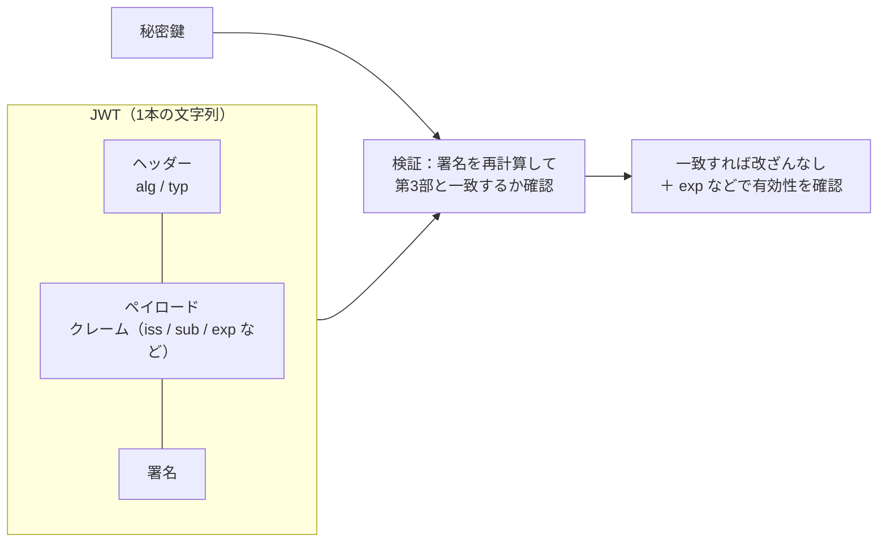

# JWTって何？

## 1. 概要

zono0013 による Qiita の技術解説記事で、認証まわりで広く使われる JWT（JSON Web Token）の概念と、Go による実装方法を、初学者向けにまとめたものである。公開日は 2024-12-12 である。

記事の構成は、JWT の定義、ヘッダー・ペイロード・署名という3部構成とその作成方法、標準的なクレームの一覧、特徴、認証フローの見出し、Go のライブラリ golang-jwt を使ったトークンの生成と検証のコード例、という流れである。中心となる主張は、JWT はデジタル署名によって検証と信頼を担保する、コンパクトで自己記述的な情報伝達の方法だという点である。

なお、記事の「認証フロー」の節は Signup / Signin / 認証リクエストという見出しのみで、本文は書かれていない。本稿でも、その内容を推測で補うことはしない。

## 2. 要約

- **JWT の定義**：JWT（JSON Web Token）は、データをやり取りする主体同士で、情報を JSON オブジェクトとして安全に転送するための、コンパクトで自己記述的な方法である。情報はデジタル署名されているため、検証でき、信頼できるものになっている。
- **3部構成**：JWT はヘッダー、ペイロード、署名の3つの部分からなる。各部分は Base64Url でエンコードされ、ピリオド（`.`）で連結される。
- **ヘッダー**：トークンのタイプ（`typ`）と署名に使うハッシュアルゴリズム（`alg`、例：HS256）を指定する JSON である。
- **ペイロード**：クレーム（要求）を格納する部分である。よく使われるクレームとして、iss（発行者）、sub（対象者）、aud（受信者）、exp（有効期限）、nbf（有効開始時刻）、iat（発行日時）、jti（一意な識別子）が挙げられている。
- **署名**：エンコード済みのヘッダーとペイロードを連結した文字列に対して、ヘッダーで指定したアルゴリズムと秘密鍵で生成する。トークンの整合性を保証し、改ざんを検出できるようにする。
- **特徴**：JSON でやりとりできる点と、署名があり改ざんを検出できる点が特徴として挙げられている。
- **Go での生成**：golang-jwt の `jwt.MapClaims` にクレームを入れ、`jwt.NewWithClaims` で署名方式（HS256）を指定し、`SignedString` で秘密鍵を使って署名する。生成後に `token.Header["kid"]` を設定すると、ヘッダーに鍵の識別子を追加できる。
- **Go での検証**：`jwt.Parse` のコールバックで署名方式が想定したもの（HMAC 系）かを確認してから鍵を返し、パース後にクレームの `exp` を現在時刻と比較して有効期限内かを追加で確認する。

## 3. 背景・前提知識

- **JWT（JSON Web Token）**：この記事全体の主題である。JSON オブジェクトを、署名付きの文字列（トークン）として安全に受け渡すための形式である。
- **クレーム（Claim）**：トークンに含まれる個々の情報（要求）のこと。発行者や対象者、有効期限などを表す。ペイロードはクレームの集合である。
- **Base64Url**：Base64 の変種で、URL やファイル名に使えない文字（`+`、`/`、`=`）を避けるようにしたエンコード方式である。JWT の各部分はこの形式でエンコードされる。エンコードは可逆な変換であり、暗号化ではない点に注意が要る。
- **署名（Signature）**：データが改ざんされていないことを検証するための仕組みである。受け手は同じ手順で署名を再計算し、一致すれば内容が書き換えられていないと判断できる。
- **HS256**：HMAC と SHA-256 を組み合わせた署名アルゴリズムである。署名と検証に同じ秘密鍵を使う共通鍵方式である。記事の例ではこの方式が使われている。
- **golang-jwt**：Go で JWT の生成と検証を行うライブラリである。記事では `jwt.MapClaims`、`jwt.NewWithClaims`、`jwt.Parse` などが使われている。
- **kid（Key ID）**：ヘッダーに任意で追加できる、署名に使った鍵の識別子である。検証側が複数の鍵から対応するものを選ぶ手がかりになる。

## 4. 詳細解説

### JWT の3部構成

JWT は、ヘッダー、ペイロード、署名という3つの部分をピリオドで連結した1本の文字列である。各部分は JSON や署名データを Base64Url でエンコードしたもので、全体としてコンパクトなテキストになる。

ヘッダーは、トークンのタイプと署名アルゴリズムを指定する JSON である。記事の例では `alg` が `HS256`、`typ` が `JWT` となっており、これを Base64Url エンコードしたものがトークンの第1部になる。

ペイロードは、クレームを格納する JSON である。記事では、よく使用されるクレームとして次の7つが説明されている。iss はトークンの発行者、sub はトークンの対象者（通常はユーザー ID など）、aud はトークンの受信者（サービスやアプリケーションの識別子）、exp は有効期限（UNIX タイムスタンプ形式）、nbf は有効開始時刻（この時刻より前は無効）、iat は発行された日時、jti はトークンの一意な識別子で、リプレイ攻撃を防ぐために使われることがある、とされる。記事の例では、sub、name、iat、exp を含むペイロードが示され、Base64Url エンコードされてトークンの第2部になる。

署名は、エンコード済みのヘッダーとペイロードをピリオドで連結した文字列を入力として、ヘッダーで指定したハッシュアルゴリズムと秘密鍵で生成される。記事は、ハッシュ化する関数を秘密鍵で初期化してからハッシュ化する、という手順で説明している。この署名がトークンの第3部になる。受け手は、受け取ったヘッダーとペイロードから署名を再計算し、第3部と一致するかを確認することで、途中で内容が改ざんされていないかを検証できる。

### 特徴と認証フロー

記事が挙げる JWT の特徴は、JSON でやりとりできる点と、署名があり改ざんを検出できる点の2つである。

続く「認証フロー」の節には、Signup、Signin、認証リクエストという3つの見出しがあるが、本文は書かれていない。したがって、この記事から認証フロー全体の具体的な手順を読み取ることはできない。本稿でも内容を補わない。

### Go での実装：生成

Go でのトークン生成は、`generateToken` という関数で示されている。処理の流れは次のとおりである。

1. `jwt.MapClaims` にクレームを詰める。記事の例では、sub にユーザー ID、name にユーザー名、発行時刻、exp に現在時刻から24時間後（UNIX 時刻）を入れ、有効期間を24時間としている。
2. `jwt.NewWithClaims(jwt.SigningMethodHS256, claims)` で、署名方式 HS256 を指定してトークンを作る。この呼び出しにより、ライブラリが `alg: HS256`、`typ: JWT` のヘッダーを自動生成する。
3. `token.SignedString` に秘密鍵を渡して署名し、文字列のトークンを得る。

さらに、生成後に `token.Header["kid"] = "custom-key-id"` のように書くことで、ヘッダーに情報を追加できることが示されている。kid を付けておくと、検証側が鍵を選ぶ手がかりになる。

### Go での実装：検証

検証は `validateToken` という関数で示されている。処理の流れは次のとおりである。

1. `jwt.Parse` にトークン文字列と、鍵を返すコールバック関数を渡す。コールバックの中では、まず署名方式の検証を行う。`token.Method` が HMAC 系の署名方式でなければ、想定外の署名方式としてエラーを返す。これにより、想定していないアルゴリズムで作られたトークンを受け付けないようにしている。
2. 署名方式が正しければ、環境変数から読み込んだ秘密鍵を返す。ライブラリはこの鍵で署名を検証する。
3. パースが成功し、トークンが有効（`token.Valid`）であれば、クレームを取り出す。さらに追加の検証として、`exp` を現在時刻と比較し、期限を過ぎていれば期限切れとしてエラーを返す。
4. いずれかの検証に失敗した場合は、無効なトークンとしてエラーを返す。

## 5. 重要なポイント

- JWT はヘッダー、ペイロード、署名の3部を Base64Url エンコードしてピリオドで連結した文字列であり、構造自体は単純である。
- 信頼性の根拠は署名にある。ペイロードはエンコードされているだけで暗号化されていないため、誰でも読める。改ざんの検出はできても、秘匿はできない。
- 標準クレーム（iss、sub、aud、exp、nbf、iat、jti）の意味を押さえると、トークンの発行者、対象者、有効期間を読み解ける。
- 検証では、署名の確認に加えて、署名方式が想定どおりか、有効期限内か、という複数の観点でのチェックが示されている。
- 記事の「認証フロー」の節は見出しのみであり、この記事は JWT そのものの構造と実装に焦点が当たっている。

## 6. 図解

JWT の構造と検証の流れを示す。

## 7. 自分なりの考察

以下はAIによる考察であり、元記事の主張とは区別する。

この記事は、JWT の構造（3部構成と標準クレーム）と、Go での最小限の生成・検証コードを一通りなぞる入門として整理されている。特に検証側で「署名方式の確認」と「有効期限の追加確認」を明示している点は、単にライブラリに任せるだけではない姿勢として、初学者が拾う価値がある。一方で、「認証フロー」の節が見出しのみで終わっているため、JWT が実際の認証の流れ（発行、保持、送信、失効）の中でどう使われるかは、この記事だけでは学べない。続きを学ぶ場合は、トークンの保存場所や失効の扱いといった運用面を別の情報源で補う必要がある。

記事の表記に関する観察として、次の2点を記録しておく。いずれも記事の誤記と思われるもので、本稿では正しい表記に直して解説した。

- 「特徴」の節に「著名があり改ざんを検出できる点」とあるが、文脈上は「署名」の誤記と思われる。
- Go の生成コードのクレームに `"ita"` というキーがあるが、標準クレームの `iat`（発行日時）の誤記と思われる。なお、このコードでは発行時刻として時刻オブジェクトそのものを入れており、記事前半のペイロード例（UNIX タイムスタンプ）とも形式が異なっている。

また、生成コードでは秘密鍵として文字列リテラルが直接書かれているのに対し、検証コードでは環境変数から読み込んでおり、扱いが揃っていない点も観察される。実務では、生成側も環境変数や秘密情報の管理機構から読み込む形に統一するのが安全である。これは記事への指摘というより、この記事を手本にする場合の注意点である。

## 8. 学んだこと

- JWT は、ヘッダー、ペイロード、署名の3部を Base64Url エンコードし、ピリオドで連結した文字列である。
- ヘッダーは署名アルゴリズム（alg）とトークンのタイプ（typ）を、ペイロードはクレームの集合を表す。
- 標準クレームには iss（発行者）、sub（対象者）、aud（受信者）、exp（有効期限）、nbf（有効開始時刻）、iat（発行日時）、jti（一意な識別子）がある。
- 署名は、エンコード済みヘッダーとペイロードの連結文字列に対して、アルゴリズムと秘密鍵で生成され、改ざん検出の根拠になる。
- ペイロードは暗号化されていないため、内容は誰でも読める。JWT が担保するのは秘匿性ではなく完全性（改ざんなし）である。
- Go（golang-jwt）では、MapClaims と NewWithClaims と SignedString で生成し、Parse のコールバックで署名方式を確認して鍵を返す形で検証する。
- ヘッダーの kid を使うと、検証側が署名に使われた鍵を識別できる。

## 9. 関連情報

- [JWTの構造とクレーム](../../knowledge/security/jwt-structure-and-claims.md) — JWT の3部構成、Base64Url、署名による検証、標準クレームを整理した知識。
- [GoでのJWT生成と検証](../../knowledge/security/jwt-generation-and-validation-in-go.md) — golang-jwt による生成と検証の実装パターンを整理した知識。
- [セキュリティ](../../topics/security.md) — 認証とセキュリティを横断するテーマ。最初の情報源として、この情報源を追加した。

## 10. 原文

元URL：https://qiita.com/zono0013/items/44c555c6ca18e8f2df22
