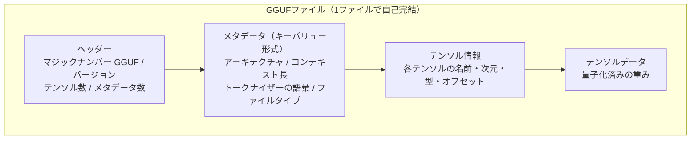

# GGUFってなんだ？〜ローカルLLMの「共通言語」を完全理解する〜

## 1. 概要

GeneLab_999 による Qiita の技術解説記事で、ローカルLLMのモデルファイル形式である GGUF（GGML Universal File Format）と、その中核技術である量子化を、仕組みから実践まで体系的に解説したものである。公開日は 2026-02-22 である。

対象読者は、llama.cpp や Ollama でローカルLLMを動かしたことがある人、HuggingFace で見かける「Q4_K_M」「Q8_0」といった記号の意味が分からない人、`.gguf` ファイルを中身を理解しないまま使っている人である。記事は、GGUF が生まれた背景、ファイル構造、量子化タイプの命名規則と品質・サイズのトレードオフ、safetensors との住み分け、モデルの変換・量子化・実行の実践手順、VRAM 容量別の量子化選択までを扱う。中心となる主張は、GGUF は単なる「軽いモデルファイル」ではなく、アーキテクチャ情報・トークナイザー・量子化済みの重みを実行に必要な情報ごと1ファイルにパッケージした、自己完結性の高いフォーマットだという点である。

なお、記事は llama.cpp の内部実装の詳細、量子化手法の数学的な厳密な導出、safetensors や ONNX との網羅的な比較は扱わないと明示している。

## 2. 要約

- **GGUF の正体**：llama.cpp のネイティブフォーマットで、モデルの重み（量子化済み）・メタデータ・トークナイザーを1ファイルに格納する「全部入り」のバイナリ形式である。ファイル1つで追加の設定なしに推論を始められる。
- **誕生の背景**：前身の GGML 形式は、モデルのメタデータを柔軟に格納する仕組みがなく、新しいアーキテクチャへの対応が難しかった。2023年8月に、Georgi Gerganov 氏自身が後継として GGUF を設計した。設計目標は、自己完結性、キーバリュー形式のメタデータによる拡張性、ポータビリティ、テンソルごとの量子化の柔軟性である。
- **ファイル構造**：ヘッダー、メタデータ（キーバリュー形式）、テンソル情報、テンソルデータの4セクションで構成される。メタデータにはアーキテクチャ名、コンテキスト長、トークナイザーの語彙などが記録される。
- **量子化タイプの解読**：`Q4_K_M` は「4ビット量子化・K-Quant 方式・Medium（バランス）」を表す。7B モデルの目安では、Q4_K_M が約4.1GB で品質とサイズのバランスが最も良く、最も人気がある。Q8_0 は約7.2GB でほぼ無劣化、F16 は約14GB で量子化なしの参照用である。
- **K-Quant の仕組み**：テンソルの重要度に応じてビット数を変える方式である。たとえば注意機構の重みは高精度に保ち、FFN 層の重みは低精度にする。全テンソル一律だった旧方式（Q4_0 など）より、同じビット数でも品質が高い。
- **safetensors との住み分け**：競合ではなく補完関係である。学習・ファインチューニング・配布は safetensors、ローカル推論・エッジデプロイは GGUF が担う、というのが現在の主流のワークフローである。
- **実践の流れ**：HuggingFace のモデルを `convert_hf_to_gguf.py` で FP16 の GGUF に変換し、`llama-quantize` で目的の量子化タイプに変換し、`llama-cli` で推論、`llama-server` で OpenAI 互換 API サーバーとして起動する、という一連の手順が示されている。
- **VRAM 別の選択指針**：4GB なら Q3_K_S、8GB なら Q4_K_M、16GB なら Q6_K、24GB 以上なら Q8_0、CPU のみなら Q4_K_M が推奨として示されている。
- **著者の所感**：GGUF の功績は「ローカルLLMの民主化」であり、70B モデルが float16 の約140GB から約35GB に縮み、CPU と GPU のハイブリッド推論で動く世界は、GGUF と llama.cpp の組み合わせなしには実現しなかった、と述べられている。

## 3. 背景・前提知識

- **GGUF（GGML Universal File Format）**：llama.cpp のネイティブなモデルファイル形式。この記事全体の主題である。重み・メタデータ・トークナイザーを1ファイルに自己完結させる設計が特徴である。
- **GGML**：GGUF の前身のファイル形式。メタデータ格納の拡張性に限界があり、GGUF へ置き換えられた。
- **量子化（Quantization）**：モデルの重み（パラメータ）の精度を下げて、ファイルサイズとメモリ使用量を削減する技術。float32 は1パラメータ4バイト、float16 は2バイト、int8 は1バイト、int4 は0.5バイトが目安である。7B モデルでは、float32 で約28GB、float16 で約14GB、int4 で約3.5GB になる。
- **llama.cpp**：Georgi Gerganov 氏が開発した C/C++ 実装の LLM 推論エンジン。依存ライブラリなしでビルドでき、CPU・GPU・NPU など幅広いハードウェアで動作する。記事によれば、2026年2月現在で GitHub のスターは85,000以上である。
- **トークナイザー**：テキストを数値列（トークン）に変換する仕組み。GGUF ファイルにはトークナイザーの語彙データも同梱される。
- **テンソル**：モデルの重みを格納する多次元配列。GGUF ではテンソルごとに名前・次元・型・オフセットが記録され、テンソルごとに異なる量子化手法を適用できる。
- **safetensors**：テンソルの保存に特化したファイル形式。PyTorch や HuggingFace Transformers での学習・配布が主な用途で、pickle を排除した安全性が特徴である。
- **VRAM**：GPU のメモリ。ローカルLLMでは、モデルサイズと VRAM 容量の兼ね合いが実行可否を決める。70B モデルを float16 で読み込むと約140GB になり、コンシューマ向け GPU では収まらない。
- **Ollama / LM Studio / GPT4All**：GGUF を採用する主要なローカルLLM実行ツール。Ollama は内部的に llama.cpp と GGUF を使っている。
- **HuggingFace Hub**：モデルの配布プラットフォーム。`GGUF-my-repo` スペースでのワンクリック変換や、Inference Endpoints の GGUF ネイティブサポートなど、GGUF のエコシステムの中心にある。

## 4. 詳細解説

### なぜ GGUF が必要になったか

ローカルLLMの実践は、VRAM 制約との戦いから始まる。70B パラメータのモデルを float16 で読み込むと約140GB が必要で、ハイエンドのコンシューマ GPU でも到底収まらない。そこで重みの精度を落としてサイズを削る量子化が要るようになるが、量子化したモデルをどういうファイル形式で配り、どう実行するかという共通の器も必要だった。

llama.cpp は当初 GGML 形式を使っていたが、GGML にはモデルのメタデータ（アーキテクチャ情報やコンテキスト長など）を柔軟に格納する仕組みがなく、新しいモデルアーキテクチャへの対応が困難だった。そこで2023年8月、llama.cpp の作者である Georgi Gerganov 氏自身が後継形式として GGUF を設計した。狙いは、モデル重みだけでなく、実行に必要な情報をすべて1ファイルに自己完結させること、キーバリュー形式のメタデータで将来の拡張に備えること、アーキテクチャをメタデータに記録してツール側で自動判定できるようにすること、そしてテンソルごとに異なる量子化を適用できるようにすることだった。

その後 GGUF は急速に普及し、記事では「2026年現在では事実上のローカルLLM標準フォーマット」と位置づけられている。HuggingFace Hub でのワンクリック変換、主要な実行ツール（Ollama、LM Studio、GPT4All）の採用が、その普及を支えている。

### ファイル構造：「全部入り」の中身

GGUF ファイルは、ヘッダー、メタデータ、テンソル情報、テンソルデータの4セクションからなる。ヘッダーにはマジックナンバー「GGUF」、バージョン番号、テンソル数とメタデータ数が記録される。メタデータはキーバリュー形式で、アーキテクチャ名（例：`general.architecture`）、コンテキスト長、トークナイザーの種類と語彙、ファイルタイプなどが格納される。テンソル情報には各テンソルの名前・次元・型・オフセットが並び、最後に実際の重みデータが続く。

safetensors との決定的な違いは、このメタデータの豊富さである。safetensors はテンソルの保存に特化しているのに対し、GGUF はアーキテクチャ、コンテキスト長、トークナイザー語彙まで同梱する。そのため、GGUF ファイル1つあれば、追加の設定ファイルなしで推論を開始できる。

### 量子化タイプの記号を読み解く

HuggingFace で見かける `Q4_K_M` のような記号は、3つの要素に分解できる。先頭の数字は量子化のビット数（4なら4ビット）、`K` は K-Quant 方式であること、末尾の `S` / `M` / `L` はサイズと品質のバランス（Small / Medium / Large）を表す。

7B モデルでの目安として、Q2_K は約2.7GB で品質は低く、Q3_K_S は約3.2GB、Q4_0 は約3.8GB（レガシー）、Q4_K_M は約4.1GB でバランスが最も良く最も人気があり、Q5_K_M は約5.0GB、Q6_K は約5.9GB、Q8_0 は約7.2GB でほぼ無劣化、F16 は約14GB で量子化なしの参照用、という対応表が示されている。記事の実践的な結論は「迷ったら Q4_K_M を選べば間違いない」である。

### K-Quant はなぜ賢いのか

`K` のつく K-Quant 方式は、テンソルの重要度に応じてビット数を変える方式である。たとえば注意機構の重みは6ビットの高精度で保持し、FFN 層の重みは4ビットに落とす、といった最適化を自動で行う。旧方式の Q4_0 は全テンソルを一律4ビットにしていたため、同じ「4ビット」でも K-Quant の方が品質が高い。量子化の設計思想は、「一律に削る」のではなく「重要な部分を守りながら削る」ことにある。

### safetensors と GGUF は競合しない

両者の住み分けは、用途で決まる。safetensors は学習・ファインチューニング・HuggingFace Hub での配布が主用途で、量子化自体は別ツールが行い、形式自体はテンソル情報のみを持つ。GGUF はローカル推論・エッジデプロイが主用途で、量子化の仕組みを内蔵し、実行に必要なメタデータ全部を持つ。セキュリティ面では、どちらも実行コードを含まない点で安全である。結論として、学習済みモデルは safetensors で配布し、ローカル推論には GGUF に変換して使う、という補完関係が現在の主流ワークフローである。

### 実践：変換から API 化まで

実践編では、まず llama.cpp を用意する。Mac では brew でのインストールが最も簡単で、GPU 対応したい場合は GitHub から取得して CMake でビルドする。Windows では Visual Studio 2022 の C++ ビルドツールが必要である。

モデルの変換と実行は4ステップである。第1に、`convert_hf_to_gguf.py` で HuggingFace のモデルを FP16 の GGUF に変換する。第2に、`llama-quantize` で FP16 から目的の量子化タイプ（例：Q4_K_M）へ変換する。第3に、`llama-cli` でプロンプトを与えて推論する。第4に、`llama-server` で OpenAI 互換 API サーバーとして起動する。サーバーを立てれば、OpenAI の SDK を使う既存コードの向き先をローカルに切り替えるだけで、ローカルLLMを透過的に利用できる。

GGUF のメタデータは、Python の `gguf` パッケージの `GGUFReader` で読み出すこともできる。トークナイザー語彙のような巨大なデータは表示から除くのが実践上の工夫である。

よくあるエラーとしては、llama.cpp が対応していないアーキテクチャ（最新版への更新で対処）、GPU オフロード層の過多による CUDA のメモリ不足（`-ngl` の調整で対処）、GGUF バージョン不一致による読み込み失敗、トークナイザーの不整合などが挙げられている。

### ユースケースと選択指針

手軽に試すなら Ollama が推奨される。カスタムの GGUF モデルも、Modelfile に `FROM` でファイルを指定すれば取り込める。既存の OpenAI API コードを切り替えるなら llama-server の構成が向く。

量子化タイプの選択は VRAM 容量で決めるのが実践的である。記事の指針では、VRAM 4GB では Q3_K_S（ほぼ唯一の選択肢）、8GB では Q4_K_M（7B モデルが快適に動く）、16GB では Q6_K（品質重視。Q8_0 も選択可能）、24GB 以上では Q8_0（ほぼ無劣化）、CPU のみでは Q4_K_M（RAM 容量に注意）となっている。開発・本番・テストで設定ファイルを分け、開発では Q8_0 の高品質、本番では Q4_K_M のバランス、CI では最軽量の Q4_0、という使い分けの例も示されている。

学習の進め方としては、初級では Ollama での体験と HuggingFace の GGUF ドキュメント、中級では変換パイプラインの自作と llama-server の接続、上級では GGUF 仕様書の精読や K-Quant のアルゴリズム理解、というロードマップが提示されている。

## 5. 重要なポイント

- GGUF は「量子化されたモデルを入れる箱」ではなく、重み・メタデータ・トークナイザーを1ファイルに自己完結させた実行可能なパッケージである。
- 前身 GGML の限界（メタデータ格納の拡張性のなさ）を解消するために、2023年8月に llama.cpp の作者自身が設計した。
- 量子化タイプの記号は「ビット数・方式・バランス」の3要素で読める。Q4_K_M が品質とサイズのバランスで標準的な選択である。
- K-Quant はテンソルの重要度に応じてビット数を変えるため、一律量子化の旧方式より同じビット数でも品質が高い。
- safetensors と GGUF は競合ではなく補完関係にある。配布と学習は safetensors、ローカル推論は GGUF が担う。
- 量子化の選択は VRAM 容量から逆算して決めるのが実践的である。
- GGUF と llama.cpp の組み合わせが、大きなモデルを個人のハードウェアで動かす「ローカルLLMの民主化」を実現した、というのが著者の評価である。

## 6. 図解

GGUF ファイルの4セクション構造を示す。

## 7. 自分なりの考察

以下はAIによる考察であり、元記事の主張とは区別する。

この記事の問題意識の中心は、「Q4_K_M を選べ」という合言葉だけが流通し、その背後の設計思想が理解されていない点にあると考えられる。記号の意味（ビット数・方式・バランス）を読み解けるようになると、量子化の選択は「人気のファイルを選ぶ」行為から「自分のハードウェア制約と品質要求から逆算する」行為に変わる。これは、ツールを使う側のリテラシーとして一般化できる論点である。

また、safetensors と GGUF の関係を「競合ではなく補完」と捉える視点も重要である。フォーマットの優劣を競うのではなく、学習・配布と推論という工程ごとに適した形式が分かれている、という理解は、他の技術選定（たとえば配布形式と実行形式が異なる一般のソフトウェア配布）にも通じる見方である。

なお、記事中の数値（スター数や「事実上の標準」という位置づけ）は2026年2月時点の著者の記述であり、エコシステムの状況は変化しうる点には注意が要る。

## 8. 学んだこと

- GGUF は、重み・メタデータ・トークナイザーを1ファイルに格納する自己完結型のフォーマットであり、追加設定なしで推論を始められる。
- GGUF のファイル構造は、ヘッダー、キーバリュー形式のメタデータ、テンソル情報、テンソルデータの4セクションである。
- 量子化タイプの記号（例：Q4_K_M）は、ビット数、量子化方式（K-Quant か旧方式か）、サイズと品質のバランス（S / M / L）に分解して読める。
- K-Quant は、テンソルの重要度に応じてビット数を変えることで、一律量子化より品質を保つ方式である。
- 量子化のビット数とサイズの対応は、7B モデルで Q4_K_M が約4.1GB、Q8_0 が約7.2GB、F16 が約14GB が目安になる。
- safetensors は学習・配布用、GGUF はローカル推論用という役割分担が主流であり、両者は補完関係にある。
- GGUF の実践手順は、変換（FP16 化）、量子化、推論、API サーバー化の4ステップで構成される。
- 量子化タイプは VRAM 容量から逆算して選ぶ（4GB は Q3_K_S、8GB は Q4_K_M、16GB は Q6_K、24GB 以上は Q8_0）。

## 9. 関連情報

- [GGUFフォーマットの構造と設計](../../knowledge/ai/gguf-format-structure.md) — GGUF の自己完結性、4セクション構造、safetensors との住み分けを整理した知識。
- [LLMの量子化タイプの読み解きと選択](../../knowledge/ai/llm-quantization-types-and-selection.md) — 量子化の基本、記号の読み方、K-Quant の仕組み、用途別の選択指針を整理した知識。
- [GGUFの実践ワークフロー（変換・量子化・実行）](../../knowledge/ai/gguf-practical-workflow.md) — 変換から API 化までの手順、Ollama 連携、よくあるエラーへの対処を整理した知識。
- [人工知能](../../topics/artificial-intelligence.md) — AI 全般を横断するテーマ。ローカルLLMの基盤技術として、この情報源を追加した。

## 10. 原文

元URL：https://qiita.com/GeneLab_999/items/0b9c83eaddb7a8b5b927
