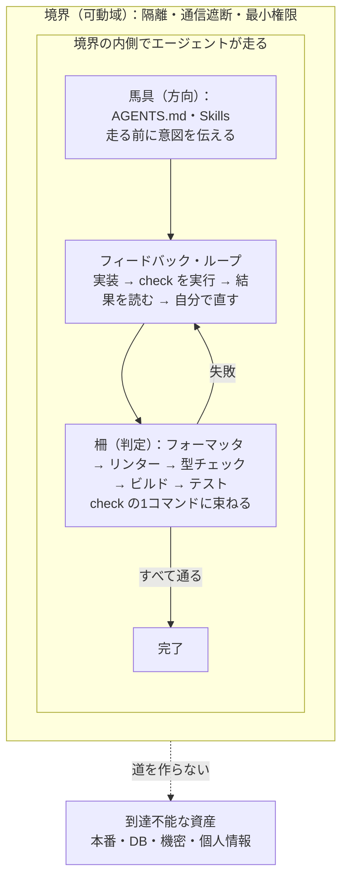

# ハーネス設計入門 〜 基礎知識の整理から実務へのステップアップ 〜

## 1. 概要

木下雄一朗（kinopee）によるスライド資料で、Findy 主催の Web セミナー（2026-09-24）での登壇資料である。全30スライド。AIエージェントが同じ失敗を繰り返さないよう、モデルの外側（環境）を設計する「ハーネスエンジニアリング」について、前半で定義と歴史を整理し、後半で実務への落とし込み方を解説する。

構成は2部である。第1部（Part 1: History）では、ハーネスの定義が論者によって異なること（5つの流派）、どちらが外側かという包含関係の対立、2026年に入ってからの語彙の収束と標準化の動きを扱う。第2部（Part 2: Practice）のゴールは、「エージェントが自分で失敗に気づき、自分で直して完走する」仕組みの設計方法を持ち帰ることであり、前提（生成AIは確率で動く）、ハーネスとガードレールという2つの仕組み、フィードバック・ループ、第3の層である境界、セキュリティ、コスト、ハーネスの寿命、作業の順序、最後に4原則が提示される。

本稿は、Speaker Deck のページに掲載されたトランスクリプト（スライドのテキスト）をもとに作成した。スライドには図表中心でトランスクリプトのテキストが薄いものがある（例：実証を紹介するスライド、Skills の基本形を示すスライド）。そのような箇所については、図の内容を推測で補わず、テキストから確認できる範囲で記述し、限界があることを明記する。また、スライド中の数値や引用（Uber のコストに関する数字など）は、スライドが提示・引用しているものであり、本稿で独立に検証したものではない。その旨は該当箇所に明記する。

## 2. 要約

- **ハーネスの定義**：ハーネスエンジニアリングとは、エージェントが同じ失敗を繰り返さないよう、モデルの外側（環境）を設計することである。
- **5つの流派**：同じ「ハーネス」でも、論者が手本にした実装によって意味の範囲が違う。Chase派は「モデル以外のすべてがハーネス」、Hashimoto派は「失敗したら環境を再設計せよ」、Fowler派（Böckeler）は「コンテキスト設計の特殊形」、Chawla派は「LLM の OS 層」、Codex派（Lopopolo）は「三重の入れ子」で、スケールで壊れる問題への答えと位置づける。
- **包含関係の対立**：Chase派と Chawla派では「ハーネス ⊃ コンテキスト」だが、Fowler派では逆にコンテキストが外側になる。どちらが外側かが流派によって逆になる。
- **語彙の収束と標準化**：2026年3〜7月にかけて、LangChain の「The Anatomy of an Agent Harness」による構成要素の整理などを経て、5つの流派の言葉づかいは約5か月でほぼ一つにまとまった。Agent Plugins 1.0 のような形式の標準化も始まったが、互換性はまだ一部にとどまる。
- **前提**：生成AIは確率で動く。同じ指示でも出力は毎回同じとは限らない。だから、指示だけに頼らず、環境と検証で受け止める設計が要る。
- **2つの仕組み**：ハーネス（馬具）は、走り出す前に意図を伝える事前設計の層で、内容は人間の判断で決める「主観」の層である。ガードレール（柵）は、走った後に道から外れていないかを機械的に Yes / No で判定する「客観」の層である。
- **フィードバック・ループ**：検証器とゴール（check がすべて通ること）を渡せば、エージェントは自分で実行し、結果を読み、自分で直すループを閉じられる。
- **境界という第3の層**：柵は逸脱を検知するが、境界は戻れない場所への道を最初から作らない。可逆な逸脱は柵で拾ってループに戻し、不可逆な逸脱は境界で試行そのものを無くす。
- **セキュリティ**：自律性を上げるほど、エージェント自体が攻撃の入口になる。機密データへのアクセス、不審コンテンツの読み取り、外部への送信の3つを同時に許さないことが要点である（lethal trifecta）。
- **コストと寿命**：ハーネスは、ターン、リクエスト、トークンを減らすことでコストを下げる。一方で、現行モデルの弱点を補う作り込みは次世代モデルで溶けて消える「隠れた技術的負債」でもあり、薄く保ち、定期的に棚卸しすることが求められる。
- **作業の順序と4原則**：境界を引く → ルールを書く → 柵を1コマンドの門に束ねる → ループを閉じる → 道具を増やす → 運用と棚卸し、という順序が示され、まとめとして4原則（戻れない場所に道を作らない、進路はハーネスで示す、逸脱はガードレールで検知、ループを閉じて自走させる）が提示される。

## 3. 背景・前提知識

- **ハーネス（Harness）**：もともとは馬具のことである。この資料では、モデルそのものではなく、モデルの外側にある環境・仕組み全体、あるいはそのうち事前に意図を伝える部分を指す。文脈によって範囲が異なる点が第1部の主題である。
- **コンテキストエンジニアリング**：モデルに渡す文脈（コンテキスト）を設計すること。ハーネスとの包含関係が流派によって逆になる。
- **AGENTS.md**：プロジェクトの前提・規約・手順・禁止事項をエージェント向けに明文化するファイルである。ハーネスの代表的な道具である。
- **Skills**：定型作業の手順書を切り出し、必要な場面でだけエージェントに読ませる仕組みである。常時読み込まれるルールとは適用範囲が異なる。
- **ガードレール（Guardrails）**：この資料では、lint、型チェック、ビルド、テストなど、機械的に Yes / No を判定する検証の仕組みを指す。AI 分野で一般に言われる「出力の安全対策」とは範囲が異なる使い方である。
- **check コマンド**：フォーマッタ、リンター、型チェック、ビルド、テストを1つに束ねた検証コマンドである。人も AI も同じ門をくぐる、という設計の中心になる。
- **フィードバック・ループ**：エージェントが実装し、検証し、失敗の出力をもとに自分で直して再実行する循環である。
- **境界（Boundaries）**：エージェントが触れる範囲を決める層である。隔離、通信遮断、最小権限によって、危険な対象への到達自体を無くす。
- **lethal trifecta（致命的な三要素）**：Simon Willison が提示した、AIエージェントの危険が最大化する条件の組み合わせである。機密データへのアクセス、不審コンテンツの読み取り、外部への送信の3つがそろう状態を指す。
- **MCP（Model Context Protocol）**：エージェントが外部ツールや情報源に接続するための共通規約である。標準化の文脈で登場する。
- **サブエージェント**：親エージェントが役割を分けて委任する子エージェントである。文脈を分離できることが要点とされる。

## 4. 詳細解説

### 第1部：ハーネスの定義と流派

資料の定義は、「エージェントが同じ失敗を繰り返さないよう、モデルの外側（環境）を設計すること」である。ただし、同じ「ハーネス」という言葉でも、論者が手本にした実装によって意味の範囲が違うとして、5つの流派が整理される。

- **Chase派**（Harrison Chase、LangChain）：モデル以外のすべてがハーネスである、という最も広い定義である。
- **Hashimoto派**（Mitchell Hashimoto）：失敗したら環境を再設計せよ、という運用哲学としての定義である。
- **Fowler派**（Birgitta Böckeler、Thoughtworks）：ハーネスをコンテキスト設計の特殊形として定義する。
- **Chawla派**（Avi Chawla、教育系）：ハーネスは LLM の OS 層である、とする。
- **Codex派**（Ryan Lopopolo、OpenAI Codex）：ハーネスは三重の入れ子であり、スケールで壊れる問題への答えである、とする。

対立点として、包含関係の向きが挙げられる。Chase派と Chawla派では「ハーネス ⊃ コンテキスト」（ハーネスが外側）だが、Fowler派では逆にコンテキストが外側になる。どちらが外側かが流派によって逆になることが、議論の混乱の一因だったと読み取れる。

その後の展開として、語彙の収束と標準化が示される。スライドによれば、2026年3月10日に LangChain が「The Anatomy of an Agent Harness」で構成要素を整理し、4月19日には Addy Osmani が「ハーネスはモデル同士より互いに似てきている」と述べた。6月には Build 2026 で Agent Harness の安定版が出て、Pydantic v2.0 がハーネス中心に再設計された。Linux Foundation が Agentic AI Foundation を設立し（MCP、AGENTS.md、Goose が関係する）、Agent Plugins 1.0（2026年8月6日）では、Skills と MCP サーバーを1つのフォルダ形式（plugin.json、skills/、mcp.json）にまとめる標準化が進んだ。これは Vercel の発案で、Amazon、Cursor、GitHub、Microsoft、OpenAI が策定し、Google も参加したとされる。対応実装として ChatGPT、Codex、Cursor、GitHub Copilot、Kiro、VS Code が挙げられる。ただし互換性は一部にとどまり、Claude Code は独自形式のままで未対応であること、Skills か MCP の片方だけ対応のクライアントもあること、hooks やコマンド、rules は標準化の対象外でクライアントごとに異なることが注意点として挙げられている。結論として、5つの流派の言葉づかいは約5か月でほぼ一つにまとまり、言葉はまとまり形式の標準化も始まったが、互換性はまだ一部である、とされる。

第1部の最後では、モデルを変えずにハーネスだけで成績や品質が変わった実証として3つの例（ベンチマークの順位、設定による差、品質低下に関するもの）が示される構成になっている。ただし、この部分は図表中心であり、トランスクリプトからは各例の具体的な内容や数値は読み取れない。本稿では、例が3つ提示されているという構成的事実のみを記録する。

### 第2部の前提：生成AIは確率で動く

第2部は、前提の確認から始まる。生成AIは、1トークンごとに確率で次の語を選ぶため、小さな揺らぎが数千トークンの積み重ねで効いてくる。同じ指示でも出力は毎回同じとは限らず、低確率の「悪い一手」もゼロではない。スライド中の分布の数字は説明用のイメージであると明記されている。従来のプログラムが「同じ入力 → 同じ出力」（決定的）であるのに対し、生成AIは「同じ入力 → 分布からのサンプル」（確率的）である。したがって、指示だけに頼らず、環境と検証で受け止めることが設計の出発点になる。

### ハーネスとガードレール：役割の違う2つの仕組み

第2部では、第1部の広いハーネスを、「指示で伝える部分」と「機械的に判定する部分」に分ける。

ハーネス（馬具）は、走り出す前に伝える事前設計の層である。役割は、プロジェクトの前提・規約・手順・禁止事項を、エージェントが参照できる形で明文化しておくことにある。性質は、人間の判断で決める「主観」の層であり、書いた分だけ効くが、書きすぎるとコンテキストを圧迫する。何を書くかを選ぶことが設計になる。馬具が手綱で進路を伝えるように、ハーネスは自然言語で伝える「意図」である。ただし、モデルは確率で動くため効き目は絶対ではなく、柵（機械的な判定）と組み合わせることが前提になる。

ガードレール（柵）は、走った後に道から外れていないかを検証する層である。lint、型、ビルド、テストで Yes / No を判定する。性質は、誰が実行しても結果が同じ「客観」の層であり、判定が機械的であるほど、エージェントは自分で失敗に気づき、自分で直せる。防護柵が道の両脇で逸脱を止めるように、確率で動くモデルを決まった判定で支えるのが役割である。

### ハーネスの道具箱

事前に伝える仕組みにも、効く範囲と深さが違う道具がある。スライドでは、左から右へ適用範囲が狭く・深くなる3つの道具が示され、続くスライドで AGENTS.md、Skills、サブエージェントが順に取り上げられる。

AGENTS.md の書き方については、「ルールは毎回コンテキストに読み込まれるので、1行ごとに『家賃』がかかる」という比喩で、書くことと書かないことの選別が示される。書くことは、プロジェクト概要（1段落で）、コマンド（ビルド、テスト、lint）、プロジェクト固有の規約・構成、してはいけないこと、である。書かないことは、一般常識や言語の一般的な作法、コードを読めばわかること、長大な設計書の貼り付け、守れているか検証できない精神論、である。「きれいに書く」のような精神論は、機械的に判定できる形に直すことが求められる。目安として、最初は最小限にし、全行が実際の失敗や規約に対応していることが基準になる。足りない分は、逸脱が出たら1行足して育てる。なお、補足として、Claude Code は CLAUDE.md があればそちらを優先し、なければ AGENTS.md を読む（v2.1.277 以降）という記述がある。

Skills は、必要なときだけ読む手順書である。ルールに全部書くとコンテキストが溢れるため、定型作業は Skill に切り出し、必要な場面でだけ読ませる。スライドには SKILL.md の基本形が示されるが、その具体的な中身は図側にあり、トランスクリプトからは読み取れない。

サブエージェントには2つの呼び出し方がある。A はオンデマンド生成で、親エージェントが必要になった瞬間に子を起こして仕事を振る使い捨ての委任であり、大量の調査・比較の並列化や、結果の要約だけ持ち帰りたい場面に向く。B は事前定義して呼び出す形で、役割・観点・出力形式をファイルに定義しておき名前で呼ぶ、育てて共有する委任であり、レビューやセキュリティ監査のように毎回同じ観点で行う作業に向く。並列化は待ち時間を大きく減らすが、同時に走る数だけ時間当たりのトークン消費は増えるため、数と深さは費用対効果で決める。共通するのは「文脈の分離」であり、定義ファイルはサブエージェント用の AGENTS.md にあたる、とされる。

### ガードレールの階層とレール

ガードレールの階層は、右へ行くほど判定が強くなる並びで示される。フォーマッタ（表記の統一。議論の余地なく自動修正できる）、リンター（作法の検査。バグの芽と規約違反を静的に検出）、型チェック（整合性の検証。データの流れの矛盾を実行前に検出）、ビルド（成果物として成立するかの最低ライン）、テスト（振る舞いの保証。仕様どおり動くかを確認）である。検証する対象は、表記 → 整合性 → 振る舞いへと深くなる。この5つを check の1コマンドに束ね、人も AI も同じ門をくぐる。共通の完了条件は「check がすべて通ること」である。原則として、ガードレールが強いほどエージェントは自分の失敗に気づけるため、任せられる範囲が広がる。

柵を走らせる仕組みが「レール」であり、3本ある。クライアント内の Hooks（エージェントの編集・実行の瞬間に走る。最速だが、クライアントの設定で無効にできる）、Git hooks（コミットや push の時に走る。Husky や lefthook など。`--no-verify` で抜けられるため強制力は中）、CI（PR の作成・更新時に走る。ブランチ保護と組み合わせれば失敗時はマージ不可にでき、抜けられないため強制力は最大）である。外側ほど強制力が強く、「内側で速く気づき、外側で確実に止める」が構図であり、レールもハーネスの一部とされる。

柵には2種類ある。成果物への柵は、書いたものを事後に検証するもので、lint、型チェック、ビルド、テストが該当し、問うことは「正しく作れたか」である。失敗はフィードバック・ループの入力になる。行動への柵は、危険な実行を事前にブロックするもので、Hooks や許可リストが該当し、問うことは「実行してよいか」である。判定の対象は行為であり、起きる前に止めるしかない事故に使う。共通の原理は、人の注意力に頼らず機械的に止めることである。

### フィードバック・ループ

フィードバック・ループは、検証器とゴールをエージェントに渡す設計である。エージェントは、タスクを進め、check を自分で実行して結果を読み、失敗の出力をもとに修正・再実行を自分で繰り返す。人が用意するものは、検証器としての門（check）と、ゴール（check がすべて通ること）である。実行コマンドと共通の条件は AGENTS.md に書き、タスク固有の条件はプロンプトで渡す。タスク固有の条件もテストにして check に入れれば、「check がすべて通る」で完了を判定できる。検証器とゴールを渡せば、エージェントは自分でループを閉じる、というのが要点である。

### 第3の層：境界

馬具と柵の外側に、境界という第3の層が置かれる。3層の役割は、馬具が方向を与える（問い：どう走るか。性質：指示する・確率的）、柵が判定する（問い：道から外れていないか。性質：機械的）、境界が可動域を決める（問い：触れられるか。性質：構造的・事前で、判定せず到達自体を無くす）である。

境界が必要な理由は、柵は漏れることがあり、漏れると取り返しのつかない事故もあるためである。本番、データベース、機密、個人情報といった資産は壁の外に置き、道そのものを作らない。可逆な逸脱は柵で拾ってループに戻し、不可逆な逸脱は境界で試行そのものを無くす。境界の手段は、コンテナやサンドボックスによる隔離、通信遮断、最小権限である。馬具と柵は、境界の内側で働く。

### セキュリティ

自律性を上げるほど、エージェント自体が攻撃の入口になる。スライドでは、危険として、間接プロンプトインジェクション（外部コンテンツに紛れた指示に従ってしまう）、機密・個人情報の漏洩（認証情報や顧客データを読ませない）、破壊的操作（rm や force push を実行できなくする）、サプライチェーン（提案された依存パッケージは人が確認する）の4つが挙げられる。

危険が最大化する条件は、機密データへのアクセス × 不審コンテンツの読み取り × 外部への送信、の3つがそろうことであり、Simon Willison の lethal trifecta（2025-06-16）として出典が示されている。この3つを同時に許さないことが要点である。守りも仕組みで作るものとされ、行動への柵 × 隔離（サンドボックス）× 信頼境界（審査済み Skill・Plugin のみ）の組み合わせが示される。

### コストと効率

自走時間は目的ではなく、短く・少なく・安く終えることが目標である、とされる。スライドでは、Uber のコスト方程式（ユーザー数 × セッション/ユーザー × ターン/セッション × リクエスト/ターン × トークン/リクエスト × 単価/トークン の6つの項の掛け算）が紹介される。利用の広がり（ユーザー数など）は増えてよい項であり、中央の3項（ターン、リクエスト、トークン）はエージェントのオーバーヘッドとして、ハーネスで減らせるものとされる。ターンについては計画を速くし不要なターンやエラーを減らす、リクエストについては根拠づけ（社内情報のグラフ）で無駄な探索を減らす、トークンについては常駐コンテキストを削る（MCP の CLI 化、キャッシュ）といった手が挙げられる。スライドが示す Uber の結果（2026年2月から8月）では、利用者7倍、リクエスト9.4倍に増えても総コストは横ばいで、1,000リクエストあたりのコストは34%減、1セッションあたりは52%減（ピーク比、モデル固定）とされる。いちばん効いた手は、サブエージェントを安いモデルにすること（方程式の右端の「単価」）だったという。これらの数値はスライドが Uber の公開情報（出典として Uber のブログ記事、2026-08-27 と示されている）を引いたものであり、本稿で検証したものではない。「長く走ったことは、成果ではない」という一文が、この節の結論である。

### ハーネスの寿命：隠れた技術的負債

作り込んだハーネスにも寿命がある。スライドでは「良いチームほど多くのハーネスを作る。その多くは次世代モデルで不要になる」という Han Lee の言葉（2026年）が引かれる。現行モデルの弱点を補う注意書きや、細かく刻んだ手順、独自のリトライ処理といった作り込みは、モデルが賢く・大きくなることで溶けて消える（モデルに吸収される）。一方で、残るものとして、テスト（check）、権限と境界、プロジェクト固有の規約が挙げられる。結論は、ある時点の形に固執せず、薄く軽く保ち、定期的に棚卸しすることである。

### 作業の順序

ハーネスエンジニアリングの手順として、次の6つが示される。逆順にやると、効かないルールと使われない道具が積み上がる、とされる。

1. **境界を引く**：安全な作業環境を用意する。サンドボックスかクラウドエージェントで作業し、本番の認証情報は渡さない。
2. **ルールを書く（AGENTS.md）**：最小限から始める。全行が実際の失敗や規約に対応していること。AI に草案を書かせ、人間が削る。
3. **柵を立て、「1コマンドの門」に束ねる**：lint、型、テストを check に束ね、人も AI も同じ門をくぐる。
4. **ループを閉じる**：検証器とゴール（check がすべて通る）を渡し、エージェント自身に回させる。
5. **繰り返しが見えたら、道具を増やす**：繰り返す手順は Skills へ、観点はサブエージェントへ。
6. **運用で育て、定期的に棚卸しする**：逸脱が出たら1行追記する。数か月に一度は全削除し、要るものだけ戻す棚卸しを行う（Git 管理で安全に試せる）。

要点は、「境界を先に引く。ルールより先に道具を増やさない」である。

### まとめ：4原則

結論として、ハーネスエンジニアリングの4原則が提示される。

1. **戻れない場所に道を作らない**：本番・機密・個人情報・不可逆な操作は、到達できないようにする。隔離環境、通信遮断、最小権限で、境界を先に引く。
2. **進路はハーネスで示す**：規約・コマンド・禁止事項を明文化し、逸脱が出るたびに1行足す。書いたあとの運用が大事である。
3. **逸脱はガードレールで検知**：lint、型、テスト、Hooks を「1コマンドの門」に束ね、人も AI も同じ門をくぐる。判定は機械的に行う。
4. **ループを閉じて自走させる**：検証器とゴールを渡せば、エージェントが自分で直して完走する。その分、任せられる範囲が広がる。

## 5. 重要なポイント

- ハーネスの定義は1つではない。論者ごとに範囲が異なり、包含関係の向きまで逆になる対立があったが、2026年に語彙は収束し、形式の標準化が始まった。
- 設計の出発点は「生成AIは確率で動く」という前提である。指示（ハーネス）だけでは受け止めきれないため、機械的な判定（ガードレール）と組み合わせる。
- ハーネスは「主観」の層、ガードレールは「客観」の層である。検証器とゴール（check がすべて通る）を渡すことで、エージェントは自分の失敗に気づいて直すループを閉じられる。
- 柵の階層（フォーマッタ → リンター → 型チェック → ビルド → テスト）を1コマンドに束ね、レール（Hooks、Git hooks、CI）の外側ほど強制力を強くするのが、判定を確実に走らせる設計である。
- 境界は、検知ではなく到達不能化の層である。可逆な逸脱は柵で拾い、不可逆な事故は境界で試行そのものを無くす。
- セキュリティの要点は、lethal trifecta の3要素を同時に許さないことであり、守りも仕組みで作る。
- ハーネスはコストを下げる手段であると同時に、モデル進化で溶ける技術的負債でもある。薄く保ち、棚卸しし、境界 → ルール → 柵 → ループ → 道具の順で育てる。

## 6. 図解

ハーネス設計の3層（馬具・柵・境界）と、その内側で回るフィードバック・ループを示す。

## 7. 自分なりの考察

以下はAIによる考察であり、元資料の主張とは区別する。

この資料の見通しの良さは、「ハーネス」という流行語を、定義の対立も含めて一度ばらしてから、馬具・柵・境界という3つの役割に組み直している点にあると考えられる。特に、柵（検知）と境界（到達不能化）を分けたことは実務的な価値が高い。可逆かどうかで対策の種類を変えるという整理は、エージェントに限らず自動化全般の安全設計に応用できる。

また、この資料の内容は、本知識ベースに既にある「エージェント作業における検証の習慣」（検証の定義を事前に決め、証拠を確認する）と同じ方向を向いている。検証の習慣が「人の側の実践」だとすれば、ハーネス設計は「エージェントが自分で検証して直せる環境の側の設計」であり、両者は補完関係にあると読める。

注意点として、この資料はスライドであり、数値や動向の一部（Uber のコストの数字、2026年の標準化の経緯など）は、資料が引用する各出典に依存する。本稿では資料の記述として記録したが、事実として利用する際は原出典に当たる必要がある。また、実証を紹介するスライドなど、図表中心でトランスクリプトが薄い箇所は、本稿でも内容を確定できていない。登壇の映像や原出典が公開されれば、補完できる余地がある。

## 8. 学んだこと

- ハーネスエンジニアリングは、エージェントが同じ失敗を繰り返さないよう、モデルの外側（環境）を設計することである。定義には5つの流派があり、ハーネスとコンテキストの包含関係は流派によって逆になる。
- 2026年3〜7月にかけて語彙は収束し、Agent Plugins 1.0 など形式の標準化も始まったが、互換性はまだ一部にとどまる。
- 生成AIは確率で動くため、指示だけに頼らず、環境と検証で受け止める設計が要る。
- ハーネス（馬具）は事前に意図を伝える主観の層、ガードレール（柵）は事後に機械的に判定する客観の層であり、役割が違う。
- AGENTS.md は1行ごとに「家賃」がかかる。書くことと書かないことを選び、逸脱が出たら1行足して育てる。
- ガードレールは、フォーマッタ、リンター、型チェック、ビルド、テストの階層を check の1コマンドに束ね、人も AI も同じ門をくぐる形にする。
- 柵を走らせるレールは、クライアント Hooks、Git hooks、CI の3本で、外側ほど強制力が強い。
- 検証器とゴール（check がすべて通る）を渡せば、エージェントは自分でループを閉じて完走できる。
- 境界は第3の層であり、不可逆な事故は検知ではなく到達不能化で防ぐ。可逆な逸脱は柵で拾ってループに戻す。
- セキュリティでは、lethal trifecta（機密データへのアクセス × 不審コンテンツの読み取り × 外部への送信）を同時に許さない。
- ハーネスはターン、リクエスト、トークンを減らしてコストを下げる一方、モデルの弱点を補う作り込みは次世代モデルで溶ける技術的負債になる。残るのはテスト、権限と境界、プロジェクト固有の規約である。
- 作業の順序は、境界 → ルール → 柵（1コマンドの門） → ループ → 道具 → 運用と棚卸し、である。

## 9. 関連情報

- [ハーネスの定義と流派](../../knowledge/ai/harness-definitions-and-schools.md) — ハーネスの定義、5つの流派、包含関係の対立、語彙の収束と標準化を整理した知識。
- [ハーネスとガードレールの設計](../../knowledge/ai/harness-and-guardrail-design.md) — ハーネスとガードレールの2つの仕組み、柵の階層とレール、フィードバック・ループを整理した知識。
- [境界とセキュリティ](../../knowledge/ai/boundaries-and-security-for-agents.md) — 第3の層である境界の役割と、lethal trifecta を中心とするセキュリティを整理した知識。
- [ハーネスの運用と寿命](../../knowledge/ai/harness-operations-and-lifespan.md) — 作業の順序、コスト、技術的負債としての側面、4原則を整理した知識。
- [人工知能](../../topics/artificial-intelligence.md) — AI 全般を横断するテーマ。エージェントの環境設計として、この情報源を追加した。

## 10. 原文

元URL：https://speakerdeck.com/kinopeee/hanesu-sekkei-nyuumon-kiso-chishiki-no-seiri-kara-jitsumu-heno-suteppu-appu
