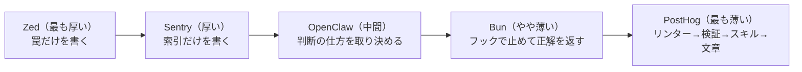

# ハーネスエンジニアリングを有名OSSはどう組んでいるのか？AIへの信頼で比べる5事例

## 1. 概要

松本 淳太郎（株式会社ジブリッシュ・ラボ）によるブログ記事で、有名 OSS プロジェクトが AI コーディングエージェント向けのハーネス（指示ファイル、ルール、フック、スキル、権限設定、AI による貢献のポリシー一式）をどう組んでいるかを、Zed・Sentry・OpenClaw・Bun・PostHog の5事例について、2026-10-16 時点の実ファイルをもとに読み比べたものである。公開日は 2026-10-16 である。

中心となる主張は、ハーネスの形の違いは「AI の判断をどこまで信頼しているか」から来ている、という点である。信頼するほど書く量は減り、信頼しないほどフックやリンターなどの機械で縛るようになる。記事では5つの OSS を信頼が厚い順に並べ、根拠となるファイルの要所を抜粋して示している。なお、信頼の厚さの評価は、ハーネスの設計から読み取った著者の解釈であり、プロジェクトの規模や開発文化の違いも影響しているはずだ、と著者自身が断っている。

記事の末尾では、5つの良いところを組み合わせたサンプルのハーネスを GitHub で公開していることも紹介されている。

## 2. 要約

- **比べる軸は AI への信頼**：ここでいう AI への信頼とは、AI の判断にどこまで任せているかのことである。信頼が厚い順に、Zed（最も厚い）、Sentry（厚い）、OpenClaw（中間）、Bun（やや薄い）、PostHog（最も薄い）と並ぶ。信頼が厚い Zed と Sentry はハーネスに書く量を最小限にして残りを AI の判断に任せ、中間の OpenClaw は AI を自走させる一方で判断の仕方そのものを細かく取り決め、信頼が薄い Bun と PostHog は機械で防げる間違いについては AI の判断に頼らず、フックやリンターと、あらかじめ決めた手順で結果をそろえている。
- **Zed（最も厚い）**：AI はコードを読めば構造をつかめるとみなし、ハーネスには構造の説明（地図）を書かず、慣れていても踏んでしまう罠だけを書く。ルールファイル（.rules）には「ルールは避けるべき罠であって、たどる地図ではない」という考え方が書かれている。新しいルールには、慣れた人でも間違える、繰り返し起きる、行動に移せるほど具体的、という3条件すべてを満たすことが求められる。何を罠とするかは AI に決めさせず、エージェントは .rules を直接編集できず、PR の説明に提案として出し、採否は人間がレビューで決める。
- **Sentry（厚い）**：ルートの AGENTS.md は短い索引にとどめ、何を読みに行くかは AI に任せる。公開しているスキルでは AGENTS.md を「60行未満を目標にし、100行は決して超えない」と定めている。全体の概要とコマンドの注意、作業場所ごとにどのファイルを読むかの案内でほぼ終わり、領域ごとの作法はその領域の AGENTS.md に、作業の手順はスキル（29本）に置いている。CLAUDE.md の中身は AGENTS.md への参照1行だけである。
- **OpenClaw（中間）**：複数のエージェントを並行して自走させ、行動の判断まで任せる。その代わりに、自分で決めてよい判断と止まって聞く判断の線引きを細かく取り決めている。取り消しのきく日常的な判断は自分で決め、新しい設定項目、公開している契約を壊す変更、有料サービスの利用、破壊的な操作は改めて聞く。返事がないことは承認とみなさない。止まる条件も決まっていて、新しい証拠のないまま同じ失敗が2回続くか、10分進展がなければ別の手段に切り替え、振る舞いが証明されて必須のチェックが通ったら、頼まれていない磨き込みはせずに終える。ただし、取り決めを守るかどうかはまだ AI に委ねられている。
- **Bun（やや薄い）**：作業の大半は AI に任せつつ、繰り返す間違いは文章で頼むのをやめ、フックで実行前に止める。設定ファイルに登録されたフックは2つだけで、そのうち Bash の実行前に走るものが、rustfmt の直接実行やリリース版の bun test の使用など、繰り返し起きる間違いに絞って止める。止めるときは拒否するだけでなく、正しいコマンドと理由を返すため、エージェントはその場で次の行動を自分で直せる。
- **PostHog（最も薄い）**：文章で頼んだことは守られるとは限らないという前提に立ち、規約を自動化するときに試す順番を、リンター（CI とセット）、コミット時の検証（lint-staged / husky）、スキル、AGENTS.md / CLAUDE.md の文章の指示、という順に定めている。上の段ほど、エージェントが読み飛ばしても守られる。スキルは100本を超え、テストを変えたら使うスキル、マイグレーションに触れたら使うスキルというように、変更の中身ごとに使うスキルまで AGENTS.md の表で指定している。
- **設計の出発点**：自分のチームのハーネスを設計するときは、まず自分たちが AI の何を信頼し、何を信頼していないかを言葉にすると、どの OSS のやり方を借りるべきかが見えてくる。ハーネスエンジニアリングは、その線引きを仕組みに落とす作業である、と記事は結んでいる。

## 3. 背景・前提知識

- **ハーネス（ハーネスエンジニアリング）**：この記事では、コーディングエージェントがリポジトリで作業するときに従う仕組み一式のことで、指示ファイル、ルール、スキル、フック、権限設定、AI による貢献のポリシーを含む。ハーネスエンジニアリングは、それを設計し保守することである（記事の「よくある質問」より）。
- **AGENTS.md**：AI コーディングエージェントに渡す指示ファイル。すべてのセッションで毎回読み込まれるため、書く量そのものがコストになる。
- **スキル（エージェントスキル）**：作業の手順を切り出したファイル群。必要な場面でだけ読み込まれるため、常時読み込まれる指示ファイルと役割が違う。
- **フック**：エージェントの操作の前後で自動的に走る仕組み。Bun の例では、Bash の実行前に走って、問題のあるコマンドをその場で止める。
- **リンター / lint-staged / husky**：コードのパターンを機械的に判定する仕組みと、コミット時にファイル単位の検証を行うための仕組み。誰が書いたコードにも同じ判定を下す。
- **AI への信頼**：この記事の比較軸で、AI の判断にどこまで任せているかを指す著者の読み取りである。プロジェクトの規模や開発文化の影響もありうる点は、著者自身が断っている。
- **対象の5つの OSS**：Zed は Rust 製のコードエディタ、Sentry はエラーと性能の問題を監視する開発者向けサービス、OpenClaw はチャットから話しかけられるオープンソースの AI アシスタント、Bun は JavaScript のランタイムなどを一つにまとめたツール、PostHog はプロダクト分析や機能フラグなどをまとめた開発者向けプラットフォームである。

## 4. 詳細解説

### 比べる軸：AI への信頼

AI コーディングエージェントに渡す指示ファイル、ルール、フック、スキル、つまりハーネスの形は、プロジェクトごとに大きく違う。Zed は「ルールは避けるべき罠であって、たどる地図ではない」と書き、PostHog はリンターとコミット時の検証を先に置いて、文章の指示を最後の手段にしている。

この違いは、AI の判断をどこまで信頼しているかから来ている、というのが記事の読みである。なお、GitHub が2,500以上のリポジトリの AGENTS.md を分析して書き方の指針をまとめているが、AI をどこまで信頼するかという問いは扱っていない、と記事は指摘している。

### Zed：罠だけを書き、地図は書かない

Zed は5つの中で AI を最も信頼している。AI はコードを読めば構造をつかめるとみなし、ハーネスには構造の説明を書かず、慣れていても踏んでしまう罠だけを書く。

ルールファイルである .rules には、ルールは避けるべき罠であって、たどる地図ではない、と書かれている。理由は二つある。ルールファイルはすべてのセッションで毎回読み込まれるので、価値の低い1行は毎回のコンテキストを無駄にすること。そして、モジュール構成やデータの流れといった地図はすぐに古くなり、エージェントはコードを読めば自分で把握できること。

そのため、新しいルールには次の3条件をすべて満たすことが求められる。

1. 慣れた人でも間違える（コードベースに慣れた人でも、そのルールがなければ間違える）
2. 繰り返し起きる（一つのセッションで複数回起きた場合も数える）
3. 行動に移せるほど具体的である（漠然とした原則ではなく、具体的な指示である）

実際の罠の例として、失敗しうる処理の結果を捨てないというルールが、書き換え例つきで示されている。ただし、何を罠とするかは AI に決めさせない。エージェントは作業中に .rules を直接編集できず、PR の説明に「ルールの追加提案」として出し、採否は人間がレビューで決める。

つまり Zed は、AI のコードを読む力を信頼して地図を書かず、AI が自分では気づけない罠だけを渡している。人間が握っているのは、何を罠とするかの判断だけである。

### Sentry：索引だけを書き、読みに行く判断を任せる

Sentry は Zed に次いで AI を信頼している。Zed が構造の説明を書かずに AI へ任せたのに対し、Sentry は「どこに何が書いてあるか」の索引だけを書き、何を読みに行くかの判断を AI に任せる。

Sentry が公開しているスキルは、AGENTS.md を60行未満を目標とし、100行は決して超えないと定めている。実際のルートの AGENTS.md は、全体の概要とコマンドの注意、そして作業する場所ごとにどのファイルを読むかの案内でほぼ終わる。領域ごとの作法はその領域の AGENTS.md に、作業の手順はスキルに置いている。スキルの数は29本である。CLAUDE.md の中身は、AGENTS.md を参照する1行だけになっている。

Sentry は、AI が必要な情報を自分で読みに行けると信頼し、常に読ませるのは短い索引だけにしている。詳細はコードの近く（領域ごとのファイル）とスキルに置き、どれを開くかは AI が決める。

### OpenClaw：自走させる代わりに、判断の仕方を取り決める

OpenClaw は、Slack や Telegram などのチャットから話しかけられるオープンソースの AI アシスタントで、AI への信頼は5つの中で中間にあたる。Zed と Sentry が任せたのは読む判断だったが、OpenClaw は複数のエージェントを並行して自走させ、行動の判断まで任せる。その代わりに、どこまで自分で決めてよいか、いつ止まるかを細かく取り決めている。

ルートの AGENTS.md は、規約集というより、仕事を任せる相手との取り決めのように書かれている。中心にあるのは、自分で決めてよい判断と、止まって聞く判断の線引きである。

- 取り消しのきく日常的な判断は、妥当な前提を置いて自分で決める。聞くのは、文脈では解決できない重大な判断だけにする。
- 新しい設定項目、公開している契約を壊す変更、有料サービスの利用、破壊的な操作は、改めて聞く。
- 返事がないことは、承認とみなさない。
- 止まる条件も決まっている。新しい証拠のないまま同じ失敗が2回続くか、10分進展がなければ別の手段に切り替える。振る舞いが証明されて必須のチェックが通ったら、頼まれていない磨き込みはせずに終える。

OpenClaw は AI を最も広く自走させる一方で、その判断の仕方を文章の取り決めで縛っている。取り決めを守るかどうかは、まだ AI に委ねられている、という点が記事の評価である。

### Bun：繰り返す間違いは、フックで止めて正解を返す

Bun は JavaScript のランタイム、バンドラー、テストランナー、パッケージマネージャーを一つにまとめたツールで、AI への信頼はやや薄い側に入る。OpenClaw が取り決めを文章で渡して守るかどうかを AI に委ねたのに対し、Bun は繰り返し起きる間違いについては文章で頼むのをやめ、フックで実行そのものを止める。

設定ファイルに登録されたフックは2つだけである。そのうち Bash の実行前に走るフックが、Bun の開発で繰り返し起きる間違いに絞って止める。たとえば、rustfmt を直接実行すること（ワークスペースの edition を読まず、CI の整形結果と食い違うため）や、リリース版の bun test の使用である。

止めるときは、拒否するだけでなく、正しいコマンドと理由を返す。エージェントはその場で代わりのコマンドを受け取れるので、同じ間違いを繰り返さずに次の行動を自分で直せる。

Bun は、作業の大半を AI に任せつつ、繰り返す間違いだけは AI の判断を当てにせず、機械で止めて正解を返している。

### PostHog：強制力の強い順に載せ、文章は最後の手段

PostHog はプロダクト分析や機能フラグなどをまとめた開発者向けのプラットフォームで、5つの中で AI を最も信頼していない。Bun が少数の間違いだけを機械で止めたのに対し、PostHog は、文章で頼んだことは守られるとは限らないという前提に立ち、規約全体を強制力の強い仕組みから順に載せている。

AGENTS.md の「Agent automation」の節は、規約を自動化するときに試す順番を次のように定めている。前の段が適さない場合にだけ、次の段に進む。

1. リンター（ruff、oxlint、semgrep など。コードパターンの強制で、常に CI とセット）
2. lint-staged / husky（コミット時のファイル単位の検証や警告）
3. スキル（.agents/skills/ に置く作業手順）
4. AGENTS.md / CLAUDE.md の文章の指示（自動化による強制が適さない場合）

上の段ほど、エージェントが読み飛ばしても守られる。リンターと CI は誰が書いたコードにも同じ判定を下し、文章の指示は読まれて初めて守られるので一番下に置かれている。

3段目のスキルは100本を超え、テストを変えたら使うスキル、マイグレーションに触れたら使うスキルというように、変更の中身ごとにどのスキルを使うかまで AGENTS.md の表で指定している。

PostHog は、AI の判断に頼る部分をできるだけ減らし、リンター、コミット時の検証、スキル、文章の4段で結果をそろえている。なお記事の「よくある質問」によれば、PostHog は実行前フック（PreToolUse など）の使用を禁じているという点でも、Bun と対照的である。

### まとめ：信頼の線引きを言葉にすることから始める

5つの OSS のハーネスは、AI をどこまで信頼するかによって、書く量と縛り方が大きく違う。自分のチームのハーネスを設計するときは、まず自分たちが AI の何を信頼し、何を信頼していないかを言葉にすると、どの OSS のやり方を借りるべきかが見えてくる。ハーネスエンジニアリングは、その線引きを仕組みに落とす作業である、というのが記事の結論である。

記事では、書籍の読者向けテンプレートとして、5つの良いところを組み合わせたサンプルのハーネスも GitHub で公開されている。取り入れた点は、Zed からはルールに地図でなく罠を書くことと、新しいルールは3条件を満たすものだけを人間がレビューで判断して足すこと、Sentry からはルートの AGENTS.md を索引にとどめること、OpenClaw からは頼まれていない範囲に広げない・重大な判断だけを聞く・返事がないことを承認とみなさないという3行の取り決め、Bun からは取り返しのつかない操作をフックで実行前に止めること、PostHog からは機械で止められるものは文章に書かないという考え方である。サンプルでは、機械による判定は Lint とフックだけにとどめ、ルールとスキルはそれぞれ4本に絞っている。

## 5. 重要なポイント

- ハーネスの形の違いは、AI の判断をどこまで信頼しているかで説明できる。信頼するほど書く量は減り、信頼しないほど機械で縛るようになる。
- Zed の原則は「ルールは地図ではなく罠」である。新しいルールは、慣れた人でも間違える、繰り返し起きる、行動に移せるほど具体的、の3条件をすべて満たすものだけに絞り、追加の採否は人間がレビューで決める。
- Sentry の原則は「ルートは索引に徹する」である。AGENTS.md は60行未満を目標とし、詳細は領域ごとのファイルとスキル（29本）に分け、どれを読むかは AI が決める。
- OpenClaw の原則は「自走させる代わりに、判断の仕方を取り決める」である。取り消しのきく判断は任せ、重大な判断は聞き、返事がないことを承認とみなさず、失敗が2回続いたら手段を変える、といった止まる条件まで定める。
- Bun の原則は「繰り返す間違いは文章で頼まず、フックで止めて正解を返す」である。フックは2つだけに絞られている。
- PostHog の原則は「強制力の強い順に載せ、文章は最後」である。リンター、コミット時の検証、スキル、文章の4段で、スキルは100本を超え、変更の中身ごとに使うスキルまで指定する。
- 設計の出発点は、自分たちが AI の何を信頼し、何を信頼していないかを言葉にすることである。

## 6. 図解

## 7. 自分なりの考察

以下は AI による考察であり、元記事の主張とは区別する。

この記事の「信頼」という軸は、既存の Knowledge「ハーネスとガードレールの設計」が整理した、ハーネス（事前の伝達）は確率的にしか効かず、ガードレール（機械的な判定）は確実に効く、という区別とよく対応している。信頼が厚い設計は伝達の層に寄せ、信頼が薄い設計は判定の層に寄せる、と言い換えることができる。2つの情報源が、別の入口から同じ構造にたどり着いている点は、この軸の確からしさを補強していると考えられる。

また、5事例は「どれか一つの正解」ではなく、同じチームの中でも対象によって使い分けられる可能性がある。たとえば、繰り返し起きるコマンドの間違いには Bun 型のフックが、領域ごとの作法には Sentry 型の索引とスキルが、というように、間違いの種類ごとに信頼の置き方を変える設計が考えられる。ただし、これは記事が直接述べていることではなく、事例の組み合わせからの考察である。

Zed の「ルールの追加提案はエージェントが出し、採否は人間が決める」という運用は、ルールファイルの肥大化を防ぐ仕組みとして具体的で、他のプロジェクトにも移しやすいと考えられる。

## 8. 学んだこと

- ハーネスの設計は、AI への信頼の置き方で大きく変わる。信頼するほど書く量は減り、信頼しないほど機械的な強制が増える。
- ルールファイルには、コードを読めば分かる地図ではなく、慣れていても踏む罠だけを書く、という原則がある。新規ルールの3条件（非自明、反復、具体的）が、その判断基準になる。
- ルートの指示ファイルを短い索引に徹し、詳細を領域ごとのファイルとスキルに分ける構成は、常時読み込みのコストを抑える方法である。
- エージェントを自走させる場合は、任せる判断と聞く判断の線引き、返事がないことを承認とみなさないこと、失敗時の止まる条件を、文章で取り決める方法がある。
- 繰り返す間違いは、文章の指示ではなく、実行前に止めて正しい方法を返すフックで防ぐ方法がある。規約を載せる順番は、リンター、コミット時の検証、スキル、文章の順が一つの型である。

## 9. 関連情報

- [AIへの信頼度で変わるハーネスの形（5つのOSSの比較）](../../knowledge/ai/harness-shapes-by-trust-in-ai.md)
- [ルールは地図ではなく罠：新規ルールの3条件と索引型の構成](../../knowledge/ai/rules-as-traps-not-maps.md)
- [エージェントを自走させる取り決め：任せる判断と聞く判断の線引き](../../knowledge/ai/agreements-for-autonomous-agents.md)
- [ハーネスとガードレールの設計](../../knowledge/ai/harness-and-guardrail-design.md) — 既存の Knowledge。ハーネス（事前の伝達）とガードレール（機械的な判定）の区別を整理したもの。
- [人工知能](../../topics/artificial-intelligence.md)

## 10. 原文

元URL：https://gibberishlab.com/blog/oss-ai-agent-harness-philosophy
