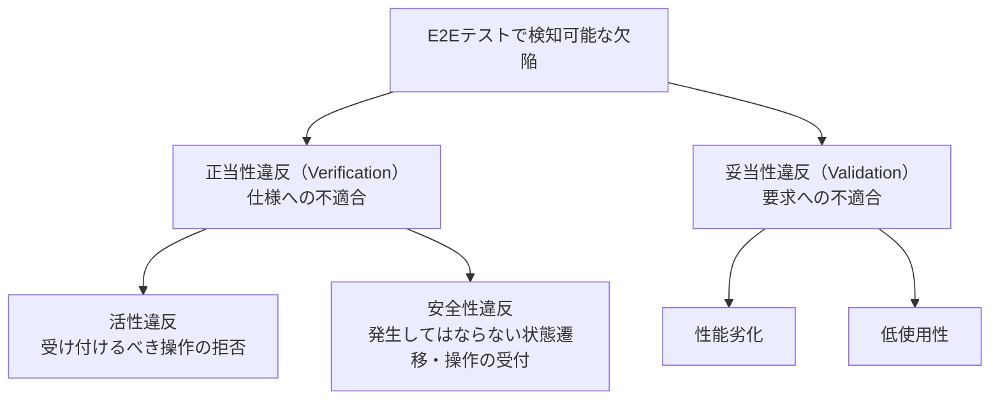
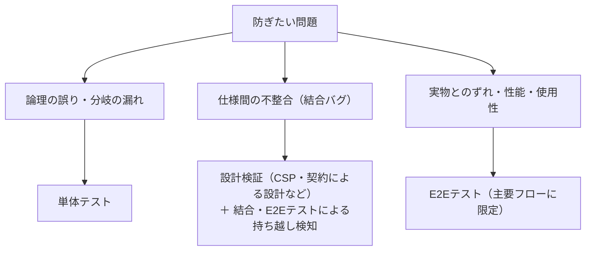

# E2Eテスト大全（あなたの知らない、E2Eテスト周辺の理論）

## 1. 概要

Kuniwak によるブログ「若くない何かの悩み」の長編記事で、E2Eテスト（End-to-Endテスト）をめぐる理論を体系的に整理したものである。公開日は 2026-11-04、更新日は 2026-11-07 である。

記事の内容は、E2Eテストの定義と境界、検知可能な欠陥の分類、E2Eテストの利点、数理的に避けられない5つの制約、テスト手法の分類体系、手続きの選択基準、実装パターン、実行タイミング、そして AI 時代の開発への含意までを扱う。中心となる主張は、E2Eテストは銀の弾丸ではなく、実行コスト・保守コスト・不確実性といった制約は数学的に決まっていて、テストを書くのが人間でも AI でも変わらない、という点である。そのため、単体テスト・形式手法による設計検証・E2Eテストの役割分担が重要になる。

なお、記事には筆者独自の用語がいくつか含まれている。グラフベース、モンキーベース、ペルソナベース、ReusableOperator、ContextStream、テストケース連鎖などである。これらは一般的な用語ではなく、筆者独自の定義であることに注意が必要である。この Source でも、初出では「筆者独自の用語」である旨を明記する。

## 2. 要約

- **定義と境界**：E2Eテストとは、利用者インターフェースから永続化層まで、すべての構成要素を結合し、インターフェース側から操作・検証するテストである。自組織の制御外にあるコンポーネントは、テストダブルへの差し替えが許容される。UIテストと E2Eテストは別物であり、UIカタログ上の Visual Regression Testing のようにバックエンドと結合していないものは E2E ではない。逆に、インターフェースが API やバッチ処理であれば、UI を操作しなくても E2E になりうる。
- **検知可能な欠陥**：正当性違反（仕様への不適合。Boehm の Verification に対応）と妥当性違反（要求への不適合。Validation に対応）に大別される。正当性違反は、受け付けるべき操作を拒否する活性違反と、発生してはならない状態遷移や操作の受付が起きる安全性違反に分かれる。妥当性違反には性能劣化と低使用性がある。
- **利点**：結合バグの検出（単体テストがすべて合格しても、コンポーネント間の事前条件・事後条件の不整合で発生する）、高い忠実度（テストダブルの模倣不備による偽陽性・偽陰性の低減）、内部設計への非依存性（ブラックボックスで駆動するため、密結合なレガシーシステムでも書ける。Feathers のいう保護ネット）がある。
- **数理的制約（5つ）**：実行コスト（単体テストのミリ秒に対し E2E は数十秒で、4〜5桁の差。CI の枠が一定ならケース数も原理的に4〜5桁少なくなる）、保守コスト（変更の影響範囲が組合せ的に広がる）、原因調査範囲の広さ、結果の不確実性（Flaky。失敗率0.1%の事象が直列に100個並ぶと成功率は約90.5%）、カバレッジの組み合わせ爆発。これらは AI がテストを書く時代でも解消しない。
- **テスト配置**：テストピラミッド（Cohn 2009、Fowler 2012）に基づく役割分担が推奨される。単体テストは論理的正確性と分岐網羅、結合・E2Eテストは仕様間の整合と忠実度（ケースは厳選）、そして CSP や契約による設計などの形式手法による設計検証で、結合バグを実装前に排除する。
- **分類体系**：テスト手法は、例ベース、グラフベース（筆者独自の用語）、モンキーベース（筆者独自の用語）、ペルソナベース（筆者独自の用語）、エラー推測ベースの5つに分類される。各手法は、入力・テストオラクル・仕組み・検知可能な欠陥・カバレッジの増やし方で比較できる。
- **手法の選択**：推奨はグラフベースと高価値シナリオの例ベースの併用である。状態遷移モデルはテスト入力であると同時に、AI や実装者への厳密な仕様資産になる。モデル作成コストを払えない場合はエラー推測ベース＋高価値シナリオ、新規システムではモンキーベース＋高価値シナリオが候補になる。使用性の検証にはペルソナベースを追加する。
- **実装パターン**：ReusableOperator（筆者独自の用語）、ContextStream（筆者独自の用語）、Record & Playback、テストケース連鎖（筆者独自の用語）が整理されている。PageObject パターンは ReusableOperator を画面・コンポーネント単位にグループ化したものとして位置づけられる。
- **実行タイミング**：実装前に書く先行実行と、結合後に書く追認実行には、それぞれ利点とリスクがある。追認実行には、実装の挙動を無批判に正解化してしまうリスクがある。
- **取り上げなかったトピック**：テスト選択、Self-Healing、並列化は、記事では意図的に扱われていない。とくに Self-Healing については、オラクル（期待結果）の核心を書き換える自動修正は追認でしかなく、有害であるという立場である。
- **まとめ**：E2Eテストの役割は、主要フローの貫通、忠実度、性能と使用性の妥当性の確認に限定するのがよい。この役割分担は AI 時代も不変である。

## 3. 背景・前提知識

- **E2Eテスト（End-to-Endテスト）**：利用者インターフェースから永続化層まで、すべての構成要素を結合した状態で、インターフェース側から操作・検証するテスト。この記事全体の主題である。
- **単体テスト・結合テスト**：単体テストは個別の関数やモジュールを対象とするテスト、結合テストは複数のコンポーネントを組み合わせて対象とするテストである。E2Eテストは、結合の範囲が最も広いテストと位置づけられる。
- **テストダブル**：テスト対象の依存先を置き換えるための代用品の総称。スタブやモックなどが含まれる。依存先の模倣が不完全だと、テストの結果が実際の振る舞いとずれる。
- **テストオラクル**：テストの成否を判定するための基準・仕組み。期待結果そのものや、期待結果を導くモデルなどがオラクルになる。テストを設計するときは、「何をオラクルにするか」が中心的な問いになる。
- **Verification と Validation（Boehm）**：Verification は「仕様どおりに作れているか」（正当性）、Validation は「要求に合ったものを作れているか」（妥当性）の確認である。この記事の欠陥分類の土台になっている。
- **活性性と安全性（liveness / safety）**：システムの性質を表す概念で、Alpern と Schneider によって定式化された。活性性は「よいことがいつか起きる」こと、安全性は「悪いことが決して起きない」ことである。この記事では、欠陥の種類として活性違反・安全性違反が対応する。
- **契約による設計（Design by Contract、Meyer）**：コンポーネントの事前条件（呼び出し側が満たすべき条件）と事後条件（呼び出された側が保証する結果）を明示して設計する手法。前段の事後条件と後段の事前条件の不整合が、結合バグの原因になる。
- **詳細化（refinement）**：抽象的な仕様を、より具体的な仕様や実装へ段階的に落とし込む関係。仕様の間で詳細化関係を検証できれば、結合バグを実装前に発見できる。
- **CSP（Communicating Sequential Processes、Hoare）**：並行システムの振る舞いを記述する形式手法。状態遷移モデルの記述や、仕様間の整合の検証に使われる。
- **Flakyテスト**：同じコードに対して、成功したり失敗したりする不安定なテスト。E2Eテストの結果の不確実性を表す代表的な現象である。
- **テストピラミッド**：Cohn が提案し Fowler が広めた、テストの配置の考え方。単体テストを多く、E2Eテストを少なくする逆ピラミッド型の構成を推奨する。
- **PageObject パターン**：画面やコンポーネントごとに、操作と要素へのアクセスをクラスにまとめる E2Eテストの実装パターン（Fowler 2013）。
- **経験ベースのテスト技法（ISTQB）**：テスト担当者の経験や過去の欠陥の傾向からテストケースを導く技法の総称。エラー推測はその代表例である。
- **暗黙的オラクル（implicit oracle、Barr et al. 2015）**：明示的な期待結果を用意せず、クラッシュや未処理例外のような「一般的に起きてはならないこと」の検出をもって判定するオラクルである。
- **保護ネット（Feathers）**：レガシーコードに対して、変更の安全を確保するために張るテストの比喩。内部設計に依存しないテストは、密結合なコードにも張ることができる。

## 4. 詳細解説

### E2Eテストの定義と境界

記事では、E2Eテストを「利用者インターフェースから永続化層まで、すべての構成要素を結合し、インターフェース側から操作・検証するテスト」と定義している。ポイントは二つある。一つは結合の範囲で、画面だけ、API だけといった部分的な結合では E2E とは呼ばない。もう一つは操作と検証の入口で、内部の関数を直接呼ぶのではなく、利用者が触れるインターフェース側から入る。

ただし、自組織の制御外にあるコンポーネントについては、テストダブルへの差し替えが許容される。外部サービスのように自分たちで制御できないものまで実物に結合することは、定義の要件ではない。

この定義から、よくある混同が切り分けられる。UIテストと E2Eテストは別物である。たとえば UI カタログ上で部品の見た目を比較する Visual Regression Testing は、バックエンドと結合していないため、E2E ではない。逆に、インターフェースが API やバッチ処理であるシステムでは、UI を操作しなくても E2E になりうる。「画面を自動操作するテスト」が E2E の本質ではない、という点が定義の要点である。

### 検知可能な欠陥

E2Eテストで検知可能な欠陥は、正当性違反と妥当性違反に大別される。

正当性違反は、仕様への不適合であり、Boehm の Verification（仕様どおりに作れているか）に対応する。正当性違反はさらに二つに分かれる。活性違反は、受け付けるべき操作を拒否してしまう欠陥である。安全性違反は、発生してはならない状態遷移が起きる、あるいは受け付けてはならない操作を受け付けてしまう欠陥である。記事では、踏切と自動販売機を例に、この二つの違いが説明されている。列車が来ていないのに遮断機が下りたままになるような不具合と、列車が接近しているのに遮断機が上がってしまうような不具合では、欠陥の性質が違う、という切り分けである。

妥当性違反は、要求への不適合であり、Boehm の Validation（要求に合ったものを作れているか）に対応する。代表例は性能劣化と低使用性である。仕様どおりに動いていても、遅すぎる、使いにくい、という形で要求を満たさない場合がこれにあたる。

この分類は、後のテスト手法の分類とつながっている。手法ごとに、活性違反・安全性違反・性能劣化・低使用性のどれを検知できるかが異なるためである。

### E2Eテストの利点

記事では、E2Eテストの利点として三つが挙げられている。

第一に、結合バグの検出である。各コンポーネントの単体テストがすべて合格していても、それらを結合すると動かないことがある。契約による設計の言葉でいえば、前段のコンポーネントの事後条件と、後段のコンポーネントの事前条件が食い違っている場合である。記事では、Myers の三角形問題が例に使われている。三辺の長さから三角形の種類を判定する課題で、「5, 1, 1」という入力を二等辺三角形と誤判定するようなケースは、個々の判定ロジックではなく、条件の組み合わせの不整合として現れる。ただし記事は同時に、設計段階で仕様間の詳細化関係を検証すれば、この種のバグは実装前に発見できるとも指摘している。つまり E2Eテストでの結合バグの検出は、本来もっと早い段階で防げたものの「持ち越し検知」である側面がある。

第二に、高い忠実度である。単体テストや結合テストでは、依存先をテストダブルに差し替えることが多い。テストダブルの模倣が実物とずれていると、実際には壊れているのにテストが通る偽陰性や、実際には正しいのにテストが落ちる偽陽性が生じる。実物の構成要素を結合する E2Eテストは、この種のずれを原理的に小さくできる。

第三に、内部設計への非依存性である。E2Eテストはインターフェース側から操作するブラックボックステストであるため、内部の設計がどうなっていても書ける。密結合で単体テストを差し込みにくいレガシーシステムでも、Feathers のいう保護ネットとしてテストを張ることができる。

### 数理的制約

利点に対して、記事は E2Eテストが免れない制約を5つ挙げている。これらはツールの出来や書き手の技量ではなく、数理的に決まる制約だと位置づけられている。

第一に、実行コストである。単体テストは1件あたりミリ秒単位で終わるが、E2Eテストは1件あたり数十秒かかることがある。これは4〜5桁の差である。CI の実行枠が一定である以上、実行できるケース数も原理的に4〜5桁少なくなる。前処理を工夫して一部の手順を省略（バイパス）すれば速くはなるが、それは忠実度を下げることと引き換えであり、トレードオフからは逃れられない。

第二に、保守コストである。各コンポーネントが下位の N 個のコンポーネントを結合する、M 層のシステムを考える。このとき、システム全体の組み合わせは N の M 乗（N^M）になる。1つのコンポーネントを変更したとき、単体テストでは K 件の再確認で済むのに対し、E2Eテストでは最大で N^M × K 件が影響を受けうる。N・M・K がすべて4の場合、影響範囲は単体テストの256倍（N^M 倍）になる。

第三に、原因調査範囲の広さである。E2Eテストが失敗したとき、原因の候補は結合されたコンポーネント全体に広がる。候補は最大で N^M 個になり、上記の例では単体テストの256倍の範囲を調べることになる。

第四に、結果の不確実性である。E2Eテストは多くの事象が直列につながった実行であり、一つひとつの事象にわずかな失敗率があっても、全体の成功率は掛け算で下がっていく。失敗率0.1%の事象が直列に100個並ぶと、成功率は (1 − 0.001)^100 ≒ 90.5% になる。つまり、コードが正しくても約1割は失敗しうる。これが Flakyテストの正体であり、Google の Micco（2016）も指摘している問題である。

第五に、カバレッジの組み合わせ爆発である。分岐の網羅を考えると、単体テストでは対象の組み合わせが N + M のオーダーで済むのに対し、E2Eテストでは N × M になり、直列に連なる要素が増えると指数的に増大する。すべての組み合わせを E2E で覆うことは原理的にできない。

記事は、これらの制約は AI 時代でも不変だと主張する。物理的な遅延、確率的な失敗、組み合わせの数理は、テストの作成者が人間でも AI でも解消しない。むしろ、AI に E2Eテストの修正ループを回させると、1回の実行に数十秒かかる待ち時間がそのままループの遅さになり、肥大化するおそれがある。

### テスト配置とテストピラミッド

制約を踏まえた配置の指針として、記事はテストピラミッド（Cohn 2009、Fowler 2012）を採用する。役割分担は次のとおりである。

- 単体テスト：論理的な正確性の確認と、分岐の網羅を担う。速く、数が多くてよい。
- 結合テスト・E2Eテスト：仕様間の整合と忠実度の確認を担う。コストが高いため、ケースは厳選する。
- 設計検証：CSP や契約による設計などの形式手法で、仕様間の不整合を実装前に排除する。結合バグは、本来この段階で防ぐのが最も安い。

記事では、この役割分担を AI 開発への指示の出し方に結びつけた例も示されている。E2Eテスト中心の進め方（パターンA）を AI に指示すると、ブラウザ実行の反復で開発ループが遅くなる。対して、関心事をストラテジーパターンで分離し、分岐の網羅は単体テストで担い、E2E は代表1シナリオに絞る進め方（パターンB）のほうが速く回る、という対比である。

### テスト手法の分類体系

記事の中心の一つが、E2Eテストの手法の分類である。各手法は「入力」「テストオラクル」「仕組み」「検知可能な欠陥」「カバレッジの増やし方」の5つの観点で整理されている。手法は、オラクルがルールとして明示されるルールベースと、そうでない非ルールベースに大きく分かれる。

#### 例ベース（ルールベース）

- 入力：イベント列と期待結果の組（シナリオ）。
- テストオラクル：シナリオに書かれた期待結果そのもの。
- 仕組み：シナリオに沿って操作を実行し、結果を期待結果と比較する、最も一般的な書き方である。
- 検知可能な欠陥：主に活性違反。書かれたシナリオの範囲で「起きるべきことが起きない」ことを検知する。
- カバレッジの増やし方：シナリオ数を増やす。

#### グラフベース（筆者独自の用語、ルールベース）

- 入力：状態遷移モデル。CSP などで記述された、システムの状態と遷移のモデルである。
- テストオラクル：モデルから導かれるトレース集合（起きてよい振る舞い）と失敗集合（起きてはならない振る舞い）。
- 仕組み：安全性の検査から活性の検査へ、という検証を反復しながら、探索アルゴリズムで次に実行するイベントを選ぶ。ランダムウォークに定期的なリセットを組み合わせる方法が例示されている。
- 検知可能な欠陥：活性違反、安全性違反、性能劣化。
- カバレッジの増やし方：実行時間を延ばす。シナリオを列挙するのではなく、モデル上を探索し続けることで覆う範囲が広がる。

#### モンキーベース（筆者独自の用語、ルールベース）

- 入力：実装そのもののみ。シナリオもモデルも用意しない。
- テストオラクル：暗黙的オラクル（Barr et al. 2015）。クラッシュ、未処理例外、HTTP 500 のような、一般的に起きてはならない事象の不在をもって正常とみなす。
- 仕組み：画面から操作可能な要素を自動で抽出し、ランダムに選んで連続実行する。
- 検知可能な欠陥：クラッシュなどの一般的な欠陥と、性能劣化。
- カバレッジの増やし方：実行時間を延ばす。

#### ペルソナベース（筆者独自の用語、非ルールベース）

- 入力：ペルソナの記述。想定利用者の属性や目的、行動の傾向を記述したものである。
- テストオラクル：二層構造になっている。第一にゴールへ到達できるか、第二に到達にかかるコスト（手数や時間）が妥当か、である。
- 仕組み：ペルソナに沿った利用を再現し、到達可能性と到達コストを評価する。
- 検知可能な欠陥：低使用性。仕様どおりに動くが使いにくい、という妥当性違反を対象にする点が他の手法と異なる。
- カバレッジの増やし方：ペルソナのバリエーションを増やす。

#### エラー推測ベース（非ルールベース）

- 入力：過去の欠陥の統計。どのような欠陥が起きやすいかの蓄積である。
- テストオラクル：テスターの暗黙のモデル。ISTQB の経験ベースのテスト技法に位置づけられる。
- 仕組み：過去に欠陥が集中した箇所や、欠陥が起きやすいパターンを狙ってテストを設計する。
- 検知可能な欠陥：過去の類型に沿った活性違反・安全性違反。
- カバレッジの増やし方：時間をかけることと、狙うシナリオを拡充すること。

### 手法の選択

記事の推奨は、グラフベースと、高価値シナリオの例ベースの併用である。状態遷移モデルは、テストの入力であるだけでなく、AI や実装者に対して振る舞いを厳密に伝える仕様資産にもなる。筆者は、状態遷移図の記述を支援する自身のツール puml-parallel にも触れている。一方で、グラフベースだけでは、特定の高価値シナリオを確実に実行することまでは保証できない。だからこそ、重要なシナリオは例ベースで明示的に押さえる、という併用になる。

次善の選択は、エラー推測ベースと高価値シナリオの併用である。状態遷移モデルを作るコストを払えない場合に、過去の欠陥統計があるなら、そこを狙うのが合理的だという判断である。

簡易な導入としては、モンキーベースと高価値シナリオの併用が挙げられている。新規システムのように、モデルも欠陥統計もまだない段階で、低コストに始められる組み合わせである。

使用性の検証が必要な場合は、これらにペルソナベースを追加する。AI でペルソナを再現する試みは、人間によるユーザビリティテストの前段階のスクリーニングとして位置づけられている。

### 実装パターン

記事では、E2Eテストの実装パターンとして4つが整理されている。

#### ReusableOperator（筆者独自の用語）

低レベルの操作（要素の取得やクリックなど）を、イベントから操作への対応表 `Map<Event, Operator>` として分離するパターンである。シナリオ側はイベント名で操作を呼び出すだけにする。セレクタが変わっても、修正は辞書の1箇所で済む。Fowler（2013）の PageObject パターンは、この考え方を画面・コンポーネント単位にグループ化したものとして位置づけられている。

#### ContextStream（筆者独自の用語）

画面遷移を、`(Screen, Context) → Promise<[次のScreen, 次のContext]>` という非同期関数として定義し、コンビネータ `compose` で合成していくパターンである。遷移の前後関係が型に現れるため、つながってはいけない遷移をコンパイル時に検出できる点が特徴である。

#### Record & Playback

操作の履歴を構造化データとして保存し、それを再生する方式である。記録するだけでテストができるため初速は速いが、DOM の構造やタイミングの変化に脆く、保守の段階で苦しくなりやすい。

#### テストケース連鎖（筆者独自の用語）

テストケース間に依存関係を持たせるパターンである。ケース A が成功したときに限り、その終了状態を引き継いでケース B を開始する。テストランナーは依存グラフから接頭辞木（Trie）を構成し、それを走査する実行計画を生成する。先行するケースが失敗した場合は、後続を自動でスキップする。状態を使い回すぶん実行は速くなるが、副作用によって偽陽性・偽陰性が生じるリスクがあり、前提となる状態の管理が課題になる。

### 実行タイミング

E2Eテストをいつ書くかについて、記事は2つの立場を対比している。

実装前に書く先行実行は、トップレベルの仕様を固定する効果があり、進捗を客観的に見る物差しにもなる。一方で、仕様が変わるたびに書き直しが発生する。仕様が固い基幹業務や、モデル自体が仕様資産になるグラフベースの手法とは相性がよい。

結合後に書く追認実行は、手戻りが少ない進め方である。しかし、実装の挙動をそのまま記録して正解としてしまうため、バグを正解化するリスクがある。また、開発の終盤までシステム全体の検証ができないという問題もある。探索的な開発や、リグレッション（回帰）防止の目的とは相性がよい。

### 取り上げなかったトピック

記事では、意図的に扱わなかったトピックも明示されている。

- テスト選択（どのテストを実行するか選ぶ技術）：実用例を筆者が見ていないため、扱っていない。
- Self-Healing（失敗したテストを自動で修復する技術）：セレクタの付け替えのような軽微な修正と、オラクルの核心、つまり期待結果そのものを書き換える自動修正は区別すべきだという立場である。後者は追認でしかなく、有害だとされている。
- 並列化：実行環境の独立性がアプリケーション側の事情に強く依存するため、一般論として扱っていない。

### まとめ：AI時代でも変わらない役割分担

記事の結論は、E2Eテストは銀の弾丸ではなく、5つの数理的制約を免れない、という点に集約される。そのうえで、役割分担として、単体テストは論理的な正確性を、形式手法は仕様間の不整合の事前排除を、E2Eテストは主要フローの貫通確認・忠実度・性能と使用性の妥当性に限定して担うべきだとされる。この役割分担は、テストや実装を AI が書く時代でも変わらない。

また、筆者独自の用語についての注意も述べられている。独自用語の概念を AI に使わせる場合は、単語だけを渡しても一般的な概念として伝わらないため、定義文やコード例をそのままプロンプトに含める必要があるという。これは、独自の語彙で AI に指示を出す際の実務的な注意点である。

## 5. 重要なポイント

- E2Eテストの定義は「インターフェースから永続化層までの全結合＋インターフェース側からの操作・検証」であり、UI の自動操作と同義ではない。UIテスト（Visual Regression Testing など）は E2E ではない場合があり、API やバッチがインターフェースなら UI なしでも E2E になる。
- 制御外のコンポーネントはテストダブルへの差し替えが許容される。これが定義の境界線である。
- 検知可能な欠陥は、正当性違反（活性違反・安全性違反）と妥当性違反（性能劣化・低使用性）に分類できる。手法ごとに検知できる範囲が異なる。
- 結合バグは、事後条件と事前条件の不整合から生じる。設計段階で詳細化関係を検証すれば実装前に防げるため、E2E での検出は「持ち越し検知」の側面がある。
- E2E の利点は、結合バグの検出、高い忠実度、内部設計への非依存性（レガシーへの保護ネット）の3つである。
- E2E の制約は5つあり、いずれも数理的に決まる。実行コスト（4〜5桁の差）、保守コスト（N^M の影響範囲）、原因調査範囲、結果の不確実性（直列100事象で成功率約90.5%）、カバレッジの組み合わせ爆発（N×M、指数増大）である。
- これらの制約は、テストの作成者が AI でも解消しない。AI に E2E の修正ループを回すと、実行の待ち時間がループを遅くする。
- テスト配置はテストピラミッドに基づき、単体＝論理と分岐網羅、結合・E2E＝仕様間整合と忠実度（厳選）、設計検証＝不整合の事前排除、と役割を分ける。
- 手法は5つに分類できる（例ベース、グラフベース、モンキーベース、ペルソナベース、エラー推測ベース）。グラフベース・モンキーベース・ペルソナベースは筆者独自の用語である。
- 推奨の組み合わせは、グラフベース＋高価値シナリオの例ベースである。状態遷移モデルは仕様資産にもなる。
- 実装パターンは、ReusableOperator、ContextStream、Record & Playback、テストケース連鎖の4つ。PageObject は ReusableOperator のグループ化として位置づけられる。これらも一部は筆者独自の用語である。
- 実行タイミングは、先行実行（仕様の固定、書き直しコスト）と追認実行（手戻りの少なさ、バグの正解化リスク）のトレードオフである。
- Self-Healing によるオラクルの自動修正は、追認でしかなく有害だという立場が示されている。
- 筆者独自の用語を AI に使わせるときは、定義文やコード例をプロンプトに含める必要がある。

## 6. 図解

検知可能な欠陥の分類を図にすると、次のとおりである。

問題の種類と、それを主に担う検証手段の対応を図にすると、次のとおりである。

## 7. 自分なりの考察

以下は、AIによる考察である。元記事の主張とは区別して読むこと。

この記事の説得力の源は、E2Eテストのつらさを「ツールの未熟さ」や「書き方の下手さ」ではなく、数理的な制約として説明している点にあると考えられる。実行時間の桁の差、N^M の影響範囲、成功率の掛け算、カバレッジの積と指数は、どれも見積りの問題ではなく構造の問題である。現場で「E2E が遅い・不安定・保守が重い」と感じるとき、その原因が自分たちの実装ではなく構造側にあると分かれば、投資の判断は変わる。E2E を増やす努力ではなく、E2E に寄せる範囲を絞る努力へ向かうはずである。

もう一つの読みどころは、利点が定性的に、制約が定量的に語られている非対称性である。忠実度や保護ネットとしての価値は実感しやすい一方で、コスト側は数字で上限が決まっている。「E2E を何件書くか」という判断は、利点の大きさではなく、制約の側から先に上限を引くべきだという読み方ができる。

分類体系については、手法を「入力とオラクルの違い」で分ける点が実務的だと考えられる。とくに、グラフベースの状態遷移モデルが「テスト入力であると同時に仕様資産である」という指摘は、AI 開発の文脈で重要である。AI にテストを書かせるときも、人間に仕様を伝えるときも、曖昧さの少ないモデルが共通の土台になる。筆者独自の用語を使う際は定義文やコード例をプロンプトに含める必要があるという注意は、この裏返しであり、語彙を作るだけでは伝わらず、定義を添えて初めて共有できるという一般的な教訓として読める。

ただし、この記事は一人の著者による理論的な整理であり、独自用語も多い。分類や推奨は一つの枠組みとして受け取り、他の情報源と突き合わせて検証していくことが望ましい。この知識ベースでも、現時点ではソフトウェアテスト分野の情報源はこの記事のみであり、今後の追加で位置づけが変わる可能性がある。

## 8. 学んだこと

- E2Eテストの定義は「全結合＋インターフェース側からの操作・検証」であり、UI 自動操作と同義ではない。UIテストと E2E を混同しないこと。
- E2E で検知できる欠陥は、正当性違反（活性・安全性）と妥当性違反（性能・使用性）に分類でき、手法ごとに検知範囲が異なる。
- 結合バグの正体は、コンポーネント間の事前条件・事後条件の不整合である。設計検証で事前に防ぐのが最も安く、E2E での検出は持ち越し検知である。
- E2E のコスト構造は数理的に決まる。実行時間は単体テストの4〜5桁倍、変更の影響範囲は N^M 倍、成功率は直列事象の掛け算で下がり、カバレッジは積と指数で膨らむ。
- Flaky は運用の失敗ではなく確率の帰結として扱うべきものである。失敗率0.1%×直列100で成功率は約90.5%になる。
- テストの役割分担は、単体＝論理と分岐網羅、形式手法＝不整合の事前排除、E2E＝主要フローの貫通・忠実度・性能と使用性の妥当性に限定する。
- 手法の選択は、グラフベース＋高価値シナリオの例ベースが推奨であり、モデルも統計もない場合はモンキーベースから始める。
- E2E の実装は、操作の分離（ReusableOperator / PageObject）、型による遷移の検証（ContextStream）などで保守コストを下げられるが、Record & Playback やテストケース連鎖には固有のリスクがある。
- 追認実行はバグを正解化するリスクがある。先行実行と追認実行は、仕様の固さと開発スタイルで使い分ける。
- AI に E2E を任せる場合も制約は変わらない。AI への指示は E2E 中心ではなく、単体テストで分岐を覆い E2E は代表シナリオに絞る形（パターンB）が速い。
- 独自用語を AI に使わせるときは、単語ではなく定義とコード例を渡す必要がある。

## 9. 関連情報

### 関連する Knowledge と Topic

- [E2Eテストで検知できる欠陥の分類](../../knowledge/programming/e2e-test-detectable-defects.md)
- [E2Eテストの数理的制約](../../knowledge/programming/e2e-test-mathematical-constraints.md)
- [E2Eテストの分類体系と手法の選択](../../knowledge/programming/e2e-test-taxonomy-and-method-selection.md)
- [自動E2Eテストの実装パターンと実行タイミング](../../knowledge/programming/e2e-test-implementation-patterns-and-timing.md)
- [ソフトウェアテスト（Topic）](../../topics/software-testing.md)

### 参考文献（記事で挙げられているもの）

- Boehm（1984）：Verification と Validation の区別。
- Hoare（1985）：CSP（Communicating Sequential Processes）。
- Alpern & Schneider（1985 / 1987）：活性性と安全性の定式化。
- Myers（2011）：三角形問題。ソフトウェアテストの古典。
- Meyer（1992）：契約による設計。
- Wacker（2015）。
- Micco（2016）：Flakyテストに関する Google の知見。
- Cohn（2009）：テストピラミッド。
- Fowler（2012）：テストピラミッドの紹介と普及。
- Fowler（2013）：PageObject パターン。
- Feathers（2004）：レガシーコードと保護ネット。
- ISTQB（2023）：経験ベースのテスト技法を含むシラバス。
- Barr et al.（2015）：テストオラクル問題と暗黙的オラクル。

## 10. 原文

元URL：https://blog.kuniwak.com/entry/e2ebok
